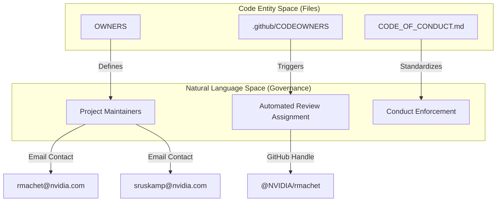
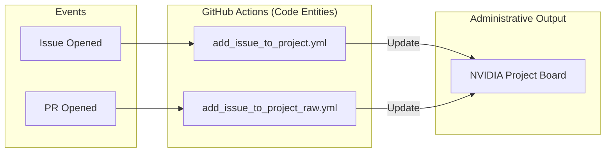

<!-- source: DeepWiki mcp.deepwiki.com · repo NVIDIA/openocd · page 4 Repository Governance and Administration · fetched 2026-10-26 -->

# Repository Governance and Administration

Relevant source files

The following files were used as context for generating this wiki page:

- [.github/CODEOWNERS](.github/CODEOWNERS)
- [CODE_OF_CONDUCT.md](CODE_OF_CONDUCT.md)
- [OWNERS](OWNERS)

This page provides an overview of the administrative and governing structures for the NVIDIA OpenOCD repository. It covers ownership models, automated project management, security protocols, and community standards. These mechanisms ensure that contributions are reviewed by the correct stakeholders and that the project remains a secure and professional environment for hardware debugging development.

## Ownership and Code Review Routing

Repository authority and review assignments are managed through two primary configuration files. These files define who has the final say on code changes and who is automatically notified when new pull requests are submitted.

*   **Global Ownership**: The `OWNERS` file identifies the primary maintainers responsible for the top-level directory and overall project direction [OWNERS:1-3]().
*   **GitHub Review Routing**: The `.github/CODEOWNERS` file is used by GitHub to automatically assign reviewers to pull requests. Currently, all files in the repository are routed to the primary maintainer [/.github/CODEOWNERS:1-1]().

### Governance Entity Mapping

The following diagram illustrates how administrative files translate to GitHub platform behaviors.

**Diagram: Administrative Configuration to Platform Action**

**Sources:** [OWNERS:1-3](), [/.github/CODEOWNERS:1-1](), [CODE_OF_CONDUCT.md:42-46]()

---

## Community Standards

NVIDIA follows the **Contributor Covenant Code of Conduct** (version 1.4) to foster a welcoming and harassment-free environment [CODE_OF_CONDUCT.md:11-18](). 

*   **Responsibilities**: Project maintainers are mandated to clarify standards and take corrective action against unacceptable behavior, including the right to remove or reject contributions not aligned with these standards [CODE_OF_CONDUCT.md:42-53]().
*   **Enforcement**: Instances of abusive or harassing behavior should be reported to `GitHub_Conduct@nvidia.com` [CODE_OF_CONDUCT.md:63-70]().

**Sources:** [CODE_OF_CONDUCT.md:1-81]()

---

## Security Policy

NVIDIA maintains a strict policy regarding the disclosure of security vulnerabilities. To protect users and hardware infrastructure, vulnerabilities must never be reported via public GitHub issues. Instead, they are handled through NVIDIA’s Product Security Incident Response Team (PSIRT).

For detailed information on the reporting process, required data fields, and PGP encryption requirements, see **[Security Vulnerability Reporting](#4.1)**.

---

## GitHub Automation

To manage the high volume of activity in a hardware-focused fork, this repository utilizes GitHub Actions to automate project management tasks. This ensures that every issue and pull request is tracked on the NVIDIA project boards without manual intervention.

### Project Board Workflows
The automation layer consists of two primary workflows:
1.  **Standard Automation**: Adds new issues to the project board.
2.  **Raw Automation**: Handles specific event types to ensure comprehensive coverage.

For details on the workflow implementations and the security implications of using `pull_request_target`, see **[GitHub Automation: Project Board Workflows](#4.2)**.

**Diagram: Automation Logic Flow**

**Sources:** [Overview: Section 4.2]()

---

