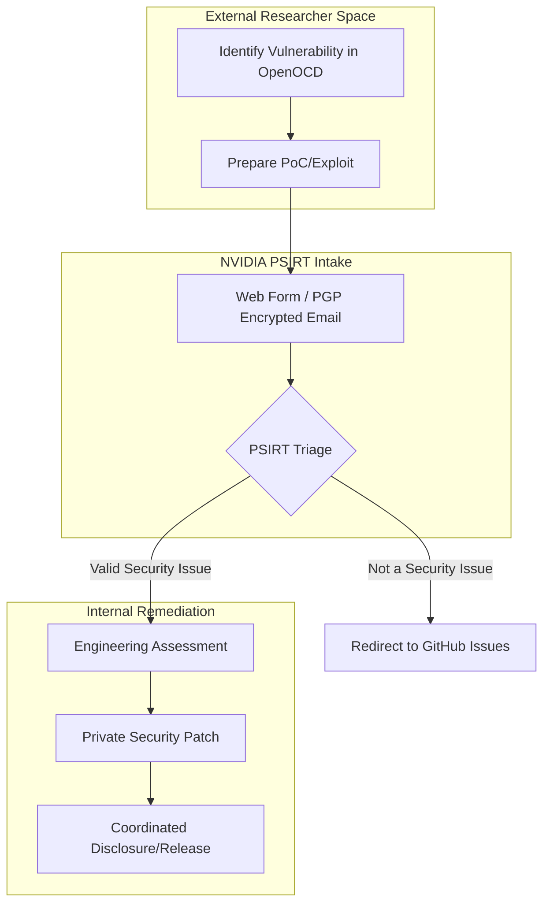
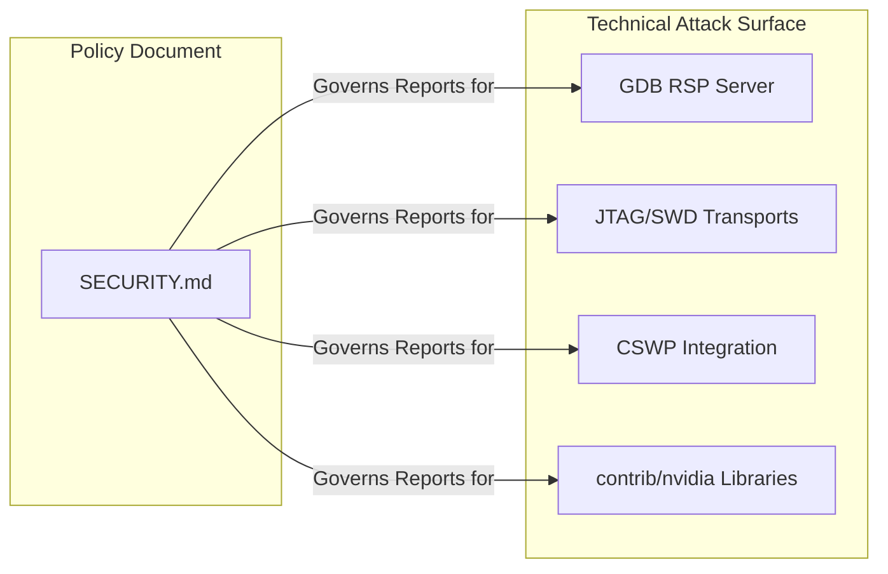

<!-- source: DeepWiki mcp.deepwiki.com · repo NVIDIA/openocd · page 4.1 Security Vulnerability Reporting · fetched 2026-10-26 -->

# Security Vulnerability Reporting

Relevant source files

The following files were used as context for generating this wiki page:

- [SECURITY.md](SECURITY.md)

This page outlines the protocols for identifying, reporting, and resolving security vulnerabilities within the NVIDIA OpenOCD repository. NVIDIA follows a Coordinated Vulnerability Disclosure (CVD) policy to ensure that security flaws are addressed in a manner that minimizes risk to the user base and the broader ecosystem.

## Policy Overview

NVIDIA is committed to maintaining the security and trust of its software products, including source code repositories like OpenOCD [SECURITY.md:1-3](). To protect users, NVIDIA requires that all potential security vulnerabilities be reported through private, dedicated channels rather than public-facing platforms.

### Prohibition on Public Disclosure
The use of GitHub Issues or Pull Requests for reporting security vulnerabilities is strictly prohibited [SECURITY.md:5-5](). 

*   **Public Redaction:** If a security issue is inadvertently posted to a public GitHub issue or pull request, NVIDIA maintainers reserve the right to limit public discussion and hide or delete comments to prevent exploitation [SECURITY.md:5-5]().
*   **Redirection:** Reporters will be immediately redirected to the private Product Security Incident Response Team (PSIRT) channels [SECURITY.md:5-5]().

## PSIRT Intake Process

The NVIDIA Product Security Incident Response Team (PSIRT) is the centralized body responsible for receiving, investigating, and coordinating the response to security vulnerability reports [SECURITY.md:20-20]().

### Submission Channels
There are two primary methods for submitting a report to the PSIRT:

1.  **Web Submission:** Reporters can use the official [Security Vulnerability Submission Form](https://www.nvidia.com/object/submit-security-vulnerability.html) [SECURITY.md:10-10]().
2.  **Encrypted Email:** Reports can be sent directly to `psirt@nvidia.com` [SECURITY.md:11-11]().

### Secure Communication (PGP)
For email submissions, NVIDIA encourages the use of PGP encryption to protect sensitive vulnerability details and exploit code during transit [SECURITY.md:12-12]().
*   **PGP Key:** The public PGP key for NVIDIA PSIRT is available at [https://www.nvidia.com/en-us/security/pgp-key](https://www.nvidia.com/en-us/security/pgp-key) [SECURITY.md:12-12]().

## Required Report Fields

To facilitate a rapid technical assessment, every submission must include specific technical details regarding the OpenOCD environment and the nature of the flaw.

| Field | Description |
| :--- | :--- |
| **Product/Branch** | The specific branch (e.g., `openocd-0.12.0` or `releases/strata`) and version containing the flaw [SECURITY.md:14-14](). |
| **Vulnerability Type** | Classification of the bug (e.g., Buffer Overflow, Denial of Service, Remote Code Execution) [SECURITY.md:15-15](). |
| **Reproduction Steps** | Step-by-step instructions to trigger the vulnerability in the OpenOCD environment [SECURITY.md:16-16](). |
| **Proof-of-Concept** | Exploit code or scripts demonstrating the impact [SECURITY.md:17-17](). |
| **Impact Analysis** | Description of how an attacker could exploit the flaw and the potential consequences [SECURITY.md:18-18](). |

**Sources:** [SECURITY.md:13-18]()

## Vulnerability Lifecycle and Acknowledgement

NVIDIA coordinates the remediation of security issues under its official PSIRT policies.

### Data Flow: Vulnerability Intake to Resolution

The following diagram illustrates the flow of a security report from the external researcher to the internal engineering teams.

**Vulnerability Reporting Pipeline**

**Sources:** [SECURITY.md:5-20]()

### Acknowledgement
While NVIDIA does not currently operate a bug bounty program, the company provides public acknowledgement to researchers who report valid security issues that are subsequently addressed under the CVD policy [SECURITY.md:20-20](). Detailed policy information can be found at the [NVIDIA PSIRT Policies page](https://www.nvidia.com/en-us/security/psirt-policies/) [SECURITY.md:20-20]().

## Mapping Policy to Code Entities

While `SECURITY.md` defines the policy, it governs the handling of vulnerabilities found within the technical components of the repository.

**Security Scope Mapping**

**Sources:** [SECURITY.md:1-3](), [SECURITY.md:14-15]()

---

