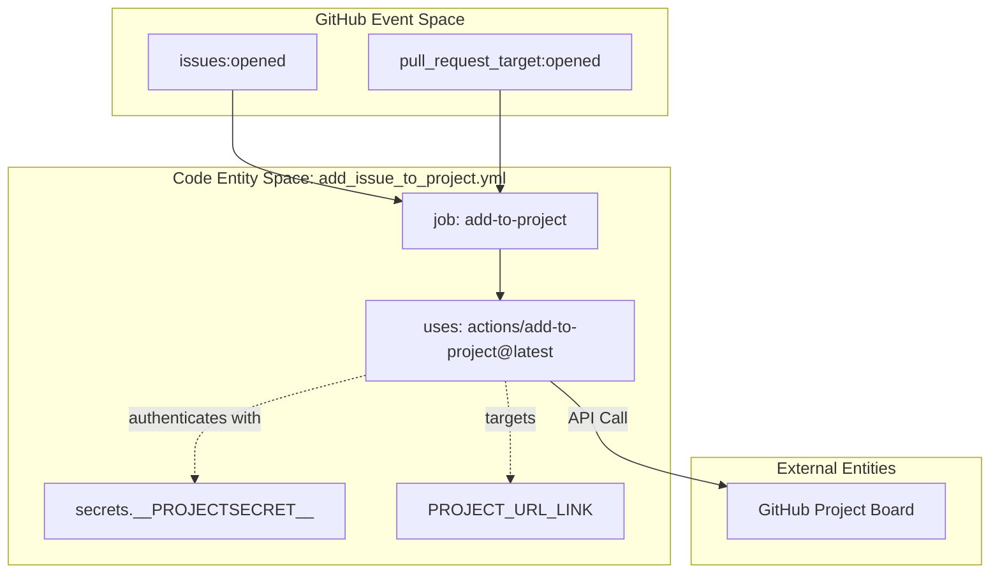
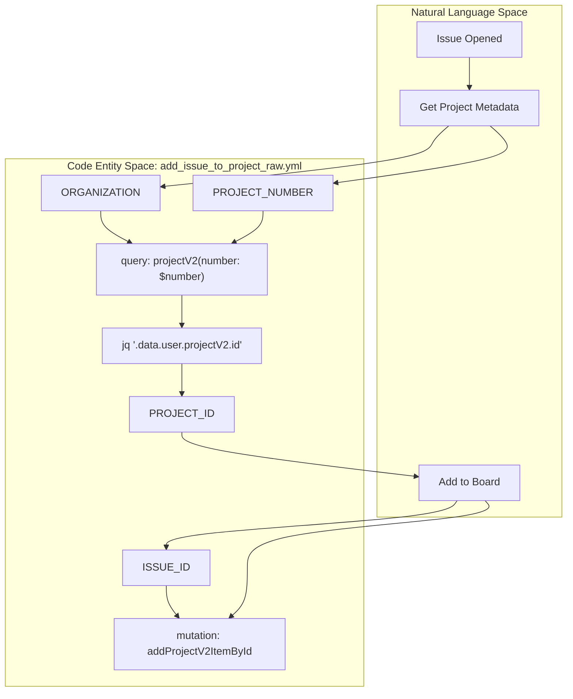

<!-- source: DeepWiki mcp.deepwiki.com · repo NVIDIA/openocd · page 4.2 GitHub Automation: Project Board Workflows · fetched 2026-10-26 -->

# GitHub Automation: Project Board Workflows

Relevant source files

The following files were used as context for generating this wiki page:

- [.github/workflow-templates/add_issue_to_project.yml](.github/workflow-templates/add_issue_to_project.yml)
- [.github/workflow-templates/add_issue_to_project_raw.yml](.github/workflow-templates/add_issue_to_project_raw.yml)

The NVIDIA OpenOCD repository utilizes GitHub Actions to automate the management of issues and pull requests within GitHub Projects. This automation ensures that every new contribution or bug report is immediately tracked without manual intervention by maintainers. The repository provides two distinct workflow templates for this purpose, catering to different levels of complexity and customization.

## Workflow Overview

The automation is centered around two primary templates located in the `.github/workflow-templates/` directory. These templates define how the GitHub API is invoked when specific repository events occur.

| Workflow Template | Target Events | Implementation Method |
| :--- | :--- | :--- |
| `add_issue_to_project.yml` | `issues`, `pull_request_target` | Uses the `actions/add-to-project` pre-built action. |
| `add_issue_to_project_raw.yml` | `issues` | Uses raw GraphQL API calls via the `gh` CLI. |

**Sources:**
- [.github/workflow-templates/add_issue_to_project.yml:1-13]()
- [.github/workflow-templates/add_issue_to_project_raw.yml:1-5]()

## Implementation Details: Standard Automation

The standard workflow, `add_issue_to_project.yml`, is designed for simplicity. It triggers whenever an issue is opened or a pull request is targeted at the repository [.github/workflow-templates/add_issue_to_project.yml:5-12]().

### Security and Context
A critical design choice in this workflow is the use of the `pull_request_target` event rather than the standard `pull_request` event [.github/workflow-templates/add_issue_to_project.yml:10](). This allows the workflow to run in the context of the base repository, granting it access to repository secrets (like the GitHub Token) which are necessary to modify project boards, even when the pull request originates from a fork.

### Configuration Requirements
To function, the template requires two placeholders to be populated:
1.  **PROJECT_URL_LINK**: The direct URL to the GitHub Project [.github/workflow-templates/add_issue_to_project.yml:24]().
2.  **__PROJECTSECRET__**: A Personal Access Token (PAT) or GitHub App token stored as a repository secret [.github/workflow-templates/add_issue_to_project.yml:25]().

### Data Flow: Standard Action
The following diagram illustrates the interaction between the GitHub Event and the Project Board via the standard action.

**Standard Project Automation Flow**

**Sources:**
- [.github/workflow-templates/add_issue_to_project.yml:1-26]()

## Implementation Details: Raw GraphQL Automation

The `add_issue_to_project_raw.yml` template provides a lower-level implementation using the GitHub GraphQL API v4. This is useful for environments where external actions are restricted or where specific metadata from the project (like `PROJECT_ID`) must be retrieved dynamically [.github/workflow-templates/add_issue_to_project_raw.yml:20-27]().

### Data Retrieval and Mutation
This workflow operates in two distinct stages:
1.  **Project Data Retrieval**: It queries the GitHub API to find the internal `projectV2` node ID using the organization name and project number [.github/workflow-templates/add_issue_to_project_raw.yml:17-27]().
2.  **Item Addition**: It executes a `mutation` called `addProjectV2ItemById` to link the issue (identified by `ISSUE_ID`) to the project (identified by `PROJECT_ID`) [.github/workflow-templates/add_issue_to_project_raw.yml:36-43]().

### Technical Data Flow: GraphQL Logic
The diagram below maps the shell variables and environment keys used in the raw workflow to the GraphQL operations.

**GraphQL Execution Pipeline**

**Sources:**
- [.github/workflow-templates/add_issue_to_project_raw.yml:10-28]()
- [.github/workflow-templates/add_issue_to_project_raw.yml:30-45]()

## Authentication Requirements

Both workflows require elevated permissions to interact with GitHub Projects, as the default `GITHUB_TOKEN` provided to actions often lacks the necessary scopes for Organization-level projects.

| Requirement | Description |
| :--- | :--- |
| **Personal Access Token (PAT)** | Must have `repo` and `project` scopes [.github/workflow-templates/add_issue_to_project.yml:22-23](). |
| **Secrets Management** | Tokens must be stored in GitHub Actions Secrets (e.g., `__PROJECTSECRET__` or `YOUR_SECRET`) to prevent exposure in logs [.github/workflow-templates/add_issue_to_project_raw.yml:14, 33](). |

**Sources:**
- [.github/workflow-templates/add_issue_to_project.yml:22-25]()
- [.github/workflow-templates/add_issue_to_project_raw.yml:11-14]()

---

