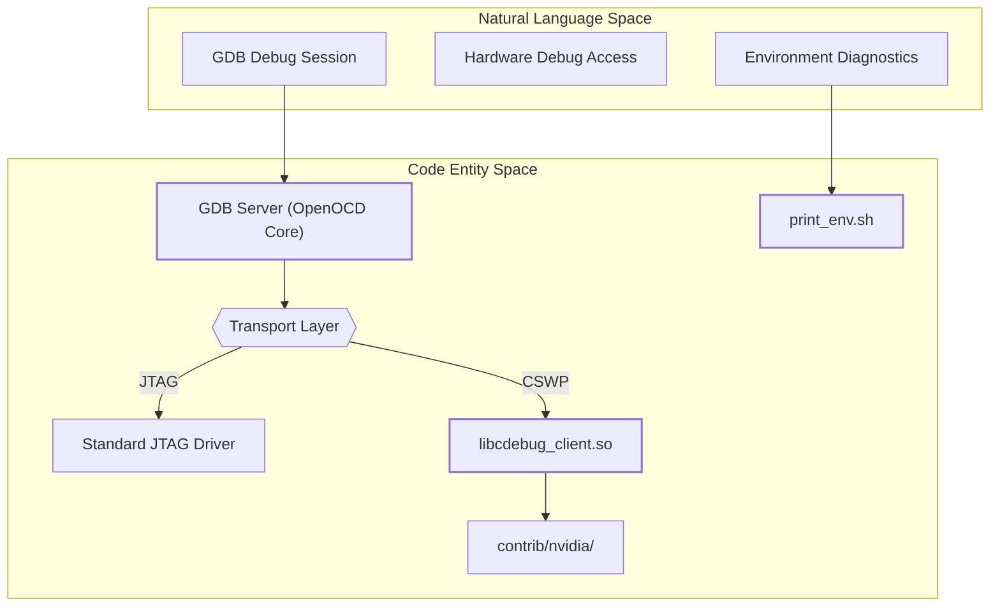
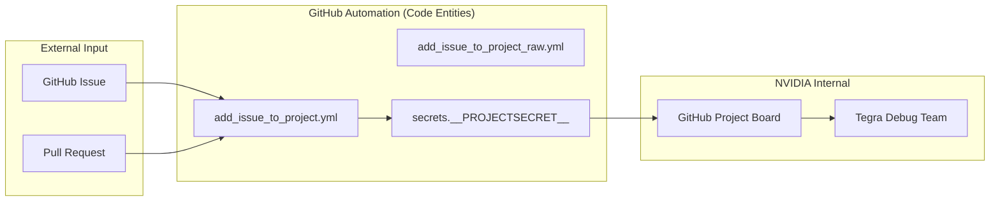

<!-- source: DeepWiki mcp.deepwiki.com · repo NVIDIA/openocd · page 5 Glossary · fetched 2026-10-26 -->

# Glossary

Relevant source files

The following files were used as context for generating this wiki page:

- [.github/ISSUE_TEMPLATE/bug_report.md](.github/ISSUE_TEMPLATE/bug_report.md)
- [.github/workflow-templates/add_issue_to_project.yml](.github/workflow-templates/add_issue_to_project.yml)
- [CLA.md](CLA.md)
- [CONTRIBUTING.md](CONTRIBUTING.md)
- [OWNERS](OWNERS)
- [README.md](README.md)
- [SECURITY.md](SECURITY.md)
- [print_env.sh](print_env.sh)

This page provides definitions for codebase-specific terminology, hardware identifiers, and architectural concepts used within NVIDIA's fork of OpenOCD. It serves as a reference for engineers to understand the mapping between high-level debug concepts and their implementation in the source tree.

## Hardware and Platform Terms

NVIDIA's OpenOCD fork is tailored for specific System-on-Chip (SoC) families. These terms appear frequently in branch names, configuration files, and bug reports.

| Term | Definition | Reference |
| :--- | :--- | :--- |
| **Grace** | A high-performance NVIDIA CPU SoC. Supported primarily in the `openocd-0.12.0` branch. | [README.md:11-11]() |
| **Thor** | An NVIDIA SoC family. Supported in the `openocd-0.12.0` branch. | [README.md:12-12]() |
| **Vera** | An NVIDIA SoC family. Stable support is found in `releases/strata`, while development occurs in `openocd-0.12.0`. | [README.md:13-13]() |
| **OpenBMC** | An open-source BMC (Baseboard Management Controller) stack. NVIDIA's OpenOCD is verified to run on OpenBMC environments for remote debug. | [README.md:51-51]() |

**Sources:**
- [README.md:11-13]()
- [README.md:51-51]()

---

## Core Infrastructure and Protocols

These terms describe the communication layers and external dependencies required to bridge GDB to NVIDIA hardware.

### CSWP (CoreSight Wire Protocol)
A protocol and software subsystem used to interface with ARM CoreSight debug components. In this repository, it refers to the integration of NVIDIA's `cswp` library, which allows OpenOCD to communicate with hardware debug agents over non-JTAG transports.
*   **Implementation:** Enabled via the `--enable-cswp` flag during configuration.
*   **Key Files:** Requires `libcdebug_client.so` and `libcstrace_client.so`.

### Debug Translation Pipeline
The process by which OpenOCD acts as a GDB server, receiving GDB Remote Serial Protocol (RSP) commands and converting them into hardware-specific requests sent via JTAG or CSWP.

### Data Flow: GDB to Hardware
The following diagram illustrates how natural language debug concepts map to specific code entities and libraries in the NVIDIA OpenOCD ecosystem.

**Debug Pipeline Mapping**

**Sources:**
- [README.md:14-16]()
- [README.md:34-46]()
- [print_env.sh:1-4]()

---

## Project Governance and Contribution Terms

Definitions related to the maintenance, security, and contribution workflow of the repository.

### CLA (Contribution License Agreement)
The legal agreement that contributors must sign to grant NVIDIA license rights to their submissions.
*   **Code Pointer:** Defined and documented in [CLA.md:2-7]().

### PSIRT (Product Security Incident Response Team)
The NVIDIA team responsible for receiving and investigating security vulnerability reports.
*   **Process:** Reports are submitted via [psirt@nvidia.com](mailto:psirt@nvidia.com) rather than GitHub issues.
*   **Reference:** [SECURITY.md:11-11]()

### Triage Workflow
The automated and manual process of categorizing incoming issues.
*   **Labels:** Issues are initially marked with `? - Needs Triage`.
*   **Automation:** GitHub Actions like `add_issue_to_project.yml` automatically move issues to the internal project board.

### Code Ownership and Review
The mechanism for routing pull requests to the appropriate maintainers.
*   **Owners:** Defined in the `OWNERS` file at the root.
*   **Reference:** [OWNERS:1-3]()

**Issue Lifecycle Mapping**

**Sources:**
- [CLA.md:2-7]()
- [SECURITY.md:11-20]()
- [OWNERS:1-3]()
- [.github/ISSUE_TEMPLATE/bug_report.md:5-5]()
- [.github/workflow-templates/add_issue_to_project.yml:1-25]()

---

## Diagnostic and Build Terms

| Term | Definition | Reference |
| :--- | :--- | :--- |
| **`print_env.sh`** | A utility script used to gather OS version, CPU info, compiler versions (gcc/g++), and environment variables (PATH, LD_LIBRARY_PATH) for bug reports. | [print_env.sh:9-64]() |
| **`config.log`** | The log file generated by the Autotools `configure` script. Required for diagnosing build failures. | [.github/ISSUE_TEMPLATE/bug_report.md:21-21]() |
| **`bootstrap`** | The initial script run to generate the `configure` script from `configure.ac` and `Makefile.am`. | [README.md:28-28]() |
| **`--enable-ftdi`** | A configuration flag used to enable support for FTDI-based JTAG adapters, often used alongside CSWP. | [README.md:42-42]() |

**Sources:**
- [print_env.sh:9-64]()
- [README.md:28-42]()
- [.github/ISSUE_TEMPLATE/bug_report.md:20-21]()