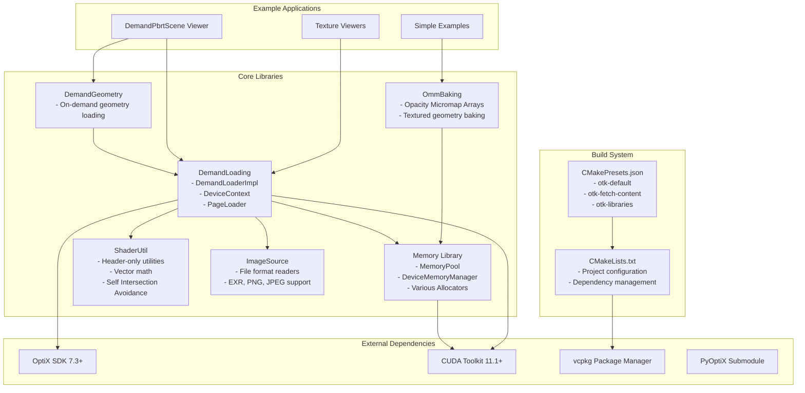
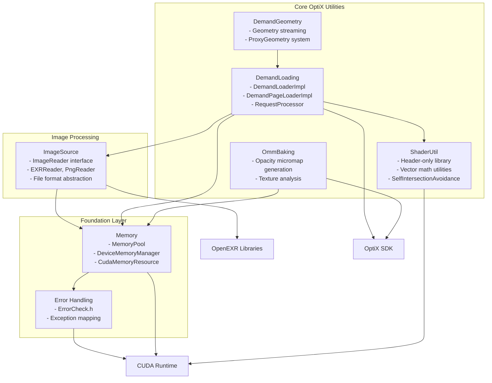
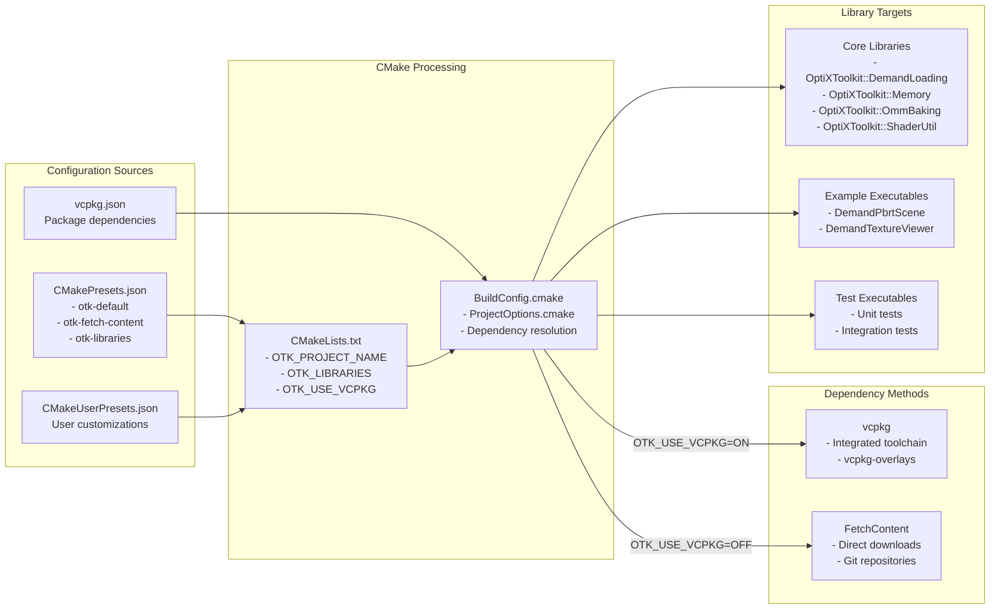

<!-- source: DeepWiki mcp.deepwiki.com · repo NVIDIA/optix-toolkit · page 1 OptiX Toolkit Overview · fetched 2026-10-26 -->

# OptiX Toolkit Overview

Relevant source files

The following files were used as context for generating this wiki page:

- [CHANGELOG.md](CHANGELOG.md)
- [CMakeLists.txt](CMakeLists.txt)
- [DemandLoading/CMakeLists.txt](DemandLoading/CMakeLists.txt)
- [DemandLoading/README.md](DemandLoading/README.md)
- [Memory/CHANGELOG.md](Memory/CHANGELOG.md)
- [Memory/LICENSE.txt](Memory/LICENSE.txt)
- [Memory/README.md](Memory/README.md)
- [Memory/include/OptiXToolkit/Memory/BitCast.h](Memory/include/OptiXToolkit/Memory/BitCast.h)
- [README.md](README.md)

## Purpose and Scope

The OptiX Toolkit (OTK) is a collection of C++/CUDA utilities designed to simplify the development of applications using the NVIDIA OptiX ray tracing API. This document provides a high-level overview of the toolkit's architecture, core libraries, and how they work together to enable advanced ray tracing features like demand-loaded textures, opacity micromaps, and efficient memory management.

For detailed information about specific components, see [Core Libraries](#1.1) for library-specific documentation, [Getting Started](#2) for build instructions, and [DemandLoading System](#3) for the toolkit's most important subsystem.

Sources: [README.md:1-3](), [CMakeLists.txt:6-7]()

## High-Level Architecture

The OptiX Toolkit follows a modular design with four main layers: external dependencies, build system infrastructure, core libraries, and example applications. The central component is the DemandLoading system, which enables sparse texture loading and forms the foundation for most advanced features.

### System Architecture Overview

Sources: [CMakeLists.txt:76-97](), [README.md:20-25](), [DemandLoading/CMakeLists.txt:35-38]()

## Core Libraries

The OptiX Toolkit provides four primary libraries that can be built independently or together. Each library serves a specific purpose and follows clear dependency relationships.

### Library Dependency Structure

### Library Configuration

The toolkit uses a flexible library selection system controlled by the `OTK_LIBRARIES` CMake variable. The default configuration includes all four core libraries with their dependencies automatically resolved.

| Library | Dependencies | Purpose |
|---------|-------------|---------|
| `Memory` | None | Foundation memory management |
| `ShaderUtil` | `Memory` | OptiX kernel utilities |
| `DemandLoading` | `Memory`, `ShaderUtil` | Sparse texture streaming |
| `OmmBaking` | `Memory` | Opacity micromap generation |

Sources: [CMakeLists.txt:76-88](), [README.md:145-148](), [Memory/README.md:7-16]()

## Build System Architecture

The OptiX Toolkit employs a sophisticated CMake-based build system with multiple dependency acquisition strategies and extensive configuration options.

### Build Configuration Flow

### CMake Configuration Options

The build system provides extensive customization through CMake variables:

| Variable | Type | Default | Description |
|----------|------|---------|-------------|
| `OTK_USE_VCPKG` | `BOOL` | `ON` | Use vcpkg for dependencies |
| `OTK_LIBRARIES` | `STRING` | `ALL` | Libraries to build |
| `OTK_BUILD_EXAMPLES` | `BOOL` | `ON` | Build example applications |
| `OTK_BUILD_TESTS` | `BOOL` | `ON` | Build test suite |
| `OTK_PROJECT_NAME` | `STRING` | `OptiXToolkit` | CMake project name |

Sources: [CMakeLists.txt:25](), [README.md:126-142](), [CMakeLists.txt:55-60]()

## System Dependencies

The OptiX Toolkit requires several external dependencies that are managed through either vcpkg or CMake FetchContent.

### External Dependency Requirements

| Component | Requirements | Purpose |
|-----------|-------------|---------|
| **Runtime** | OptiX SDK 7.3+, CUDA Toolkit 11.1+ | Core ray tracing and compute |
| **Image Processing** | OpenEXR 3.1.5+, Imath 3.1.5+, OpenImageIO (optional) | Texture file format support |
| **GUI (Examples)** | GLFW 3.3+, ImGui, glad, stb | Interactive applications |
| **Testing** | Google Test, Google Mock | Unit and integration testing |
| **Build Tools** | CMake 3.27+, git with LFS | Build system and version control |

The toolkit automatically detects and configures these dependencies using the specified acquisition method (vcpkg or FetchContent).

Sources: [README.md:27-35](), [README.md:155-164](), [CMakeLists.txt:55-60]()

## Integration Points

The OptiX Toolkit is designed to integrate seamlessly with existing OptiX applications. The primary integration points are:

1. **CMake Integration**: Include as a subdirectory using `add_subdirectory(OptiXToolkit)`
2. **Library Linking**: Link against specific libraries like `OptiXToolkit::DemandLoading`
3. **Header Inclusion**: Use toolkit headers with the `<OptiXToolkit/Library>` prefix
4. **Device Code**: Include toolkit device functions in OptiX kernels

For comprehensive integration guidance, see [Getting Started](#2) and library-specific documentation in [Core Libraries](#1.1).

Sources: [DemandLoading/README.md:84-95](), [Memory/README.md:9-15]()

---

