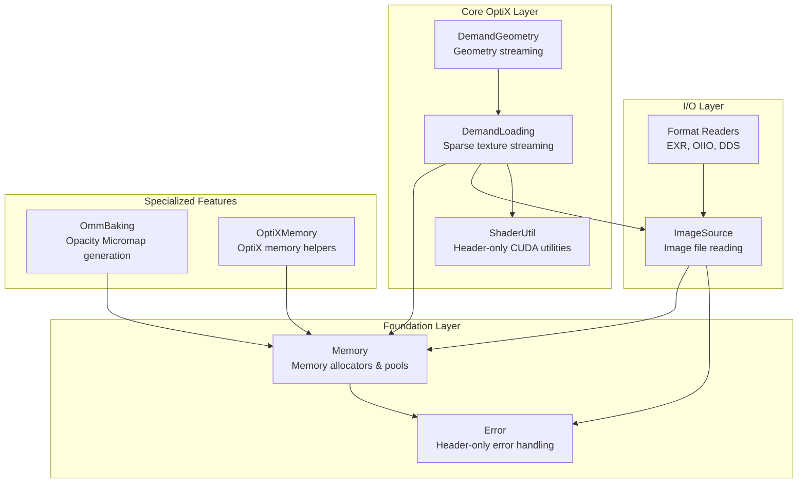
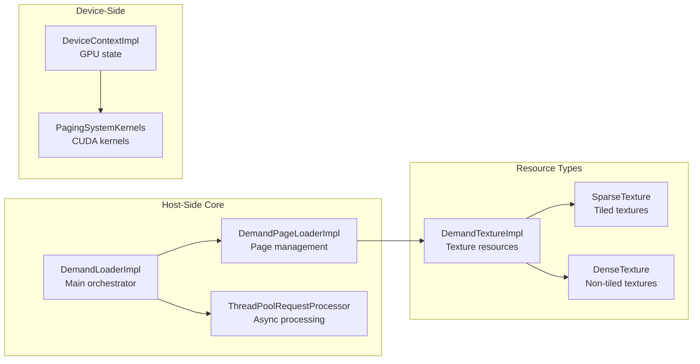
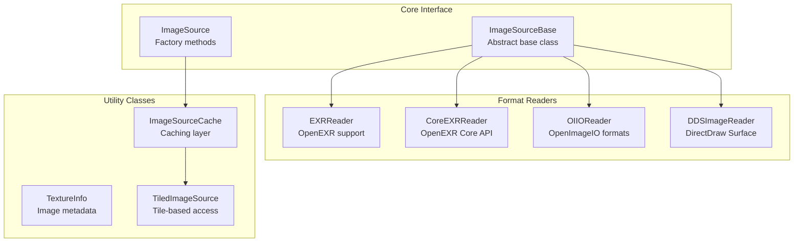
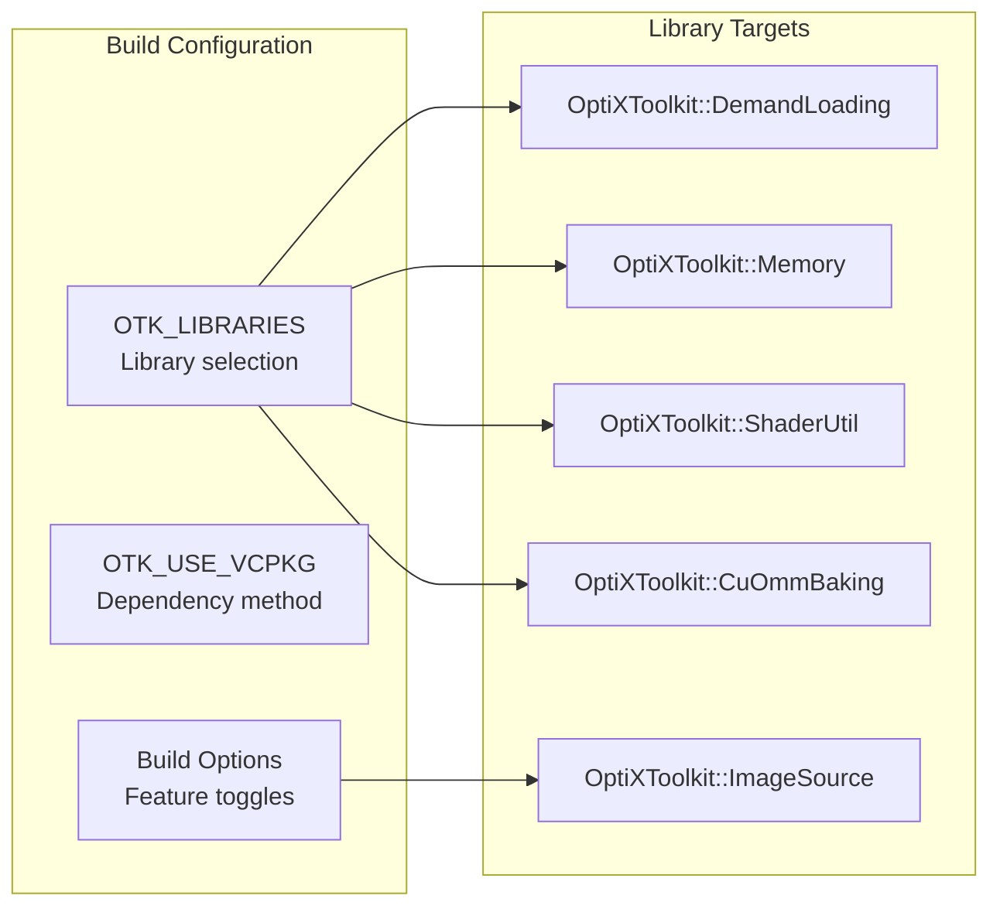

<!-- source: DeepWiki mcp.deepwiki.com · repo NVIDIA/optix-toolkit · page 1.1 Core Libraries · fetched 2026-10-26 -->

# Core Libraries

Relevant source files

The following files were used as context for generating this wiki page:

- [CHANGELOG.md](CHANGELOG.md)
- [CMake/SetCxxStandard.cmake](CMake/SetCxxStandard.cmake)
- [DemandLoading/DemandGeometry/CMakeLists.txt](DemandLoading/DemandGeometry/CMakeLists.txt)
- [DemandLoading/DemandLoading/CMakeLists.txt](DemandLoading/DemandLoading/CMakeLists.txt)
- [DemandLoading/ImageSource/CMakeLists.txt](DemandLoading/ImageSource/CMakeLists.txt)
- [DemandLoading/ImageSource/include/OptiXToolkit/ImageSource/EXRReader.h](DemandLoading/ImageSource/include/OptiXToolkit/ImageSource/EXRReader.h)
- [DemandLoading/README.md](DemandLoading/README.md)
- [Memory/CHANGELOG.md](Memory/CHANGELOG.md)
- [Memory/CMakeLists.txt](Memory/CMakeLists.txt)
- [Memory/LICENSE.txt](Memory/LICENSE.txt)
- [Memory/README.md](Memory/README.md)
- [Memory/include/OptiXToolkit/Memory/BitCast.h](Memory/include/OptiXToolkit/Memory/BitCast.h)
- [OmmBaking/CMakeLists.txt](OmmBaking/CMakeLists.txt)
- [README.md](README.md)
- [ShaderUtil/CMakeLists.txt](ShaderUtil/CMakeLists.txt)
- [examples/CMakeLists.txt](examples/CMakeLists.txt)
- [examples/CuOmmBaking/Simple/CMakeLists.txt](examples/CuOmmBaking/Simple/CMakeLists.txt)
- [examples/CuOmmBaking/Viewer/CMakeLists.txt](examples/CuOmmBaking/Viewer/CMakeLists.txt)

This document covers the main library components that form the foundation of the OptiX Toolkit. These libraries provide essential functionality for demand loading, memory management, shader utilities, and specialized OptiX features. For information about example applications that demonstrate these libraries, see [Example Applications](#5). For details about the build system that orchestrates these components, see [Build System](#2.2).

## Library Overview

The OptiX Toolkit consists of several interconnected core libraries, each serving specific roles in the overall architecture:

**Library Dependency Architecture**

Sources: [README.md:20-25](), [Memory/CMakeLists.txt:78-108](), [DemandLoading/DemandLoading/CMakeLists.txt:157-164]()

## Library Component Details

### DemandLoading Library

The `DemandLoading` library is the centerpiece of the toolkit, providing on-demand loading of sparse textures and other resources for OptiX applications.

| Component | Purpose | Key Classes |
|-----------|---------|-------------|
| Core Implementation | Main demand loading orchestration | `DemandLoaderImpl`, `DemandPageLoaderImpl` |
| Device Context | GPU-side state management | `DeviceContextImpl`, `DeviceContext` |
| Texture Management | Sparse texture handling | `DemandTextureImpl`, `SparseTexture`, `DenseTexture` |
| Request Processing | Asynchronous request handling | `ThreadPoolRequestProcessor`, `RequestQueue` |
| Memory Management | GPU memory allocation | `DeviceMemoryManager` |

**DemandLoading Internal Architecture**

Sources: [DemandLoading/DemandLoading/CMakeLists.txt:34-81](), [DemandLoading/README.md:1-11]()

### Memory Library

The `Memory` library provides the foundational memory management capabilities used throughout the toolkit, with special focus on CUDA memory operations.

| Library | Type | Purpose |
|---------|------|---------|
| Error | Interface | Error code to exception mapping |
| Memory | Interface | Memory allocators and pools |
| OptiXMemory | Interface | OptiX-specific memory helpers |

Key components include:
- **Allocators**: `Allocators.h`, `BinnedSuballocator.h`, `HeapSuballocator.h`
- **Memory Pools**: `MemoryPool.h`, `DeviceFixedPool.h`, `DeviceRingBuffer.h`
- **Synchronization**: `SyncVector.h`, `MemoryBlockDesc.h`
- **OptiX Helpers**: `Builders.h`, `Record.h`, `SyncRecord.h`

Sources: [Memory/CMakeLists.txt:78-159](), [Memory/README.md:7-16]()

### ShaderUtil Library

`ShaderUtil` is a header-only library providing utilities for OptiX device-side programming.

| Category | Headers | Purpose |
|----------|---------|---------|
| Math Utilities | `vec_math.h`, `Transform4.h` | Vector and matrix operations |
| Ray Processing | `ray_cone.h`, `SelfIntersectionAvoidance.h` | Ray geometry utilities |
| Sampling | `AliasTable.h`, `CdfInversionTable.h`, `PdfTable.h` | Probability distribution sampling |
| Debugging | `DebugLocation.h`, `vec_printers.h` | Development and debugging aids |
| Color | `color.h` | Color space operations |

Sources: [ShaderUtil/CMakeLists.txt:35-51]()

### ImageSource Library

The `ImageSource` library abstracts image file I/O operations, supporting multiple formats through a unified interface.

**ImageSource Architecture**

Sources: [DemandLoading/ImageSource/CMakeLists.txt:26-42](), [DemandLoading/ImageSource/include/OptiXToolkit/ImageSource/EXRReader.h:31-34]()

### OmmBaking Library

The `OmmBaking` library provides functionality for generating Opacity Micromap Arrays (OMMs) for use with OptiX ray tracing.

| Component | File | Purpose |
|-----------|------|---------|
| Main Interface | `CuOmmBaking.h` | Primary API for OMM baking |
| Buffer Management | `CuBuffer.h` | CUDA buffer utilities |
| Implementation | `CuOmmBakingImpl.h` | Internal implementation details |
| Texture Processing | `Texture.h` | Texture analysis for OMM generation |

Sources: [OmmBaking/CMakeLists.txt:67-70](), [README.md:23]()

## Library Configuration and Build Integration

The core libraries are configured through CMake with several important build options:

| Option | Default | Purpose |
|--------|---------|---------|
| `OTK_LIBRARIES` | `ALL` | Selects which libraries to build |
| `OTK_USE_OPENEXR` | `${OTK_USE_VCPKG}` | Enable OpenEXR support in ImageSource |
| `OTK_USE_OIIO` | `OFF` | Enable OpenImageIO support |
| `OTK_USE_CUDA_MEMORY_POOLS` | `ON` (CUDA 11.2+) | Use CUDA memory pools |

**Library Build Configuration**

The libraries can be built individually or as a complete set. Dependencies are automatically included when building specific libraries.

Sources: [README.md:141-149](), [DemandLoading/ImageSource/CMakeLists.txt:64-114](), [Memory/CMakeLists.txt:105-107]()

---

