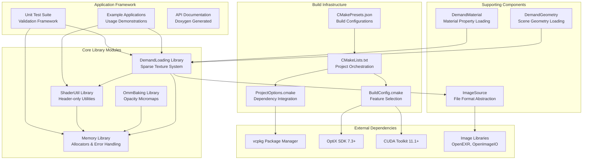
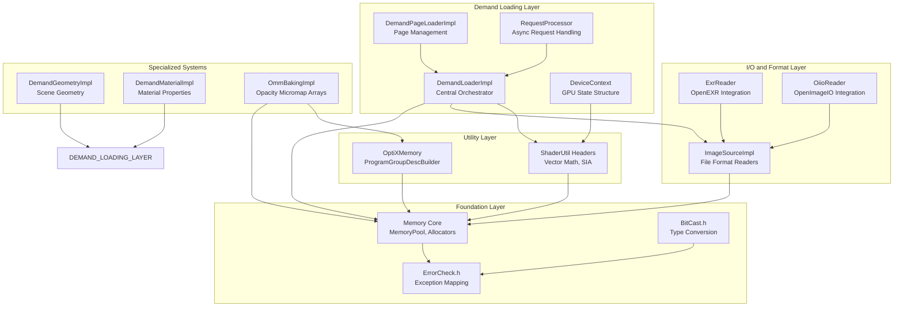
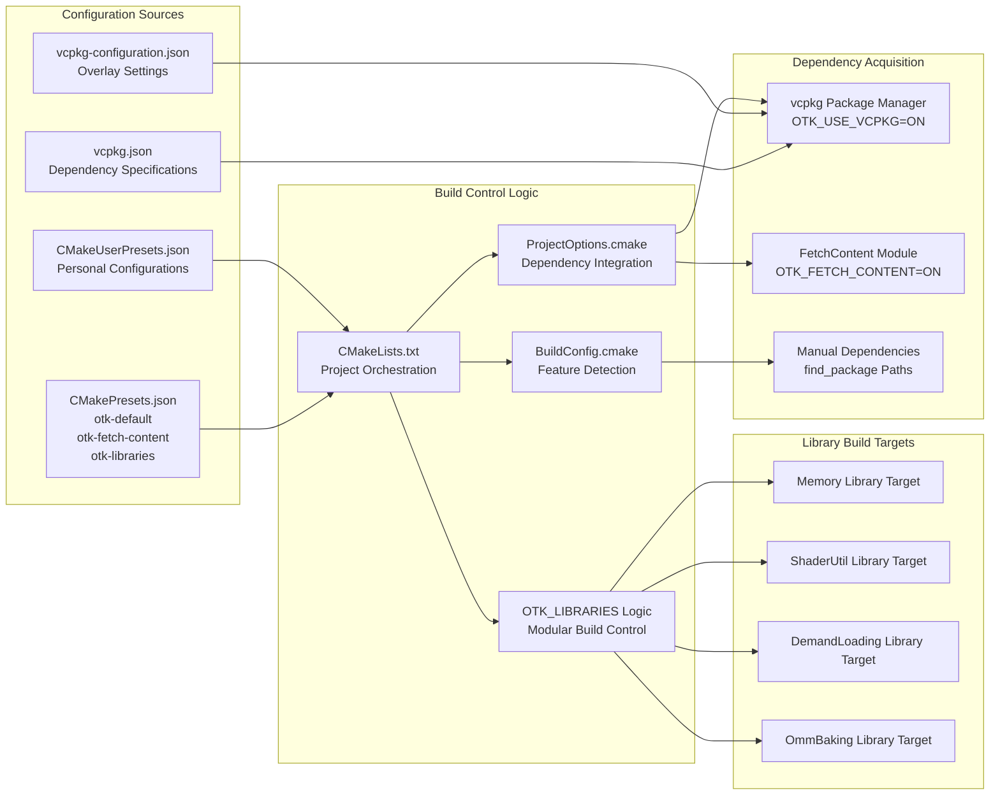
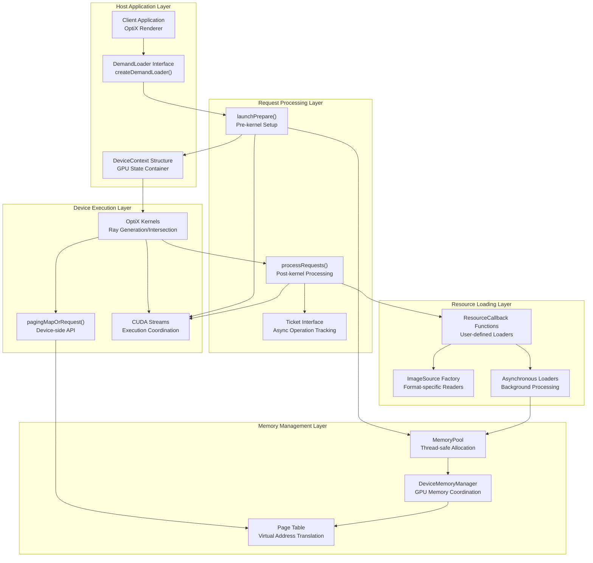

<!-- source: DeepWiki mcp.deepwiki.com · repo NVIDIA/optix-toolkit · page 1.2 System Architecture · fetched 2026-10-26 -->

# System Architecture

Relevant source files

The following files were used as context for generating this wiki page:

- [CHANGELOG.md](CHANGELOG.md)
- [CMakeLists.txt](CMakeLists.txt)
- [DemandLoading/CMakeLists.txt](DemandLoading/CMakeLists.txt)
- [DemandLoading/README.md](DemandLoading/README.md)
- [Memory/CHANGELOG.md](Memory/CHANGELOG.md)
- [Memory/LICENSE.txt](Memory/LICENSE.txt)
- [Memory/README.md](Memory/README.md)
- [Memory/include/OptiXToolkit/Memory/BitCast.h](Memory/include/OptiXToolkit/Memory/BitCast.h)
- [README.md](README.md)

This document describes the high-level system architecture of the OptiX Toolkit, focusing on the modular organization of components, their interdependencies, and how they integrate to provide OptiX ray tracing utilities. This covers the structural design patterns, build system architecture, and runtime component relationships.

For detailed implementation of specific libraries, see [Core Libraries](#1.1). For build procedures and configuration, see [Build System](#2.2).

## Overall System Organization

The OptiX Toolkit follows a modular architecture where core libraries provide fundamental functionality, examples demonstrate usage patterns, and a sophisticated build system manages dependencies and configuration.

**OptiX Toolkit Modular Organization**

The architecture separates concerns into distinct layers: external dependencies are managed through vcpkg, build infrastructure provides flexible configuration, core libraries implement ray tracing utilities, and applications demonstrate integration patterns.

Sources: [CMakeLists.txt:1-111](), [README.md:20-26](), [DemandLoading/CMakeLists.txt:1-39]()

## Core Library Dependencies

The core libraries form a dependency hierarchy where foundational components support higher-level functionality. The `Memory` library provides the base layer, while `DemandLoading` represents the most complex subsystem.

**Core Library Dependency Graph**

The dependency flow follows a layered pattern where each layer builds upon lower layers. The `Memory` library provides foundational allocators and error handling, while `DemandLoading` integrates multiple subsystems for texture streaming functionality.

Sources: [CMakeLists.txt:76-88](), [Memory/README.md:7-15](), [DemandLoading/README.md:1-23]()

## Build System Architecture

The build system uses CMake with a preset-based configuration approach, supporting multiple dependency acquisition methods and flexible library selection.

**Build System Configuration Flow**

The build system provides multiple configuration methods through CMake presets, with intelligent dependency resolution that can use vcpkg, FetchContent, or manual dependency specification based on configuration variables.

Sources: [CMakeLists.txt:14-28](), [README.md:64-96](), [README.md:126-149]()

## Runtime Component Integration

During runtime, the core components integrate through well-defined interfaces, with the `DemandLoader` serving as the central orchestrator for resource management and GPU communication.

**Runtime Component Integration Pattern**

The runtime architecture follows an asynchronous request-response pattern where device-side code requests resources through `pagingMapOrRequest()`, host-side processing handles these requests through callbacks, and memory management coordinates GPU resource allocation.

Sources: [DemandLoading/README.md:41-81](), [CMakeLists.txt:55-59]()

## Extension and Integration Points

The toolkit provides multiple extension mechanisms for integrating with client applications and extending functionality through well-defined interfaces.

| Integration Point | Interface | Purpose | Implementation |
|------------------|-----------|---------|----------------|
| **Resource Loading** | `ResourceCallback` | Custom data loading logic | User-implemented callbacks for `createResource()` |
| **Memory Allocation** | `MemoryPool` interface | Custom allocator strategies | Pluggable allocator implementations |
| **Image Formats** | `ImageSource` factory | Additional file format support | Format-specific reader implementations |
| **Build Configuration** | CMake variables | Selective library building | `OTK_LIBRARIES` and feature flags |
| **Shader Integration** | Header-only utilities | OptiX kernel utilities | Include `ShaderUtil` headers in device code |
| **OptiX Integration** | `DeviceContext` passing | Kernel parameter structure | Pass context through OptiX launch parameters |

**Primary Extension Mechanisms**

The architecture supports extension through callback interfaces for resource loading, pluggable memory allocators, format-specific image readers, and modular build configuration. The header-only `ShaderUtil` library provides seamless integration with OptiX device code.

Sources: [DemandLoading/README.md:33-40](), [Memory/README.md:10-15](), [CMakeLists.txt:141-148]()

---

