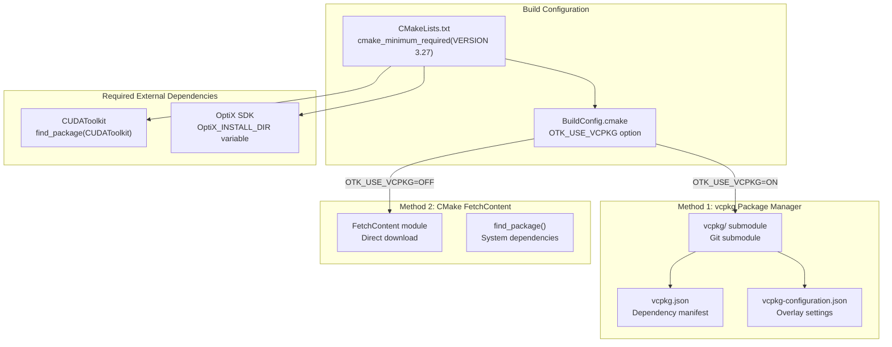
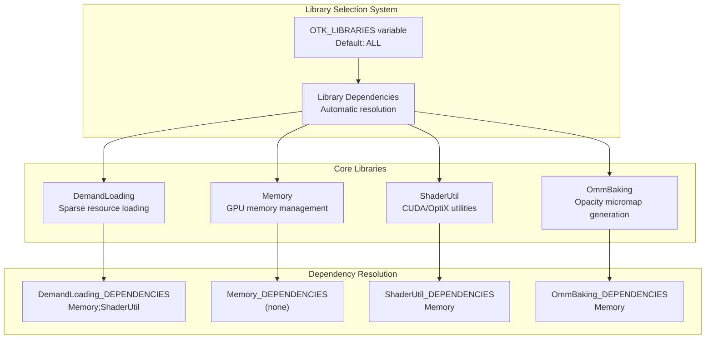
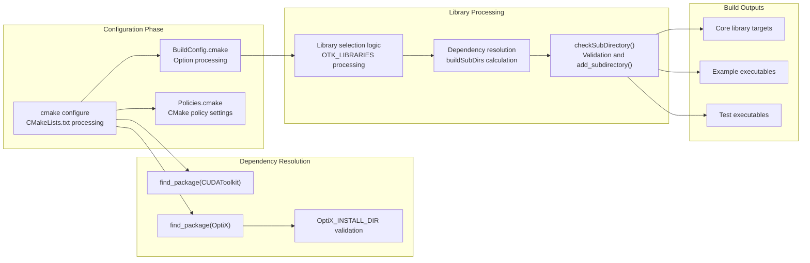

<!-- source: DeepWiki mcp.deepwiki.com · repo NVIDIA/optix-toolkit · page 2 Getting Started · fetched 2026-10-26 -->

# Getting Started

<details>
<summary>Relevant source files</summary>

The following files were used as context for generating this wiki page:

- [.gitmodules](.gitmodules)
- [CMakeLists.txt](CMakeLists.txt)
- [DemandLoading/CMakeLists.txt](DemandLoading/CMakeLists.txt)

</details>


This guide covers the essential steps for building and configuring the OptiX Toolkit (OTK). It focuses on the build system setup, dependency management, and basic configuration options needed to compile the toolkit's core libraries and example applications.

For detailed information about individual libraries and their APIs, see [Core Libraries](#1.1). For advanced build system customization and development workflows, see [CMake Development](#6.2).

## Prerequisites and Dependencies

The OptiX Toolkit requires several external dependencies that must be installed before building:

### Required Dependencies

| Dependency | Version | Purpose |
|------------|---------|---------|
| CMake | 3.27+ | Build system orchestration |
| CUDA Toolkit | 11.1+ | GPU computing platform |
| OptiX SDK | 7.3+ | Ray tracing library |
| C++ Compiler | C++11 | Core compilation |

### Dependency Acquisition Methods

The toolkit supports two methods for acquiring third-party dependencies:



**vcpkg Method (Recommended)**
- Uses the vcpkg submodule for dependency management
- Configured via `vcpkg.json` manifest file
- Provides consistent, reproducible builds
- Handles complex dependency chains automatically

**FetchContent Method**
- Downloads dependencies at configure time
- Suitable for environments where vcpkg is not available
- Requires manual dependency resolution

Sources: [CMakeLists.txt:14-17](), [CMakeLists.txt:55-59](), [.gitmodules:1-3]()

## Quick Start Build Process

### 1. Clone and Initialize Repository

```bash
git clone https://github.com/NVIDIA/optix-toolkit.git
cd optix-toolkit
git submodule update --init --recursive
```

### 2. Set OptiX SDK Path

The OptiX SDK must be installed separately and its path specified:

```bash
# Set OptiX_INSTALL_DIR to your OptiX SDK installation
export OptiX_INSTALL_DIR=/path/to/optix/sdk
```

### 3. Configure and Build

```bash
# Basic configuration with default options
cmake -B build -S .

# Build the toolkit
cmake --build build --parallel
```

## Core Library Selection and Dependencies

The toolkit uses a modular library system where you can select which components to build:



The build system automatically resolves dependencies between libraries. For example, selecting `DemandLoading` automatically includes `Memory` and `ShaderUtil`.

Sources: [CMakeLists.txt:76-97]()

## Build Configuration Options

### Primary Build Options

| Option | Default | Description |
|--------|---------|-------------|
| `OTK_LIBRARIES` | `"ALL"` | Semicolon-separated list of libraries to build |
| `OTK_BUILD_EXAMPLES` | `ON` | Build example applications |
| `OTK_BUILD_TESTS` | `ON` | Build unit tests and test framework |
| `OTK_BUILD_PYOPTIX` | `OFF` | Build Python bindings |
| `OTK_BUILD_DOCS` | `OFF` | Build API documentation |
| `OTK_USE_VCPKG` | `ON` | Use vcpkg for dependency management |
| `BUILD_SHARED_LIBS` | `ON` | Build shared libraries instead of static |

### Advanced CUDA Options

For CUDA Toolkit 11.2+, additional memory management options are available:

| Option | Default | Description |
|--------|---------|-------------|
| `OTK_USE_CUDA_MEMORY_POOLS` | `ON` (CUDA 11.2+) | Enable CUDA memory pools and stream-ordered allocators |

Sources: [CMakeLists.txt:33-37](), [DemandLoading/CMakeLists.txt:21-25]()

## Configuration Examples

### Minimal Build (Core Libraries Only)

```bash
cmake -B build -S . \
  -DOTK_BUILD_EXAMPLES=OFF \
  -DOTK_BUILD_TESTS=OFF \
  -DOTK_LIBRARIES="Memory;ShaderUtil"
```

### Full Development Build

```bash
cmake -B build -S . \
  -DOTK_BUILD_EXAMPLES=ON \
  -DOTK_BUILD_TESTS=ON \
  -DOTK_BUILD_DOCS=ON \
  -DOTK_LIBRARIES="ALL"
```

### Custom Library Selection

```bash
cmake -B build -S . \
  -DOTK_LIBRARIES="DemandLoading;OmmBaking"
```

## Build System Architecture

The following diagram shows how the CMake build system processes configuration and manages the modular build:



Sources: [CMakeLists.txt:11-29](), [CMakeLists.txt:65-97]()

## Verification and Testing

After building, verify the installation by running the test suite:

```bash
# Run all tests
ctest --test-dir build

# Run tests with verbose output
ctest --test-dir build --verbose
```

The test framework validates core functionality including memory management, demand loading, and OptiX integration. For detailed information about the testing infrastructure, see [Testing Framework](#6.1).

Sources: [CMakeLists.txt:32-37]()

---

