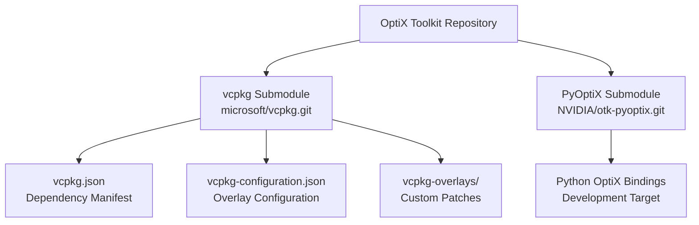
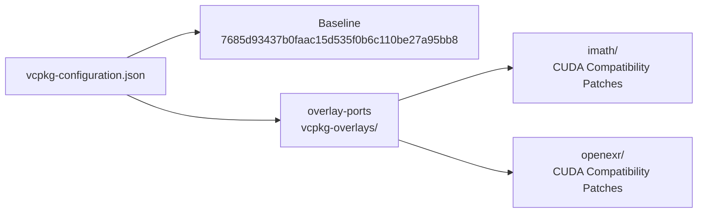
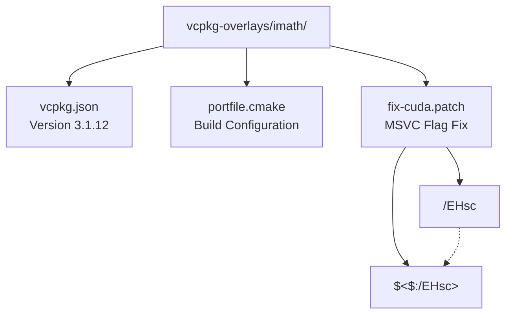
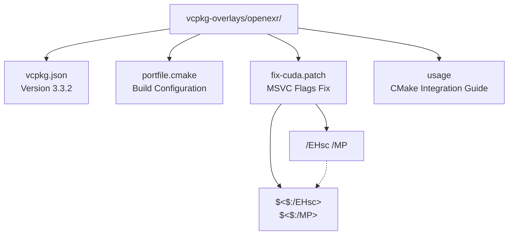
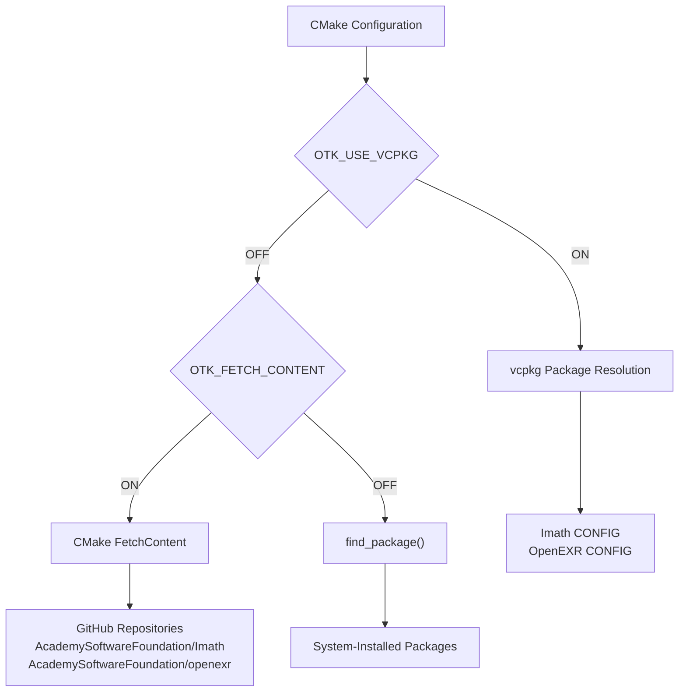
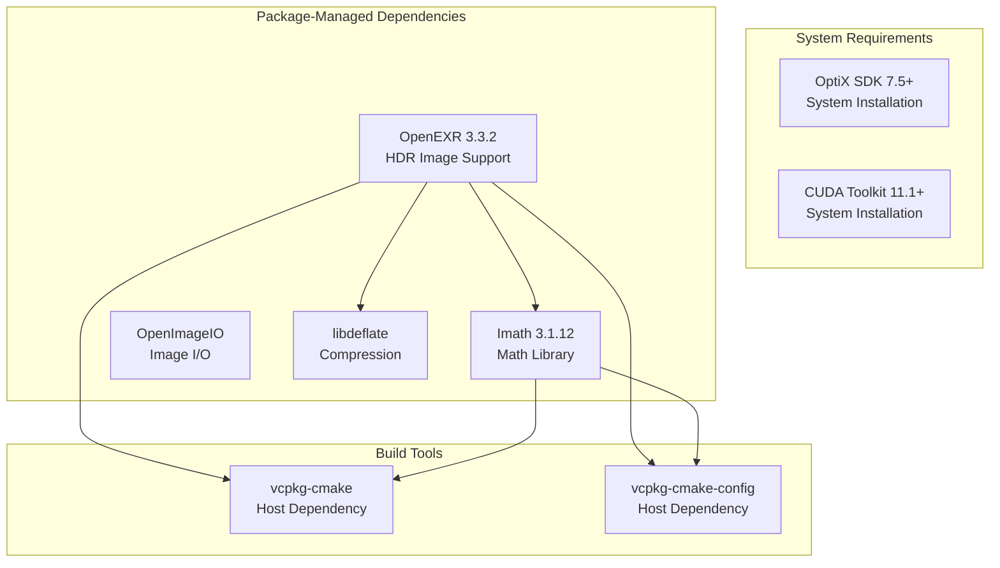

<!-- source: DeepWiki mcp.deepwiki.com · repo NVIDIA/optix-toolkit · page 2.1 Dependencies and External Libraries · fetched 2026-10-26 -->

# Dependencies and External Libraries

Relevant source files

The following files were used as context for generating this wiki page:

- [.gitmodules](.gitmodules)
- [CMake/FetchOpenEXR.cmake](CMake/FetchOpenEXR.cmake)
- [vcpkg-configuration.json](vcpkg-configuration.json)
- [vcpkg-overlays/imath/fix-cuda.patch](vcpkg-overlays/imath/fix-cuda.patch)
- [vcpkg-overlays/imath/portfile.cmake](vcpkg-overlays/imath/portfile.cmake)
- [vcpkg-overlays/imath/vcpkg.json](vcpkg-overlays/imath/vcpkg.json)
- [vcpkg-overlays/openexr/fix-cuda.patch](vcpkg-overlays/openexr/fix-cuda.patch)
- [vcpkg-overlays/openexr/portfile.cmake](vcpkg-overlays/openexr/portfile.cmake)
- [vcpkg-overlays/openexr/usage](vcpkg-overlays/openexr/usage)
- [vcpkg-overlays/openexr/vcpkg.json](vcpkg-overlays/openexr/vcpkg.json)

This document covers the external dependencies, package management, and build-time configuration for the OptiX Toolkit. It explains how the toolkit manages its dependencies through git submodules, vcpkg package management, and custom overlay patches to ensure compatibility with CUDA and OptiX development.

For information about the CMake build system configuration that orchestrates these dependencies, see [Build System](#2.2). For details about CMake presets and build options, see [Build Configuration](#2.3).

## Git Submodules

The OptiX Toolkit uses two primary git submodules to manage external dependencies and related projects:

| Submodule | Repository | Purpose |
|-----------|------------|---------|
| `vcpkg` | https://github.com/microsoft/vcpkg.git | Microsoft's C++ package manager for dependency resolution |
| `PyOptiX` | https://github.com/NVIDIA/otk-pyoptix.git | Python bindings for OptiX, developed alongside the toolkit |

### Submodule Architecture

Sources: [.gitmodules:1-6]()

## vcpkg Package Management

The toolkit uses vcpkg as its primary dependency management system, configured through a baseline and custom overlay ports to handle special requirements for CUDA compatibility.

### vcpkg Configuration

The `vcpkg-configuration.json` establishes the package management baseline and overlay system:

The configuration uses a specific baseline commit (`7685d93437b0faac15d535f0b6c110be27a95bb8`) from the vcpkg builtin registry to ensure reproducible builds across different environments.

Sources: [vcpkg-configuration.json:1-9]()

## vcpkg Overlays and CUDA Compatibility

### Custom Overlay Patches

The toolkit includes custom vcpkg overlay ports to resolve compilation issues between image processing libraries and CUDA/nvcc:

| Library | Issue | Solution |
|---------|-------|----------|
| Imath | MSVC `/EHsc` flag conflicts with nvcc | Wrap in `$<$<COMPILE_LANGUAGE:CXX>:/EHsc>` generator expression |
| OpenEXR | MSVC `/EHsc` and `/MP` flags conflict with nvcc | Wrap both flags in CXX-specific generator expressions |

### Imath Overlay Implementation

The patch modifies the `LibraryDefine.cmake` file to replace the problematic MSVC compile flag with a CMake generator expression that only applies the flag when compiling C++ code, not CUDA code.

Sources: [vcpkg-overlays/imath/fix-cuda.patch:1-14](), [vcpkg-overlays/imath/vcpkg.json:1-18](), [vcpkg-overlays/imath/portfile.cmake:1-28]()

### OpenEXR Overlay Implementation

The OpenEXR overlay follows the same pattern, handling both `/EHsc` and `/MP` MSVC compiler flags:

Sources: [vcpkg-overlays/openexr/fix-cuda.patch:1-14](), [vcpkg-overlays/openexr/vcpkg.json:1-26](), [vcpkg-overlays/openexr/portfile.cmake:1-61](), [vcpkg-overlays/openexr/usage:1-4]()

## Dependency Resolution Methods

The build system supports multiple dependency acquisition methods through CMake configuration options:

### vcpkg vs FetchContent Resolution

### OpenEXR Resolution Implementation

The `FetchOpenEXR.cmake` module demonstrates the multi-method resolution approach:

1. **vcpkg Method** ([CMake/FetchOpenEXR.cmake:5-10]()): Uses `find_package(Imath CONFIG REQUIRED)` and `find_package(OpenEXR CONFIG REQUIRED)`
2. **FetchContent Method** ([CMake/FetchOpenEXR.cmake:54-93]()): Downloads from GitHub repositories with specific version tags
3. **System Method** ([CMake/FetchOpenEXR.cmake:52]()): Uses `find_package(OpenEXR 3.1 REQUIRED)` for system installations

### Compile Flag Compatibility Handling

The `FetchOpenEXR.cmake` module includes functions to handle MSVC/CUDA compile flag conflicts when not using vcpkg overlays:

- `otk_cxx_flag_only()` ([CMake/FetchOpenEXR.cmake:14-24]()): Wraps individual flags in CXX-specific generator expressions
- `otk_replace_flags()` ([CMake/FetchOpenEXR.cmake:26-43]()): Processes target dependency chains to fix flag conflicts

Sources: [CMake/FetchOpenEXR.cmake:1-108]()

## Major External Dependencies

### Runtime Dependencies

| Dependency | Minimum Version | Purpose | Resolution Method |
|------------|----------------|---------|-------------------|
| NVIDIA OptiX SDK | 7.5+ | Ray tracing acceleration | System installation required |
| CUDA Toolkit | 11.1+ | GPU compute platform | System installation required |
| OpenEXR/Imath | 3.1+ | HDR image format support | vcpkg, FetchContent, or system |
| OpenImageIO | Latest | Multi-format image I/O | vcpkg or FetchContent |

### Build-Time Dependencies

| Dependency | Purpose | Resolution Method |
|------------|---------|-------------------|
| vcpkg-cmake | CMake integration for vcpkg | vcpkg host dependency |
| vcpkg-cmake-config | CMake config file generation | vcpkg host dependency |
| libdeflate | Compression for OpenEXR | vcpkg dependency |

### Dependency Architecture

The OptiX Toolkit requires system-level installation of OptiX SDK and CUDA Toolkit, while other dependencies are managed through the package system with special handling for CUDA compilation compatibility.

Sources: [vcpkg-overlays/openexr/vcpkg.json:9-19](), [vcpkg-overlays/imath/vcpkg.json:8-17]()

---

