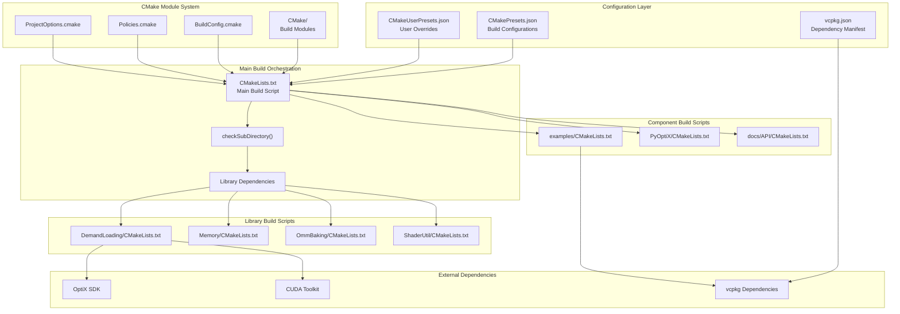
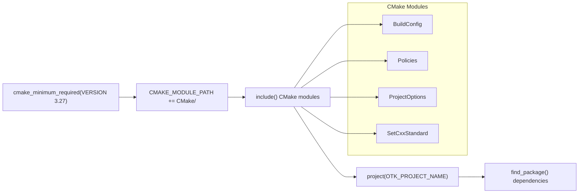
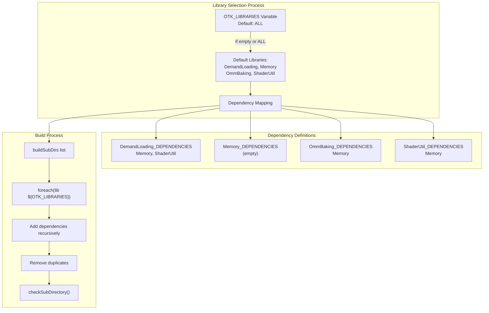
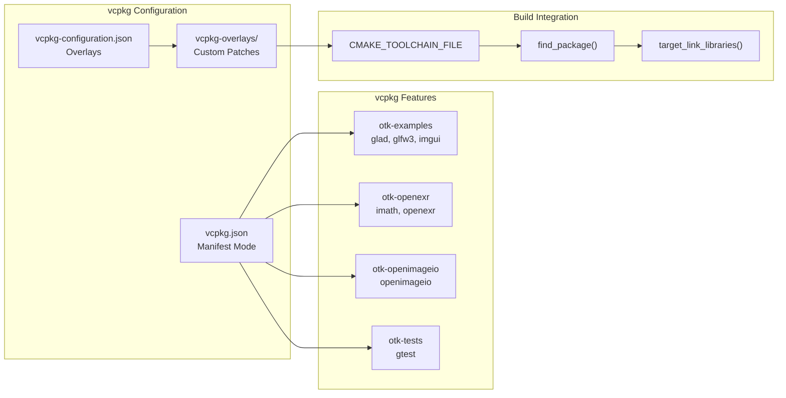
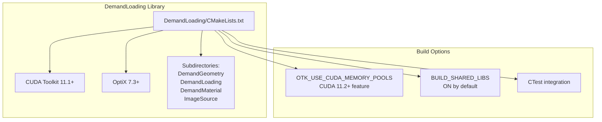

<!-- source: DeepWiki mcp.deepwiki.com · repo NVIDIA/optix-toolkit · page 2.2 Build System · fetched 2026-10-26 -->

# Build System

Relevant source files

The following files were used as context for generating this wiki page:

- [.gitattributes](.gitattributes)
- [.gitignore](.gitignore)
- [CMakeLists.txt](CMakeLists.txt)
- [CMakePresets.json](CMakePresets.json)
- [DemandLoading/CMakeLists.txt](DemandLoading/CMakeLists.txt)
- [vcpkg.json](vcpkg.json)

The OptiX Toolkit uses a sophisticated CMake-based build system that supports modular library selection, multiple dependency acquisition methods, and extensive configuration through presets. This system allows users to build only the components they need while handling complex dependency relationships automatically.

For information about external dependencies and how they're managed, see [Dependencies and External Libraries](#2.1). For specific build configuration options and presets, see [Build Configuration](#2.3).

## Build System Architecture

The build system is organized around a hierarchical CMake structure with a central orchestrator and modular components:

The build system follows a modular architecture where the main [CMakeLists.txt:1-111]() orchestrates the build process, individual libraries have their own build scripts, and configuration is managed through presets and CMake modules.

Sources: [CMakeLists.txt:1-111](), [CMakePresets.json:1-414](), [DemandLoading/CMakeLists.txt:1-39]()

## CMake Configuration and Module System

The build system uses a comprehensive CMake module system located in the `CMake/` directory:

| Module | Purpose | Key Functionality |
|--------|---------|-------------------|
| `BuildConfig.cmake` | Build configuration | Sets up project-wide build settings |
| `Policies.cmake` | CMake policies | Manages CMake version compatibility |
| `ProjectOptions.cmake` | Project options | Defines configurable build options |
| `SetCxxStandard.cmake` | C++ standard | Sets C++11 standard across projects |
| `FindOptiX.cmake` | OptiX detection | Locates OptiX SDK installation |

The main configuration process follows this flow:

The system requires CMake 3.27 or later for proper CUDA compilation support and modern CMake features like FetchContent integration.

Sources: [CMakeLists.txt:11-29](), [CMakeLists.txt:17-21]()

## Library Selection and Dependency Resolution

The build system implements a sophisticated library selection mechanism through the `OTK_LIBRARIES` variable:

The `checkSubDirectory()` function validates that required CMake files exist before attempting to build each component:

- Validates existence of `CMakeLists.txt` in each subdirectory
- Provides detailed error messages for missing components
- Handles conditional building based on options like `OTK_BUILD_EXAMPLES`

Sources: [CMakeLists.txt:76-97](), [CMakeLists.txt:65-74](), [CMakeLists.txt:79-82]()

## Dependency Management Strategies

The build system supports two primary dependency acquisition methods:

### vcpkg Integration

When `OTK_USE_VCPKG=ON` (default), the system uses vcpkg for dependency management:

### FetchContent Alternative

When `OTK_USE_VCPKG=OFF`, the system uses CMake's FetchContent for dependency acquisition:

- Downloads and builds dependencies from source
- Integrates with CMake's native dependency resolution
- Provides fallback when vcpkg is not available

Sources: [vcpkg.json:1-42](), [CMakePresets.json:98-114]()

## Build Configuration Options

The build system provides extensive configuration through CMake variables and presets:

| Option | Default | Purpose |
|--------|---------|---------|
| `OTK_LIBRARIES` | `"ALL"` | Select which libraries to build |
| `OTK_BUILD_EXAMPLES` | `ON` | Build example applications |
| `OTK_BUILD_TESTS` | `ON` | Build unit tests |
| `OTK_BUILD_DOCS` | `OFF` | Build API documentation |
| `OTK_BUILD_PYOPTIX` | `OFF` | Build Python bindings |
| `OTK_USE_VCPKG` | `ON` | Use vcpkg for dependencies |
| `OTK_USE_OIIO` | `OFF` | Enable OpenImageIO support |
| `OTK_USE_OPENEXR` | `OFF` | Enable OpenEXR support |
| `BUILD_SHARED_LIBS` | `ON` | Build shared libraries |

### Preset System

The [CMakePresets.json:1-414]() file defines a comprehensive preset system:

- **Base Presets**: Hidden presets for common configuration patterns
- **Main Presets**: User-facing presets like `otk-default`, `otk-fetch-content`
- **Library-Specific Presets**: For building individual libraries
- **Workflow Presets**: Complete configure-build-test workflows

Sources: [CMakeLists.txt:33-37](), [CMakePresets.json:8-183]()

## Per-Library Build Configuration

Each library has its own `CMakeLists.txt` with specific requirements:

Individual library builds handle:
- Version-specific feature detection (e.g., CUDA memory pools)
- Conditional compilation based on available features
- Dependency validation and error reporting
- Integration with the parent build system

Sources: [DemandLoading/CMakeLists.txt:1-39](), [DemandLoading/CMakeLists.txt:21-25]()

## Testing and Documentation Integration

The build system integrates testing and documentation generation:

- **CTest Integration**: Enabled through `include(CTest)` when `OTK_BUILD_TESTS=ON`
- **Test Presets**: Comprehensive test configuration with timeout and output settings
- **Documentation**: Optional Doxygen-based API documentation when `OTK_BUILD_DOCS=ON`

The system provides workflow presets that combine configure, build, and test steps for streamlined development.

Sources: [CMakeLists.txt:33-37](), [CMakePresets.json:229-284](), [CMakePresets.json:285-412]()

---

