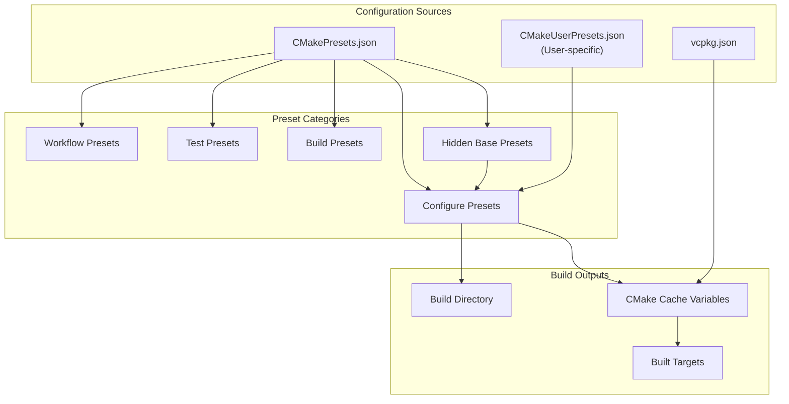
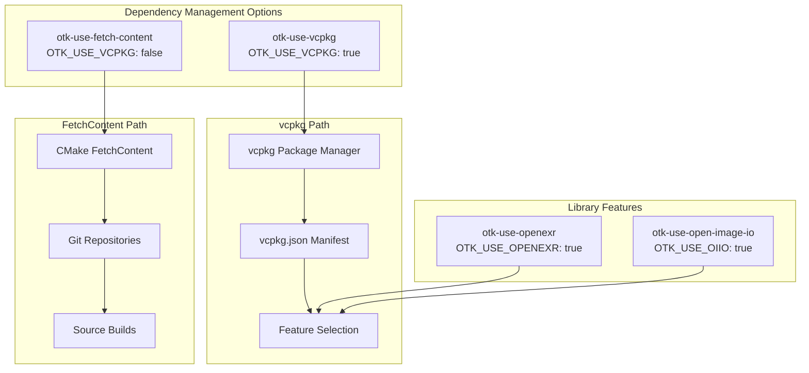
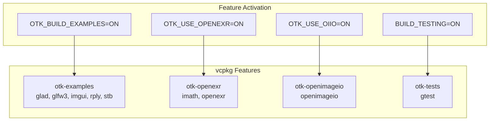
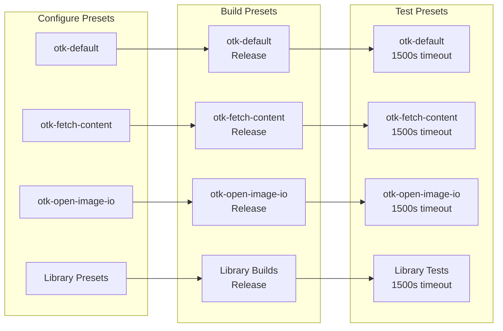

<!-- source: DeepWiki mcp.deepwiki.com · repo NVIDIA/optix-toolkit · page 2.3 Build Configuration · fetched 2026-10-26 -->

# Build Configuration

Relevant source files

The following files were used as context for generating this wiki page:

- [.gitattributes](.gitattributes)
- [.gitignore](.gitignore)
- [CMake/OptiXToolkitConfig.cmake.in](CMake/OptiXToolkitConfig.cmake.in)
- [CMakePresets.json](CMakePresets.json)
- [vcpkg.json](vcpkg.json)

This document covers the build configuration system for the OptiX Toolkit, including CMake presets, vcpkg configuration, and build customization options. The configuration system provides flexible ways to customize which libraries are built, how dependencies are managed, and various build settings.

For information about the overall build system architecture, see page [2.2](#2.2). For details about dependencies and external libraries, see page [2.1](#2.1).

## Configuration System Overview

The OptiX Toolkit uses CMake presets as the primary mechanism for build configuration. The preset system provides a structured way to define reusable build configurations that can be composed and inherited.

**Configuration Flow Overview**
The configuration system processes presets through inheritance and composition to generate final build settings.

Sources: [CMakePresets.json:1-413](), [vcpkg.json:1-42]()

## CMake Preset Categories

The preset system is organized into several categories, each serving a specific purpose in the build configuration process.

### Hidden Base Presets

Hidden presets provide reusable configuration components that can be inherited by public presets. These are not intended for direct use but serve as building blocks.

| Preset Name | Purpose | Key Variables |
|-------------|---------|---------------|
| `otk-child-build-dir-preset` | Sets build directory structure | `binaryDir: ${sourceDir}/build-${presetName}` |
| `otk-project-name-preset` | Configures IDE project naming | `OTK_PROJECT_NAME: "OptiX Toolkit ${presetName}"` |
| `otk-demand-loading-library` | DemandLoading library only | `OTK_LIBRARIES: "DemandLoading"` |
| `otk-memory-library` | Memory library only | `OTK_LIBRARIES: "Memory"` |
| `otk-omm-baking-library` | OmmBaking library only | `OTK_LIBRARIES: "OmmBaking"` |
| `otk-shader-util-library` | ShaderUtil library only | `OTK_LIBRARIES: "ShaderUtil"` |

Sources: [CMakePresets.json:10-72]()

### Build Control Presets

Additional hidden presets control what components are built and how:

| Preset Name | Purpose | Configuration |
|-------------|---------|---------------|
| `otk-no-examples` | Skip example builds | `OTK_BUILD_EXAMPLES: false` |
| `otk-no-tests` | Skip test builds | `BUILD_TESTING: false` |
| `otk-docs` | Enable documentation | `OTK_BUILD_DOCS: true` |
| `otk-warnings-as-errors` | Strict compilation | `OTK_WARNINGS_AS_ERRORS: true` |

Sources: [CMakePresets.json:74-141]()

## Dependency Management Configuration

The OptiX Toolkit supports two primary methods for dependency management, configured through preset selection.

**Dependency Management Configuration**
The system supports both vcpkg and FetchContent for dependency acquisition, with additional feature flags for optional libraries.

Sources: [CMakePresets.json:98-132](), [vcpkg.json:22-34]()

### vcpkg Configuration

When using vcpkg (`OTK_USE_VCPKG: true`), dependencies are managed through the vcpkg manifest system:

**vcpkg Feature Dependencies**
Features in `vcpkg.json` are automatically enabled based on CMake configuration variables.

Sources: [vcpkg.json:5-41]()

## Public Configuration Presets

Public presets combine hidden base presets to provide ready-to-use configurations for common build scenarios.

### General Purpose Presets

| Preset Name | Description | Inheritance | Key Features |
|-------------|-------------|-------------|--------------|
| `otk-default` | Standard vcpkg build | `otk-child-build-dir-preset`, `otk-project-name-preset`, `otk-use-vcpkg` | All libraries, tests, examples |
| `otk-fetch-content` | FetchContent build | `otk-child-build-dir-preset`, `otk-project-name-preset`, `otk-use-fetch-content` | All libraries, tests, examples |
| `otk-open-image-io` | OpenImageIO enabled | `otk-default`, `otk-use-open-image-io` | Additional texture formats |

Sources: [CMakePresets.json:143-159]()

### Library-Specific Presets

For building individual libraries in isolation:

| Preset Name | Target Library | Build Configuration |
|-------------|----------------|-------------------|
| `otk-demand-loading` | DemandLoading only | Tests and examples enabled |
| `otk-memory` | Memory only | Tests only (no examples) |
| `otk-omm-baking` | OmmBaking only | Tests and examples enabled |
| `otk-shader-util` | ShaderUtil only | Tests only (no examples) |

Sources: [CMakePresets.json:161-183]()

## Build and Test Presets

Build and test presets correspond to configure presets, providing consistent execution environments.

**Preset Execution Pipeline**
Configure, build, and test presets form a coordinated pipeline for complete build workflows.

Sources: [CMakePresets.json:185-283]()

## Workflow Presets

Workflow presets combine configure, build, and test steps into complete automation sequences. Each workflow preset defines a three-step process:

1. **Configure**: Set up the build system with the specified preset
2. **Build**: Compile the configured targets
3. **Test**: Execute the test suite

All workflow presets follow the same pattern, with each step referencing the corresponding preset by name.

Sources: [CMakePresets.json:285-412]()

## Key Configuration Variables

The following table summarizes the primary CMake variables that control build behavior:

| Variable | Type | Default | Purpose |
|----------|------|---------|---------|
| `OTK_USE_VCPKG` | BOOL | ON | Use vcpkg for dependencies vs FetchContent |
| `OTK_LIBRARIES` | STRING | ALL | Semicolon-separated list of libraries to build |
| `OTK_BUILD_EXAMPLES` | BOOL | ON | Build example applications |
| `BUILD_TESTING` | BOOL | ON | Build test executables |
| `OTK_BUILD_DOCS` | BOOL | OFF | Build documentation |
| `OTK_USE_OPENEXR` | BOOL | OFF | Enable OpenEXR support |
| `OTK_USE_OIIO` | BOOL | OFF | Enable OpenImageIO support |
| `OTK_WARNINGS_AS_ERRORS` | BOOL | OFF | Treat warnings as errors |
| `OTK_PROJECT_NAME` | STRING | "OptiX Toolkit" | IDE project name |

Sources: [CMakePresets.json:21-139]()

## User Customization

Users can create `CMakeUserPresets.json` to define custom configurations without modifying the main preset file. This file is ignored by Git and allows for local customization.

The user presets file can:
- Define new presets that inherit from existing ones
- Override specific cache variables
- Add custom build configurations
- Specify local paths and settings

Sources: [.gitignore:4]()

---

