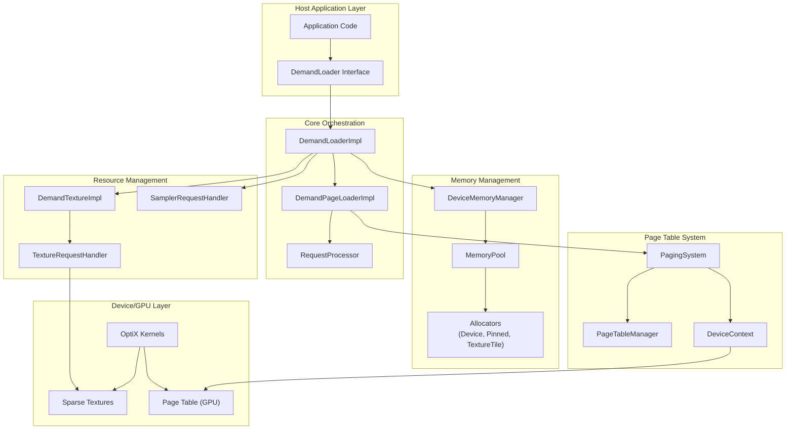
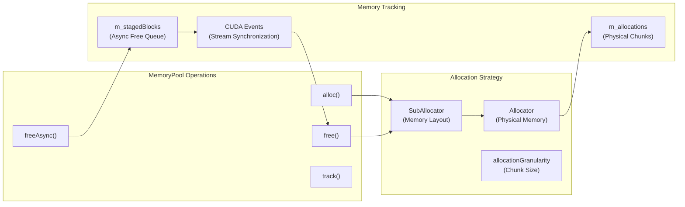
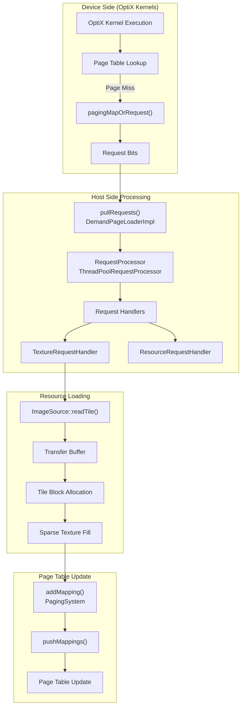
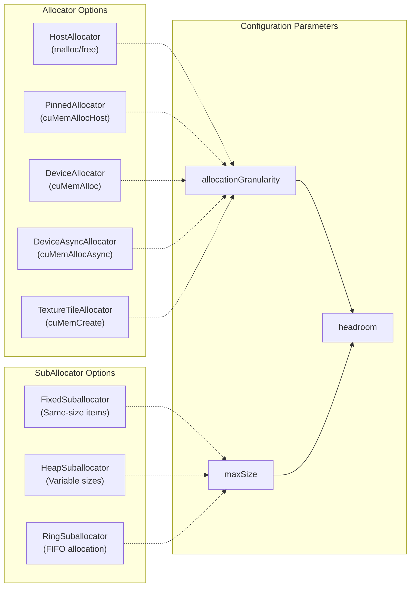
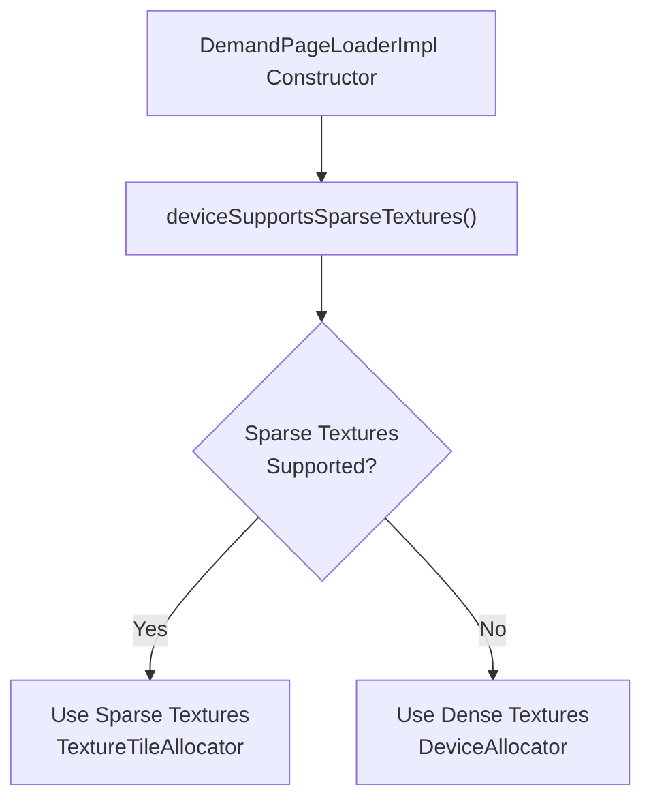

<!-- source: DeepWiki mcp.deepwiki.com · repo NVIDIA/optix-toolkit · page 3 DemandLoading System · fetched 2026-10-26 -->

# DemandLoading System

Relevant source files

The following files were used as context for generating this wiki page:

- [CHANGELOG.md](CHANGELOG.md)
- [DemandLoading/DemandLoading/include/OptiXToolkit/DemandLoading/Options.h](DemandLoading/DemandLoading/include/OptiXToolkit/DemandLoading/Options.h)
- [DemandLoading/DemandLoading/src/DemandLoaderImpl.cpp](DemandLoading/DemandLoading/src/DemandLoaderImpl.cpp)
- [DemandLoading/DemandLoading/src/DemandLoaderImpl.h](DemandLoading/DemandLoading/src/DemandLoaderImpl.h)
- [DemandLoading/DemandLoading/src/DemandPageLoaderImpl.cpp](DemandLoading/DemandLoading/src/DemandPageLoaderImpl.cpp)
- [DemandLoading/DemandLoading/src/Memory/DeviceMemoryManager.cpp](DemandLoading/DemandLoading/src/Memory/DeviceMemoryManager.cpp)
- [DemandLoading/DemandLoading/src/Memory/DeviceMemoryManager.h](DemandLoading/DemandLoading/src/Memory/DeviceMemoryManager.h)
- [DemandLoading/DemandLoading/src/Textures/DemandTextureImpl.h](DemandLoading/DemandLoading/src/Textures/DemandTextureImpl.h)
- [DemandLoading/DemandLoading/src/Textures/TextureRequestHandler.cpp](DemandLoading/DemandLoading/src/Textures/TextureRequestHandler.cpp)
- [DemandLoading/README.md](DemandLoading/README.md)
- [Memory/CHANGELOG.md](Memory/CHANGELOG.md)
- [Memory/LICENSE.txt](Memory/LICENSE.txt)
- [Memory/README.md](Memory/README.md)
- [Memory/include/OptiXToolkit/Memory/Allocators.h](Memory/include/OptiXToolkit/Memory/Allocators.h)
- [Memory/include/OptiXToolkit/Memory/BitCast.h](Memory/include/OptiXToolkit/Memory/BitCast.h)
- [Memory/include/OptiXToolkit/Memory/MemoryPool.h](Memory/include/OptiXToolkit/Memory/MemoryPool.h)
- [README.md](README.md)

The DemandLoading System is the core component of the OptiX Toolkit that enables on-demand loading of texture data and other resources during GPU rendering. This system allows applications to work with textures much larger than available GPU memory by loading only the required portions (tiles) as they are accessed by OptiX shaders.

The system operates through a virtual memory paging mechanism where texture data is divided into tiles that are loaded from storage to GPU memory only when requested. This dramatically reduces memory usage and enables handling of massive texture datasets that would otherwise be impossible to load entirely into GPU memory.

For information about building and configuring the demand loading system, see [Build System](#2.2). For details about example applications using demand loading, see [Example Applications](#5).

## System Architecture

### Core Components Overview

The DemandLoading System consists of several interconnected subsystems that work together to provide seamless on-demand resource loading:

**Sources:** [DemandLoading/DemandLoading/src/DemandLoaderImpl.h:42-205](), [DemandLoading/DemandLoading/src/DemandPageLoaderImpl.cpp:39-54](), [DemandLoading/DemandLoading/src/Memory/DeviceMemoryManager.h:30-124]()

### Memory Management Architecture

The memory management subsystem handles allocation and deallocation of different types of memory required by the demand loading system:

```mermaid
graph TB
    subgraph "Memory Pool System"
        MEMPOOL["MemoryPool&lt;Allocator,SubAllocator&gt;"]
        SAMPLERPAL["SamplerPool<br/>MemoryPool&lt;DeviceAllocator,FixedSuballocator&gt;"]
        TILEPOOL["TilePool<br/>MemoryPool&lt;TextureTileAllocator,HeapSuballocator&gt;"]
        DEVICECTXPOOL["DeviceContextPool<br/>MemoryPool&lt;DeviceAllocator,HeapSuballocator&gt;"]
        PINNEDPOOL["PinnedMemoryPool<br/>MemoryPool&lt;PinnedAllocator,RingSuballocator&gt;"]
    end
    
    subgraph "Allocator Types"
        DEVALLOCATOR["DeviceAllocator<br/>(cuMemAlloc)"]
        DEVICEASYNC["DeviceAsyncAllocator<br/>(cuMemAllocAsync)"]
        PINNEDALLOC["PinnedAllocator<br/>(cuMemAllocHost)"]
        TEXALLOC["TextureTileAllocator<br/>(cuMemCreate)"]
        HOSTALLOC["HostAllocator<br/>(malloc)"]
    end
    
    subgraph "SubAllocator Types"
        FIXEDSUB["FixedSuballocator<br/>(Fixed size items)"]
        HEAPSUB["HeapSuballocator<br/>(Variable size blocks)"]
        RINGSUB["RingSuballocator<br/>(Ring buffer)"]
    end
    
    subgraph "Managed Resources"
        SAMPLERS["TextureSampler Objects"]
        TILES["Texture Tiles"]
        CONTEXTS["DeviceContext Objects"]
        TRANSFERS["Transfer Buffers"]
    end

    MEMPOOL --> SAMPLERPAL
    MEMPOOL --> TILEPOOL
    MEMPOOL --> DEVICECTXPOOL
    MEMPOOL --> PINNEDPOOL
    
    SAMPLERPAL --> DEVALLOCATOR
    SAMPLERPAL --> FIXEDSUB
    SAMPLERPAL --> SAMPLERS
    
    TILEPOOL --> TEXALLOC
    TILEPOOL --> HEAPSUB
    TILEPOOL --> TILES
    
    DEVICECTXPOOL --> DEVALLOCATOR
    DEVICECTXPOOL --> HEAPSUB
    DEVICECTXPOOL --> CONTEXTS
    
    PINNEDPOOL --> PINNEDALLOC
    PINNEDPOOL --> RINGSUB
    PINNEDPOOL --> TRANSFERS
```

**Sources:** [Memory/include/OptiXToolkit/Memory/MemoryPool.h:33-437](), [DemandLoading/DemandLoading/src/Memory/DeviceMemoryManager.h:113-119](), [Memory/include/OptiXToolkit/Memory/Allocators.h:19-199]()

## Core Classes and Interfaces

### DemandLoaderImpl Class

The `DemandLoaderImpl` class serves as the main orchestrator for the demand loading system. It manages texture creation, resource allocation, and coordinates between different subsystems.

| Method | Purpose |
|--------|---------|
| `createTexture()` | Create demand-loaded textures from image sources |
| `createResource()` | Create arbitrary paged resources with custom callbacks |
| `launchPrepare()` | Prepare device context before kernel launch |
| `processRequests()` | Process page requests from device after kernel execution |
| `loadTextureTiles()` | Pre-load specific texture tiles |
| `replaceTexture()` | Replace texture data while preserving loaded tiles |

**Sources:** [DemandLoading/DemandLoading/src/DemandLoaderImpl.h:42-205](), [DemandLoading/DemandLoading/src/DemandLoaderImpl.cpp:124-638]()

### DeviceMemoryManager Class

The `DeviceMemoryManager` handles allocation and tracking of GPU memory resources:

| Component | Memory Pool Type | Purpose |
|-----------|------------------|---------|
| `m_samplerPool` | `MemoryPool<DeviceAllocator,FixedSuballocator>` | Texture sampler objects |
| `m_tilePool` | `MemoryPool<TextureTileAllocator,HeapSuballocator>` | Sparse texture tile storage |
| `m_deviceContextMemory` | `MemoryPool<DeviceAllocator,HeapSuballocator>` | Device context allocation |

**Sources:** [DemandLoading/DemandLoading/src/Memory/DeviceMemoryManager.h:30-124](), [DemandLoading/DemandLoading/src/Memory/DeviceMemoryManager.cpp:16-88]()

### MemoryPool Template Class

The `MemoryPool<Allocator, SubAllocator>` template provides thread-safe memory management with support for immediate and asynchronous deallocation:

**Sources:** [Memory/include/OptiXToolkit/Memory/MemoryPool.h:33-437]()

## Request Processing Pipeline

### Request Flow Architecture

The demand loading system processes texture and resource requests through a multi-stage pipeline:

**Sources:** [DemandLoading/DemandLoading/src/DemandPageLoaderImpl.cpp:100-113](), [DemandLoading/DemandLoading/src/Textures/TextureRequestHandler.cpp:21-162]()

### TextureRequestHandler Processing

The `TextureRequestHandler` manages the loading of individual texture tiles and mip tails:

| Method | Purpose |
|--------|---------|
| `fillTileRequest()` | Load and fill a specific texture tile |
| `fillMipTailRequest()` | Load and fill the mip tail (smallest mip levels) |
| `loadPage()` | General page loading with residency checking |
| `unmapTileResource()` | Unmap tile backing storage during eviction |

**Sources:** [DemandLoading/DemandLoading/src/Textures/TextureRequestHandler.cpp:26-262]()

## Configuration and Options

### DemandLoading Options

The system behavior is controlled through the `Options` structure:

| Category | Key Options | Default Values |
|----------|-------------|----------------|
| **Page Table** | `numPages`, `numPageTableEntries` | 64M pages, 1M entries |
| **Request Processing** | `maxRequestedPages`, `maxFilledPages` | 8192 each |
| **Memory Limits** | `maxTexMemPerDevice`, `maxPinnedMemory` | 0 (unlimited), 64MB |
| **Eviction** | `maxStalePages`, `evictionActive` | 8192, true |
| **Concurrency** | `maxThreads` | 0 (auto-detect) |

**Sources:** [DemandLoading/DemandLoading/include/OptiXToolkit/DemandLoading/Options.h:18-54]()

### Memory Pool Configuration

Memory pools can be configured with different allocator and suballocator combinations:

**Sources:** [Memory/include/OptiXToolkit/Memory/Allocators.h:19-199](), [Memory/include/OptiXToolkit/Memory/MemoryPool.h:37-48]()

## Integration with OptiX

### Device Context and Kernel Integration

The system provides a `DeviceContext` structure that must be passed to OptiX kernels to enable demand loading functionality:

| DeviceContext Fields | Purpose |
|---------------------|---------|
| `pageTable` | Device-side page table for virtual address translation |
| `requestArray` | Array for recording page requests |
| `residenceBits` | Bit array tracking page residency |
| `evictionActive` | Controls whether eviction is enabled |

The kernel-side interface uses functions like `pagingMapOrRequest()` to check page residency and record requests when pages are not resident.

**Sources:** [DemandLoading/DemandLoading/src/DemandLoaderImpl.cpp:449-477]()

### Sparse Texture Support

The system automatically detects sparse texture support and falls back to dense textures when necessary:

**Sources:** [DemandLoading/DemandLoading/src/DemandPageLoaderImpl.cpp:30-36]()

---

