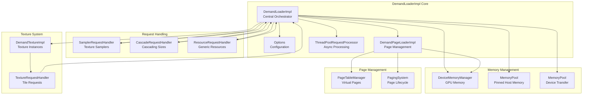
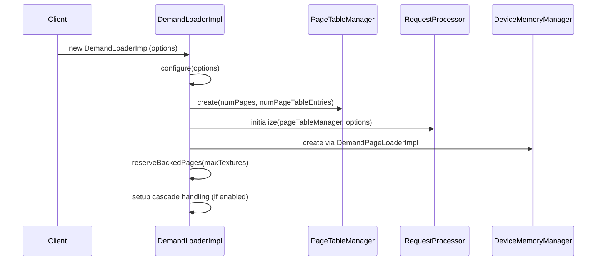
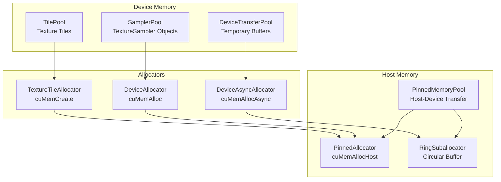
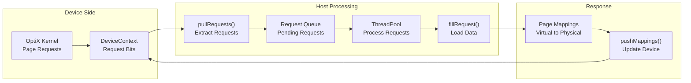
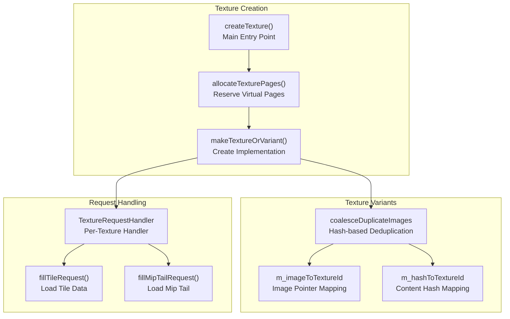

<!-- source: DeepWiki mcp.deepwiki.com · repo NVIDIA/optix-toolkit · page 3.1 DemandLoader Implementation · fetched 2026-10-26 -->

# DemandLoader Implementation

Relevant source files

The following files were used as context for generating this wiki page:

- [DemandLoading/DemandLoading/include/OptiXToolkit/DemandLoading/Options.h](DemandLoading/DemandLoading/include/OptiXToolkit/DemandLoading/Options.h)
- [DemandLoading/DemandLoading/src/DemandLoaderImpl.cpp](DemandLoading/DemandLoading/src/DemandLoaderImpl.cpp)
- [DemandLoading/DemandLoading/src/DemandLoaderImpl.h](DemandLoading/DemandLoading/src/DemandLoaderImpl.h)
- [DemandLoading/DemandLoading/src/DemandPageLoaderImpl.cpp](DemandLoading/DemandLoading/src/DemandPageLoaderImpl.cpp)
- [DemandLoading/DemandLoading/src/Memory/DeviceMemoryManager.cpp](DemandLoading/DemandLoading/src/Memory/DeviceMemoryManager.cpp)
- [DemandLoading/DemandLoading/src/Memory/DeviceMemoryManager.h](DemandLoading/DemandLoading/src/Memory/DeviceMemoryManager.h)
- [DemandLoading/DemandLoading/src/Textures/DemandTextureImpl.h](DemandLoading/DemandLoading/src/Textures/DemandTextureImpl.h)
- [DemandLoading/DemandLoading/src/Textures/TextureRequestHandler.cpp](DemandLoading/DemandLoading/src/Textures/TextureRequestHandler.cpp)
- [Memory/include/OptiXToolkit/Memory/Allocators.h](Memory/include/OptiXToolkit/Memory/Allocators.h)
- [Memory/include/OptiXToolkit/Memory/MemoryPool.h](Memory/include/OptiXToolkit/Memory/MemoryPool.h)

This document covers the core implementation of the demand loading system, focusing on the `DemandLoaderImpl` class and its associated components. This system provides the central orchestration for texture and resource loading on-demand in OptiX applications.

For information about memory management details, see [Memory Management](#3.2). For texture filtering specifics, see [Texture Filtering and Quality](#3.3). For overall system architecture, see [System Architecture](#1.2).

## System Overview

The demand loader implementation is built around the `DemandLoaderImpl` class, which serves as the central coordinator for all demand loading operations. It manages texture creation, memory allocation, request processing, and resource lifecycle management across multiple CUDA streams and contexts.

## Core Architecture

The following diagram shows the main components of the DemandLoader implementation and their relationships:

Sources: [DemandLoading/DemandLoading/src/DemandLoaderImpl.h:44-206](), [DemandLoading/DemandLoading/src/DemandLoaderImpl.cpp:124-156]()

## DemandLoaderImpl Class Structure

The `DemandLoaderImpl` class manages several key subsystems:

| Component | Type | Purpose |
|-----------|------|---------|
| `m_options` | `std::shared_ptr<Options>` | Configuration parameters |
| `m_pageTableManager` | `std::shared_ptr<PageTableManager>` | Virtual page allocation |
| `m_requestProcessor` | `ThreadPoolRequestProcessor` | Asynchronous request processing |
| `m_pageLoader` | `std::unique_ptr<DemandPageLoaderImpl>` | Page loading operations |
| `m_textures` | `std::map<unsigned int, std::unique_ptr<DemandTextureImpl>>` | Active textures |
| `m_samplerRequestHandler` | `SamplerRequestHandler` | Texture sampler requests |
| `m_deviceTransferPool` | `MemoryPool<DeviceAsyncAllocator, RingSuballocator>` | Device transfer buffers |

Sources: [DemandLoading/DemandLoading/src/DemandLoaderImpl.h:175-195]()

## Initialization and Configuration

The `DemandLoaderImpl` constructor performs several critical setup operations:

The constructor includes option validation and memory pool initialization:

- **Option Configuration**: [DemandLoading/DemandLoading/src/DemandLoaderImpl.cpp:109-122]()
- **Page Reservation**: [DemandLoading/DemandLoading/src/DemandLoaderImpl.cpp:139-149]()
- **Memory Pool Setup**: [DemandLoading/DemandLoading/src/DemandLoaderImpl.cpp:131-132]()

Sources: [DemandLoading/DemandLoading/src/DemandLoaderImpl.cpp:124-150]()

## Memory Management Architecture

The demand loader uses a multi-tier memory management system:

### Memory Pool Types

The system uses specialized memory pools for different allocation patterns:

- **Pinned Memory Pool**: Circular buffer for host-device transfers [DemandLoading/DemandLoading/src/DemandPageLoaderImpl.cpp:49]()
- **Sampler Pool**: Fixed-size allocations for `TextureSampler` objects [DemandLoading/DemandLoading/src/Memory/DeviceMemoryManager.cpp:18]()
- **Tile Pool**: Sparse texture tile storage using virtual memory [DemandLoading/DemandLoading/src/Memory/DeviceMemoryManager.cpp:24-26]()
- **Device Transfer Pool**: Temporary buffers for data transfer [DemandLoading/DemandLoading/src/DemandLoaderImpl.cpp:131]()

Sources: [Memory/include/OptiXToolkit/Memory/MemoryPool.h:29-435](), [DemandLoading/DemandLoading/src/Memory/DeviceMemoryManager.h:30-125]()

## Request Processing Pipeline

The demand loader implements an asynchronous request processing pipeline:

### Key Processing Methods

| Method | Purpose | Location |
|--------|---------|----------|
| `processRequests()` | Extract requests from device context | [DemandLoading/DemandLoading/src/DemandLoaderImpl.cpp:456-478]() |
| `pullRequests()` | Launch kernel to scan request bits | [DemandLoading/DemandLoading/src/DemandPageLoaderImpl.cpp:100-113]() |
| `launchPrepare()` | Update device page tables | [DemandLoading/DemandLoading/src/DemandLoaderImpl.cpp:449-454]() |
| `fillRequest()` | Load and transfer texture data | [DemandLoading/DemandLoading/src/Textures/TextureRequestHandler.cpp:21-24]() |

Sources: [DemandLoading/DemandLoading/src/DemandLoaderImpl.cpp:456-478](), [DemandLoading/DemandLoading/src/DemandPageLoaderImpl.cpp:100-113]()

## Texture Management

The demand loader manages textures through the `DemandTextureImpl` class and associated request handlers:

### Texture Deduplication

The system supports two forms of texture deduplication:

- **Pointer-based**: Multiple textures sharing the same `ImageSource` instance [DemandLoading/DemandLoading/src/DemandLoaderImpl.cpp:238-244]()
- **Content-based**: Textures with identical content identified by hash [DemandLoading/DemandLoading/src/DemandLoaderImpl.cpp:248-258]()

Sources: [DemandLoading/DemandLoading/src/DemandLoaderImpl.cpp:157-275](), [DemandLoading/DemandLoading/src/Textures/TextureRequestHandler.cpp:21-162]()

## Configuration Options

The demand loader behavior is controlled through the `Options` structure:

| Category | Key Options | Purpose |
|----------|-------------|---------|
| **Page Table** | `numPages`, `numPageTableEntries` | Virtual memory space size |
| **Memory Limits** | `maxTexMemPerDevice`, `maxPinnedMemory` | Resource constraints |
| **Request Processing** | `maxRequestedPages`, `maxFilledPages` | Batch processing sizes |
| **Optimizations** | `useSparseTextures`, `coalesceWhiteBlackTiles` | Performance features |
| **Eviction** | `maxStalePages`, `evictionActive` | Memory management |

The options are validated and configured during initialization:
- Unlimited memory handling [DemandLoading/DemandLoading/src/DemandLoaderImpl.cpp:112-113]()
- Capacity validation [DemandLoading/DemandLoading/src/DemandLoaderImpl.cpp:116-117]()

Sources: [DemandLoading/DemandLoading/include/OptiXToolkit/DemandLoading/Options.h:16-57](), [DemandLoading/DemandLoading/src/DemandLoaderImpl.cpp:109-122]()

## Thread Safety and Synchronization

The demand loader implements thread safety through several mechanisms:

- **Mutex Protection**: Main operations protected by `m_mutex` [DemandLoading/DemandLoading/src/DemandLoaderImpl.h:175]()
- **Per-Page Locking**: Tile loading uses `MutexArray` for fine-grained locking [DemandLoading/DemandLoading/src/Textures/TextureRequestHandler.cpp:34]()
- **Context Validation**: CUDA context checking throughout operations [DemandLoading/DemandLoading/src/DemandLoaderImpl.cpp:134]()
- **Async Processing**: Background thread pool for request processing [DemandLoading/DemandLoading/src/DemandLoaderImpl.h:181]()

Sources: [DemandLoading/DemandLoading/src/DemandLoaderImpl.cpp:163-164](), [DemandLoading/DemandLoading/src/Textures/TextureRequestHandler.cpp:33-35]()

---

