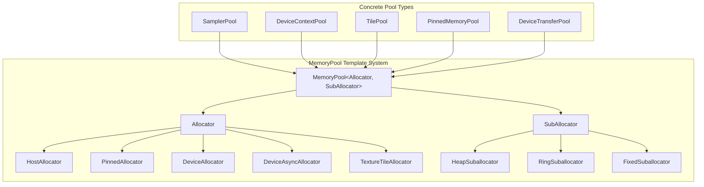
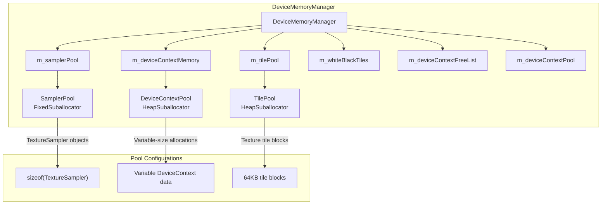
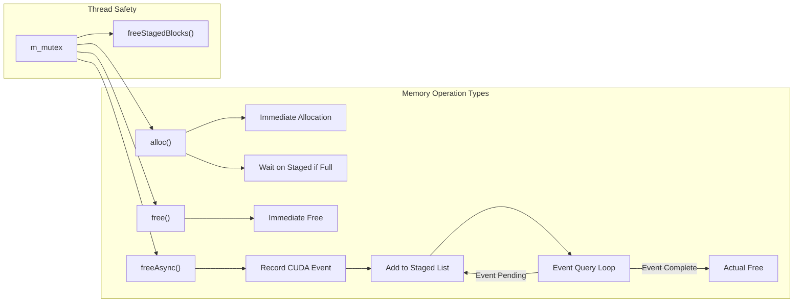
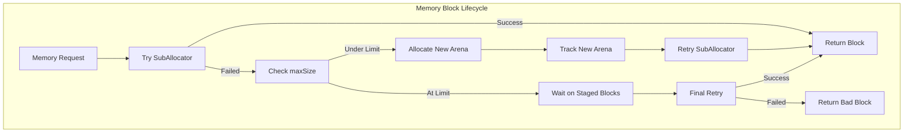
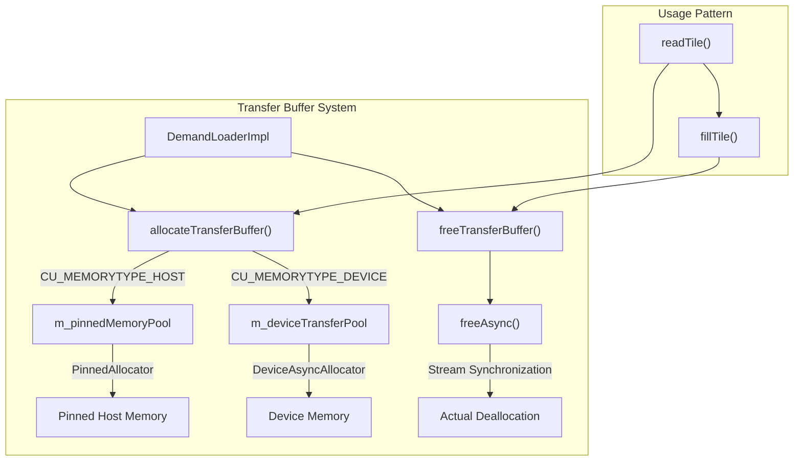
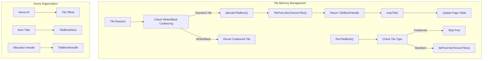
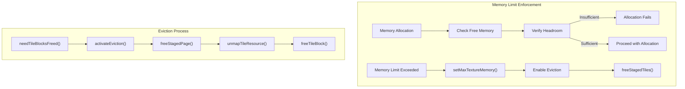
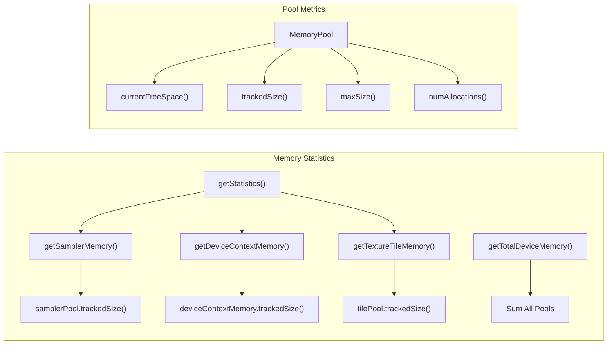

<!-- source: DeepWiki mcp.deepwiki.com · repo NVIDIA/optix-toolkit · page 3.2 Memory Management · fetched 2026-10-26 -->

# Memory Management

Relevant source files

The following files were used as context for generating this wiki page:

- [CHANGELOG.md](CHANGELOG.md)
- [DemandLoading/DemandLoading/include/OptiXToolkit/DemandLoading/Options.h](DemandLoading/DemandLoading/include/OptiXToolkit/DemandLoading/Options.h)
- [DemandLoading/DemandLoading/src/DemandLoaderImpl.cpp](DemandLoading/DemandLoading/src/DemandLoaderImpl.cpp)
- [DemandLoading/DemandLoading/src/DemandLoaderImpl.h](DemandLoading/DemandLoading/src/DemandLoaderImpl.h)
- [DemandLoading/DemandLoading/src/DemandPageLoaderImpl.cpp](DemandLoading/DemandLoading/src/DemandPageLoaderImpl.cpp)
- [DemandLoading/DemandLoading/src/Memory/DeviceMemoryManager.cpp](DemandLoading/DemandLoading/src/Memory/DeviceMemoryManager.cpp)
- [DemandLoading/DemandLoading/src/Memory/DeviceMemoryManager.h](DemandLoading/DemandLoading/src/Memory/DeviceMemoryManager.h)
- [DemandLoading/DemandLoading/src/Textures/DemandTextureImpl.h](DemandLoading/DemandLoading/src/Textures/DemandTextureImpl.h)
- [DemandLoading/DemandLoading/src/Textures/TextureRequestHandler.cpp](DemandLoading/DemandLoading/src/Textures/TextureRequestHandler.cpp)
- [DemandLoading/README.md](DemandLoading/README.md)
- [Memory/CHANGELOG.md](Memory/CHANGELOG.md)
- [Memory/LICENSE.txt](Memory/LICENSE.txt)
- [Memory/README.md](Memory/README.md)
- [Memory/include/OptiXToolkit/Memory/Allocators.h](Memory/include/OptiXToolkit/Memory/Allocators.h)
- [Memory/include/OptiXToolkit/Memory/BitCast.h](Memory/include/OptiXToolkit/Memory/BitCast.h)
- [Memory/include/OptiXToolkit/Memory/MemoryPool.h](Memory/include/OptiXToolkit/Memory/MemoryPool.h)
- [README.md](README.md)

The Memory Management system provides thread-safe memory allocation and pooling infrastructure for the OptiX Toolkit's demand loading operations. This system manages various types of memory including host memory, pinned memory, device memory, and specialized texture tile storage across multiple CUDA contexts and streams.

For information about the broader demand loading architecture, see [DemandLoader Implementation](#3.1). For details about texture processing and filtering, see [Texture Filtering and Quality](#3.3).

## Memory Pool Architecture

The memory management system is built around a flexible `MemoryPool` template class that combines different allocators and sub-allocators to handle various memory allocation patterns and performance requirements.

### Memory Pool Template Structure

Sources: [Memory/include/OptiXToolkit/Memory/MemoryPool.h:29-436](), [Memory/include/OptiXToolkit/Memory/Allocators.h:14-199](), [DemandLoading/DemandLoading/src/Memory/DeviceMemoryManager.h:113-116]()

### Allocator Types

| Allocator Type | Memory Location | Allocation Method | Handle-Based |
|----------------|-----------------|-------------------|---------------|
| `HostAllocator` | Host RAM | `malloc`/`free` | No |
| `PinnedAllocator` | Pinned Host | `cuMemAllocHost` | No |
| `DeviceAllocator` | GPU VRAM | `cuMemAlloc` | No |
| `DeviceAsyncAllocator` | GPU VRAM | `cuMemAllocAsync` | No |
| `TextureTileAllocator` | GPU VRAM | `cuMemCreate` | Yes |

Sources: [Memory/include/OptiXToolkit/Memory/Allocators.h:19-198]()

## Device Memory Manager

The `DeviceMemoryManager` serves as the central coordinator for all GPU memory operations within the demand loading system, managing multiple specialized memory pools.

### Device Memory Manager Structure

Sources: [DemandLoading/DemandLoading/src/Memory/DeviceMemoryManager.h:30-125](), [DemandLoading/DemandLoading/src/Memory/DeviceMemoryManager.cpp:16-88]()

### Memory Pool Specializations

The system uses three main types of memory pools, each optimized for specific allocation patterns:

**Sampler Pool**: Fixed-size allocations for `TextureSampler` objects
- Uses `FixedSuballocator` for uniform object sizes
- Pool allocation size: 65536 bytes
- Thread-safe allocation and deallocation

**Device Context Pool**: Variable-size allocations for per-stream and per-device data
- Uses `HeapSuballocator` for flexible allocation sizes
- Manages both per-device shared data and per-stream private data
- Implements object pooling with free list for reuse

**Tile Pool**: Specialized management of texture tile memory blocks
- Uses `TextureTileAllocator` with `cuMemCreate` for sparse texture support
- Manages 64KB tile blocks with arena-based organization
- Supports memory-mapped texture operations

Sources: [DemandLoading/DemandLoading/src/Memory/DeviceMemoryManager.cpp:14-27](), [DemandLoading/DemandLoading/src/Memory/DeviceMemoryManager.h:113-116]()

## Memory Operations and Thread Safety

### Synchronous and Asynchronous Operations

The memory system supports both immediate and stream-ordered memory operations to optimize performance and ensure correctness.

Sources: [Memory/include/OptiXToolkit/Memory/MemoryPool.h:121-175](), [Memory/include/OptiXToolkit/Memory/MemoryPool.h:255-273](), [Memory/include/OptiXToolkit/Memory/MemoryPool.h:394-414]()

### Memory Block Management

Sources: [Memory/include/OptiXToolkit/Memory/MemoryPool.h:134-174]()

## Integration with Demand Loading

### Transfer Buffer Management

The demand loading system uses memory pools to manage temporary transfer buffers for moving data between host and device during texture tile loading operations.

Sources: [DemandLoading/DemandLoading/src/DemandLoaderImpl.cpp:538-564](), [DemandLoading/DemandLoading/src/DemandLoaderImpl.h:191]()

### Texture Tile Memory Management

Texture tiles use specialized memory management through the `TilePool` to support sparse texture operations.

Sources: [DemandLoading/DemandLoading/src/Textures/TextureRequestHandler.cpp:78-89](), [DemandLoading/DemandLoading/src/Memory/DeviceMemoryManager.h:46-65](), [Memory/include/OptiXToolkit/Memory/MemoryPool.h:195-210]()

## Memory Limits and Eviction

### Memory Constraint Management

The system implements sophisticated memory limit enforcement with eviction support to prevent out-of-memory conditions.

| Memory Type | Default Limit | Configuration |
|-------------|---------------|---------------|
| Texture Tiles | Unlimited (0) | `maxTexMemPerDevice` |
| Pinned Memory | 64 MB | `maxPinnedMemory` |
| Device Transfer | Unlimited | Controlled by granularity |

Sources: [Memory/include/OptiXToolkit/Memory/MemoryPool.h:136-145](), [DemandLoading/DemandLoading/src/DemandLoaderImpl.cpp:523-536](), [DemandLoading/DemandLoading/src/Memory/DeviceMemoryManager.h:91-96]()

## Memory Statistics and Monitoring

The system provides comprehensive memory usage statistics for monitoring and debugging purposes.

### Statistics Collection

Sources: [DemandLoading/DemandLoading/src/Memory/DeviceMemoryManager.h:104-109](), [Memory/include/OptiXToolkit/Memory/MemoryPool.h:303-320]()

---

