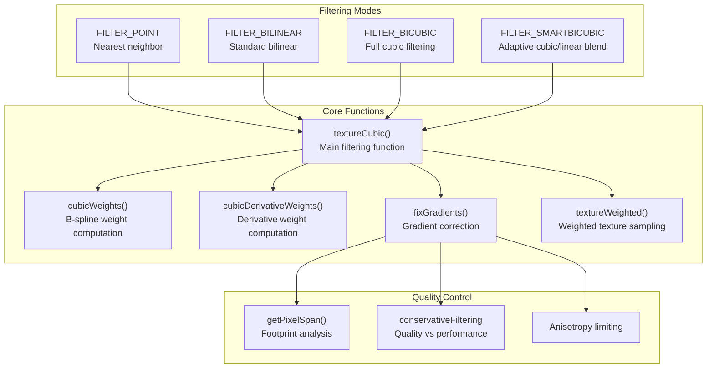
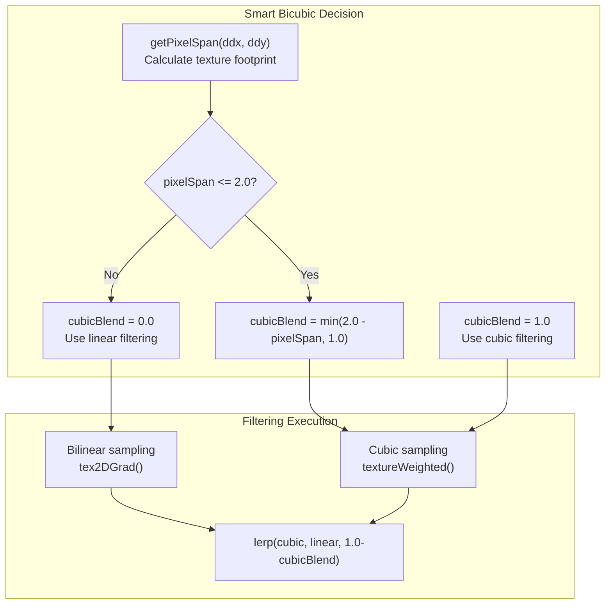
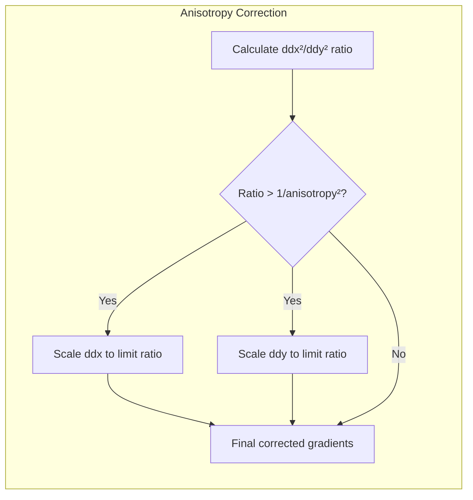
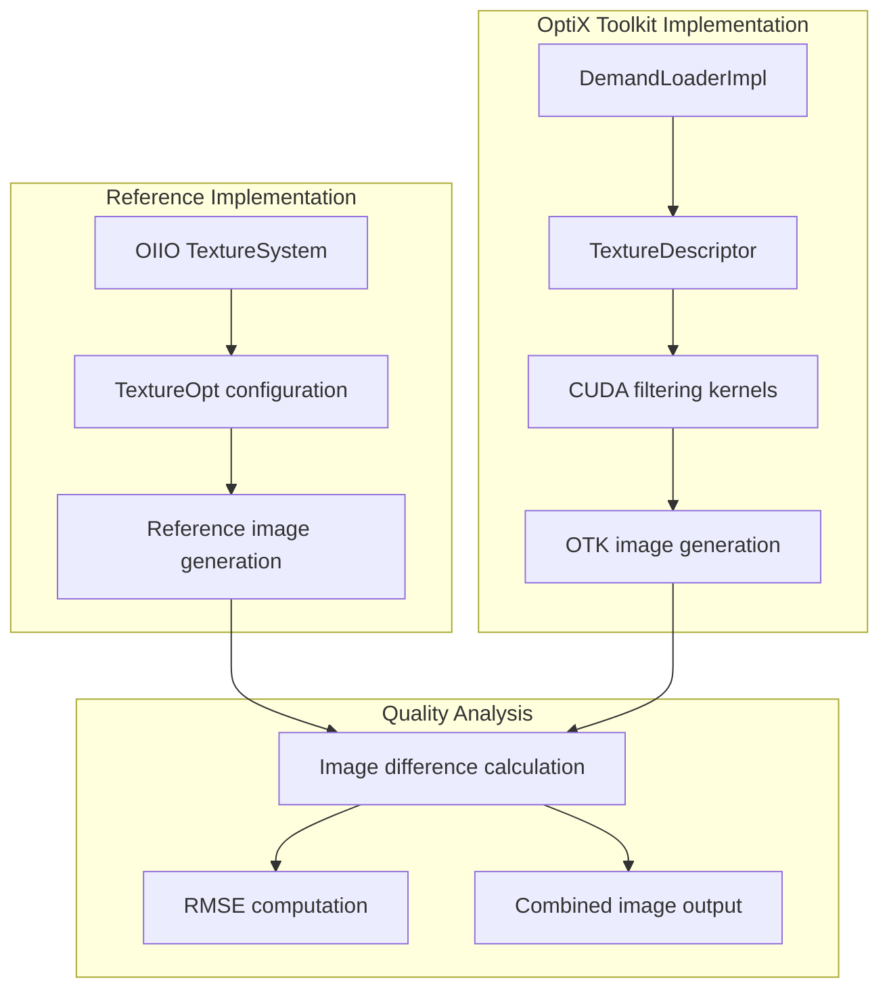
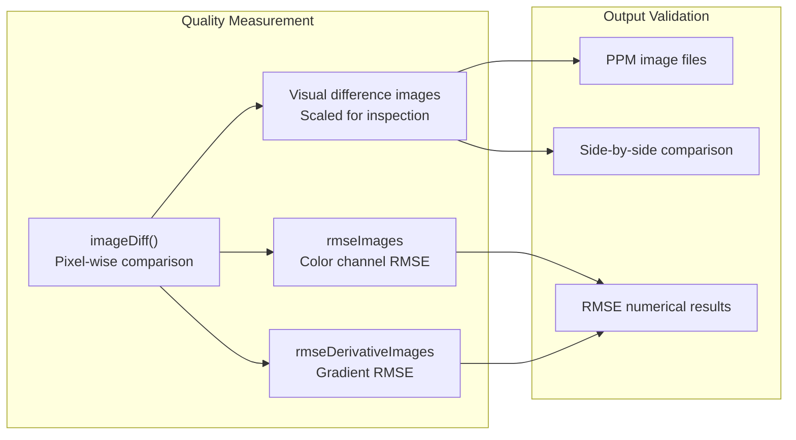

<!-- source: DeepWiki mcp.deepwiki.com · repo NVIDIA/optix-toolkit · page 3.3 Texture Filtering and Quality · fetched 2026-10-26 -->

# Texture Filtering and Quality

Relevant source files

The following files were used as context for generating this wiki page:

- [DemandLoading/DemandLoading/tests/CMakeLists.txt](DemandLoading/DemandLoading/tests/CMakeLists.txt)
- [DemandLoading/DemandLoading/tests/TestCubicFiltering.cpp](DemandLoading/DemandLoading/tests/TestCubicFiltering.cpp)
- [DemandLoading/DemandLoading/tests/TestCubicFiltering.cu](DemandLoading/DemandLoading/tests/TestCubicFiltering.cu)
- [DemandLoading/DemandLoading/tests/TestCubicFiltering.h](DemandLoading/DemandLoading/tests/TestCubicFiltering.h)
- [DemandLoading/DemandLoading/tests/TestDemandTexture.cpp](DemandLoading/DemandLoading/tests/TestDemandTexture.cpp)
- [DemandLoading/DemandLoading/tests/TestSparseTexture.cu](DemandLoading/DemandLoading/tests/TestSparseTexture.cu)
- [DemandLoading/DemandLoading/tests/TestSparseTexture.h](DemandLoading/DemandLoading/tests/TestSparseTexture.h)
- [ShaderUtil/include/OptiXToolkit/ShaderUtil/CubicFiltering.h](ShaderUtil/include/OptiXToolkit/ShaderUtil/CubicFiltering.h)

## Purpose and Scope

This document covers the OptiX Toolkit's advanced texture filtering system, focusing on cubic filtering algorithms and quality validation mechanisms. The system provides high-quality texture filtering for demand-loaded textures with particular emphasis on cubic and smart bicubic filtering modes. Quality validation is performed through comprehensive testing against reference implementations.

For basic texture sampling and demand loading mechanics, see [DemandLoader Implementation](#3.1). For memory management of texture data, see [Memory Management](#3.2).

## Filtering Mode Architecture

The texture filtering system supports multiple filtering modes through a unified interface, with specialized implementations for different quality levels.

**Sources:** [ShaderUtil/include/OptiXToolkit/ShaderUtil/CubicFiltering.h:98-236](), [DemandLoading/DemandLoading/tests/TestCubicFiltering.cpp:376-425]()

## Cubic Filtering Implementation

The cubic filtering algorithm implements B-spline interpolation with derivative computation for high-quality texture sampling.

### Weight Computation

The system uses B-spline basis functions for cubic interpolation:

| Function | Purpose | Implementation |
|----------|---------|----------------|
| `cubicWeights()` | Computes 4-tap B-spline weights | [CubicFiltering.h:13-21]() |
| `cubicDerivativeWeights()` | Computes derivative weights for gradients | [CubicFiltering.h:23-31]() |
| `textureWeighted()` | Performs weighted texture sampling | [CubicFiltering.h:79-94]() |

### Smart Bicubic Algorithm

Smart bicubic filtering adaptively blends between linear and cubic filtering based on the texture footprint:

**Sources:** [ShaderUtil/include/OptiXToolkit/ShaderUtil/CubicFiltering.h:106-116](), [ShaderUtil/include/OptiXToolkit/ShaderUtil/CubicFiltering.h:33-38]()

## Gradient Correction System

The `fixGradients()` function ensures proper filtering behavior by correcting texture coordinate gradients for various edge cases:

### Gradient Correction Features

| Correction Type | Purpose | Implementation |
|-----------------|---------|----------------|
| Zero gradient handling | Prevents degenerate filtering | [CubicFiltering.h:55-59]() |
| Short gradient handling | Ensures minimum filtering quality | [CubicFiltering.h:61-65]() |
| Anisotropy limiting | Controls maximum anisotropic ratio | [CubicFiltering.h:67-76]() |
| Conservative filtering | Maintains quality vs performance balance | [CubicFiltering.h:40-77]() |

### Anisotropy Control

The system limits anisotropic filtering to prevent excessive quality degradation:

**Sources:** [ShaderUtil/include/OptiXToolkit/ShaderUtil/CubicFiltering.h:40-77]()

## Quality Validation Framework

The system includes comprehensive quality validation through comparison with reference implementations.

### Test Framework Architecture

**Sources:** [DemandLoading/DemandLoading/tests/TestCubicFiltering.cpp:177-220](), [DemandLoading/DemandLoading/tests/TestCubicFiltering.cpp:224-301]()

### Test Scenarios

The validation system tests multiple scenarios to ensure quality across different use cases:

| Test Case | Purpose | Configuration |
|-----------|---------|---------------|
| `mip0` | Base mip level testing | Small gradients, high detail |
| `mip3` | Mid-level mip testing | Medium gradients, anisotropic |
| `mip4` | High mip level testing | Large gradients, heavy filtering |
| `smartBicubic` | Adaptive filtering | Variable pixel spans |
| `nonConservative` | Performance mode | Relaxed quality constraints |
| `wrap` | Texture wrapping | Edge case handling |

**Sources:** [DemandLoading/DemandLoading/tests/TestCubicFiltering.cpp:370-628]()

### Quality Metrics

The system computes multiple quality metrics for validation:

**Sources:** [DemandLoading/DemandLoading/tests/TestCubicFiltering.cpp:147-158](), [DemandLoading/DemandLoading/tests/TestCubicFiltering.cpp:305-355]()

## Performance Considerations

The filtering system balances quality and performance through several mechanisms:

### Conservative vs Non-Conservative Filtering

| Mode | Quality | Performance | Use Case |
|------|---------|-------------|----------|
| Conservative | Higher | Lower | Final rendering, quality-critical applications |
| Non-Conservative | Lower | Higher | Interactive rendering, real-time applications |

### Mipmap Level Blending

For `FILTER_BICUBIC` mode, the system performs tri-linear blending between adjacent mip levels:

- Single level sampling for performance
- Dual level sampling for quality
- Fractional mip level interpolation

**Sources:** [ShaderUtil/include/OptiXToolkit/ShaderUtil/CubicFiltering.h:194-236](), [DemandLoading/DemandLoading/tests/TestCubicFiltering.cpp:551-583]()

## Integration with Demand Loading

The cubic filtering system integrates seamlessly with the demand loading infrastructure:

- Operates on demand-loaded texture tiles
- Supports both sparse and dense textures  
- Handles texture coordinate derivatives for proper mip level selection
- Works with texture wrapping and clamping modes

The system validates quality through extensive testing, ensuring that the cubic filtering implementation matches reference implementations within acceptable tolerances while providing the performance benefits of GPU-accelerated demand loading.

**Sources:** [DemandLoading/DemandLoading/tests/TestCubicFiltering.cu:14-77](), [DemandLoading/DemandLoading/tests/TestDemandTexture.cpp:491-540]()

---

