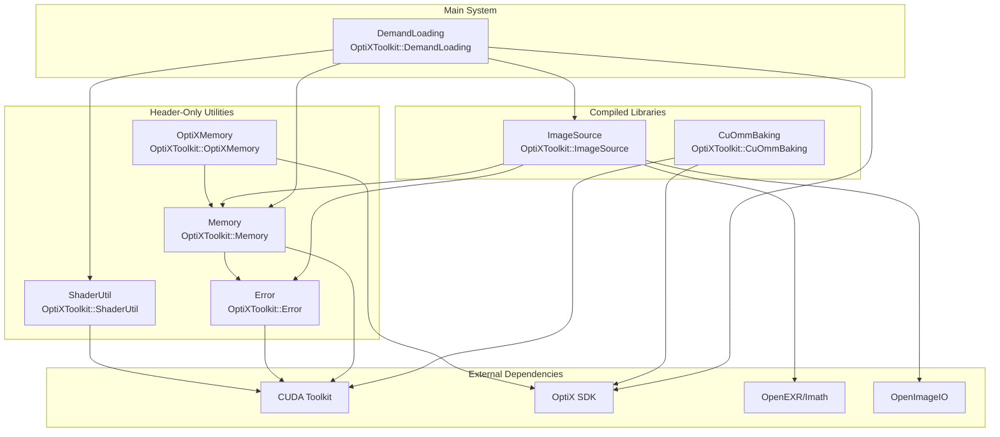
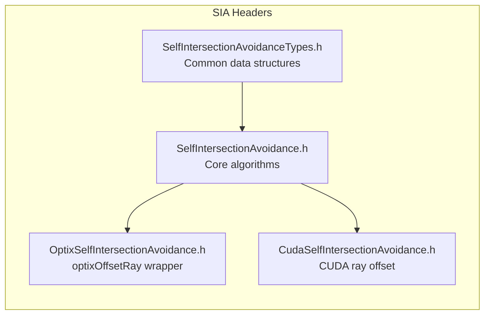
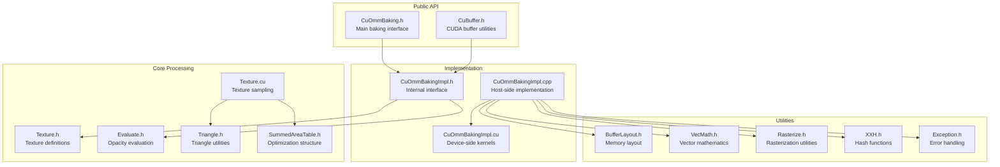
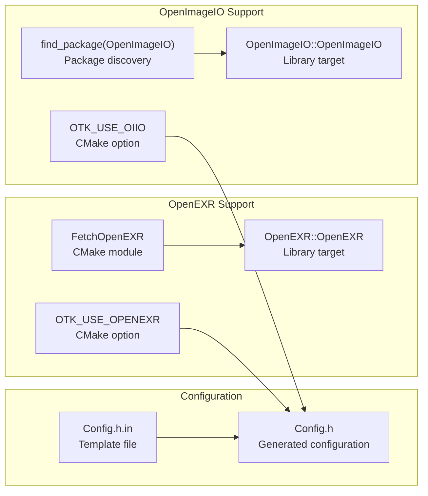
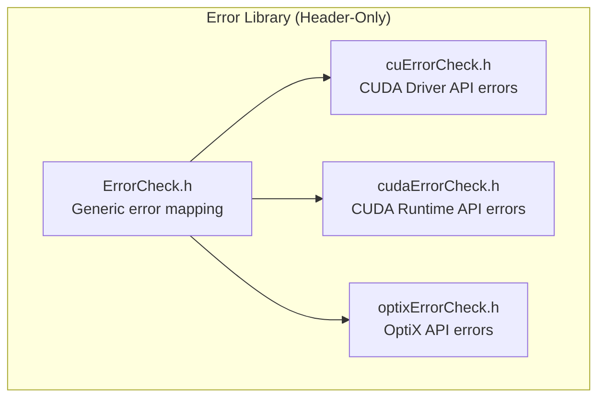
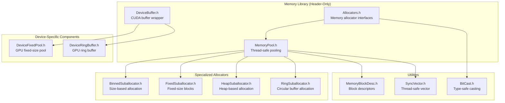
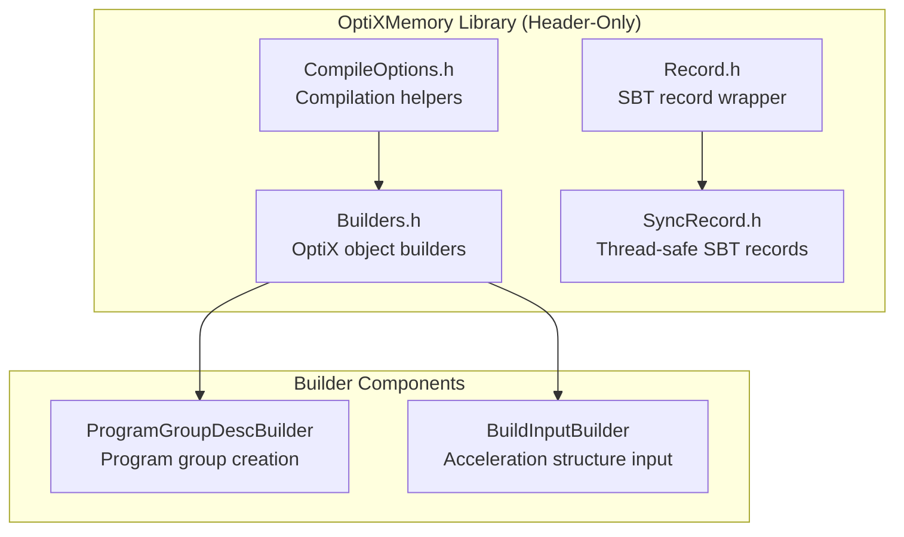
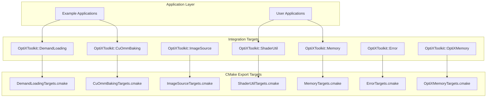

<!-- source: DeepWiki mcp.deepwiki.com · repo NVIDIA/optix-toolkit · page 4 Other Core Libraries · fetched 2026-10-26 -->

# Other Core Libraries

Relevant source files

The following files were used as context for generating this wiki page:

- [CHANGELOG.md](CHANGELOG.md)
- [CMake/SetCxxStandard.cmake](CMake/SetCxxStandard.cmake)
- [DemandLoading/DemandGeometry/CMakeLists.txt](DemandLoading/DemandGeometry/CMakeLists.txt)
- [DemandLoading/DemandLoading/CMakeLists.txt](DemandLoading/DemandLoading/CMakeLists.txt)
- [DemandLoading/ImageSource/CMakeLists.txt](DemandLoading/ImageSource/CMakeLists.txt)
- [DemandLoading/ImageSource/include/OptiXToolkit/ImageSource/EXRReader.h](DemandLoading/ImageSource/include/OptiXToolkit/ImageSource/EXRReader.h)
- [DemandLoading/README.md](DemandLoading/README.md)
- [Memory/CHANGELOG.md](Memory/CHANGELOG.md)
- [Memory/CMakeLists.txt](Memory/CMakeLists.txt)
- [Memory/LICENSE.txt](Memory/LICENSE.txt)
- [Memory/README.md](Memory/README.md)
- [Memory/include/OptiXToolkit/Memory/BitCast.h](Memory/include/OptiXToolkit/Memory/BitCast.h)
- [OmmBaking/CMakeLists.txt](OmmBaking/CMakeLists.txt)
- [README.md](README.md)
- [ShaderUtil/CMakeLists.txt](ShaderUtil/CMakeLists.txt)
- [examples/CMakeLists.txt](examples/CMakeLists.txt)
- [examples/CuOmmBaking/Simple/CMakeLists.txt](examples/CuOmmBaking/Simple/CMakeLists.txt)
- [examples/CuOmmBaking/Viewer/CMakeLists.txt](examples/CuOmmBaking/Viewer/CMakeLists.txt)

This page documents the supporting libraries that complement the DemandLoading system in the OptiX Toolkit. These libraries provide essential functionality for shader utilities, image processing, memory management, and opacity micromap baking. For information about the main DemandLoading system, see [DemandLoading System](#3). For build configuration and dependencies, see [Build System](#2.2).

## Library Overview

The OptiX Toolkit includes several specialized libraries that work together to provide a complete ray tracing development environment:

**Library Dependency Relationships**

Sources: [README.md:20-26](), [ShaderUtil/CMakeLists.txt:27-28](), [Memory/CMakeLists.txt:45-108](), [DemandLoading/ImageSource/CMakeLists.txt:24-25](), [OmmBaking/CMakeLists.txt:61-62]()

## ShaderUtil Library

`ShaderUtil` is a header-only library providing mathematical utilities and helper functions for OptiX device code. It implements common operations needed in ray tracing kernels without requiring separate compilation.

### Core Components

```mermaid
graph TD
    ShaderUtilLib["ShaderUtil Library<br/>INTERFACE target"]
    
    subgraph "Mathematical Utilities"
        vec_math["vec_math.h<br/>Vector operations"]
        Transform4["Transform4.h<br/>4x4 transformations"]
        color["color.h<br/>Color space operations"]
    end
    
    subgraph "Ray Tracing Utilities"
        SIA["SelfIntersectionAvoidance.h<br/>Ray offset calculations"]
        OptixSIA["OptixSelfIntersectionAvoidance.h<br/>OptiX-specific helpers"]
        CudaSIA["CudaSelfIntersectionAvoidance.h<br/>CUDA-specific helpers"]
        ray_cone["ray_cone.h<br/>Ray cone calculations"]
    end
    
    subgraph "Sampling Utilities"
        AliasTable["AliasTable.h<br/>Alias method sampling"]
        CdfInversion["CdfInversionTable.h<br/>CDF inversion sampling"]
        PdfTable["PdfTable.h<br/>PDF table utilities"]
        SummedArea["ISummedAreaTable.h<br/>Summed area tables"]
    end
    
    subgraph "Development Utilities"
        DebugLocation["DebugLocation.h<br/>Debug annotations"]
        Preprocessor["Preprocessor.h<br/>Macro utilities"]
        vec_printers["vec_printers.h<br/>Vector printing"]
    end
    
    ShaderUtilLib --> vec_math
    ShaderUtilLib --> Transform4
    ShaderUtilLib --> color
    ShaderUtilLib --> SIA
    ShaderUtilLib --> OptixSIA
    ShaderUtilLib --> CudaSIA
    ShaderUtilLib --> ray_cone
    ShaderUtilLib --> AliasTable
    ShaderUtilLib --> CdfInversion
    ShaderUtilLib --> PdfTable
    ShaderUtilLib --> SummedArea
    ShaderUtilLib --> DebugLocation
    ShaderUtilLib --> Preprocessor
    ShaderUtilLib --> vec_printers
```

**ShaderUtil Component Architecture**

The library is configured as an `INTERFACE` CMake target, meaning all headers are included directly in consuming projects without separate compilation:

Sources: [ShaderUtil/CMakeLists.txt:27-51](), [ShaderUtil/CMakeLists.txt:53-57]()

### Self-Intersection Avoidance System

One of the most important components is the self-intersection avoidance system, which prevents ray-surface intersection artifacts:

**Self-Intersection Avoidance Structure**

Sources: [ShaderUtil/CMakeLists.txt:38-45]()

## OmmBaking Library

`CuOmmBaking` provides functionality for baking Opacity Micromap Arrays (OMMs), which enable hardware-accelerated alpha testing in OptiX 7.6+. This library processes textured geometry to generate efficient opacity representations.

### Implementation Architecture

**OmmBaking Internal Architecture**

The library requires OptiX 7.6+ and uses CUDA for GPU-accelerated processing:

Sources: [OmmBaking/CMakeLists.txt:24-27](), [OmmBaking/CMakeLists.txt:32-46](), [OmmBaking/CMakeLists.txt:82-86]()

## ImageSource Library

`ImageSource` provides a unified interface for reading various image file formats, abstracting away format-specific details while supporting both CPU and GPU memory operations.

### Reader Architecture

```mermaid
graph TB
    subgraph "Core Interface"
        ImageSource_h["ImageSource.h<br/>ImageSourceBase class"]
        TextureInfo_h["TextureInfo.h<br/>Image metadata"]
        ImageHelpers_h["ImageHelpers.h<br/>Utility functions"]
    end
    
    subgraph "Format Readers"
        EXRReader_h["EXRReader.h<br/>OpenEXR support"]
        CoreEXRReader_h["CoreEXRReader.h<br/>OpenEXR Core API"]
        DDSImageReader_h["DDSImageReader.h<br/>DirectDraw Surface"]
        OIIOReader_h["OIIOReader.h<br/>OpenImageIO formats"]
    end
    
    subgraph "Processing Components"
        MipMapImageSource_h["MipMapImageSource.h<br/>Mipmap generation"]
        TiledImageSource_h["TiledImageSource.h<br/>Tile-based access"]
        CascadeImage_h["CascadeImage.h<br/>Multi-resolution"]
        CheckerBoardImage_h["CheckerBoardImage.h<br/>Procedural patterns"]
    end
    
    subgraph "Caching & Management"
        ImageSourceCache_h["ImageSourceCache.h<br/>Reader caching"]
        RateLimitedImageSource_h["RateLimitedImageSource.h<br/>Bandwidth control"]
        WrappedImageSource_h["WrappedImageSource.h<br/>Reader wrapper"]
    end
    
    ImageSource_h --> TextureInfo_h
    ImageSource_h --> ImageHelpers_h
    EXRReader_h --> ImageSource_h
    CoreEXRReader_h --> ImageSource_h
    DDSImageReader_h --> ImageSource_h
    OIIOReader_h --> ImageSource_h
    MipMapImageSource_h --> ImageSource_h
    TiledImageSource_h --> ImageSource_h
    CascadeImage_h --> ImageSource_h
    CheckerBoardImage_h --> ImageSource_h
    ImageSourceCache_h --> ImageSource_h
    RateLimitedImageSource_h --> ImageSource_h
    WrappedImageSource_h --> ImageSource_h
```

**ImageSource Reader Hierarchy**

### Configuration Options

The library supports conditional compilation based on available dependencies:

**ImageSource Configuration System**

Sources: [DemandLoading/ImageSource/CMakeLists.txt:7-22](), [DemandLoading/ImageSource/CMakeLists.txt:64-97](), [DemandLoading/ImageSource/CMakeLists.txt:99-114](), [DemandLoading/ImageSource/CMakeLists.txt:116-121]()

## Memory Management Libraries

The OptiX Toolkit provides three interconnected libraries for memory management and error handling:

### Error Handling System

**Error Handling Component Structure**

### Memory Allocation System

**Memory Management Architecture**

### OptiX-Specific Memory Utilities

**OptiXMemory Specialized Components**

Sources: [Memory/CMakeLists.txt:45-75](), [Memory/CMakeLists.txt:78-108](), [Memory/CMakeLists.txt:125-144](), [Memory/README.md:7-15]()

### CUDA Memory Pool Integration

The Memory library supports CUDA memory pools when available:

Sources: [Memory/CMakeLists.txt:25-29](), [Memory/CMakeLists.txt:105-107]()

## Library Integration Patterns

These core libraries integrate with the main OptiX Toolkit through well-defined interfaces:

**CMake Target Export System**

Each library provides CMake export targets for integration into downstream projects, with consistent naming conventions using the `OptiXToolkit::` namespace.

Sources: [ShaderUtil/CMakeLists.txt:69-73](), [OmmBaking/CMakeLists.txt:104-108](), [DemandLoading/ImageSource/CMakeLists.txt:133-137](), [Memory/CMakeLists.txt:71-75](), [Memory/CMakeLists.txt:118-122](), [Memory/CMakeLists.txt:155-159]()

---

