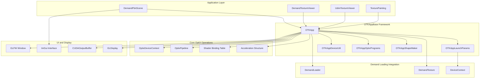
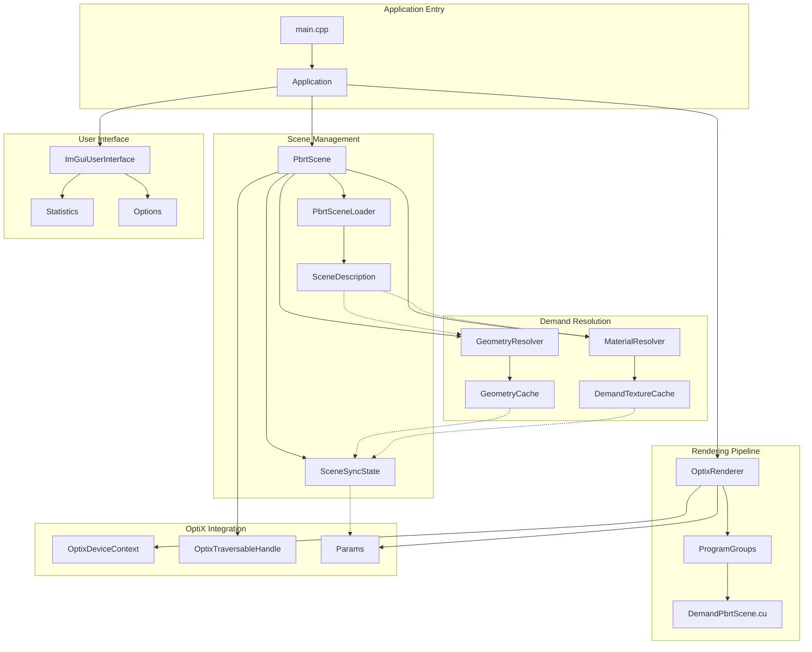
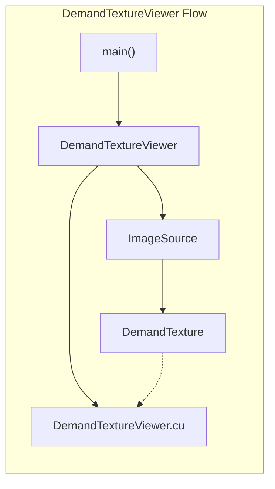
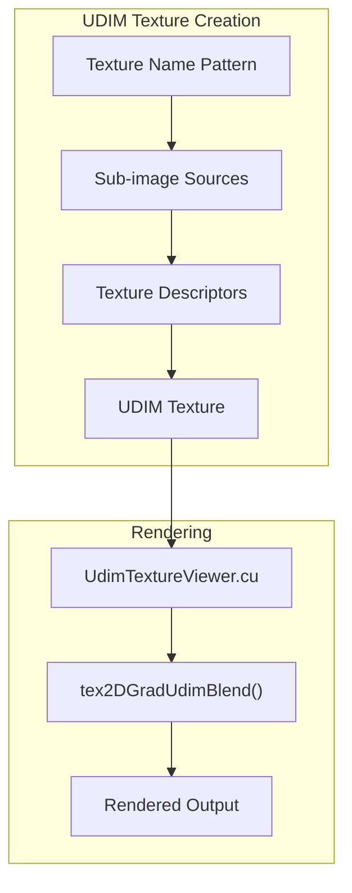
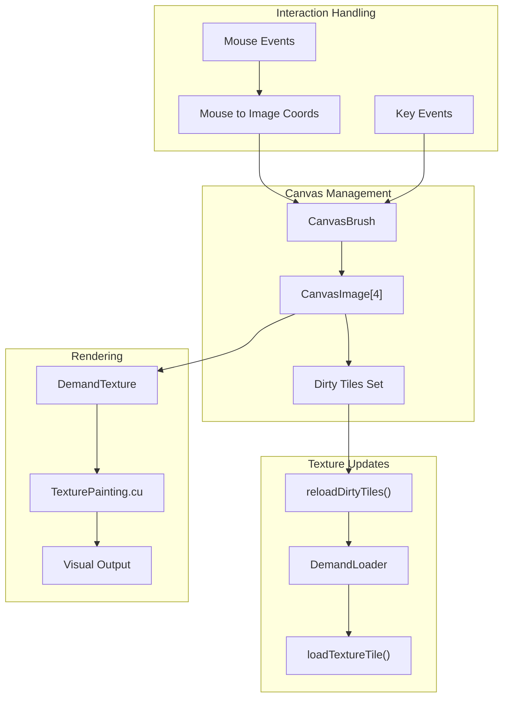
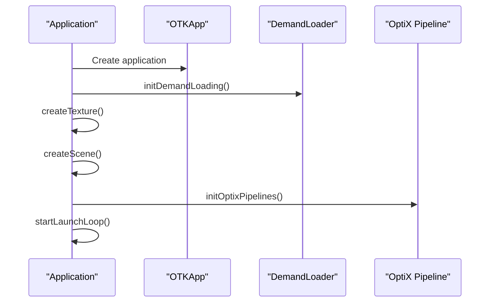

<!-- source: DeepWiki mcp.deepwiki.com · repo NVIDIA/optix-toolkit · page 5 Example Applications · fetched 2026-10-26 -->

# Example Applications

Relevant source files

The following files were used as context for generating this wiki page:

- [examples/DemandLoading/DemandPbrtScene/CMakeLists.txt](examples/DemandLoading/DemandPbrtScene/CMakeLists.txt)
- [examples/DemandLoading/DemandPbrtScene/ImGuiUserInterface.cpp](examples/DemandLoading/DemandPbrtScene/ImGuiUserInterface.cpp)
- [examples/DemandLoading/DemandPbrtScene/PbrtScene.cpp](examples/DemandLoading/DemandPbrtScene/PbrtScene.cpp)
- [examples/DemandLoading/DemandPbrtScene/include/DemandPbrtScene/ImGuiUserInterface.h](examples/DemandLoading/DemandPbrtScene/include/DemandPbrtScene/ImGuiUserInterface.h)
- [examples/DemandLoading/DemandPbrtScene/include/DemandPbrtScene/JsonStatisticsPrinter.h](examples/DemandLoading/DemandPbrtScene/include/DemandPbrtScene/JsonStatisticsPrinter.h)
- [examples/DemandLoading/DemandPbrtScene/tests/CMakeLists.txt](examples/DemandLoading/DemandPbrtScene/tests/CMakeLists.txt)
- [examples/DemandLoading/DemandPbrtScene/tests/TestJsonStatisticsPrinter.cpp](examples/DemandLoading/DemandPbrtScene/tests/TestJsonStatisticsPrinter.cpp)
- [examples/DemandLoading/DemandPbrtScene/tests/TestPbrtScene.cpp](examples/DemandLoading/DemandPbrtScene/tests/TestPbrtScene.cpp)
- [examples/DemandLoading/DemandTextureViewer/CMakeLists.txt](examples/DemandLoading/DemandTextureViewer/CMakeLists.txt)
- [examples/DemandLoading/DemandTextureViewer/DemandTextureViewer.cpp](examples/DemandLoading/DemandTextureViewer/DemandTextureViewer.cpp)
- [examples/DemandLoading/DemandTextureViewer/DemandTextureViewer.cu](examples/DemandLoading/DemandTextureViewer/DemandTextureViewer.cu)
- [examples/DemandLoading/TexturePainting/TexturePainting.cpp](examples/DemandLoading/TexturePainting/TexturePainting.cpp)
- [examples/DemandLoading/UdimTextureViewer/UdimTextureViewer.cpp](examples/DemandLoading/UdimTextureViewer/UdimTextureViewer.cpp)
- [examples/OTKAppBase/CMakeLists.txt](examples/OTKAppBase/CMakeLists.txt)
- [examples/OTKAppBase/include/OptiXToolkit/OTKAppBase/OTKApp.h](examples/OTKAppBase/include/OptiXToolkit/OTKAppBase/OTKApp.h)
- [examples/OTKAppBase/include/OptiXToolkit/OTKAppBase/OTKAppDeviceUtil.h](examples/OTKAppBase/include/OptiXToolkit/OTKAppBase/OTKAppDeviceUtil.h)
- [examples/OTKAppBase/include/OptiXToolkit/OTKAppBase/OTKAppLaunchParams.h](examples/OTKAppBase/include/OptiXToolkit/OTKAppBase/OTKAppLaunchParams.h)
- [examples/OTKAppBase/include/OptiXToolkit/OTKAppBase/OTKAppOptixPrograms.h](examples/OTKAppBase/include/OptiXToolkit/OTKAppBase/OTKAppOptixPrograms.h)
- [examples/OTKAppBase/include/OptiXToolkit/OTKAppBase/OTKAppSimpleBsdf.h](examples/OTKAppBase/include/OptiXToolkit/OTKAppBase/OTKAppSimpleBsdf.h)
- [examples/OTKAppBase/src/OTKApp.cpp](examples/OTKAppBase/src/OTKApp.cpp)

This page covers the example applications that demonstrate OptiX Toolkit capabilities. These applications showcase demand loading, texture handling, and ray tracing features through practical, interactive implementations.

For information about the core demand loading system used by these examples, see [DemandLoading System](#3). For details about the underlying framework components, see [Core Libraries](#1.1).

## Application Architecture

The OptiX Toolkit provides a structured framework for building ray tracing applications through the `OTKAppBase` library. All example applications inherit from or utilize this common foundation.

### OTKApp Framework Architecture

Sources: [examples/OTKAppBase/include/OptiXToolkit/OTKAppBase/OTKApp.h:30-159](), [examples/OTKAppBase/src/OTKApp.cpp:54-88]()

### Core Application Components

| Component | Purpose | Key Classes |
|-----------|---------|-------------|
| **Application Base** | Common OptiX setup and rendering loop | `OTKApp`, `OTKAppPerDeviceOptixState` |
| **Launch Parameters** | GPU kernel parameter structure | `OTKAppLaunchParams`, `OTKAppRayPayload` |
| **Device Utilities** | GPU helper functions | Functions in `OTKAppDeviceUtil.h` |
| **OptiX Programs** | Standard ray tracing shaders | `__miss__OTKApp`, `__closesthit__OTKApp` |
| **Shape Generation** | Geometric primitive creation | `OTKAppShapeMaker` |

Sources: [examples/OTKAppBase/include/OptiXToolkit/OTKAppBase/OTKAppLaunchParams.h:40-71](), [examples/OTKAppBase/include/OptiXToolkit/OTKAppBase/OTKAppDeviceUtil.h:29-98]()

## DemandPbrtScene Viewer

The most sophisticated example application, `DemandPbrtScene` provides a full-featured PBRT scene viewer with advanced demand loading capabilities.

### DemandPbrtScene System Architecture

Sources: [examples/DemandLoading/DemandPbrtScene/PbrtScene.cpp:44-94](), [examples/DemandLoading/DemandPbrtScene/ImGuiUserInterface.cpp:52-119]()

### Key Features

The `DemandPbrtScene` application demonstrates:

- **Scene Proxy System**: Decomposes complex scenes into demand-loadable components through `GeometryResolver` and `MaterialResolver`
- **Interactive Rendering**: Multiple rendering modes (primary ray, ambient occlusion, path tracing) via `RenderMode` enum
- **Statistics Collection**: Comprehensive performance monitoring through `UserInterfaceStatistics`
- **Debug Capabilities**: Pixel-level debugging and performance analysis

The main application logic resides in `PbrtScene::beforeLaunch()` and `PbrtScene::afterLaunch()`, which coordinate demand loading requests and scene updates.

Sources: [examples/DemandLoading/DemandPbrtScene/PbrtScene.cpp:321-346](), [examples/DemandLoading/DemandPbrtScene/ImGuiUserInterface.cpp:233-297]()

## Texture Viewer Applications

### DemandTextureViewer

A straightforward texture viewing application that demonstrates basic demand loading capabilities.

Key implementation details:
- Creates `ImageSource` objects with optional tiling and mipmapping via `createImageSource()`
- Uses `tex2DGrad()` for texture sampling in the CUDA kernel
- Supports both ray casting and direct texture coordinate calculation

Sources: [examples/DemandLoading/DemandTextureViewer/DemandTextureViewer.cpp:44-78](), [examples/DemandLoading/DemandTextureViewer/DemandTextureViewer.cu:22-66]()

### UdimTextureViewer

Demonstrates UDIM (UV Tile) texture support for complex texture atlases.

The application creates UDIM textures by:
1. Generating sub-images for each U,V tile coordinate
2. Creating texture descriptors with `CU_TR_ADDRESS_MODE_BORDER` for proper blending
3. Using `createUdimTexture()` to combine sub-images into a single addressable texture

Sources: [examples/DemandLoading/UdimTextureViewer/UdimTextureViewer.cpp:91-144]()

## TexturePainting Application

An interactive painting application showcasing real-time texture modification and tile reloading.

### TexturePainting Architecture

Sources: [examples/DemandLoading/TexturePainting/TexturePainting.cpp:122-171](), [examples/DemandLoading/TexturePainting/TexturePainting.cpp:245-263]()

### Interactive Features

The `TexturePainting` application provides:

- **Real-time Editing**: Direct painting on textures through `CanvasImage` and `CanvasBrush`
- **Multi-canvas Support**: Switch between 4 different canvases using number keys or UI buttons
- **Selective Tile Reloading**: Only reloads modified texture tiles via `reloadDirtyTiles()`
- **Brush Customization**: Adjustable size and color through mouse and keyboard interaction

Key interaction methods:
- `mouseToImageCoords()`: Converts screen coordinates to texture space
- `drawStroke()`: Paints between two points for smooth drawing
- `loadTextureTile()`: Refreshes specific texture tiles after modification

Sources: [examples/DemandLoading/TexturePainting/TexturePainting.cpp:227-235](), [examples/DemandLoading/TexturePainting/TexturePainting.cpp:152-157]()

## Common Application Patterns

### Initialization Sequence

All example applications follow a consistent initialization pattern:

### Launch Loop Pattern

The rendering loop in `OTKApp::performLaunches()` provides the core execution pattern:

1. **Demand Loading Preparation**: Call `demandLoader->launchPrepare()`
2. **OptiX Launch**: Execute `optixLaunch()` with current parameters
3. **Request Processing**: Handle demand loading requests with `processRequests()`
4. **Convergence Check**: Continue until all requests are satisfied

Sources: [examples/OTKAppBase/src/OTKApp.cpp:495-567]()

### Texture Descriptor Patterns

Applications consistently use `makeTextureDescriptor()` to configure textures:

- **Address Mode**: Typically `CU_TR_ADDRESS_MODE_CLAMP` for single textures, `CU_TR_ADDRESS_MODE_BORDER` for UDIM tiles
- **Filter Mode**: `FILTER_BILINEAR` for smooth interpolation
- **Mipmap Support**: Automatic mipmap generation through `createMipMapImageSource()`

Sources: [examples/OTKAppBase/src/OTKApp.cpp:426-436](), [examples/DemandLoading/UdimTextureViewer/UdimTextureViewer.cpp:126-131]()

---

