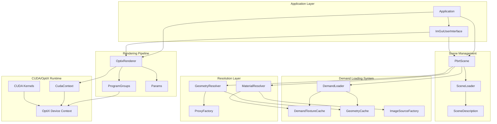
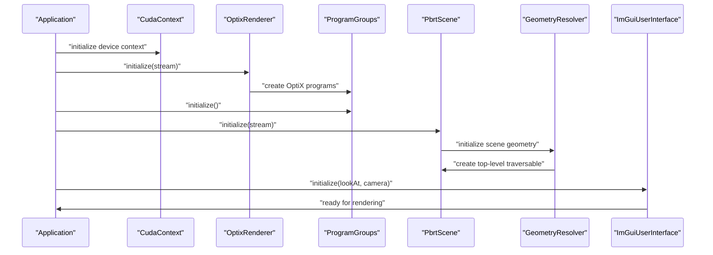
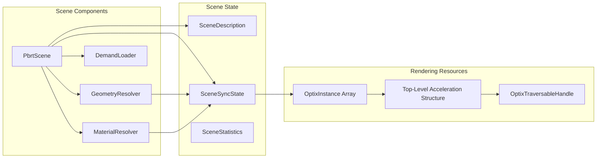
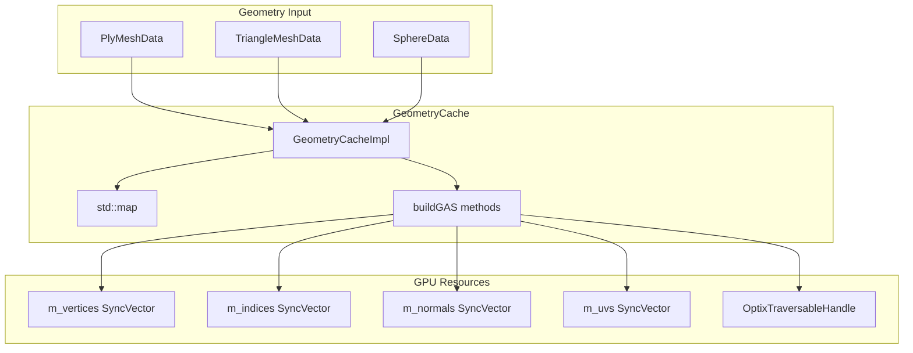
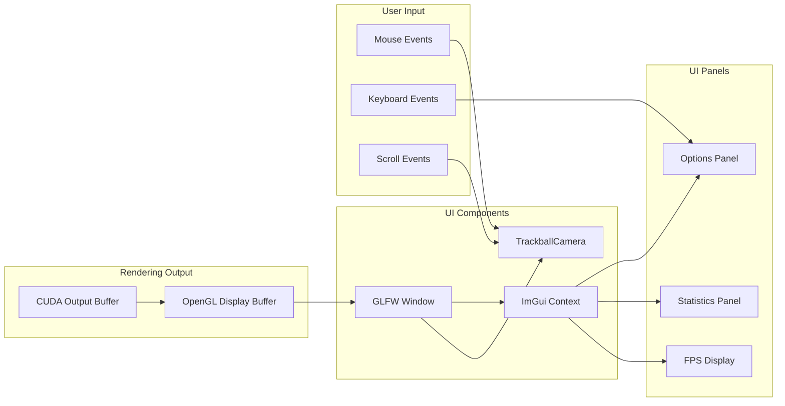
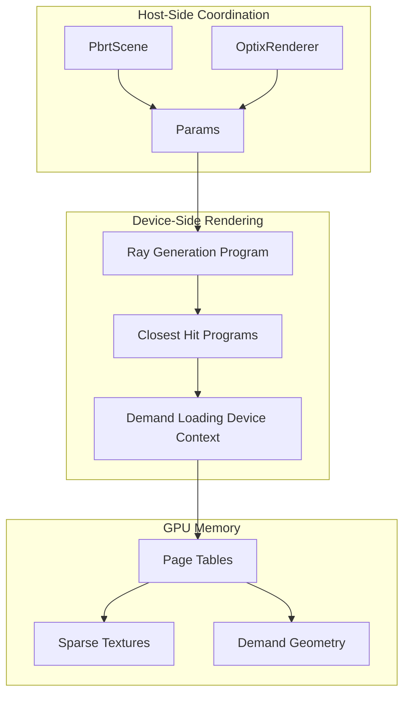

<!-- source: DeepWiki mcp.deepwiki.com · repo NVIDIA/optix-toolkit · page 5.1 PbrtScene Viewer · fetched 2026-10-26 -->

# PbrtScene Viewer

<details>
<summary>Relevant source files</summary>

The following files were used as context for generating this wiki page:

- [examples/DemandLoading/DemandPbrtScene/Application.cpp](examples/DemandLoading/DemandPbrtScene/Application.cpp)
- [examples/DemandLoading/DemandPbrtScene/CMakeLists.txt](examples/DemandLoading/DemandPbrtScene/CMakeLists.txt)
- [examples/DemandLoading/DemandPbrtScene/GeometryCache.cpp](examples/DemandLoading/DemandPbrtScene/GeometryCache.cpp)
- [examples/DemandLoading/DemandPbrtScene/ImGuiUserInterface.cpp](examples/DemandLoading/DemandPbrtScene/ImGuiUserInterface.cpp)
- [examples/DemandLoading/DemandPbrtScene/PbrtScene.cpp](examples/DemandLoading/DemandPbrtScene/PbrtScene.cpp)
- [examples/DemandLoading/DemandPbrtScene/include/DemandPbrtScene/Application.h](examples/DemandLoading/DemandPbrtScene/include/DemandPbrtScene/Application.h)
- [examples/DemandLoading/DemandPbrtScene/include/DemandPbrtScene/Dependencies.h](examples/DemandLoading/DemandPbrtScene/include/DemandPbrtScene/Dependencies.h)
- [examples/DemandLoading/DemandPbrtScene/include/DemandPbrtScene/GeometryCache.h](examples/DemandLoading/DemandPbrtScene/include/DemandPbrtScene/GeometryCache.h)
- [examples/DemandLoading/DemandPbrtScene/include/DemandPbrtScene/ImGuiUserInterface.h](examples/DemandLoading/DemandPbrtScene/include/DemandPbrtScene/ImGuiUserInterface.h)
- [examples/DemandLoading/DemandPbrtScene/include/DemandPbrtScene/JsonStatisticsPrinter.h](examples/DemandLoading/DemandPbrtScene/include/DemandPbrtScene/JsonStatisticsPrinter.h)
- [examples/DemandLoading/DemandPbrtScene/include/DemandPbrtScene/ProxyFactoryStatistics.h](examples/DemandLoading/DemandPbrtScene/include/DemandPbrtScene/ProxyFactoryStatistics.h)
- [examples/DemandLoading/DemandPbrtScene/include/DemandPbrtScene/SceneAdapters.h](examples/DemandLoading/DemandPbrtScene/include/DemandPbrtScene/SceneAdapters.h)
- [examples/DemandLoading/DemandPbrtScene/tests/CMakeLists.txt](examples/DemandLoading/DemandPbrtScene/tests/CMakeLists.txt)
- [examples/DemandLoading/DemandPbrtScene/tests/TestGeometryCache.cpp](examples/DemandLoading/DemandPbrtScene/tests/TestGeometryCache.cpp)
- [examples/DemandLoading/DemandPbrtScene/tests/TestJsonStatisticsPrinter.cpp](examples/DemandLoading/DemandPbrtScene/tests/TestJsonStatisticsPrinter.cpp)
- [examples/DemandLoading/DemandPbrtScene/tests/TestPbrtScene.cpp](examples/DemandLoading/DemandPbrtScene/tests/TestPbrtScene.cpp)

</details>


## Purpose and Scope

The PbrtScene Viewer is a comprehensive interactive viewer application for PBRT scene files that demonstrates advanced demand loading capabilities for both geometry and materials. This application serves as the primary example of how to integrate OptiX Toolkit's demand loading systems with real-world scene rendering. The viewer loads PBRT scene descriptions and renders them using OptiX ray tracing with on-demand streaming of geometry and texture data.

For information about the underlying demand loading system, see [DemandLoading System](#3). For details about other texture viewing applications, see [Texture Viewers](#5.2). For PBRT file parsing components, see [PBRT Scene Loading](#5.3).

## System Architecture Overview

The PbrtScene Viewer follows a modular architecture with clear separation between scene management, rendering, and user interface components.

### High-Level Component Architecture



**Sources:** [examples/DemandLoading/DemandPbrtScene/Application.cpp:45-64](), [examples/DemandLoading/DemandPbrtScene/PbrtScene.cpp:44-94]()

### Application Initialization Flow



**Sources:** [examples/DemandLoading/DemandPbrtScene/Application.cpp:66-74](), [examples/DemandLoading/DemandPbrtScene/PbrtScene.cpp:244-250]()

## Core Application Components

### Application Class

The `Application` class serves as the main orchestrator, managing all subsystem dependencies and controlling the application lifecycle.

| Component | Type | Purpose |
|-----------|------|---------|
| `m_cuda` | `CudaContext` | CUDA device management |
| `m_demandLoader` | `DemandLoaderPtr` | Demand loading coordination |
| `m_geometryCache` | `GeometryCachePtr` | Geometry acceleration structure caching |
| `m_renderer` | `RendererPtr` | OptiX rendering pipeline |
| `m_scene` | `ScenePtr` | Scene state and management |
| `m_materialResolver` | `MaterialResolverPtr` | Material proxy resolution |
| `m_geometryResolver` | `GeometryResolverPtr` | Geometry proxy resolution |

The application supports both interactive viewing and batch rendering modes, determined by the presence of an output file specification.

**Sources:** [examples/DemandLoading/DemandPbrtScene/Application.cpp:45-64](), [examples/DemandLoading/DemandPbrtScene/include/DemandPbrtScene/Application.h:39-78]()

### PbrtScene Implementation

The `PbrtScene` class manages the PBRT scene description and coordinates between geometry resolution, material resolution, and demand loading.



Key methods in `PbrtScene`:
- `initialize()`: Parses scene file and creates initial acceleration structures
- `beforeLaunch()`: Resolves proxy geometries/materials and updates acceleration structures
- `afterLaunch()`: Processes demand loading requests from GPU

**Sources:** [examples/DemandLoading/DemandPbrtScene/PbrtScene.cpp:44-367]()

### Geometry Cache System

The `GeometryCache` provides efficient caching of OptiX acceleration structures for scene geometry, supporting both individual shapes and aggregated objects.



The cache supports:
- PLY mesh loading via `MeshReader` interface
- Triangle mesh data with optional normals and UVs
- Sphere primitives with radius scaling
- Material flag-based geometry variants for alpha/diffuse textures

**Sources:** [examples/DemandLoading/DemandPbrtScene/GeometryCache.cpp:69-500](), [examples/DemandLoading/DemandPbrtScene/include/DemandPbrtScene/GeometryCache.h:23-64]()

## Interactive User Interface

### ImGui Integration

The `ImGuiUserInterface` class provides a comprehensive interactive interface with real-time statistics, rendering options, and camera controls.



**Key Interactive Features:**
- Real-time camera manipulation via trackball controls
- Toggle options for demand loading behavior (one-shot geometry/material)
- Rendering mode selection (primary ray, ambient occlusion, path tracing)
- Debug pixel selection with Ctrl+click
- Statistics display with expandable categories
- Performance metrics and frame rate monitoring

**Keyboard Controls:**
- `G`: Resolve one geometry proxy
- `M`: Resolve one material proxy
- `D`: Toggle debug mode / fire debug dump
- `S`: Save statistics to JSON file
- `L`: Print camera LookAt values
- `Space`: Toggle pause mode
- `Esc/Q`: Quit application

**Sources:** [examples/DemandLoading/DemandPbrtScene/ImGuiUserInterface.cpp:34-597](), [examples/DemandLoading/DemandPbrtScene/include/DemandPbrtScene/ImGuiUserInterface.h:52-121]()

### Statistics and Monitoring

The viewer provides comprehensive statistics tracking across all major subsystems:

| Statistics Category | Key Metrics | Purpose |
|-------------------|-------------|---------|
| Scene | Parse time, shape counts, object instances | Scene complexity analysis |
| Geometry Cache | Traversables, triangles, spheres, I/O metrics | Geometry processing performance |
| Image Sources | Cache hits, bytes read, read time | Texture loading efficiency |
| Proxy Factory | Proxy creation counts by type | Demand loading granularity |
| Material Resolver | Materials realized/reused | Material system efficiency |
| Geometry Resolver | Geometries resolved/realized | Geometry demand loading |

**Sources:** [examples/DemandLoading/DemandPbrtScene/ImGuiUserInterface.cpp:127-231](), [examples/DemandLoading/DemandPbrtScene/include/DemandPbrtScene/JsonStatisticsPrinter.h:15-222]()

## Demand Loading Integration

### Scene Proxy System

The viewer uses a sophisticated proxy system to enable demand loading of geometry and materials. For detailed information about the proxy system implementation, see [Scene Proxy System](#5.1.1).

### Rendering Pipeline Integration

The rendering pipeline coordinates between OptiX ray tracing and the demand loading system through shared device contexts and parameter structures.



The `Params` structure serves as the interface between host and device code, containing:
- OptiX traversable handles
- Demand loading device contexts
- Material and geometry data arrays
- Rendering configuration parameters

**Sources:** [examples/DemandLoading/DemandPbrtScene/PbrtScene.cpp:266-319](), [examples/DemandLoading/DemandPbrtScene/include/DemandPbrtScene/Params.h]()

## Build System and Configuration

The PbrtScene Viewer uses CMake with embedded CUDA compilation for OptiX kernels:

```cmake
embed_cuda(CONST HEADER DemandPbrtSceneKernelCuda.h
    OUTPUT_TARGET DemandPbrtSceneKernel
    LIBRARIES
        OptiXToolkit::DemandGeometry
        OptiXToolkit::DemandLoading
        OptiXToolkit::DemandMaterial
        OptiXToolkit::ImageSource
        OptiXToolkit::ShaderUtil
    SOURCES
        DemandPbrtScene.cu
        PhongMaterial.cu
)
```

The application requires OptiX 7.5+ and CUDA 11.1+ for demand loading support. The build system automatically configures header generation for GPU kernel integration.

**Sources:** [examples/DemandLoading/DemandPbrtScene/CMakeLists.txt:21-44]()

## Testing Infrastructure

The viewer includes comprehensive unit tests covering all major components:

- `TestGeometryCache`: Geometry caching and acceleration structure building
- `TestPbrtScene`: Scene management and initialization
- `TestOptixRenderer`: OptiX pipeline setup and rendering
- `TestMaterialResolver`: Material proxy resolution
- `TestGeometryResolver`: Geometry proxy resolution

The test suite uses Google Test with custom matchers for OptiX data structures and mock implementations for external dependencies.

**Sources:** [examples/DemandLoading/DemandPbrtScene/tests/TestGeometryCache.cpp:1-50](), [examples/DemandLoading/DemandPbrtScene/tests/TestPbrtScene.cpp:1-50](), [examples/DemandLoading/DemandPbrtScene/tests/CMakeLists.txt:9-51]()

---

