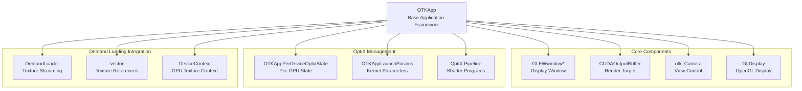
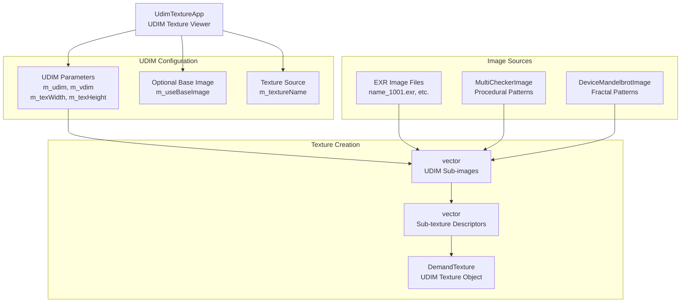
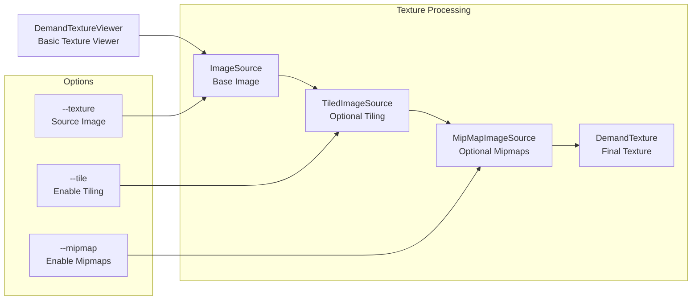
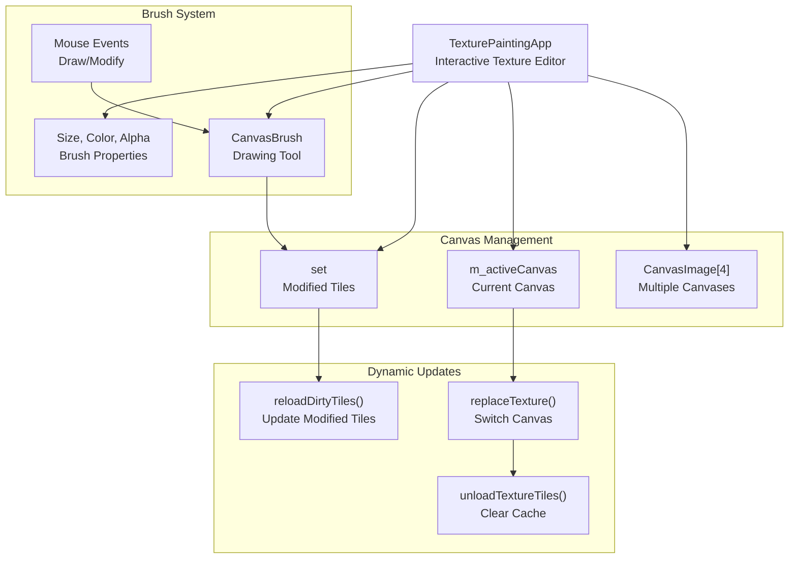
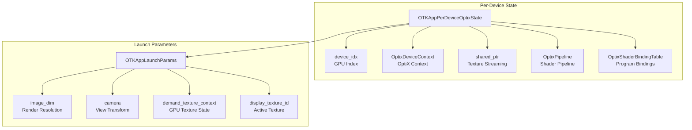
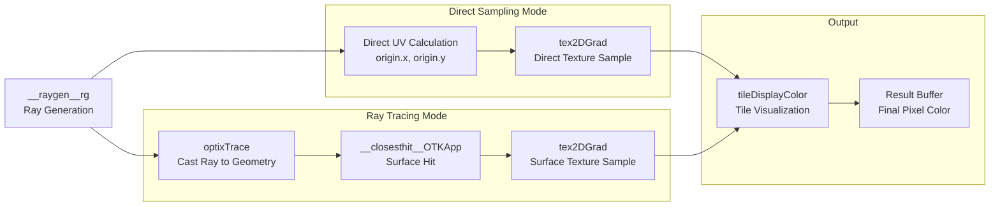
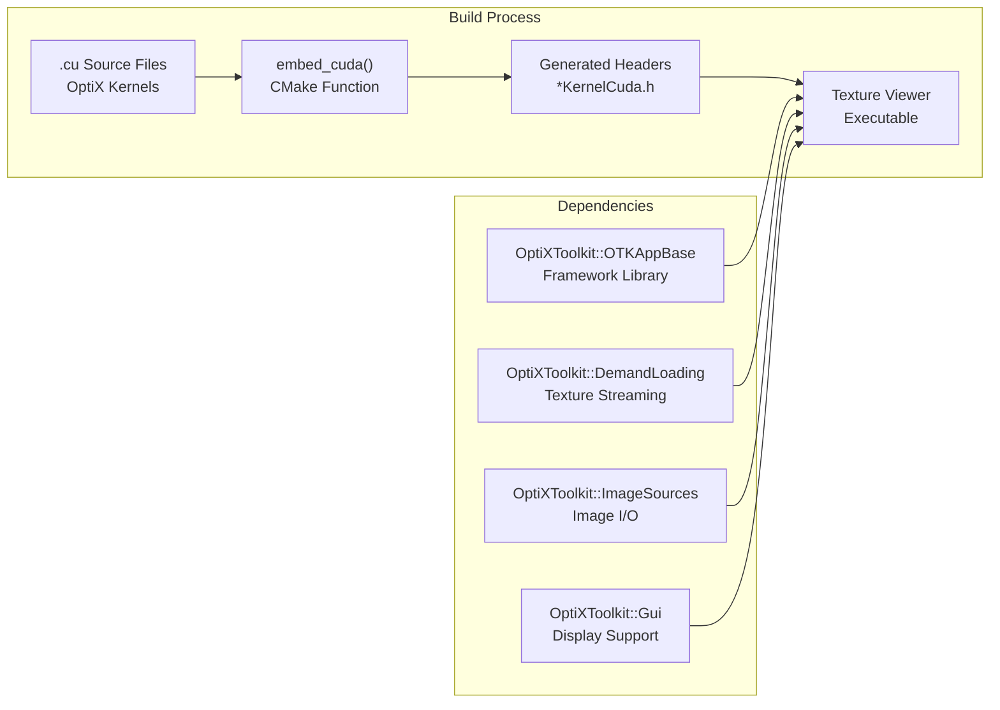

<!-- source: DeepWiki mcp.deepwiki.com · repo NVIDIA/optix-toolkit · page 5.2 Texture Viewers · fetched 2026-10-26 -->

# Texture Viewers

Relevant source files

The following files were used as context for generating this wiki page:

- [examples/DemandLoading/DemandTextureViewer/CMakeLists.txt](examples/DemandLoading/DemandTextureViewer/CMakeLists.txt)
- [examples/DemandLoading/DemandTextureViewer/DemandTextureViewer.cpp](examples/DemandLoading/DemandTextureViewer/DemandTextureViewer.cpp)
- [examples/DemandLoading/DemandTextureViewer/DemandTextureViewer.cu](examples/DemandLoading/DemandTextureViewer/DemandTextureViewer.cu)
- [examples/DemandLoading/TexturePainting/TexturePainting.cpp](examples/DemandLoading/TexturePainting/TexturePainting.cpp)
- [examples/DemandLoading/UdimTextureViewer/UdimTextureViewer.cpp](examples/DemandLoading/UdimTextureViewer/UdimTextureViewer.cpp)
- [examples/OTKAppBase/CMakeLists.txt](examples/OTKAppBase/CMakeLists.txt)
- [examples/OTKAppBase/include/OptiXToolkit/OTKAppBase/OTKApp.h](examples/OTKAppBase/include/OptiXToolkit/OTKAppBase/OTKApp.h)
- [examples/OTKAppBase/include/OptiXToolkit/OTKAppBase/OTKAppDeviceUtil.h](examples/OTKAppBase/include/OptiXToolkit/OTKAppBase/OTKAppDeviceUtil.h)
- [examples/OTKAppBase/include/OptiXToolkit/OTKAppBase/OTKAppLaunchParams.h](examples/OTKAppBase/include/OptiXToolkit/OTKAppBase/OTKAppLaunchParams.h)
- [examples/OTKAppBase/include/OptiXToolkit/OTKAppBase/OTKAppOptixPrograms.h](examples/OTKAppBase/include/OptiXToolkit/OTKAppBase/OTKAppOptixPrograms.h)
- [examples/OTKAppBase/include/OptiXToolkit/OTKAppBase/OTKAppSimpleBsdf.h](examples/OTKAppBase/include/OptiXToolkit/OTKAppBase/OTKAppSimpleBsdf.h)
- [examples/OTKAppBase/src/OTKApp.cpp](examples/OTKAppBase/src/OTKApp.cpp)

This document covers the texture viewer example applications in the OptiX Toolkit, which demonstrate various aspects of demand-loaded texture rendering using OptiX. These applications showcase UDIM texture support, basic demand texture loading, and interactive texture modification capabilities. For information about the underlying demand loading system, see [DemandLoading System](#3). For details about the PBRT scene viewer, see [PbrtScene Viewer](#5.1).

## OTKApp Framework

The texture viewers are built on the `OTKApp` framework, which provides a common foundation for OptiX-based applications with demand loading support. The framework handles OpenGL/CUDA interop, camera controls, OptiX pipeline management, and integration with the demand loading system.

The `OTKApp` class provides virtual methods for customization by derived applications, including scene creation, OptiX program specification, and user interaction handling.

**Sources:** [examples/OTKAppBase/include/OptiXToolkit/OTKAppBase/OTKApp.h:30-159](), [examples/OTKAppBase/src/OTKApp.cpp:54-88]()

## Texture Viewer Applications

### UDIM Texture Viewer

The `UdimTextureApp` demonstrates UDIM (U-Dimension) texture support, which allows multiple texture tiles to be addressed as a single logical texture across UV coordinate ranges greater than [0,1].

The UDIM texture creation process involves generating sub-images for each UDIM tile and combining them into a single demand-loaded texture that can be sampled across extended UV coordinates.

**Sources:** [examples/DemandLoading/UdimTextureViewer/UdimTextureViewer.cpp:23-53](), [examples/DemandLoading/UdimTextureViewer/UdimTextureViewer.cpp:55-144]()

### Demand Texture Viewer

The `DemandTextureViewer` provides a simpler example of basic demand texture loading with optional tiling and mipmap generation.

The application supports procedural textures (`checkerboard`, `mandelbrot`) as well as image files, with optional post-processing to add tiling and mipmap support.

**Sources:** [examples/DemandLoading/DemandTextureViewer/DemandTextureViewer.cpp:25-78](), [examples/DemandLoading/DemandTextureViewer/DemandTextureViewer.cpp:44-64]()

### Texture Painting Application

The `TexturePaintingApp` demonstrates advanced demand texture features including dynamic texture modification, tile reloading, and texture swapping.

The texture painting application showcases real-time texture modification by tracking dirty tiles and selectively reloading only the modified portions of the texture.

**Sources:** [examples/DemandLoading/TexturePainting/TexturePainting.cpp:25-68](), [examples/DemandLoading/TexturePainting/TexturePainting.cpp:245-289]()

## OptiX Integration

### Launch Parameters and Device State

The texture viewers use a structured approach to manage OptiX state and launch parameters across multiple GPUs.

The per-device state management allows the texture viewers to work across multiple GPUs with synchronized texture streaming.

**Sources:** [examples/OTKAppBase/include/OptiXToolkit/OTKAppBase/OTKAppPerDeviceOptixState.h](), [examples/OTKAppBase/include/OptiXToolkit/OTKAppBase/OTKAppLaunchParams.h:40-71]()

### OptiX Kernel Implementation

The texture viewers use OptiX kernels for rendering with integrated demand texture sampling.

| Program Type | Function | Purpose |
|--------------|----------|---------|
| Ray Generation | `__raygen__rg` | Generate camera rays and sample textures |
| Miss | `__miss__OTKApp` | Handle background rendering |
| Closest Hit | `__closesthit__OTKApp` | Calculate surface shading with texture sampling |

The ray generation program demonstrates both direct texture sampling and ray-traced texture sampling modes:

**Sources:** [examples/DemandLoading/DemandTextureViewer/DemandTextureViewer.cu:22-66](), [examples/OTKAppBase/include/OptiXToolkit/OTKAppBase/OTKAppOptixPrograms.h:13-78]()

## User Interaction and Controls

The texture viewers provide consistent user interaction patterns through the `OTKApp` framework:

| Input | Action | Purpose |
|-------|--------|---------|
| WASD Keys | Pan camera | Navigate the texture view |
| QE Keys | Zoom in/out | Control magnification |
| Mouse LMB | Pan (drag) | Mouse-based navigation |
| Mouse RMB | Zoom (drag) | Mouse-based magnification |
| C Key | Re-center view | Reset camera position |
| ESC Key | Exit application | Close the viewer |

The `OTKAppUIMode` enum supports different interaction modes:
- `UI_IMAGEVIEW` - 2D texture viewing with pan/zoom
- `UI_FIRSTPERSON` - 3D navigation mode
- `UI_NONE` - No interactive controls

**Sources:** [examples/OTKAppBase/src/OTKApp.cpp:730-832](), [examples/OTKAppBase/include/OptiXToolkit/OTKAppBase/OTKApp.h:28]()

## Build System Integration

The texture viewers use the `embed_cuda` CMake function to compile OptiX kernels into embedded headers:

Each texture viewer has its own CMakeLists.txt that follows this pattern, with the embedded CUDA kernels linked as static libraries.

**Sources:** [examples/DemandLoading/DemandTextureViewer/CMakeLists.txt:15-27](), [examples/OTKAppBase/CMakeLists.txt:17-48]()

---

