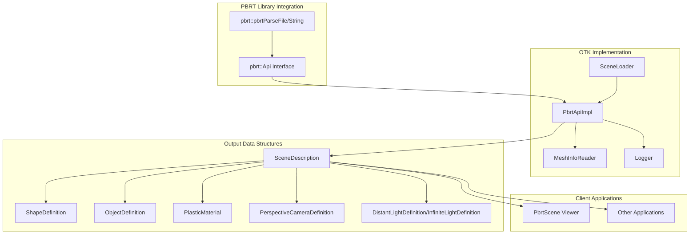
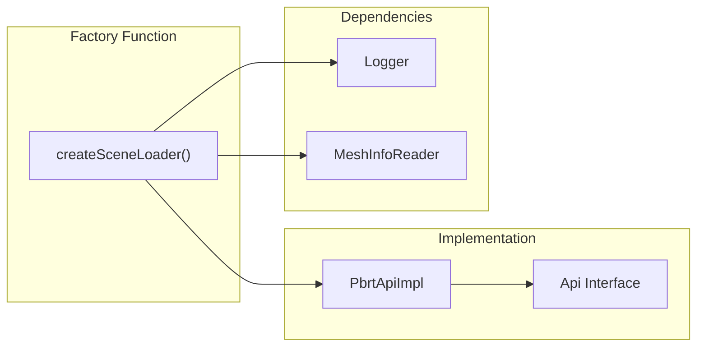
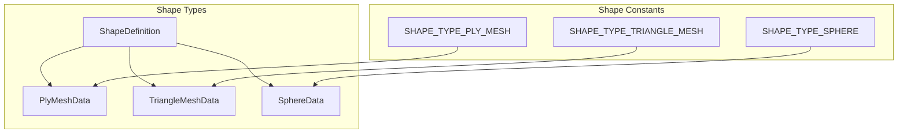
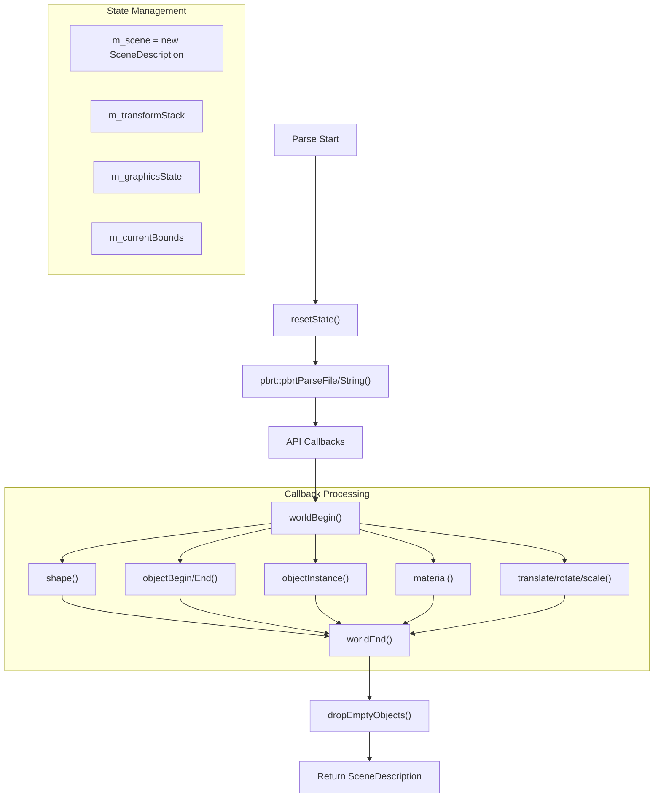
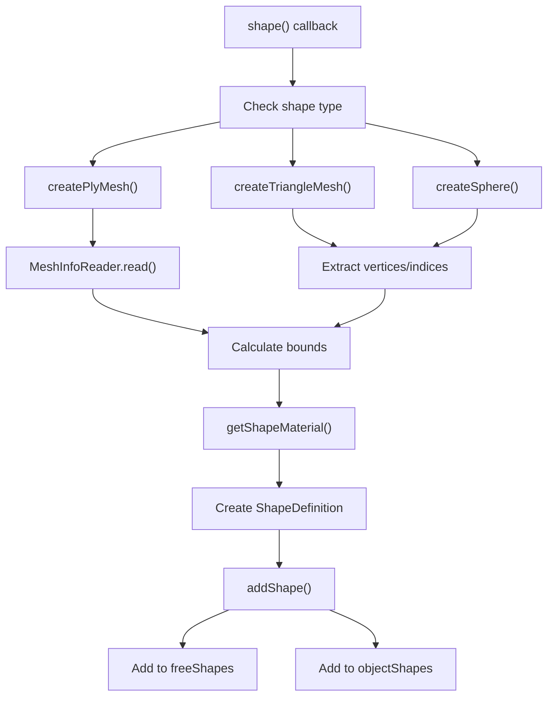
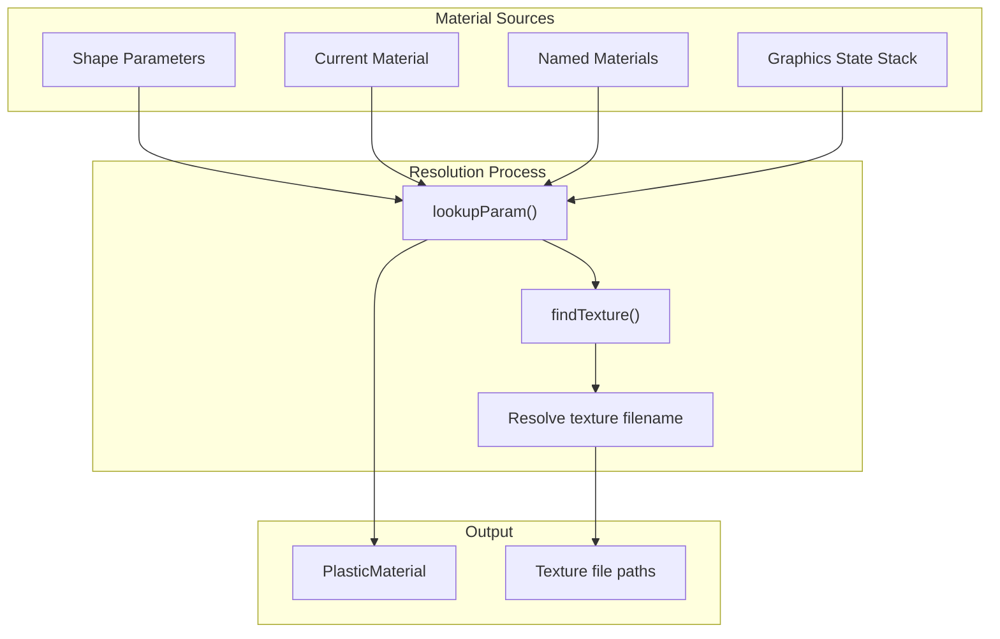
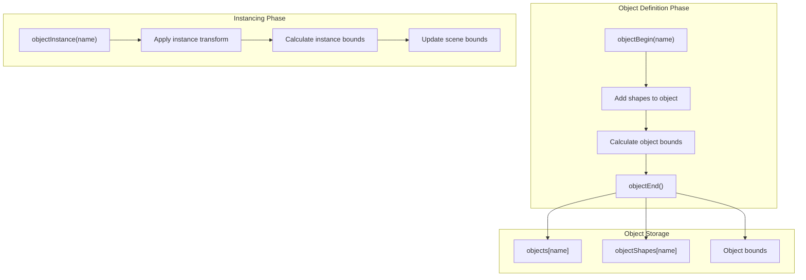
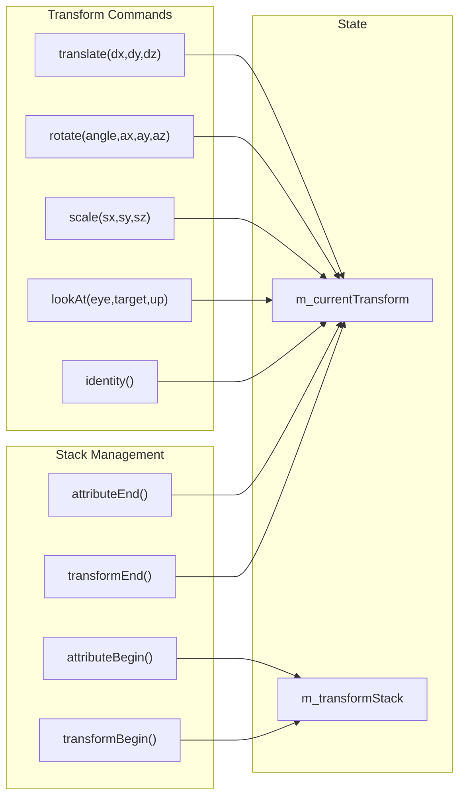
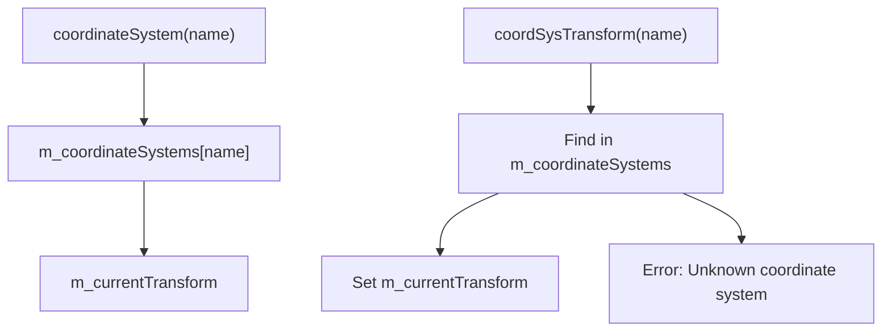
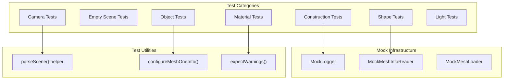

<!-- source: DeepWiki mcp.deepwiki.com · repo NVIDIA/optix-toolkit · page 5.3 PBRT Scene Loading · fetched 2026-10-26 -->

# PBRT Scene Loading

Relevant source files

The following files were used as context for generating this wiki page:

- [examples/PbrtSceneLoader/PbrtApiImpl.cpp](examples/PbrtSceneLoader/PbrtApiImpl.cpp)
- [examples/PbrtSceneLoader/include/OptiXToolkit/PbrtSceneLoader/SceneDescription.h](examples/PbrtSceneLoader/include/OptiXToolkit/PbrtSceneLoader/SceneDescription.h)
- [examples/PbrtSceneLoader/tests/TestPbrtApi.cpp](examples/PbrtSceneLoader/tests/TestPbrtApi.cpp)

## Purpose and Scope

The PBRT Scene Loading system provides functionality to parse PBRT (Physically Based Rendering Toolkit) scene files and convert them into structured data representations that can be consumed by OptiX-based rendering applications. This system serves as the foundation for loading complex 3D scenes in the OptiX Toolkit examples, particularly the PbrtScene viewer application.

For information about how parsed scenes are used in rendering applications, see [PbrtScene Viewer](#5.1). For details about the scene proxy system that processes the parsed scene data, see [Scene Proxy System](#5.1.1).

The system handles PBRT v3 file format specifications and supports cameras, lighting, materials, geometry, object definitions, instancing, and scene transformations.

## System Architecture

The PBRT Scene Loading system is built around a layered architecture that integrates with the upstream PBRT parsing library while providing a clean interface for OptiX Toolkit applications.

### Core Components Architecture

**Sources**: [examples/PbrtSceneLoader/PbrtApiImpl.cpp:32-45](), [examples/PbrtSceneLoader/include/OptiXToolkit/PbrtSceneLoader/SceneDescription.h:1-148]()

### Factory and Interface Design

The system uses a clean factory pattern to create scene loaders and decouple the implementation from client code:

**Sources**: [examples/PbrtSceneLoader/PbrtApiImpl.cpp:86-89](), [examples/PbrtSceneLoader/tests/TestPbrtApi.cpp:92]()

## Core Data Structures

The system defines comprehensive data structures to represent all aspects of a PBRT scene after parsing. These structures are designed to be easily consumed by rendering applications.

### Scene Description Hierarchy

| Structure | Purpose | Key Fields |
|-----------|---------|------------|
| `SceneDescription` | Root container for entire scene | `bounds`, `camera`, `freeShapes`, `objects`, `objectInstances` |
| `ShapeDefinition` | Individual geometry definitions | `type`, `transform`, `material`, `bounds`, shape-specific data |
| `ObjectDefinition` | Named object containers | `name`, `bounds` |
| `ObjectInstanceDefinition` | Object instance placements | `name`, `transform`, `bounds` |
| `PerspectiveCameraDefinition` | Camera configuration | `fov`, `cameraToWorld`, `cameraToScreen` |
| `PlasticMaterial` | Material properties | `Ka`, `Kd`, `Ks`, texture file names |

**Sources**: [examples/PbrtSceneLoader/include/OptiXToolkit/PbrtSceneLoader/SceneDescription.h:128-142](), [examples/PbrtSceneLoader/include/OptiXToolkit/PbrtSceneLoader/SceneDescription.h:88-97]()

### Shape Type Support

The system supports multiple shape types with dedicated data structures:

**Sources**: [examples/PbrtSceneLoader/include/OptiXToolkit/PbrtSceneLoader/SceneDescription.h:84-97](), [examples/PbrtSceneLoader/include/OptiXToolkit/PbrtSceneLoader/SceneDescription.h:62-82]()

## Parsing Process

The parsing process follows a state-machine approach that maintains context throughout the scene file processing.

### Parse Flow

**Sources**: [examples/PbrtSceneLoader/PbrtApiImpl.cpp:48-62](), [examples/PbrtSceneLoader/PbrtApiImpl.cpp:740-754](), [examples/PbrtSceneLoader/PbrtApiImpl.cpp:64-84]()

### State Management

The parser maintains several types of state throughout the parsing process:

| State Type | Purpose | Storage |
|------------|---------|---------|
| Transform Stack | Hierarchical transformations | `m_transformStack` |
| Graphics State Stack | Material and texture context | `m_graphicsStateStack` |
| Bounds Stack | Object bounds calculation | `m_boundsStack` |
| Current Object | Active object definition | `m_currentObjectName` |
| In-World Flag | Parse phase tracking | `m_inWorld` |

**Sources**: [examples/PbrtSceneLoader/PbrtApiImpl.cpp:272-291](), [examples/PbrtSceneLoader/PbrtApiImpl.cpp:293-310]()

## Shape and Material Handling

The system provides comprehensive support for different shape types and material processing, including texture resolution and parameter inheritance.

### Shape Creation Process

**Sources**: [examples/PbrtSceneLoader/PbrtApiImpl.cpp:427-453](), [examples/PbrtSceneLoader/PbrtApiImpl.cpp:533-548](), [examples/PbrtSceneLoader/PbrtApiImpl.cpp:409-425]()

### Material Resolution

The material system supports complex inheritance and texture resolution:

**Sources**: [examples/PbrtSceneLoader/PbrtApiImpl.cpp:678-697](), [examples/PbrtSceneLoader/PbrtApiImpl.cpp:782-804](), [examples/PbrtSceneLoader/PbrtApiImpl.cpp:599-610]()

## Object System

The PBRT scene loader implements a comprehensive object definition and instancing system that supports hierarchical scene organization and efficient geometry reuse.

### Object Definition and Instancing

**Sources**: [examples/PbrtSceneLoader/PbrtApiImpl.cpp:462-484](), [examples/PbrtSceneLoader/PbrtApiImpl.cpp:486-516]()

### Instance Counting and Management

The system tracks object instance usage and provides cleanup for empty objects:

| Data Structure | Purpose | Usage |
|----------------|---------|-------|
| `instanceCounts` | Track instance usage per object | Populated in `objectInstance()` |
| `objectInstances` | List of all object instances | Contains transform and bounds |
| `objectShapes` | Map object names to shape lists | Used for instancing and cleanup |

**Sources**: [examples/PbrtSceneLoader/PbrtApiImpl.cpp:511](), [examples/PbrtSceneLoader/include/OptiXToolkit/PbrtSceneLoader/SceneDescription.h:116-119]()

## Transform Management

The parser maintains a sophisticated transform management system that handles hierarchical transformations and coordinate system management.

### Transform Stack Operations

**Sources**: [examples/PbrtSceneLoader/PbrtApiImpl.cpp:91-134](), [examples/PbrtSceneLoader/PbrtApiImpl.cpp:272-310]()

### Coordinate System Management

The system supports named coordinate systems for complex scene setups:

**Sources**: [examples/PbrtSceneLoader/PbrtApiImpl.cpp:136-173]()

## Testing Framework

The system includes comprehensive testing that validates parsing behavior, scene structure, and error handling.

### Test Structure

**Sources**: [examples/PbrtSceneLoader/tests/TestPbrtApi.cpp:37-119](), [examples/PbrtSceneLoader/tests/TestPbrtApi.cpp:75-96]()

The testing framework validates complex scenarios including object instancing, material inheritance, bounds calculation, and error handling for malformed scenes.

**Sources**: [examples/PbrtSceneLoader/tests/TestPbrtApi.cpp:366-573](), [examples/PbrtSceneLoader/tests/TestPbrtApi.cpp:795-828]()

---

