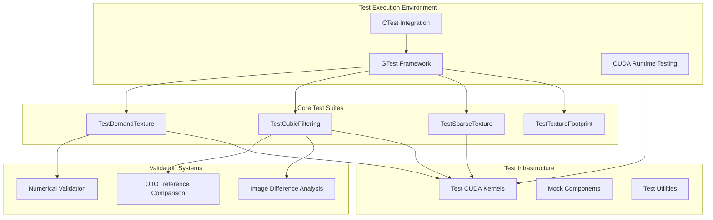
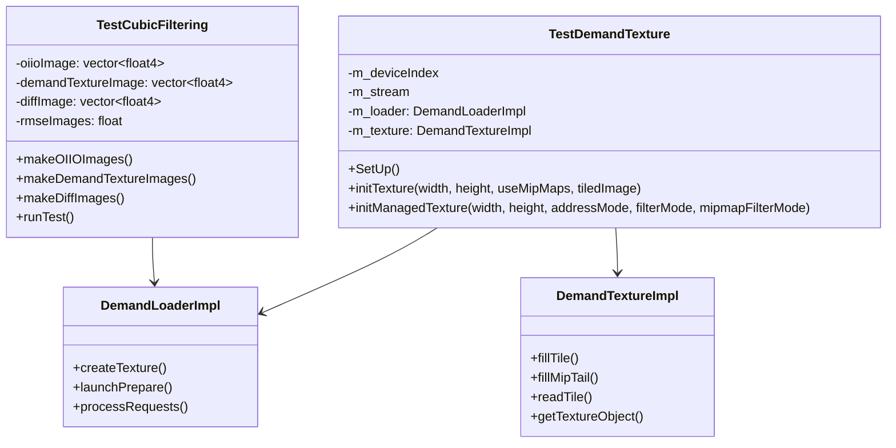
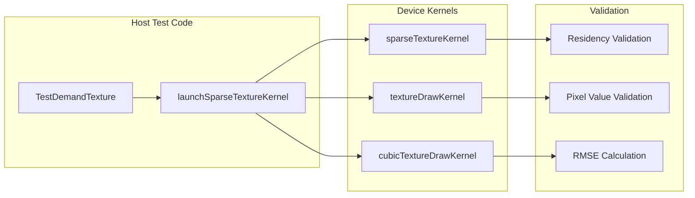

<!-- source: DeepWiki mcp.deepwiki.com · repo NVIDIA/optix-toolkit · page 6 Development and Testing · fetched 2026-10-26 -->

# Development and Testing

<details>
<summary>Relevant source files</summary>

The following files were used as context for generating this wiki page:

- [CMake/OptiXToolkitConfig.cmake.in](CMake/OptiXToolkitConfig.cmake.in)
- [DemandLoading/DemandLoading/tests/CMakeLists.txt](DemandLoading/DemandLoading/tests/CMakeLists.txt)
- [DemandLoading/DemandLoading/tests/TestCubicFiltering.cpp](DemandLoading/DemandLoading/tests/TestCubicFiltering.cpp)
- [DemandLoading/DemandLoading/tests/TestCubicFiltering.cu](DemandLoading/DemandLoading/tests/TestCubicFiltering.cu)
- [DemandLoading/DemandLoading/tests/TestCubicFiltering.h](DemandLoading/DemandLoading/tests/TestCubicFiltering.h)
- [DemandLoading/DemandLoading/tests/TestDemandTexture.cpp](DemandLoading/DemandLoading/tests/TestDemandTexture.cpp)
- [DemandLoading/DemandLoading/tests/TestSparseTexture.cu](DemandLoading/DemandLoading/tests/TestSparseTexture.cu)
- [DemandLoading/DemandLoading/tests/TestSparseTexture.h](DemandLoading/DemandLoading/tests/TestSparseTexture.h)
- [ShaderUtil/include/OptiXToolkit/ShaderUtil/CubicFiltering.h](ShaderUtil/include/OptiXToolkit/ShaderUtil/CubicFiltering.h)

</details>


This section provides information for developers working on the OptiX Toolkit itself, covering the testing infrastructure, validation systems, and development practices used to ensure code quality and correctness. 

For information about using the toolkit in applications, see [Getting Started](#2). For details about the testing framework infrastructure specifically, see [Testing Framework](#6.1).

## Testing Framework Overview

The OptiX Toolkit employs a comprehensive testing strategy that combines unit testing, integration testing, and validation against reference implementations. The testing framework is built around Google Test (GTest) and includes specialized CUDA kernel testing capabilities.



**Testing Framework Architecture**

Sources: [DemandLoading/DemandLoading/tests/CMakeLists.txt:1-155](), [DemandLoading/DemandLoading/tests/TestCubicFiltering.cpp:1-629]()

## Test Organization and Structure

The testing infrastructure is organized into focused test suites that validate specific subsystems. Each test suite follows a consistent pattern using GTest fixtures and specialized test kernels.

| Test Suite | Primary Focus | Key Files |
|------------|---------------|-----------|
| `TestDemandTexture` | Core demand loading functionality | `TestDemandTexture.cpp`, `TestSparseTexture.cu` |
| `TestCubicFiltering` | Advanced filtering validation | `TestCubicFiltering.cpp`, `TestCubicFiltering.cu` |
| `TestSparseTexture` | Sparse texture operations | `TestSparseTexture.cu`, `TestSparseTexture.h` |
| `TestTextureFootprint` | OptiX kernel integration | `TestTextureFootprint.cpp`, `TestTextureFootprint.cu` |

### Test Class Structure



**Core Test Class Relationships**

Sources: [DemandLoading/DemandLoading/tests/TestDemandTexture.cpp:31-112](), [DemandLoading/DemandLoading/tests/TestCubicFiltering.cpp:41-86]()

## Key Test Suites

### Cubic Filtering Validation

The `TestCubicFiltering` suite provides comprehensive validation of cubic texture filtering by comparing OptiX Toolkit results against OpenImageIO reference implementations.

**Test Methodology:**
- Generates identical test scenarios using both OIIO and DemandLoading
- Computes pixel-level differences and RMSE values
- Validates derivative calculations for texture gradients
- Tests multiple filtering modes: bilinear, bicubic, smart bicubic

The test harness at [DemandLoading/DemandLoading/tests/TestCubicFiltering.cpp:348-355]() implements the core validation loop:

```cpp
void TestCubicFiltering::runTest()
{
    makeDemandTextureImages();
    makeOIIOImages();
    makeDiffImages();
    rmseImages = imageDiff( oiioImage, demandTextureImage );
    rmseDerivativeImages = imageDiff( oiioDerivativeImage, demandTextureDerivativeImage );
}
```

**Test Scenarios:**
- Mip level testing (`mip0`, `mip3`, `mip4`)
- Anisotropic filtering validation
- Conservative vs non-conservative filtering
- Wrap mode testing
- Smart bicubic filtering behavior

Sources: [DemandLoading/DemandLoading/tests/TestCubicFiltering.cpp:370-628](), [ShaderUtil/include/OptiXToolkit/ShaderUtil/CubicFiltering.h:1-237]()

### Demand Texture Testing

The `TestDemandTexture` suite validates core demand loading functionality including tile management, mip tail handling, and texture residency.

**Key Test Methods:**

| Test | Purpose | Validation |
|------|---------|------------|
| `TestFillTile` | Tile loading and residency | Sparse texture tile presence |
| `TestFillMipTail` | Mip tail management | Small mip level correctness |
| `TestDenseTexture` | Dense texture fallback | Non-sparse texture handling |
| `TestSparseNonMipmappedTexture` | Non-mipmapped sparse textures | Single-level sparse textures |

The test framework uses specialized CUDA kernels to validate texture sampling behavior:

```cpp
__global__ static void sparseTextureKernel( cudaTextureObject_t texture, float4* output, int width, int height, float lod )
{
    // Texture sampling with residency checking
    bool isResident = true;
    float4 pixel = tex2DLod<float4>( texture, s, t, lod, &isResident );
    output[y * width + x] = isResident ? pixel : make_float4( -1.f, -1.f, -1.f, -1.f );
}
```

Sources: [DemandLoading/DemandLoading/tests/TestDemandTexture.cpp:114-574](), [DemandLoading/DemandLoading/tests/TestSparseTexture.cu:18-44]()

### Sparse Texture Kernel Testing

The testing infrastructure includes specialized CUDA kernels for validating demand loading behavior in GPU context:



**GPU Test Execution Flow**

Sources: [DemandLoading/DemandLoading/tests/TestSparseTexture.cu:76-101](), [DemandLoading/DemandLoading/tests/TestCubicFiltering.cu:14-38]()

## Build System Integration

The testing framework integrates with the CMake build system through specialized functions and target configurations:

### Test Target Configuration

The build system uses `embed_cuda` to compile CUDA test kernels and `otk_add_executable` for test executables:

```cmake
embed_cuda( CONST HEADER TestDemandLoadingKernelsCuda.h
    PTX
    OUTPUT_TARGET testDemandLoadingKernels
    LIBRARIES
        DemandLoading
        ShaderUtil
    SOURCES DeferredImageLoadingKernels.cu
    FOLDER DemandLoading/Tests
)
```

### Dependency Management

Test executables link against core libraries and testing frameworks:

```cmake
target_link_libraries( testDemandLoading
  testDemandLoadingKernels
  DemandLoadingKernels
  OptiXToolkit::OptiXMemory
  OptiX::OptiX
  DemandLoading
  ShaderUtil
  CUDA::cudart
  OpenEXR::OpenEXR
  GTest::gmock
  ${CMAKE_DL_LIBS}
)
```

### CTest Integration

Tests are registered with CTest for automated execution:

```cmake
gtest_discover_tests(testDemandLoading PROPERTIES LABELS DemandLoading)
gtest_discover_tests(testTextureFootprint PROPERTIES LABELS DemandLoading)
```

Sources: [DemandLoading/DemandLoading/tests/CMakeLists.txt:9-17](), [DemandLoading/DemandLoading/tests/CMakeLists.txt:76-87](), [DemandLoading/DemandLoading/tests/CMakeLists.txt:107-154]()

## Testing Infrastructure and Utilities

### Image Comparison Utilities

The testing framework provides utilities for comparing rendered images and computing difference metrics:

**Key Functions:**
- `imageDiff()`: Computes RMSE between image pairs
- `makeDiffImage()`: Generates difference images with scaling
- `scaleAndBiasImage()`: Normalizes images for comparison
- `writePPM()`: Outputs debug images for visual inspection

### Device Management

Tests handle multiple GPU scenarios and device capability checking:

```cpp
unsigned int deviceIndex = getFirstSparseTextureDevice();
if( deviceIndex == demandLoading::MAX_DEVICES )
    return; // Skip test if sparse textures not supported
```

### Memory Management

Test fixtures manage CUDA memory allocation and cleanup:

```cpp
CUdeviceptr devImage = 0;
OTK_ERROR_CHECK( cuMemAlloc( &devImage, width * height * sizeof(float4) ) );
// ... test execution ...
OTK_ERROR_CHECK( cuMemFree( devImage ) );
```

Sources: [DemandLoading/DemandLoading/tests/TestCubicFiltering.cpp:147-158](), [DemandLoading/DemandLoading/tests/TestDemandTexture.cpp:36-50](), [DemandLoading/DemandLoading/tests/TestCubicFiltering.cpp:268-296]()

## Development Workflow Integration

### Continuous Integration

The testing framework is designed for automated CI/CD integration through:
- CTest discovery and execution
- Consistent exit codes for pass/fail determination  
- Comprehensive error reporting and logging
- Platform-specific capability detection

### Debugging Support

Tests provide extensive debugging capabilities:
- PPM image output for visual validation
- Detailed error messages with CUDA error checking
- Configurable test parameters for focused debugging
- Optional image output compilation flags

### Performance Validation

The testing framework includes performance validation through:
- Request counting and validation
- Launch iteration testing
- Memory usage tracking
- Timing measurement capabilities

Sources: [DemandLoading/DemandLoading/tests/TestCubicFiltering.cpp:313-344](), [DemandLoading/DemandLoading/tests/TestDemandTexture.cpp:469-489]()

---

