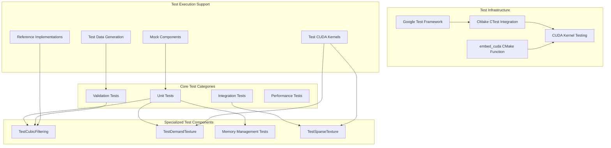
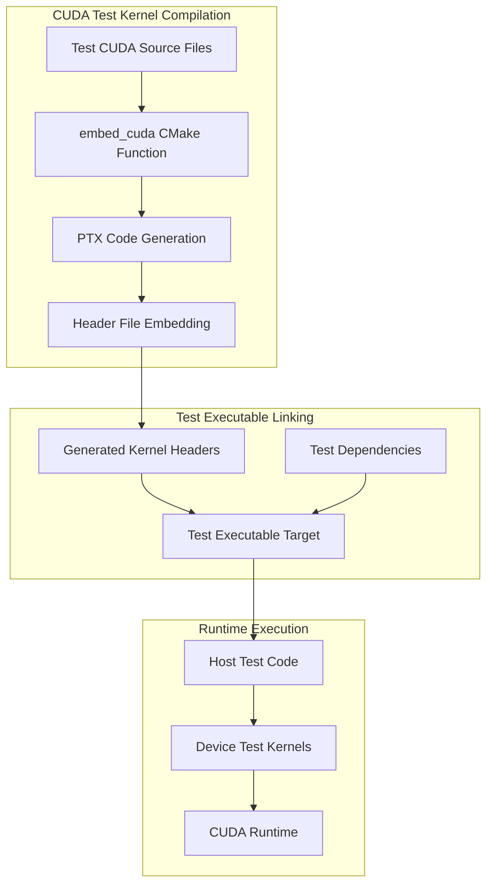
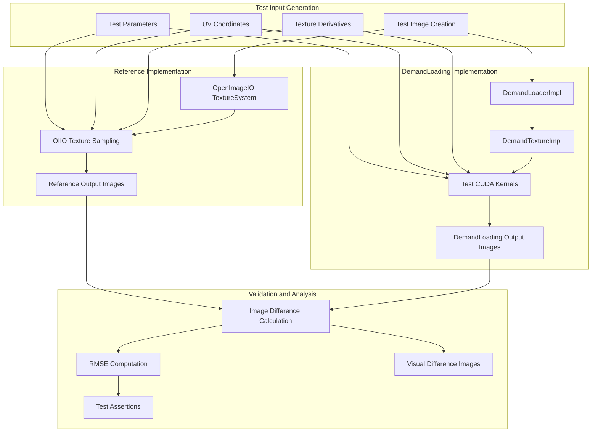
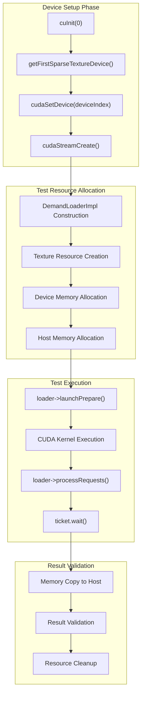
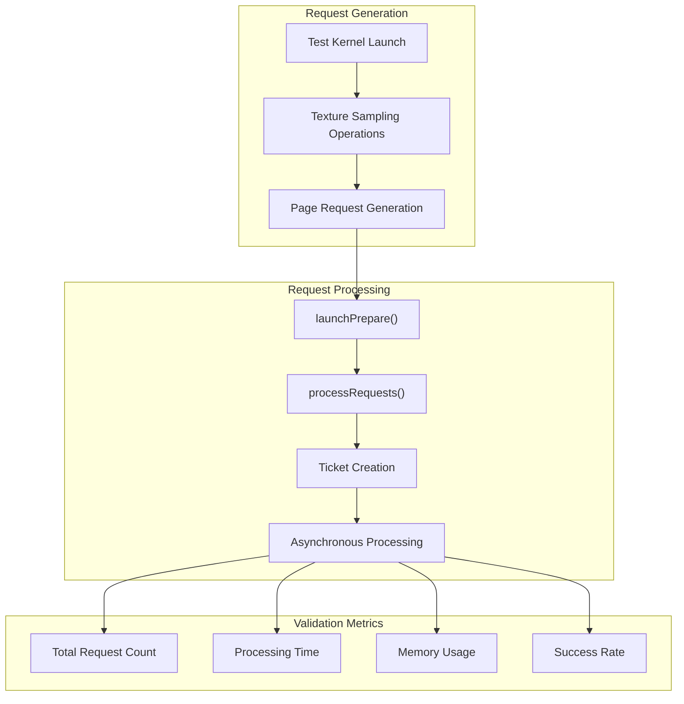

<!-- source: DeepWiki mcp.deepwiki.com · repo NVIDIA/optix-toolkit · page 6.1 Testing Framework · fetched 2026-10-26 -->

# Testing Framework

Relevant source files

The following files were used as context for generating this wiki page:

- [DemandLoading/DemandLoading/tests/CMakeLists.txt](DemandLoading/DemandLoading/tests/CMakeLists.txt)
- [DemandLoading/DemandLoading/tests/TestCubicFiltering.cpp](DemandLoading/DemandLoading/tests/TestCubicFiltering.cpp)
- [DemandLoading/DemandLoading/tests/TestCubicFiltering.cu](DemandLoading/DemandLoading/tests/TestCubicFiltering.cu)
- [DemandLoading/DemandLoading/tests/TestCubicFiltering.h](DemandLoading/DemandLoading/tests/TestCubicFiltering.h)
- [DemandLoading/DemandLoading/tests/TestDemandTexture.cpp](DemandLoading/DemandLoading/tests/TestDemandTexture.cpp)
- [DemandLoading/DemandLoading/tests/TestSparseTexture.cu](DemandLoading/DemandLoading/tests/TestSparseTexture.cu)
- [DemandLoading/DemandLoading/tests/TestSparseTexture.h](DemandLoading/DemandLoading/tests/TestSparseTexture.h)
- [ShaderUtil/include/OptiXToolkit/ShaderUtil/CubicFiltering.h](ShaderUtil/include/OptiXToolkit/ShaderUtil/CubicFiltering.h)

The OptiX Toolkit employs a comprehensive testing framework designed to validate the correctness and performance of demand loading, texture filtering, memory management, and other core systems. The framework combines unit testing, integration testing, and specialized validation approaches including pixel-level image comparison against reference implementations.

For information about the development build system that supports testing, see [CMake Development](#6.2). For details about the core libraries being tested, see [Core Libraries](#1.1).

## Test Architecture Overview

The testing framework is built around Google Test (GTest) with specialized extensions for CUDA kernel testing and image validation. Tests are organized by component and functionality, with both isolated unit tests and end-to-end integration tests.

**Sources:** [DemandLoading/DemandLoading/tests/CMakeLists.txt:1-155]()

## Test Organization and Build System

The testing framework integrates with the CMake build system through specialized functions and test discovery mechanisms. Each test suite is compiled as a separate executable with its own dependencies and CUDA kernels.

### Test Executable Structure

| Test Executable | Purpose | Key Components |
|-----------------|---------|----------------|
| `testDemandLoading` | Core demand loading functionality | DemandLoader, textures, memory management |
| `testTextureFootprint` | OptiX kernel texture footprint analysis | OptiX integration, texture sampling |
| Individual component tests | Isolated unit testing | Specific library components |

### CUDA Kernel Test Integration

The framework uses the `embed_cuda` CMake function to compile CUDA test kernels into header files that can be linked with test executables:

**Sources:** [DemandLoading/DemandLoading/tests/CMakeLists.txt:8-17](), [DemandLoading/DemandLoading/tests/CMakeLists.txt:110-121]()

## Validation Testing Framework

The most sophisticated component of the testing framework is the validation system, exemplified by the `TestCubicFiltering` class. This system compares OptiX Toolkit implementations against reference implementations to ensure correctness.

### Cubic Filtering Validation Architecture

**Sources:** [DemandLoading/DemandLoading/tests/TestCubicFiltering.cpp:41-86](), [DemandLoading/DemandLoading/tests/TestCubicFiltering.cpp:177-220]()

## Test Execution and Device Management

The testing framework includes sophisticated device management and CUDA initialization to ensure tests run correctly across different GPU configurations.

### Device Initialization Pattern

The test framework follows a consistent pattern for device setup and resource management:

**Sources:** [DemandLoading/DemandLoading/tests/TestDemandTexture.cpp:34-57](), [DemandLoading/DemandLoading/tests/TestCubicFiltering.cpp:225-241]()

## Image Validation and Quality Metrics

The framework includes sophisticated image comparison and quality assessment tools for validating rendering correctness.

### Image Comparison Workflow

The validation system implements pixel-level comparison with mathematical precision:

| Function | Purpose | Implementation |
|----------|---------|----------------|
| `makeDiffImage()` | Generate difference images | Scale differences and add bias for visualization |
| `imageDiff()` | Calculate RMSE | Compute root mean square error between images |
| `scaleAndBiasImage()` | Normalize images | Apply scaling and bias for comparison |
| `writePPM()` | Output validation images | Write PPM files for visual inspection |

### Test Coverage Categories

The testing framework covers multiple quality dimensions:

```mermaid
graph TB
    subgraph "Filtering Quality Tests"
        BILINEAR_TEST["Bilinear Filtering"]
        BICUBIC_TEST["Bicubic Filtering"]
        SMART_BICUBIC["Smart Bicubic"]
        ANISOTROPIC["Anisotropic Filtering"]
    end
    
    subgraph "Mipmap Level Tests"
        MIP0_TESTS["Mip Level 0 Tests"]
        MIP3_TESTS["Mip Level 3 Tests"]
        MIP4_TESTS["Mip Level 4 Tests"]
        MIPTAIL_TESTS["Mip Tail Tests"]
    end
    
    subgraph "Texture Configuration Tests"
        SPARSE_TEXTURE["Sparse Texture Tests"]
        DENSE_TEXTURE["Dense Texture Tests"]
        WRAP_MODE["Address Mode Tests"]
        NON_MIPMAPPED["Non-Mipmapped Tests"]
    end
    
    subgraph "Quality Metrics"
        RMSE_IMAGES["Image RMSE"]
        RMSE_DERIVATIVES["Derivative RMSE"]
        VISUAL_DIFF["Visual Difference Images"]
        PIXEL_VALIDATION["Pixel-Level Validation"]
    end
    
    BILINEAR_TEST --> RMSE_IMAGES
    BICUBIC_TEST --> RMSE_IMAGES
    SMART_BICUBIC --> RMSE_DERIVATIVES
    ANISOTROPIC --> VISUAL_DIFF
    
    MIP0_TESTS --> PIXEL_VALIDATION
    MIP3_TESTS --> PIXEL_VALIDATION
    MIP4_TESTS --> PIXEL_VALIDATION
    MIPTAIL_TESTS --> PIXEL_VALIDATION
    
    SPARSE_TEXTURE --> RMSE_IMAGES
    DENSE_TEXTURE --> RMSE_IMAGES
    WRAP_MODE --> VISUAL_DIFF
    NON_MIPMAPPED --> PIXEL_VALIDATION
```

**Sources:** [DemandLoading/DemandLoading/tests/TestCubicFiltering.cpp:135-158](), [DemandLoading/DemandLoading/tests/TestCubicFiltering.cpp:370-628]()

## Mock Components and Test Doubles

The framework implements mock components to isolate functionality and enable unit testing without external dependencies.

### ImageSource Test Implementations

The testing framework provides specialized image sources for controlled testing:

| Mock Component | Purpose | Key Features |
|----------------|---------|--------------|
| `CheckerBoardImage` | Predictable test patterns | Configurable size, mipmap support, tiled/non-tiled |
| `DeviceConstantImage` | GPU memory testing | Device-side constant values |
| Test texture generators | Validation patterns | Known pixel values for validation |

**Sources:** [DemandLoading/DemandLoading/tests/TestDemandTexture.cpp:72-78](), [OptiXToolkit/ImageSource/CheckerBoardImage.h]()

## Performance and Integration Testing

Beyond correctness validation, the framework includes performance measurement and end-to-end integration testing.

### Request Processing Validation

The framework validates that the demand loading system correctly processes texture requests:

**Sources:** [DemandLoading/DemandLoading/tests/TestDemandTexture.cpp:468-488](), [DemandLoading/DemandLoading/tests/TestCubicFiltering.cpp:274-289]()

## Test Data Management

The framework includes sophisticated test data generation and management systems to ensure consistent and comprehensive testing coverage.

### Test Asset Pipeline

Test data is managed through a combination of generated content and embedded resources:

| Asset Type | Generation Method | Usage |
|------------|------------------|-------|
| Synthetic images | `CheckerBoardImage` generation | Predictable patterns for validation |
| Reference textures | External file loading | Real-world texture testing |
| Test parameters | Parameterized test generation | Comprehensive coverage |
| Expected results | Reference implementation | Ground truth validation |

**Sources:** [DemandLoading/DemandLoading/tests/CMakeLists.txt:73-74](), [DemandLoading/DemandLoading/tests/TestCubicFiltering.cpp:372-373]()

---

