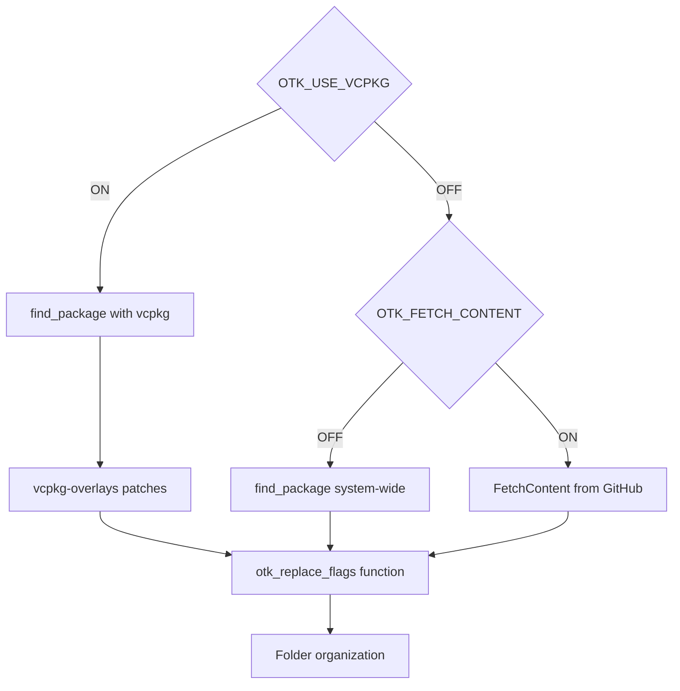
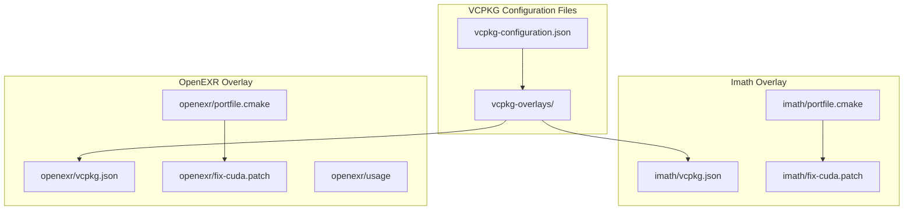
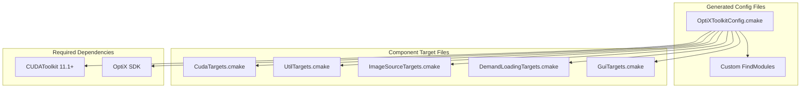
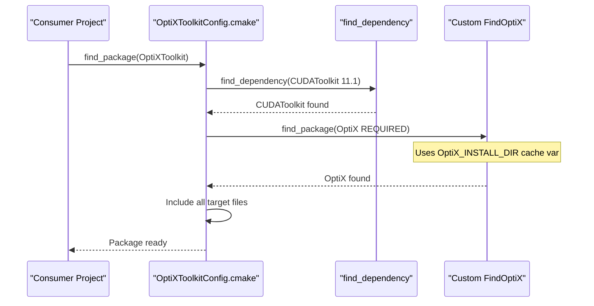
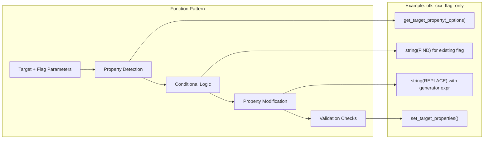

<!-- source: DeepWiki mcp.deepwiki.com · repo NVIDIA/optix-toolkit · page 6.2 CMake Development · fetched 2026-10-26 -->

# CMake Development

<details>
<summary>Relevant source files</summary>

The following files were used as context for generating this wiki page:

- [CMake/FetchOpenEXR.cmake](CMake/FetchOpenEXR.cmake)
- [CMake/OptiXToolkitConfig.cmake.in](CMake/OptiXToolkitConfig.cmake.in)
- [vcpkg-configuration.json](vcpkg-configuration.json)
- [vcpkg-overlays/imath/fix-cuda.patch](vcpkg-overlays/imath/fix-cuda.patch)
- [vcpkg-overlays/imath/portfile.cmake](vcpkg-overlays/imath/portfile.cmake)
- [vcpkg-overlays/imath/vcpkg.json](vcpkg-overlays/imath/vcpkg.json)
- [vcpkg-overlays/openexr/fix-cuda.patch](vcpkg-overlays/openexr/fix-cuda.patch)
- [vcpkg-overlays/openexr/portfile.cmake](vcpkg-overlays/openexr/portfile.cmake)
- [vcpkg-overlays/openexr/usage](vcpkg-overlays/openexr/usage)
- [vcpkg-overlays/openexr/vcpkg.json](vcpkg-overlays/openexr/vcpkg.json)

</details>


This document covers advanced CMake development for the OptiX Toolkit build system, including custom modules, dependency management extensions, and package configuration. This page is intended for developers who need to modify or extend the OptiX Toolkit's build infrastructure itself.

For information about using the build system as an end user, see [Build System](#2.2). For basic configuration options, see [Build Configuration](#2.3).

## Custom CMake Module Architecture

The OptiX Toolkit includes several custom CMake modules that handle complex dependency scenarios, particularly around CUDA compatibility with third-party libraries. The primary module is `FetchOpenEXR.cmake`, which demonstrates the pattern used throughout the toolkit.

### Dependency Resolution Strategy



The module implements a three-tier dependency resolution strategy controlled by CMake variables. When `OTK_USE_VCPKG` is enabled, it uses vcpkg with custom overlay patches. Otherwise, it falls back to either FetchContent or system packages.

**Sources:** [CMake/FetchOpenEXR.cmake:5-10](), [CMake/FetchOpenEXR.cmake:51-53]()

### CUDA Compatibility Functions

The core challenge addressed by the custom modules is making third-party libraries compatible with CUDA's `nvcc` compiler, which has different flag requirements than standard C++ compilers.

```mermaid
flowchart LR
    subgraph "Flag Compatibility System"
        otk_cxx_flag_only["otk_cxx_flag_only()"]
        otk_replace_flags["otk_replace_flags()"]
        
        MSVC_FLAGS["\"/EHsc\", \"/MP\""]
        GENERATOR_EXPR["\"$<$<COMPILE_LANGUAGE:CXX>:/flag>\""]
        
        TARGET_PROPS["INTERFACE_COMPILE_OPTIONS"]
        DEPENDENCIES["INTERFACE_LINK_LIBRARIES"]
    end
    
    otk_cxx_flag_only --> GENERATOR_EXPR
    MSVC_FLAGS --> otk_cxx_flag_only
    
    otk_replace_flags --> TARGET_PROPS
    otk_replace_flags --> DEPENDENCIES
    otk_replace_flags --> otk_cxx_flag_only
```

The `otk_cxx_flag_only` function converts MSVC compiler flags like `/EHsc` into generator expressions that only apply to C++ compilation, preventing conflicts with CUDA compilation.

**Sources:** [CMake/FetchOpenEXR.cmake:14-24](), [CMake/FetchOpenEXR.cmake:26-43]()

## VCPKG Overlay System

The OptiX Toolkit uses vcpkg overlays to provide patched versions of third-party libraries that have CUDA compatibility issues. This system allows the toolkit to use standard vcpkg packages while applying necessary fixes.

### Overlay Configuration Structure



The overlay system is configured through `vcpkg-configuration.json` which specifies the overlay directory. Each overlay contains a complete port definition with patches applied during the build process.

**Sources:** [vcpkg-configuration.json:6-8](), [vcpkg-overlays/imath/portfile.cmake:7-8](), [vcpkg-overlays/openexr/portfile.cmake:7-8]()

### CUDA Compatibility Patches

The overlay patches specifically target MSVC compiler flags that cause issues with CUDA compilation:

| Library | Original Flag | Patched Flag |
|---------|---------------|--------------|
| Imath | `/EHsc` | `$<$<COMPILE_LANGUAGE:CXX>:/EHsc>` |
| OpenEXR | `/EHsc` `/MP` | `$<$<COMPILE_LANGUAGE:CXX>:/EHsc>` `$<$<COMPILE_LANGUAGE:CXX>:/MP>` |

The patches use CMake generator expressions to ensure compiler flags only apply to C++ compilation, not CUDA compilation. This prevents `nvcc` from receiving incompatible flags.

**Sources:** [vcpkg-overlays/imath/fix-cuda.patch:9-10](), [vcpkg-overlays/openexr/fix-cuda.patch:9-10]()

## Package Configuration System

The OptiX Toolkit provides a CMake package configuration system for downstream consumers through `OptiXToolkitConfig.cmake.in`.

### Installation Target Structure



The configuration system uses CMake's standard package mechanism with component-based target exports. The `GUI_TARGETS` import is optional, allowing the toolkit to be used in headless environments.

**Sources:** [CMake/OptiXToolkitConfig.cmake.in:11-22]()

### Dependency Discovery Chain

The package configuration implements a two-stage dependency discovery process:

1. **Standard Dependencies**: Uses `find_dependency` for CUDAToolkit with version requirements
2. **Custom Dependencies**: Uses custom find modules for OptiX SDK with user-specified installation paths



**Sources:** [CMake/OptiXToolkitConfig.cmake.in:9-15]()

## Build System Extension Patterns

### Custom Function Design Pattern

The OptiX Toolkit follows a consistent pattern for implementing custom CMake functions that handle cross-platform and cross-compiler compatibility:



This pattern ensures functions are idempotent and handle edge cases like missing properties or already-processed targets.

**Sources:** [CMake/FetchOpenEXR.cmake:14-24]()

### Target Organization Strategy

The custom modules implement a consistent target organization strategy using CMake's `FOLDER` property:

```cmake
# Pattern used throughout custom modules
foreach(_target OpenEXR OpenEXRCore OpenEXRUtil IlmThread Iex Imath)
  if(TARGET ${_target})
    set_property(TARGET ${_target} PROPERTY FOLDER ThirdParty/OpenEXR)
  endif()
endforeach()
```

This creates a hierarchical organization in IDEs that support CMake folders, grouping third-party dependencies separately from toolkit code.

**Sources:** [CMake/FetchOpenEXR.cmake:95-107]()