# Page: OptiX Toolkit Overview

# OptiX Toolkit Overview

<details>
<summary>Relevant source files</summary>

The following files were used as context for generating this wiki page:

- [CHANGELOG.md](CHANGELOG.md)
- [CMakeLists.txt](CMakeLists.txt)
- [DemandLoading/CMakeLists.txt](DemandLoading/CMakeLists.txt)
- [DemandLoading/README.md](DemandLoading/README.md)
- [Memory/CHANGELOG.md](Memory/CHANGELOG.md)
- [Memory/LICENSE.txt](Memory/LICENSE.txt)
- [Memory/README.md](Memory/README.md)
- [Memory/include/OptiXToolkit/Memory/BitCast.h](Memory/include/OptiXToolkit/Memory/BitCast.h)
- [README.md](README.md)

</details>


## Purpose and Scope

The OptiX Toolkit (OTK) is a collection of C++/CUDA utilities designed to simplify the development of applications using the NVIDIA OptiX ray tracing API. This document provides a high-level overview of the toolkit's architecture, core libraries, and how they work together to enable advanced ray tracing features like demand-loaded textures, opacity micromaps, and efficient memory management.

For detailed information about specific components, see [Core Libraries](#1.1) for library-specific documentation, [Getting Started](#2) for build instructions, and [DemandLoading System](#3) for the toolkit's most important subsystem.

Sources: [README.md:1-3](), [CMakeLists.txt:6-7]()

## High-Level Architecture

The OptiX Toolkit follows a modular design with four main layers: external dependencies, build system infrastructure, core libraries, and example applications. The central component is the DemandLoading system, which enables sparse texture loading and forms the foundation for most advanced features.

### System Architecture Overview

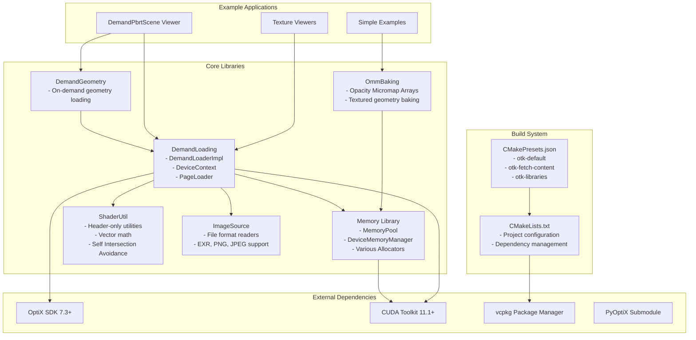

Sources: [CMakeLists.txt:76-97](), [README.md:20-25](), [DemandLoading/CMakeLists.txt:35-38]()

## Core Libraries

The OptiX Toolkit provides four primary libraries that can be built independently or together. Each library serves a specific purpose and follows clear dependency relationships.

### Library Dependency Structure

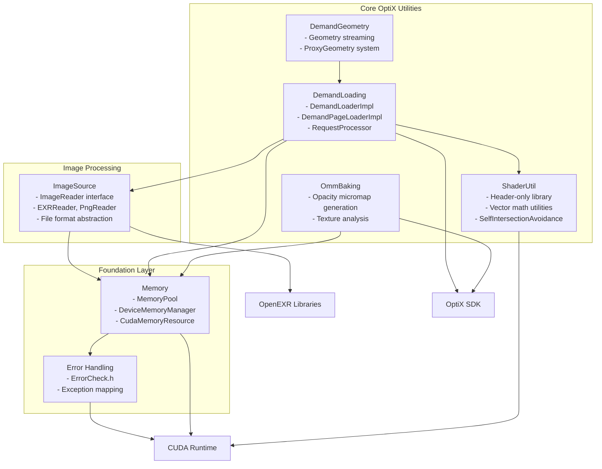

### Library Configuration

The toolkit uses a flexible library selection system controlled by the `OTK_LIBRARIES` CMake variable. The default configuration includes all four core libraries with their dependencies automatically resolved.

| Library | Dependencies | Purpose |
|---------|-------------|---------|
| `Memory` | None | Foundation memory management |
| `ShaderUtil` | `Memory` | OptiX kernel utilities |
| `DemandLoading` | `Memory`, `ShaderUtil` | Sparse texture streaming |
| `OmmBaking` | `Memory` | Opacity micromap generation |

Sources: [CMakeLists.txt:76-88](), [README.md:145-148](), [Memory/README.md:7-16]()

## Build System Architecture

The OptiX Toolkit employs a sophisticated CMake-based build system with multiple dependency acquisition strategies and extensive configuration options.

### Build Configuration Flow

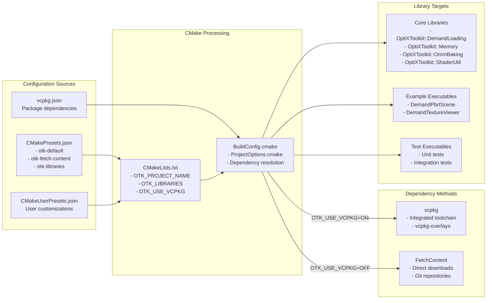

### CMake Configuration Options

The build system provides extensive customization through CMake variables:

| Variable | Type | Default | Description |
|----------|------|---------|-------------|
| `OTK_USE_VCPKG` | `BOOL` | `ON` | Use vcpkg for dependencies |
| `OTK_LIBRARIES` | `STRING` | `ALL` | Libraries to build |
| `OTK_BUILD_EXAMPLES` | `BOOL` | `ON` | Build example applications |
| `OTK_BUILD_TESTS` | `BOOL` | `ON` | Build test suite |
| `OTK_PROJECT_NAME` | `STRING` | `OptiXToolkit` | CMake project name |

Sources: [CMakeLists.txt:25](), [README.md:126-142](), [CMakeLists.txt:55-60]()

## System Dependencies

The OptiX Toolkit requires several external dependencies that are managed through either vcpkg or CMake FetchContent.

### External Dependency Requirements

| Component | Requirements | Purpose |
|-----------|-------------|---------|
| **Runtime** | OptiX SDK 7.3+, CUDA Toolkit 11.1+ | Core ray tracing and compute |
| **Image Processing** | OpenEXR 3.1.5+, Imath 3.1.5+, OpenImageIO (optional) | Texture file format support |
| **GUI (Examples)** | GLFW 3.3+, ImGui, glad, stb | Interactive applications |
| **Testing** | Google Test, Google Mock | Unit and integration testing |
| **Build Tools** | CMake 3.27+, git with LFS | Build system and version control |

The toolkit automatically detects and configures these dependencies using the specified acquisition method (vcpkg or FetchContent).

Sources: [README.md:27-35](), [README.md:155-164](), [CMakeLists.txt:55-60]()

## Integration Points

The OptiX Toolkit is designed to integrate seamlessly with existing OptiX applications. The primary integration points are:

1. **CMake Integration**: Include as a subdirectory using `add_subdirectory(OptiXToolkit)`
2. **Library Linking**: Link against specific libraries like `OptiXToolkit::DemandLoading`
3. **Header Inclusion**: Use toolkit headers with the `<OptiXToolkit/Library>` prefix
4. **Device Code**: Include toolkit device functions in OptiX kernels

For comprehensive integration guidance, see [Getting Started](#2) and library-specific documentation in [Core Libraries](#1.1).

Sources: [DemandLoading/README.md:84-95](), [Memory/README.md:9-15]()

---

# Page: Core Libraries

# Core Libraries

<details>
<summary>Relevant source files</summary>

The following files were used as context for generating this wiki page:

- [CHANGELOG.md](CHANGELOG.md)
- [CMake/SetCxxStandard.cmake](CMake/SetCxxStandard.cmake)
- [DemandLoading/DemandGeometry/CMakeLists.txt](DemandLoading/DemandGeometry/CMakeLists.txt)
- [DemandLoading/DemandLoading/CMakeLists.txt](DemandLoading/DemandLoading/CMakeLists.txt)
- [DemandLoading/ImageSource/CMakeLists.txt](DemandLoading/ImageSource/CMakeLists.txt)
- [DemandLoading/ImageSource/include/OptiXToolkit/ImageSource/EXRReader.h](DemandLoading/ImageSource/include/OptiXToolkit/ImageSource/EXRReader.h)
- [DemandLoading/README.md](DemandLoading/README.md)
- [Memory/CHANGELOG.md](Memory/CHANGELOG.md)
- [Memory/CMakeLists.txt](Memory/CMakeLists.txt)
- [Memory/LICENSE.txt](Memory/LICENSE.txt)
- [Memory/README.md](Memory/README.md)
- [Memory/include/OptiXToolkit/Memory/BitCast.h](Memory/include/OptiXToolkit/Memory/BitCast.h)
- [OmmBaking/CMakeLists.txt](OmmBaking/CMakeLists.txt)
- [README.md](README.md)
- [ShaderUtil/CMakeLists.txt](ShaderUtil/CMakeLists.txt)
- [examples/CMakeLists.txt](examples/CMakeLists.txt)
- [examples/CuOmmBaking/Simple/CMakeLists.txt](examples/CuOmmBaking/Simple/CMakeLists.txt)
- [examples/CuOmmBaking/Viewer/CMakeLists.txt](examples/CuOmmBaking/Viewer/CMakeLists.txt)

</details>


This document covers the main library components that form the foundation of the OptiX Toolkit. These libraries provide essential functionality for demand loading, memory management, shader utilities, and specialized OptiX features. For information about example applications that demonstrate these libraries, see [Example Applications](#5). For details about the build system that orchestrates these components, see [Build System](#2.2).

## Library Overview

The OptiX Toolkit consists of several interconnected core libraries, each serving specific roles in the overall architecture:

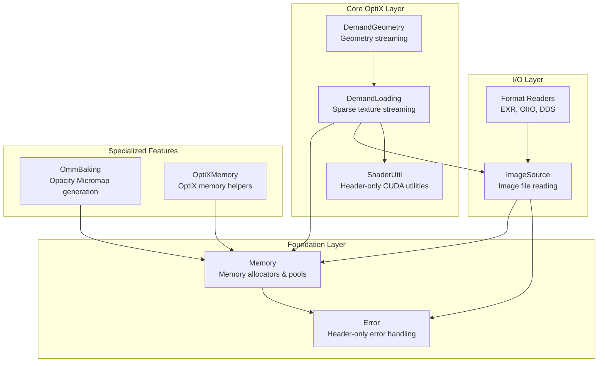

**Library Dependency Architecture**

Sources: [README.md:20-25](), [Memory/CMakeLists.txt:78-108](), [DemandLoading/DemandLoading/CMakeLists.txt:157-164]()

## Library Component Details

### DemandLoading Library

The `DemandLoading` library is the centerpiece of the toolkit, providing on-demand loading of sparse textures and other resources for OptiX applications.

| Component | Purpose | Key Classes |
|-----------|---------|-------------|
| Core Implementation | Main demand loading orchestration | `DemandLoaderImpl`, `DemandPageLoaderImpl` |
| Device Context | GPU-side state management | `DeviceContextImpl`, `DeviceContext` |
| Texture Management | Sparse texture handling | `DemandTextureImpl`, `SparseTexture`, `DenseTexture` |
| Request Processing | Asynchronous request handling | `ThreadPoolRequestProcessor`, `RequestQueue` |
| Memory Management | GPU memory allocation | `DeviceMemoryManager` |

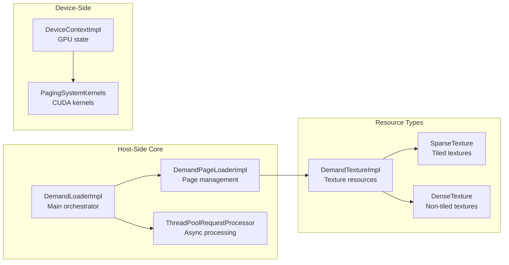

**DemandLoading Internal Architecture**

Sources: [DemandLoading/DemandLoading/CMakeLists.txt:34-81](), [DemandLoading/README.md:1-11]()

### Memory Library

The `Memory` library provides the foundational memory management capabilities used throughout the toolkit, with special focus on CUDA memory operations.

| Library | Type | Purpose |
|---------|------|---------|
| Error | Interface | Error code to exception mapping |
| Memory | Interface | Memory allocators and pools |
| OptiXMemory | Interface | OptiX-specific memory helpers |

Key components include:
- **Allocators**: `Allocators.h`, `BinnedSuballocator.h`, `HeapSuballocator.h`
- **Memory Pools**: `MemoryPool.h`, `DeviceFixedPool.h`, `DeviceRingBuffer.h`
- **Synchronization**: `SyncVector.h`, `MemoryBlockDesc.h`
- **OptiX Helpers**: `Builders.h`, `Record.h`, `SyncRecord.h`

Sources: [Memory/CMakeLists.txt:78-159](), [Memory/README.md:7-16]()

### ShaderUtil Library

`ShaderUtil` is a header-only library providing utilities for OptiX device-side programming.

| Category | Headers | Purpose |
|----------|---------|---------|
| Math Utilities | `vec_math.h`, `Transform4.h` | Vector and matrix operations |
| Ray Processing | `ray_cone.h`, `SelfIntersectionAvoidance.h` | Ray geometry utilities |
| Sampling | `AliasTable.h`, `CdfInversionTable.h`, `PdfTable.h` | Probability distribution sampling |
| Debugging | `DebugLocation.h`, `vec_printers.h` | Development and debugging aids |
| Color | `color.h` | Color space operations |

Sources: [ShaderUtil/CMakeLists.txt:35-51]()

### ImageSource Library

The `ImageSource` library abstracts image file I/O operations, supporting multiple formats through a unified interface.

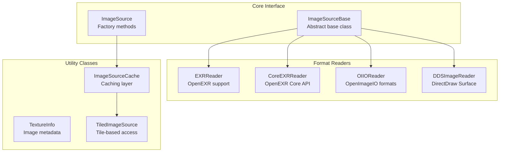

**ImageSource Architecture**

Sources: [DemandLoading/ImageSource/CMakeLists.txt:26-42](), [DemandLoading/ImageSource/include/OptiXToolkit/ImageSource/EXRReader.h:31-34]()

### OmmBaking Library

The `OmmBaking` library provides functionality for generating Opacity Micromap Arrays (OMMs) for use with OptiX ray tracing.

| Component | File | Purpose |
|-----------|------|---------|
| Main Interface | `CuOmmBaking.h` | Primary API for OMM baking |
| Buffer Management | `CuBuffer.h` | CUDA buffer utilities |
| Implementation | `CuOmmBakingImpl.h` | Internal implementation details |
| Texture Processing | `Texture.h` | Texture analysis for OMM generation |

Sources: [OmmBaking/CMakeLists.txt:67-70](), [README.md:23]()

## Library Configuration and Build Integration

The core libraries are configured through CMake with several important build options:

| Option | Default | Purpose |
|--------|---------|---------|
| `OTK_LIBRARIES` | `ALL` | Selects which libraries to build |
| `OTK_USE_OPENEXR` | `${OTK_USE_VCPKG}` | Enable OpenEXR support in ImageSource |
| `OTK_USE_OIIO` | `OFF` | Enable OpenImageIO support |
| `OTK_USE_CUDA_MEMORY_POOLS` | `ON` (CUDA 11.2+) | Use CUDA memory pools |

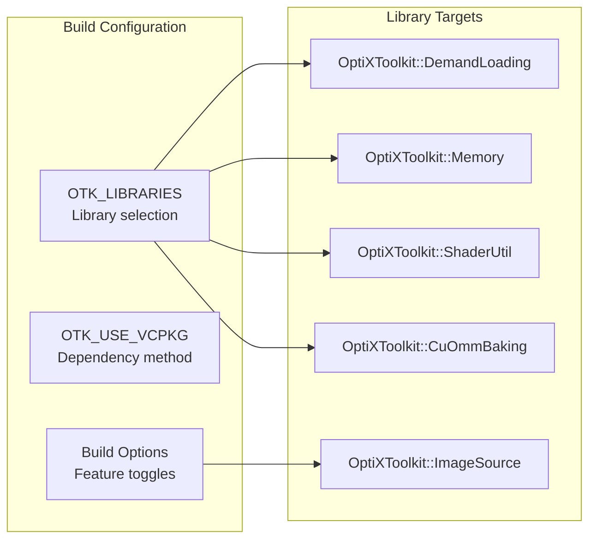

**Library Build Configuration**

The libraries can be built individually or as a complete set. Dependencies are automatically included when building specific libraries.

Sources: [README.md:141-149](), [DemandLoading/ImageSource/CMakeLists.txt:64-114](), [Memory/CMakeLists.txt:105-107]()

---

# Page: System Architecture

# System Architecture

<details>
<summary>Relevant source files</summary>

The following files were used as context for generating this wiki page:

- [CHANGELOG.md](CHANGELOG.md)
- [CMakeLists.txt](CMakeLists.txt)
- [DemandLoading/CMakeLists.txt](DemandLoading/CMakeLists.txt)
- [DemandLoading/README.md](DemandLoading/README.md)
- [Memory/CHANGELOG.md](Memory/CHANGELOG.md)
- [Memory/LICENSE.txt](Memory/LICENSE.txt)
- [Memory/README.md](Memory/README.md)
- [Memory/include/OptiXToolkit/Memory/BitCast.h](Memory/include/OptiXToolkit/Memory/BitCast.h)
- [README.md](README.md)

</details>


This document describes the high-level system architecture of the OptiX Toolkit, focusing on the modular organization of components, their interdependencies, and how they integrate to provide OptiX ray tracing utilities. This covers the structural design patterns, build system architecture, and runtime component relationships.

For detailed implementation of specific libraries, see [Core Libraries](#1.1). For build procedures and configuration, see [Build System](#2.2).

## Overall System Organization

The OptiX Toolkit follows a modular architecture where core libraries provide fundamental functionality, examples demonstrate usage patterns, and a sophisticated build system manages dependencies and configuration.

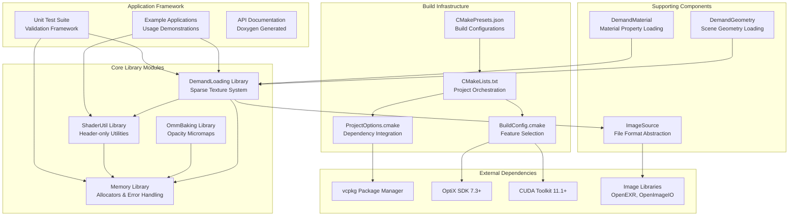

**OptiX Toolkit Modular Organization**

The architecture separates concerns into distinct layers: external dependencies are managed through vcpkg, build infrastructure provides flexible configuration, core libraries implement ray tracing utilities, and applications demonstrate integration patterns.

Sources: [CMakeLists.txt:1-111](), [README.md:20-26](), [DemandLoading/CMakeLists.txt:1-39]()

## Core Library Dependencies

The core libraries form a dependency hierarchy where foundational components support higher-level functionality. The `Memory` library provides the base layer, while `DemandLoading` represents the most complex subsystem.

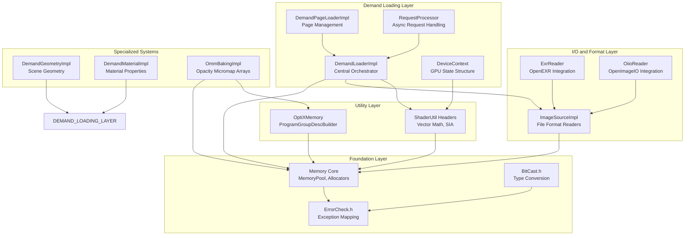

**Core Library Dependency Graph**

The dependency flow follows a layered pattern where each layer builds upon lower layers. The `Memory` library provides foundational allocators and error handling, while `DemandLoading` integrates multiple subsystems for texture streaming functionality.

Sources: [CMakeLists.txt:76-88](), [Memory/README.md:7-15](), [DemandLoading/README.md:1-23]()

## Build System Architecture

The build system uses CMake with a preset-based configuration approach, supporting multiple dependency acquisition methods and flexible library selection.

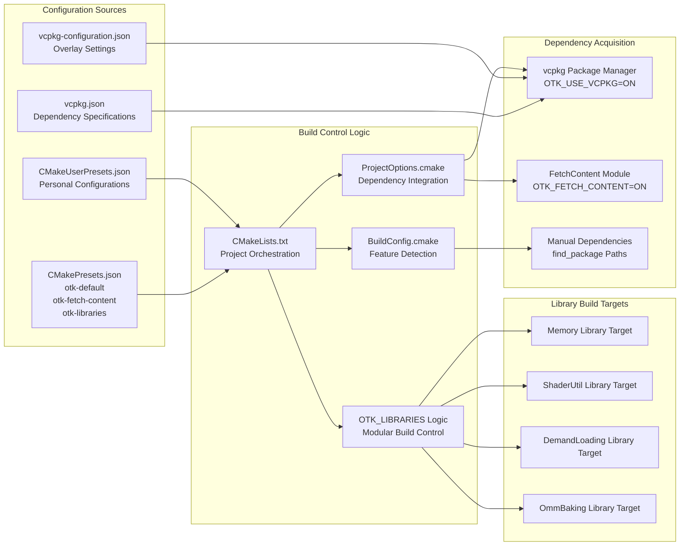

**Build System Configuration Flow**

The build system provides multiple configuration methods through CMake presets, with intelligent dependency resolution that can use vcpkg, FetchContent, or manual dependency specification based on configuration variables.

Sources: [CMakeLists.txt:14-28](), [README.md:64-96](), [README.md:126-149]()

## Runtime Component Integration

During runtime, the core components integrate through well-defined interfaces, with the `DemandLoader` serving as the central orchestrator for resource management and GPU communication.

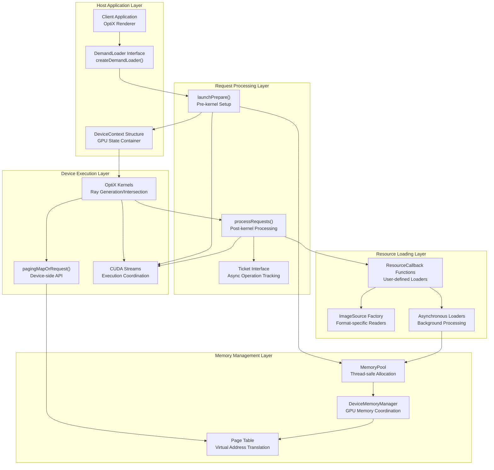

**Runtime Component Integration Pattern**

The runtime architecture follows an asynchronous request-response pattern where device-side code requests resources through `pagingMapOrRequest()`, host-side processing handles these requests through callbacks, and memory management coordinates GPU resource allocation.

Sources: [DemandLoading/README.md:41-81](), [CMakeLists.txt:55-59]()

## Extension and Integration Points

The toolkit provides multiple extension mechanisms for integrating with client applications and extending functionality through well-defined interfaces.

| Integration Point | Interface | Purpose | Implementation |
|------------------|-----------|---------|----------------|
| **Resource Loading** | `ResourceCallback` | Custom data loading logic | User-implemented callbacks for `createResource()` |
| **Memory Allocation** | `MemoryPool` interface | Custom allocator strategies | Pluggable allocator implementations |
| **Image Formats** | `ImageSource` factory | Additional file format support | Format-specific reader implementations |
| **Build Configuration** | CMake variables | Selective library building | `OTK_LIBRARIES` and feature flags |
| **Shader Integration** | Header-only utilities | OptiX kernel utilities | Include `ShaderUtil` headers in device code |
| **OptiX Integration** | `DeviceContext` passing | Kernel parameter structure | Pass context through OptiX launch parameters |

**Primary Extension Mechanisms**

The architecture supports extension through callback interfaces for resource loading, pluggable memory allocators, format-specific image readers, and modular build configuration. The header-only `ShaderUtil` library provides seamless integration with OptiX device code.

Sources: [DemandLoading/README.md:33-40](), [Memory/README.md:10-15](), [CMakeLists.txt:141-148]()

---

# Page: Getting Started

# Getting Started

<details>
<summary>Relevant source files</summary>

The following files were used as context for generating this wiki page:

- [.gitmodules](.gitmodules)
- [CMakeLists.txt](CMakeLists.txt)
- [DemandLoading/CMakeLists.txt](DemandLoading/CMakeLists.txt)

</details>


This guide covers the essential steps for building and configuring the OptiX Toolkit (OTK). It focuses on the build system setup, dependency management, and basic configuration options needed to compile the toolkit's core libraries and example applications.

For detailed information about individual libraries and their APIs, see [Core Libraries](#1.1). For advanced build system customization and development workflows, see [CMake Development](#6.2).

## Prerequisites and Dependencies

The OptiX Toolkit requires several external dependencies that must be installed before building:

### Required Dependencies

| Dependency | Version | Purpose |
|------------|---------|---------|
| CMake | 3.27+ | Build system orchestration |
| CUDA Toolkit | 11.1+ | GPU computing platform |
| OptiX SDK | 7.3+ | Ray tracing library |
| C++ Compiler | C++11 | Core compilation |

### Dependency Acquisition Methods

The toolkit supports two methods for acquiring third-party dependencies:

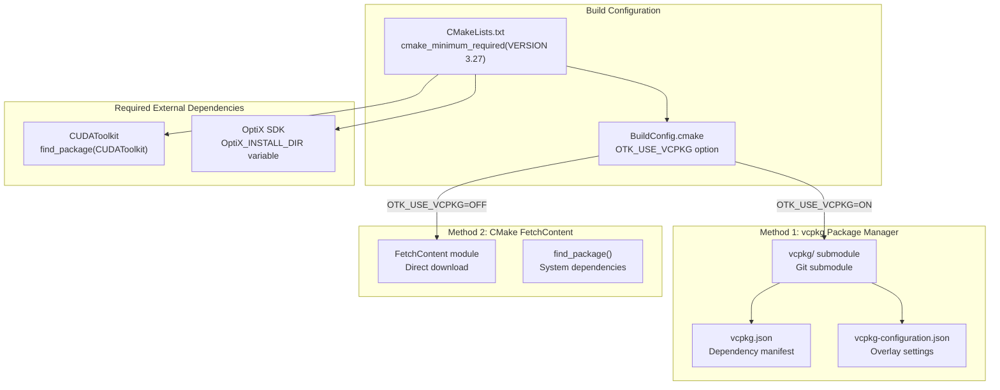

**vcpkg Method (Recommended)**
- Uses the vcpkg submodule for dependency management
- Configured via `vcpkg.json` manifest file
- Provides consistent, reproducible builds
- Handles complex dependency chains automatically

**FetchContent Method**
- Downloads dependencies at configure time
- Suitable for environments where vcpkg is not available
- Requires manual dependency resolution

Sources: [CMakeLists.txt:14-17](), [CMakeLists.txt:55-59](), [.gitmodules:1-3]()

## Quick Start Build Process

### 1. Clone and Initialize Repository

```bash
git clone https://github.com/NVIDIA/optix-toolkit.git
cd optix-toolkit
git submodule update --init --recursive
```

### 2. Set OptiX SDK Path

The OptiX SDK must be installed separately and its path specified:

```bash
# Set OptiX_INSTALL_DIR to your OptiX SDK installation
export OptiX_INSTALL_DIR=/path/to/optix/sdk
```

### 3. Configure and Build

```bash
# Basic configuration with default options
cmake -B build -S .

# Build the toolkit
cmake --build build --parallel
```

## Core Library Selection and Dependencies

The toolkit uses a modular library system where you can select which components to build:

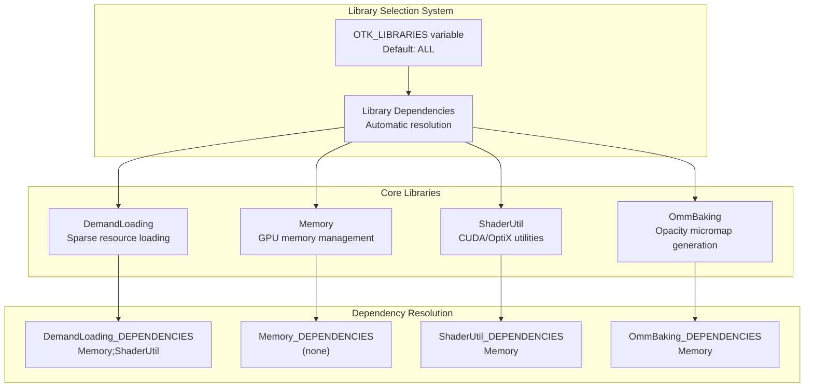

The build system automatically resolves dependencies between libraries. For example, selecting `DemandLoading` automatically includes `Memory` and `ShaderUtil`.

Sources: [CMakeLists.txt:76-97]()

## Build Configuration Options

### Primary Build Options

| Option | Default | Description |
|--------|---------|-------------|
| `OTK_LIBRARIES` | `"ALL"` | Semicolon-separated list of libraries to build |
| `OTK_BUILD_EXAMPLES` | `ON` | Build example applications |
| `OTK_BUILD_TESTS` | `ON` | Build unit tests and test framework |
| `OTK_BUILD_PYOPTIX` | `OFF` | Build Python bindings |
| `OTK_BUILD_DOCS` | `OFF` | Build API documentation |
| `OTK_USE_VCPKG` | `ON` | Use vcpkg for dependency management |
| `BUILD_SHARED_LIBS` | `ON` | Build shared libraries instead of static |

### Advanced CUDA Options

For CUDA Toolkit 11.2+, additional memory management options are available:

| Option | Default | Description |
|--------|---------|-------------|
| `OTK_USE_CUDA_MEMORY_POOLS` | `ON` (CUDA 11.2+) | Enable CUDA memory pools and stream-ordered allocators |

Sources: [CMakeLists.txt:33-37](), [DemandLoading/CMakeLists.txt:21-25]()

## Configuration Examples

### Minimal Build (Core Libraries Only)

```bash
cmake -B build -S . \
  -DOTK_BUILD_EXAMPLES=OFF \
  -DOTK_BUILD_TESTS=OFF \
  -DOTK_LIBRARIES="Memory;ShaderUtil"
```

### Full Development Build

```bash
cmake -B build -S . \
  -DOTK_BUILD_EXAMPLES=ON \
  -DOTK_BUILD_TESTS=ON \
  -DOTK_BUILD_DOCS=ON \
  -DOTK_LIBRARIES="ALL"
```

### Custom Library Selection

```bash
cmake -B build -S . \
  -DOTK_LIBRARIES="DemandLoading;OmmBaking"
```

## Build System Architecture

The following diagram shows how the CMake build system processes configuration and manages the modular build:

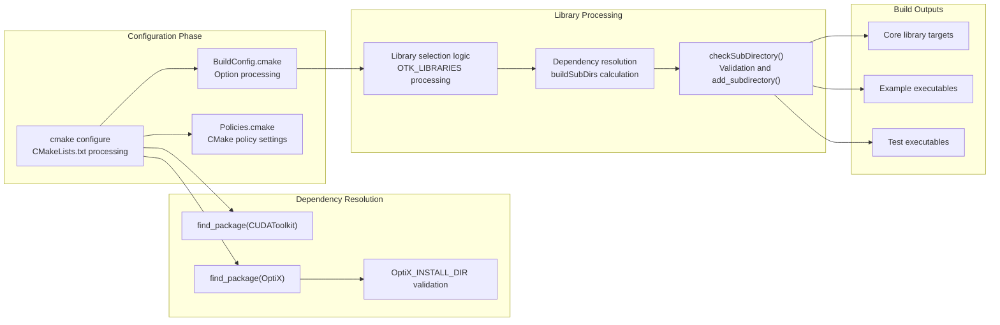

Sources: [CMakeLists.txt:11-29](), [CMakeLists.txt:65-97]()

## Verification and Testing

After building, verify the installation by running the test suite:

```bash
# Run all tests
ctest --test-dir build

# Run tests with verbose output
ctest --test-dir build --verbose
```

The test framework validates core functionality including memory management, demand loading, and OptiX integration. For detailed information about the testing infrastructure, see [Testing Framework](#6.1).

Sources: [CMakeLists.txt:32-37]()

---

# Page: Dependencies and External Libraries

# Dependencies and External Libraries

<details>
<summary>Relevant source files</summary>

The following files were used as context for generating this wiki page:

- [.gitmodules](.gitmodules)
- [CMake/FetchOpenEXR.cmake](CMake/FetchOpenEXR.cmake)
- [vcpkg-configuration.json](vcpkg-configuration.json)
- [vcpkg-overlays/imath/fix-cuda.patch](vcpkg-overlays/imath/fix-cuda.patch)
- [vcpkg-overlays/imath/portfile.cmake](vcpkg-overlays/imath/portfile.cmake)
- [vcpkg-overlays/imath/vcpkg.json](vcpkg-overlays/imath/vcpkg.json)
- [vcpkg-overlays/openexr/fix-cuda.patch](vcpkg-overlays/openexr/fix-cuda.patch)
- [vcpkg-overlays/openexr/portfile.cmake](vcpkg-overlays/openexr/portfile.cmake)
- [vcpkg-overlays/openexr/usage](vcpkg-overlays/openexr/usage)
- [vcpkg-overlays/openexr/vcpkg.json](vcpkg-overlays/openexr/vcpkg.json)

</details>


This document covers the external dependencies, package management, and build-time configuration for the OptiX Toolkit. It explains how the toolkit manages its dependencies through git submodules, vcpkg package management, and custom overlay patches to ensure compatibility with CUDA and OptiX development.

For information about the CMake build system configuration that orchestrates these dependencies, see [Build System](#2.2). For details about CMake presets and build options, see [Build Configuration](#2.3).

## Git Submodules

The OptiX Toolkit uses two primary git submodules to manage external dependencies and related projects:

| Submodule | Repository | Purpose |
|-----------|------------|---------|
| `vcpkg` | https://github.com/microsoft/vcpkg.git | Microsoft's C++ package manager for dependency resolution |
| `PyOptiX` | https://github.com/NVIDIA/otk-pyoptix.git | Python bindings for OptiX, developed alongside the toolkit |

### Submodule Architecture

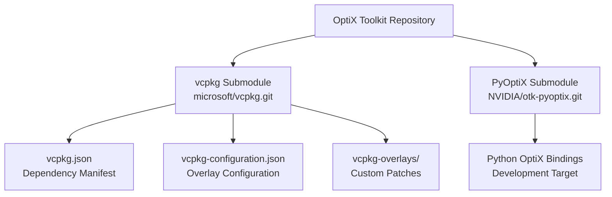

Sources: [.gitmodules:1-6]()

## vcpkg Package Management

The toolkit uses vcpkg as its primary dependency management system, configured through a baseline and custom overlay ports to handle special requirements for CUDA compatibility.

### vcpkg Configuration

The `vcpkg-configuration.json` establishes the package management baseline and overlay system:

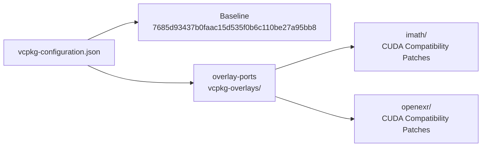

The configuration uses a specific baseline commit (`7685d93437b0faac15d535f0b6c110be27a95bb8`) from the vcpkg builtin registry to ensure reproducible builds across different environments.

Sources: [vcpkg-configuration.json:1-9]()

## vcpkg Overlays and CUDA Compatibility

### Custom Overlay Patches

The toolkit includes custom vcpkg overlay ports to resolve compilation issues between image processing libraries and CUDA/nvcc:

| Library | Issue | Solution |
|---------|-------|----------|
| Imath | MSVC `/EHsc` flag conflicts with nvcc | Wrap in `$<$<COMPILE_LANGUAGE:CXX>:/EHsc>` generator expression |
| OpenEXR | MSVC `/EHsc` and `/MP` flags conflict with nvcc | Wrap both flags in CXX-specific generator expressions |

### Imath Overlay Implementation

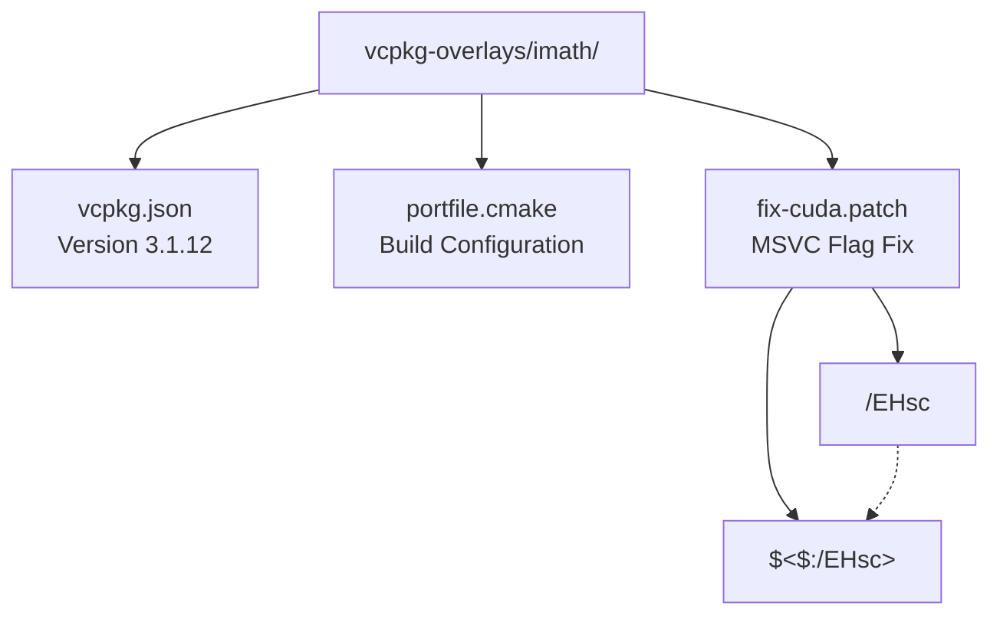

The patch modifies the `LibraryDefine.cmake` file to replace the problematic MSVC compile flag with a CMake generator expression that only applies the flag when compiling C++ code, not CUDA code.

Sources: [vcpkg-overlays/imath/fix-cuda.patch:1-14](), [vcpkg-overlays/imath/vcpkg.json:1-18](), [vcpkg-overlays/imath/portfile.cmake:1-28]()

### OpenEXR Overlay Implementation

The OpenEXR overlay follows the same pattern, handling both `/EHsc` and `/MP` MSVC compiler flags:

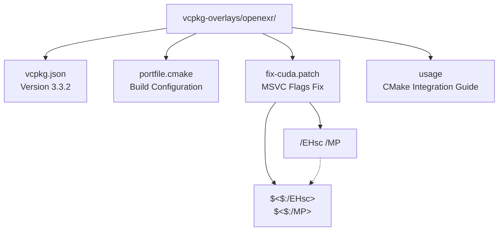

Sources: [vcpkg-overlays/openexr/fix-cuda.patch:1-14](), [vcpkg-overlays/openexr/vcpkg.json:1-26](), [vcpkg-overlays/openexr/portfile.cmake:1-61](), [vcpkg-overlays/openexr/usage:1-4]()

## Dependency Resolution Methods

The build system supports multiple dependency acquisition methods through CMake configuration options:

### vcpkg vs FetchContent Resolution

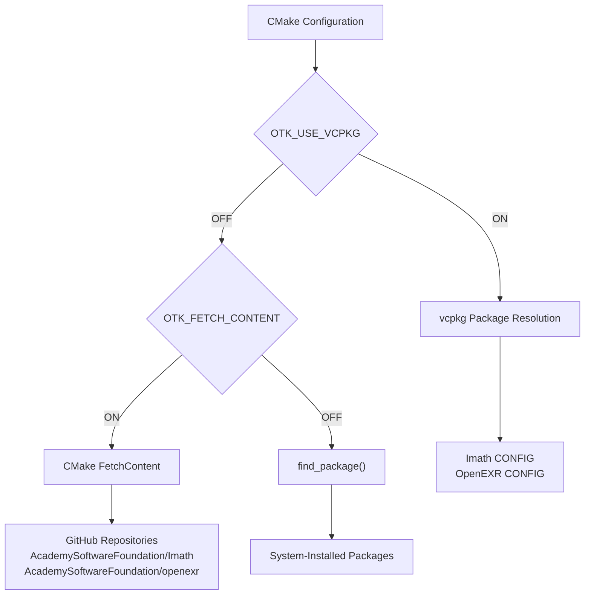

### OpenEXR Resolution Implementation

The `FetchOpenEXR.cmake` module demonstrates the multi-method resolution approach:

1. **vcpkg Method** ([CMake/FetchOpenEXR.cmake:5-10]()): Uses `find_package(Imath CONFIG REQUIRED)` and `find_package(OpenEXR CONFIG REQUIRED)`
2. **FetchContent Method** ([CMake/FetchOpenEXR.cmake:54-93]()): Downloads from GitHub repositories with specific version tags
3. **System Method** ([CMake/FetchOpenEXR.cmake:52]()): Uses `find_package(OpenEXR 3.1 REQUIRED)` for system installations

### Compile Flag Compatibility Handling

The `FetchOpenEXR.cmake` module includes functions to handle MSVC/CUDA compile flag conflicts when not using vcpkg overlays:

- `otk_cxx_flag_only()` ([CMake/FetchOpenEXR.cmake:14-24]()): Wraps individual flags in CXX-specific generator expressions
- `otk_replace_flags()` ([CMake/FetchOpenEXR.cmake:26-43]()): Processes target dependency chains to fix flag conflicts

Sources: [CMake/FetchOpenEXR.cmake:1-108]()

## Major External Dependencies

### Runtime Dependencies

| Dependency | Minimum Version | Purpose | Resolution Method |
|------------|----------------|---------|-------------------|
| NVIDIA OptiX SDK | 7.5+ | Ray tracing acceleration | System installation required |
| CUDA Toolkit | 11.1+ | GPU compute platform | System installation required |
| OpenEXR/Imath | 3.1+ | HDR image format support | vcpkg, FetchContent, or system |
| OpenImageIO | Latest | Multi-format image I/O | vcpkg or FetchContent |

### Build-Time Dependencies

| Dependency | Purpose | Resolution Method |
|------------|---------|-------------------|
| vcpkg-cmake | CMake integration for vcpkg | vcpkg host dependency |
| vcpkg-cmake-config | CMake config file generation | vcpkg host dependency |
| libdeflate | Compression for OpenEXR | vcpkg dependency |

### Dependency Architecture

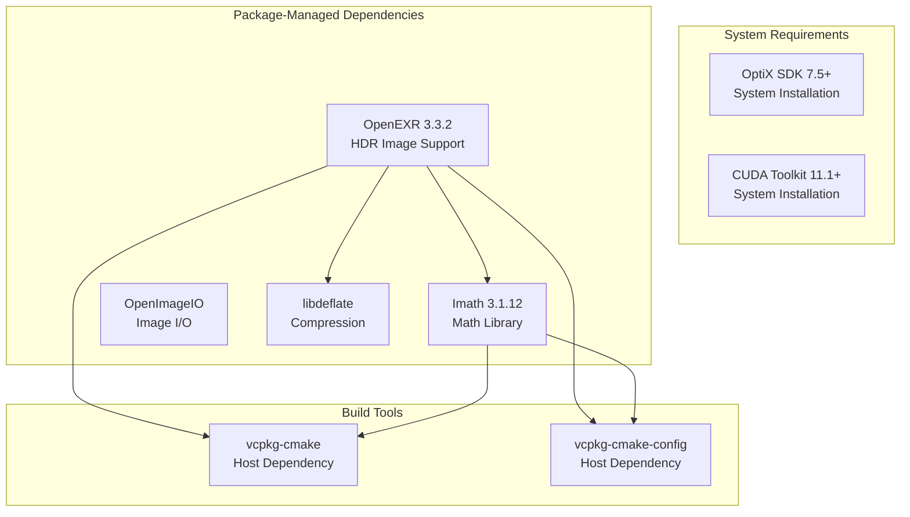

The OptiX Toolkit requires system-level installation of OptiX SDK and CUDA Toolkit, while other dependencies are managed through the package system with special handling for CUDA compilation compatibility.

Sources: [vcpkg-overlays/openexr/vcpkg.json:9-19](), [vcpkg-overlays/imath/vcpkg.json:8-17]()

---

# Page: Build System

# Build System

<details>
<summary>Relevant source files</summary>

The following files were used as context for generating this wiki page:

- [.gitattributes](.gitattributes)
- [.gitignore](.gitignore)
- [CMakeLists.txt](CMakeLists.txt)
- [CMakePresets.json](CMakePresets.json)
- [DemandLoading/CMakeLists.txt](DemandLoading/CMakeLists.txt)
- [vcpkg.json](vcpkg.json)

</details>


The OptiX Toolkit uses a sophisticated CMake-based build system that supports modular library selection, multiple dependency acquisition methods, and extensive configuration through presets. This system allows users to build only the components they need while handling complex dependency relationships automatically.

For information about external dependencies and how they're managed, see [Dependencies and External Libraries](#2.1). For specific build configuration options and presets, see [Build Configuration](#2.3).

## Build System Architecture

The build system is organized around a hierarchical CMake structure with a central orchestrator and modular components:

```mermaid
graph TB
    subgraph "Configuration Layer"
        PRESETS["CMakePresets.json<br/>Build Configurations"]
        VCPKG_JSON["vcpkg.json<br/>Dependency Manifest"]
        USER_PRESETS["CMakeUserPresets.json<br/>User Overrides"]
    end
    
    subgraph "CMake Module System"
        CMAKE_MODULES["CMake/<br/>Build Modules"]
        BUILD_CONFIG["BuildConfig.cmake"]
        POLICIES["Policies.cmake"]
        PROJECT_OPTIONS["ProjectOptions.cmake"]
    end
    
    subgraph "Main Build Orchestration"
        TOP_CMAKE["CMakeLists.txt<br/>Main Build Script"]
        CHECKSUBDIR["checkSubDirectory()"]
        LIB_DEPS["Library Dependencies"]
    end
    
    subgraph "Library Build Scripts"
        DL_CMAKE["DemandLoading/CMakeLists.txt"]
        MEM_CMAKE["Memory/CMakeLists.txt"]
        OMM_CMAKE["OmmBaking/CMakeLists.txt"]
        SHADER_CMAKE["ShaderUtil/CMakeLists.txt"]
    end
    
    subgraph "Component Build Scripts"
        EXAMPLES_CMAKE["examples/CMakeLists.txt"]
        PYOPTIX_CMAKE["PyOptiX/CMakeLists.txt"]
        DOCS_CMAKE["docs/API/CMakeLists.txt"]
    end
    
    subgraph "External Dependencies"
        OPTIX_SDK["OptiX SDK"]
        CUDA_TOOLKIT["CUDA Toolkit"]
        VCPKG_DEPS["vcpkg Dependencies"]
    end

    PRESETS --> TOP_CMAKE
    VCPKG_JSON --> VCPKG_DEPS
    USER_PRESETS --> TOP_CMAKE
    
    CMAKE_MODULES --> TOP_CMAKE
    BUILD_CONFIG --> TOP_CMAKE
    POLICIES --> TOP_CMAKE
    PROJECT_OPTIONS --> TOP_CMAKE
    
    TOP_CMAKE --> CHECKSUBDIR
    CHECKSUBDIR --> LIB_DEPS
    LIB_DEPS --> DL_CMAKE
    LIB_DEPS --> MEM_CMAKE
    LIB_DEPS --> OMM_CMAKE
    LIB_DEPS --> SHADER_CMAKE
    
    TOP_CMAKE --> EXAMPLES_CMAKE
    TOP_CMAKE --> PYOPTIX_CMAKE
    TOP_CMAKE --> DOCS_CMAKE
    
    DL_CMAKE --> OPTIX_SDK
    DL_CMAKE --> CUDA_TOOLKIT
    EXAMPLES_CMAKE --> VCPKG_DEPS
```

The build system follows a modular architecture where the main [CMakeLists.txt:1-111]() orchestrates the build process, individual libraries have their own build scripts, and configuration is managed through presets and CMake modules.

Sources: [CMakeLists.txt:1-111](), [CMakePresets.json:1-414](), [DemandLoading/CMakeLists.txt:1-39]()

## CMake Configuration and Module System

The build system uses a comprehensive CMake module system located in the `CMake/` directory:

| Module | Purpose | Key Functionality |
|--------|---------|-------------------|
| `BuildConfig.cmake` | Build configuration | Sets up project-wide build settings |
| `Policies.cmake` | CMake policies | Manages CMake version compatibility |
| `ProjectOptions.cmake` | Project options | Defines configurable build options |
| `SetCxxStandard.cmake` | C++ standard | Sets C++11 standard across projects |
| `FindOptiX.cmake` | OptiX detection | Locates OptiX SDK installation |

The main configuration process follows this flow:

```mermaid
graph LR
    CMAKE_MIN["cmake_minimum_required(VERSION 3.27)"]
    MODULES["CMAKE_MODULE_PATH += CMake/"]
    INCLUDES["include() CMake modules"]
    PROJECT_DEF["project(OTK_PROJECT_NAME)"]
    FIND_DEPS["find_package() dependencies"]
    
    CMAKE_MIN --> MODULES
    MODULES --> INCLUDES
    INCLUDES --> PROJECT_DEF
    PROJECT_DEF --> FIND_DEPS
    
    subgraph "CMake Modules"
        BUILD_CONFIG["BuildConfig"]
        POLICIES["Policies"]
        PROJECT_OPTIONS["ProjectOptions"]
        SET_CXX["SetCxxStandard"]
    end
    
    INCLUDES --> BUILD_CONFIG
    INCLUDES --> POLICIES
    INCLUDES --> PROJECT_OPTIONS
    INCLUDES --> SET_CXX
```

The system requires CMake 3.27 or later for proper CUDA compilation support and modern CMake features like FetchContent integration.

Sources: [CMakeLists.txt:11-29](), [CMakeLists.txt:17-21]()

## Library Selection and Dependency Resolution

The build system implements a sophisticated library selection mechanism through the `OTK_LIBRARIES` variable:

```mermaid
graph TB
    subgraph "Library Selection Process"
        OTK_LIBS["OTK_LIBRARIES Variable<br/>Default: ALL"]
        DEFAULT_LIBS["Default Libraries:<br/>DemandLoading, Memory<br/>OmmBaking, ShaderUtil"]
        DEPS_MAP["Dependency Mapping"]
    end
    
    subgraph "Dependency Definitions"
        DL_DEPS["DemandLoading_DEPENDENCIES<br/>Memory, ShaderUtil"]
        MEM_DEPS["Memory_DEPENDENCIES<br/>(empty)"]
        OMM_DEPS["OmmBaking_DEPENDENCIES<br/>Memory"]
        SHADER_DEPS["ShaderUtil_DEPENDENCIES<br/>Memory"]
    end
    
    subgraph "Build Process"
        BUILD_SUBDIRS["buildSubDirs list"]
        FOREACH_LIB["foreach(lib ${OTK_LIBRARIES})"]
        ADD_DEPS["Add dependencies recursively"]
        REMOVE_DUPS["Remove duplicates"]
        CHECK_SUBDIR["checkSubDirectory()"]
    end

    OTK_LIBS --> |"if empty or ALL"| DEFAULT_LIBS
    DEFAULT_LIBS --> DEPS_MAP
    DEPS_MAP --> DL_DEPS
    DEPS_MAP --> MEM_DEPS
    DEPS_MAP --> OMM_DEPS
    DEPS_MAP --> SHADER_DEPS
    
    DEPS_MAP --> BUILD_SUBDIRS
    BUILD_SUBDIRS --> FOREACH_LIB
    FOREACH_LIB --> ADD_DEPS
    ADD_DEPS --> REMOVE_DUPS
    REMOVE_DUPS --> CHECK_SUBDIR
```

The `checkSubDirectory()` function validates that required CMake files exist before attempting to build each component:

- Validates existence of `CMakeLists.txt` in each subdirectory
- Provides detailed error messages for missing components
- Handles conditional building based on options like `OTK_BUILD_EXAMPLES`

Sources: [CMakeLists.txt:76-97](), [CMakeLists.txt:65-74](), [CMakeLists.txt:79-82]()

## Dependency Management Strategies

The build system supports two primary dependency acquisition methods:

### vcpkg Integration

When `OTK_USE_VCPKG=ON` (default), the system uses vcpkg for dependency management:

```mermaid
graph LR
    subgraph "vcpkg Configuration"
        VCPKG_JSON["vcpkg.json<br/>Manifest Mode"]
        VCPKG_CONFIG["vcpkg-configuration.json<br/>Overlays"]
        VCPKG_OVERLAYS["vcpkg-overlays/<br/>Custom Patches"]
    end
    
    subgraph "vcpkg Features"
        OTK_EXAMPLES["otk-examples<br/>glad, glfw3, imgui"]
        OTK_OPENEXR["otk-openexr<br/>imath, openexr"]
        OTK_OIIO["otk-openimageio<br/>openimageio"]
        OTK_TESTS["otk-tests<br/>gtest"]
    end
    
    subgraph "Build Integration"
        CMAKE_TOOLCHAIN["CMAKE_TOOLCHAIN_FILE"]
        FIND_PACKAGE["find_package()"]
        TARGET_LINK["target_link_libraries()"]
    end
    
    VCPKG_JSON --> OTK_EXAMPLES
    VCPKG_JSON --> OTK_OPENEXR
    VCPKG_JSON --> OTK_OIIO
    VCPKG_JSON --> OTK_TESTS
    
    VCPKG_CONFIG --> VCPKG_OVERLAYS
    VCPKG_OVERLAYS --> CMAKE_TOOLCHAIN
    CMAKE_TOOLCHAIN --> FIND_PACKAGE
    FIND_PACKAGE --> TARGET_LINK
```

### FetchContent Alternative

When `OTK_USE_VCPKG=OFF`, the system uses CMake's FetchContent for dependency acquisition:

- Downloads and builds dependencies from source
- Integrates with CMake's native dependency resolution
- Provides fallback when vcpkg is not available

Sources: [vcpkg.json:1-42](), [CMakePresets.json:98-114]()

## Build Configuration Options

The build system provides extensive configuration through CMake variables and presets:

| Option | Default | Purpose |
|--------|---------|---------|
| `OTK_LIBRARIES` | `"ALL"` | Select which libraries to build |
| `OTK_BUILD_EXAMPLES` | `ON` | Build example applications |
| `OTK_BUILD_TESTS` | `ON` | Build unit tests |
| `OTK_BUILD_DOCS` | `OFF` | Build API documentation |
| `OTK_BUILD_PYOPTIX` | `OFF` | Build Python bindings |
| `OTK_USE_VCPKG` | `ON` | Use vcpkg for dependencies |
| `OTK_USE_OIIO` | `OFF` | Enable OpenImageIO support |
| `OTK_USE_OPENEXR` | `OFF` | Enable OpenEXR support |
| `BUILD_SHARED_LIBS` | `ON` | Build shared libraries |

### Preset System

The [CMakePresets.json:1-414]() file defines a comprehensive preset system:

- **Base Presets**: Hidden presets for common configuration patterns
- **Main Presets**: User-facing presets like `otk-default`, `otk-fetch-content`
- **Library-Specific Presets**: For building individual libraries
- **Workflow Presets**: Complete configure-build-test workflows

Sources: [CMakeLists.txt:33-37](), [CMakePresets.json:8-183]()

## Per-Library Build Configuration

Each library has its own `CMakeLists.txt` with specific requirements:

```mermaid
graph TB
    subgraph "DemandLoading Library"
        DL_CMAKE["DemandLoading/CMakeLists.txt"]
        DL_CUDA["CUDA Toolkit 11.1+"]
        DL_OPTIX["OptiX 7.3+"]
        DL_SUBDIRS["Subdirectories:<br/>DemandGeometry<br/>DemandLoading<br/>DemandMaterial<br/>ImageSource"]
    end
    
    subgraph "Build Options"
        CUDA_POOLS["OTK_USE_CUDA_MEMORY_POOLS<br/>CUDA 11.2+ feature"]
        SHARED_LIBS["BUILD_SHARED_LIBS<br/>ON by default"]
        CTEST["CTest integration"]
    end
    
    DL_CMAKE --> DL_CUDA
    DL_CMAKE --> DL_OPTIX
    DL_CMAKE --> DL_SUBDIRS
    DL_CMAKE --> CUDA_POOLS
    DL_CMAKE --> SHARED_LIBS
    DL_CMAKE --> CTEST
```

Individual library builds handle:
- Version-specific feature detection (e.g., CUDA memory pools)
- Conditional compilation based on available features
- Dependency validation and error reporting
- Integration with the parent build system

Sources: [DemandLoading/CMakeLists.txt:1-39](), [DemandLoading/CMakeLists.txt:21-25]()

## Testing and Documentation Integration

The build system integrates testing and documentation generation:

- **CTest Integration**: Enabled through `include(CTest)` when `OTK_BUILD_TESTS=ON`
- **Test Presets**: Comprehensive test configuration with timeout and output settings
- **Documentation**: Optional Doxygen-based API documentation when `OTK_BUILD_DOCS=ON`

The system provides workflow presets that combine configure, build, and test steps for streamlined development.

Sources: [CMakeLists.txt:33-37](), [CMakePresets.json:229-284](), [CMakePresets.json:285-412]()

---

# Page: Build Configuration

# Build Configuration

<details>
<summary>Relevant source files</summary>

The following files were used as context for generating this wiki page:

- [.gitattributes](.gitattributes)
- [.gitignore](.gitignore)
- [CMake/OptiXToolkitConfig.cmake.in](CMake/OptiXToolkitConfig.cmake.in)
- [CMakePresets.json](CMakePresets.json)
- [vcpkg.json](vcpkg.json)

</details>


This document covers the build configuration system for the OptiX Toolkit, including CMake presets, vcpkg configuration, and build customization options. The configuration system provides flexible ways to customize which libraries are built, how dependencies are managed, and various build settings.

For information about the overall build system architecture, see page [2.2](#2.2). For details about dependencies and external libraries, see page [2.1](#2.1).

## Configuration System Overview

The OptiX Toolkit uses CMake presets as the primary mechanism for build configuration. The preset system provides a structured way to define reusable build configurations that can be composed and inherited.

```mermaid
graph TD
    subgraph "Configuration Sources"
        PRESETS["CMakePresets.json"]
        USER_PRESETS["CMakeUserPresets.json<br/>(User-specific)"]
        VCPKG_JSON["vcpkg.json"]
    end
    
    subgraph "Preset Categories"
        HIDDEN["Hidden Base Presets"]
        CONFIGURE["Configure Presets"]
        BUILD["Build Presets"]
        TEST["Test Presets"]
        WORKFLOW["Workflow Presets"]
    end
    
    subgraph "Build Outputs"
        CMAKE_CACHE["CMake Cache Variables"]
        BUILD_DIR["Build Directory"]
        TARGETS["Built Targets"]
    end

    PRESETS --> HIDDEN
    PRESETS --> CONFIGURE
    PRESETS --> BUILD
    PRESETS --> TEST
    PRESETS --> WORKFLOW
    
    USER_PRESETS --> CONFIGURE
    VCPKG_JSON --> CMAKE_CACHE
    
    HIDDEN --> CONFIGURE
    CONFIGURE --> CMAKE_CACHE
    CONFIGURE --> BUILD_DIR
    CMAKE_CACHE --> TARGETS
```

**Configuration Flow Overview**
The configuration system processes presets through inheritance and composition to generate final build settings.

Sources: [CMakePresets.json:1-413](), [vcpkg.json:1-42]()

## CMake Preset Categories

The preset system is organized into several categories, each serving a specific purpose in the build configuration process.

### Hidden Base Presets

Hidden presets provide reusable configuration components that can be inherited by public presets. These are not intended for direct use but serve as building blocks.

| Preset Name | Purpose | Key Variables |
|-------------|---------|---------------|
| `otk-child-build-dir-preset` | Sets build directory structure | `binaryDir: ${sourceDir}/build-${presetName}` |
| `otk-project-name-preset` | Configures IDE project naming | `OTK_PROJECT_NAME: "OptiX Toolkit ${presetName}"` |
| `otk-demand-loading-library` | DemandLoading library only | `OTK_LIBRARIES: "DemandLoading"` |
| `otk-memory-library` | Memory library only | `OTK_LIBRARIES: "Memory"` |
| `otk-omm-baking-library` | OmmBaking library only | `OTK_LIBRARIES: "OmmBaking"` |
| `otk-shader-util-library` | ShaderUtil library only | `OTK_LIBRARIES: "ShaderUtil"` |

Sources: [CMakePresets.json:10-72]()

### Build Control Presets

Additional hidden presets control what components are built and how:

| Preset Name | Purpose | Configuration |
|-------------|---------|---------------|
| `otk-no-examples` | Skip example builds | `OTK_BUILD_EXAMPLES: false` |
| `otk-no-tests` | Skip test builds | `BUILD_TESTING: false` |
| `otk-docs` | Enable documentation | `OTK_BUILD_DOCS: true` |
| `otk-warnings-as-errors` | Strict compilation | `OTK_WARNINGS_AS_ERRORS: true` |

Sources: [CMakePresets.json:74-141]()

## Dependency Management Configuration

The OptiX Toolkit supports two primary methods for dependency management, configured through preset selection.

```mermaid
graph TB
    subgraph "Dependency Management Options"
        VCPKG_PRESET["otk-use-vcpkg<br/>OTK_USE_VCPKG: true"]
        FETCH_PRESET["otk-use-fetch-content<br/>OTK_USE_VCPKG: false"]
    end
    
    subgraph "vcpkg Path"
        VCPKG_MANAGER["vcpkg Package Manager"]
        VCPKG_MANIFEST["vcpkg.json Manifest"]
        VCPKG_FEATURES["Feature Selection"]
    end
    
    subgraph "FetchContent Path"
        FETCH_CONTENT["CMake FetchContent"]
        GIT_REPOS["Git Repositories"]
        SOURCE_BUILDS["Source Builds"]
    end
    
    subgraph "Library Features"
        OPENEXR["otk-use-openexr<br/>OTK_USE_OPENEXR: true"]
        OIIO["otk-use-open-image-io<br/>OTK_USE_OIIO: true"]
    end

    VCPKG_PRESET --> VCPKG_MANAGER
    VCPKG_MANAGER --> VCPKG_MANIFEST
    VCPKG_MANIFEST --> VCPKG_FEATURES
    
    FETCH_PRESET --> FETCH_CONTENT
    FETCH_CONTENT --> GIT_REPOS
    GIT_REPOS --> SOURCE_BUILDS
    
    OPENEXR --> VCPKG_FEATURES
    OIIO --> VCPKG_FEATURES
```

**Dependency Management Configuration**
The system supports both vcpkg and FetchContent for dependency acquisition, with additional feature flags for optional libraries.

Sources: [CMakePresets.json:98-132](), [vcpkg.json:22-34]()

### vcpkg Configuration

When using vcpkg (`OTK_USE_VCPKG: true`), dependencies are managed through the vcpkg manifest system:

```mermaid
graph TD
    subgraph "vcpkg Features"
        EXAMPLES["otk-examples<br/>glad, glfw3, imgui, rply, stb"]
        OPENEXR_FEAT["otk-openexr<br/>imath, openexr"]
        OIIO_FEAT["otk-openimageio<br/>openimageio"]
        TESTS["otk-tests<br/>gtest"]
    end
    
    subgraph "Feature Activation"
        BUILD_EXAMPLES["OTK_BUILD_EXAMPLES=ON"]
        USE_OPENEXR["OTK_USE_OPENEXR=ON"]
        USE_OIIO["OTK_USE_OIIO=ON"]
        BUILD_TESTING["BUILD_TESTING=ON"]
    end

    BUILD_EXAMPLES --> EXAMPLES
    USE_OPENEXR --> OPENEXR_FEAT
    USE_OIIO --> OIIO_FEAT
    BUILD_TESTING --> TESTS
```

**vcpkg Feature Dependencies**
Features in `vcpkg.json` are automatically enabled based on CMake configuration variables.

Sources: [vcpkg.json:5-41]()

## Public Configuration Presets

Public presets combine hidden base presets to provide ready-to-use configurations for common build scenarios.

### General Purpose Presets

| Preset Name | Description | Inheritance | Key Features |
|-------------|-------------|-------------|--------------|
| `otk-default` | Standard vcpkg build | `otk-child-build-dir-preset`, `otk-project-name-preset`, `otk-use-vcpkg` | All libraries, tests, examples |
| `otk-fetch-content` | FetchContent build | `otk-child-build-dir-preset`, `otk-project-name-preset`, `otk-use-fetch-content` | All libraries, tests, examples |
| `otk-open-image-io` | OpenImageIO enabled | `otk-default`, `otk-use-open-image-io` | Additional texture formats |

Sources: [CMakePresets.json:143-159]()

### Library-Specific Presets

For building individual libraries in isolation:

| Preset Name | Target Library | Build Configuration |
|-------------|----------------|-------------------|
| `otk-demand-loading` | DemandLoading only | Tests and examples enabled |
| `otk-memory` | Memory only | Tests only (no examples) |
| `otk-omm-baking` | OmmBaking only | Tests and examples enabled |
| `otk-shader-util` | ShaderUtil only | Tests only (no examples) |

Sources: [CMakePresets.json:161-183]()

## Build and Test Presets

Build and test presets correspond to configure presets, providing consistent execution environments.

```mermaid
graph LR
    subgraph "Configure Presets"
        CONF_DEFAULT["otk-default"]
        CONF_FETCH["otk-fetch-content"]
        CONF_OIIO["otk-open-image-io"]
        CONF_LIBS["Library Presets"]
    end
    
    subgraph "Build Presets"
        BUILD_DEFAULT["otk-default<br/>Release"]
        BUILD_FETCH["otk-fetch-content<br/>Release"]
        BUILD_OIIO["otk-open-image-io<br/>Release"]
        BUILD_LIBS["Library Builds<br/>Release"]
    end
    
    subgraph "Test Presets"
        TEST_DEFAULT["otk-default<br/>1500s timeout"]
        TEST_FETCH["otk-fetch-content<br/>1500s timeout"]
        TEST_OIIO["otk-open-image-io<br/>1500s timeout"]
        TEST_LIBS["Library Tests<br/>1500s timeout"]
    end

    CONF_DEFAULT --> BUILD_DEFAULT
    CONF_FETCH --> BUILD_FETCH
    CONF_OIIO --> BUILD_OIIO
    CONF_LIBS --> BUILD_LIBS
    
    BUILD_DEFAULT --> TEST_DEFAULT
    BUILD_FETCH --> TEST_FETCH
    BUILD_OIIO --> TEST_OIIO
    BUILD_LIBS --> TEST_LIBS
```

**Preset Execution Pipeline**
Configure, build, and test presets form a coordinated pipeline for complete build workflows.

Sources: [CMakePresets.json:185-283]()

## Workflow Presets

Workflow presets combine configure, build, and test steps into complete automation sequences. Each workflow preset defines a three-step process:

1. **Configure**: Set up the build system with the specified preset
2. **Build**: Compile the configured targets
3. **Test**: Execute the test suite

All workflow presets follow the same pattern, with each step referencing the corresponding preset by name.

Sources: [CMakePresets.json:285-412]()

## Key Configuration Variables

The following table summarizes the primary CMake variables that control build behavior:

| Variable | Type | Default | Purpose |
|----------|------|---------|---------|
| `OTK_USE_VCPKG` | BOOL | ON | Use vcpkg for dependencies vs FetchContent |
| `OTK_LIBRARIES` | STRING | ALL | Semicolon-separated list of libraries to build |
| `OTK_BUILD_EXAMPLES` | BOOL | ON | Build example applications |
| `BUILD_TESTING` | BOOL | ON | Build test executables |
| `OTK_BUILD_DOCS` | BOOL | OFF | Build documentation |
| `OTK_USE_OPENEXR` | BOOL | OFF | Enable OpenEXR support |
| `OTK_USE_OIIO` | BOOL | OFF | Enable OpenImageIO support |
| `OTK_WARNINGS_AS_ERRORS` | BOOL | OFF | Treat warnings as errors |
| `OTK_PROJECT_NAME` | STRING | "OptiX Toolkit" | IDE project name |

Sources: [CMakePresets.json:21-139]()

## User Customization

Users can create `CMakeUserPresets.json` to define custom configurations without modifying the main preset file. This file is ignored by Git and allows for local customization.

The user presets file can:
- Define new presets that inherit from existing ones
- Override specific cache variables
- Add custom build configurations
- Specify local paths and settings

Sources: [.gitignore:4]()

---

# Page: DemandLoading System

# DemandLoading System

<details>
<summary>Relevant source files</summary>

The following files were used as context for generating this wiki page:

- [CHANGELOG.md](CHANGELOG.md)
- [DemandLoading/DemandLoading/include/OptiXToolkit/DemandLoading/Options.h](DemandLoading/DemandLoading/include/OptiXToolkit/DemandLoading/Options.h)
- [DemandLoading/DemandLoading/src/DemandLoaderImpl.cpp](DemandLoading/DemandLoading/src/DemandLoaderImpl.cpp)
- [DemandLoading/DemandLoading/src/DemandLoaderImpl.h](DemandLoading/DemandLoading/src/DemandLoaderImpl.h)
- [DemandLoading/DemandLoading/src/DemandPageLoaderImpl.cpp](DemandLoading/DemandLoading/src/DemandPageLoaderImpl.cpp)
- [DemandLoading/DemandLoading/src/Memory/DeviceMemoryManager.cpp](DemandLoading/DemandLoading/src/Memory/DeviceMemoryManager.cpp)
- [DemandLoading/DemandLoading/src/Memory/DeviceMemoryManager.h](DemandLoading/DemandLoading/src/Memory/DeviceMemoryManager.h)
- [DemandLoading/DemandLoading/src/Textures/DemandTextureImpl.h](DemandLoading/DemandLoading/src/Textures/DemandTextureImpl.h)
- [DemandLoading/DemandLoading/src/Textures/TextureRequestHandler.cpp](DemandLoading/DemandLoading/src/Textures/TextureRequestHandler.cpp)
- [DemandLoading/README.md](DemandLoading/README.md)
- [Memory/CHANGELOG.md](Memory/CHANGELOG.md)
- [Memory/LICENSE.txt](Memory/LICENSE.txt)
- [Memory/README.md](Memory/README.md)
- [Memory/include/OptiXToolkit/Memory/Allocators.h](Memory/include/OptiXToolkit/Memory/Allocators.h)
- [Memory/include/OptiXToolkit/Memory/BitCast.h](Memory/include/OptiXToolkit/Memory/BitCast.h)
- [Memory/include/OptiXToolkit/Memory/MemoryPool.h](Memory/include/OptiXToolkit/Memory/MemoryPool.h)
- [README.md](README.md)

</details>


The DemandLoading System is the core component of the OptiX Toolkit that enables on-demand loading of texture data and other resources during GPU rendering. This system allows applications to work with textures much larger than available GPU memory by loading only the required portions (tiles) as they are accessed by OptiX shaders.

The system operates through a virtual memory paging mechanism where texture data is divided into tiles that are loaded from storage to GPU memory only when requested. This dramatically reduces memory usage and enables handling of massive texture datasets that would otherwise be impossible to load entirely into GPU memory.

For information about building and configuring the demand loading system, see [Build System](#2.2). For details about example applications using demand loading, see [Example Applications](#5).

## System Architecture

### Core Components Overview

The DemandLoading System consists of several interconnected subsystems that work together to provide seamless on-demand resource loading:

```mermaid
graph TB
    subgraph "Host Application Layer"
        APP["Application Code"]
        DLOADER["DemandLoader Interface"]
    end
    
    subgraph "Core Orchestration"
        DLOADERIMPL["DemandLoaderImpl"]
        DPAGELOADER["DemandPageLoaderImpl"]
        REQPROCESSOR["RequestProcessor"]
    end
    
    subgraph "Memory Management"
        DEVMEMMGR["DeviceMemoryManager"]
        MEMPOOL["MemoryPool<T>"]
        ALLOCATORS["Allocators<br/>(Device, Pinned, TextureTile)"]
    end
    
    subgraph "Resource Management"
        DTEXTUREIMPL["DemandTextureImpl"]
        TEXREQHANDLER["TextureRequestHandler"]
        SAMPLERHANDLER["SamplerRequestHandler"]
    end
    
    subgraph "Page Table System"
        PAGETABLEMGR["PageTableManager"]
        PAGINGSYSTEM["PagingSystem"]
        DEVICECTX["DeviceContext"]
    end
    
    subgraph "Device/GPU Layer"
        OPTIXKERNEL["OptiX Kernels"]
        SPARSETEX["Sparse Textures"]
        PAGETABLE["Page Table (GPU)"]
    end

    APP --> DLOADER
    DLOADER --> DLOADERIMPL
    DLOADERIMPL --> DPAGELOADER
    DLOADERIMPL --> DEVMEMMGR
    DLOADERIMPL --> DTEXTUREIMPL
    
    DPAGELOADER --> REQPROCESSOR
    DPAGELOADER --> PAGINGSYSTEM
    
    DEVMEMMGR --> MEMPOOL
    MEMPOOL --> ALLOCATORS
    
    DTEXTUREIMPL --> TEXREQHANDLER
    DLOADERIMPL --> SAMPLERHANDLER
    
    PAGINGSYSTEM --> PAGETABLEMGR
    PAGINGSYSTEM --> DEVICECTX
    
    DEVICECTX --> PAGETABLE
    OPTIXKERNEL --> PAGETABLE
    OPTIXKERNEL --> SPARSETEX
    
    TEXREQHANDLER --> SPARSETEX
```

**Sources:** [DemandLoading/DemandLoading/src/DemandLoaderImpl.h:42-205](), [DemandLoading/DemandLoading/src/DemandPageLoaderImpl.cpp:39-54](), [DemandLoading/DemandLoading/src/Memory/DeviceMemoryManager.h:30-124]()

### Memory Management Architecture

The memory management subsystem handles allocation and deallocation of different types of memory required by the demand loading system:

```mermaid
graph TB
    subgraph "Memory Pool System"
        MEMPOOL["MemoryPool&lt;Allocator,SubAllocator&gt;"]
        SAMPLERPAL["SamplerPool<br/>MemoryPool&lt;DeviceAllocator,FixedSuballocator&gt;"]
        TILEPOOL["TilePool<br/>MemoryPool&lt;TextureTileAllocator,HeapSuballocator&gt;"]
        DEVICECTXPOOL["DeviceContextPool<br/>MemoryPool&lt;DeviceAllocator,HeapSuballocator&gt;"]
        PINNEDPOOL["PinnedMemoryPool<br/>MemoryPool&lt;PinnedAllocator,RingSuballocator&gt;"]
    end
    
    subgraph "Allocator Types"
        DEVALLOCATOR["DeviceAllocator<br/>(cuMemAlloc)"]
        DEVICEASYNC["DeviceAsyncAllocator<br/>(cuMemAllocAsync)"]
        PINNEDALLOC["PinnedAllocator<br/>(cuMemAllocHost)"]
        TEXALLOC["TextureTileAllocator<br/>(cuMemCreate)"]
        HOSTALLOC["HostAllocator<br/>(malloc)"]
    end
    
    subgraph "SubAllocator Types"
        FIXEDSUB["FixedSuballocator<br/>(Fixed size items)"]
        HEAPSUB["HeapSuballocator<br/>(Variable size blocks)"]
        RINGSUB["RingSuballocator<br/>(Ring buffer)"]
    end
    
    subgraph "Managed Resources"
        SAMPLERS["TextureSampler Objects"]
        TILES["Texture Tiles"]
        CONTEXTS["DeviceContext Objects"]
        TRANSFERS["Transfer Buffers"]
    end

    MEMPOOL --> SAMPLERPAL
    MEMPOOL --> TILEPOOL
    MEMPOOL --> DEVICECTXPOOL
    MEMPOOL --> PINNEDPOOL
    
    SAMPLERPAL --> DEVALLOCATOR
    SAMPLERPAL --> FIXEDSUB
    SAMPLERPAL --> SAMPLERS
    
    TILEPOOL --> TEXALLOC
    TILEPOOL --> HEAPSUB
    TILEPOOL --> TILES
    
    DEVICECTXPOOL --> DEVALLOCATOR
    DEVICECTXPOOL --> HEAPSUB
    DEVICECTXPOOL --> CONTEXTS
    
    PINNEDPOOL --> PINNEDALLOC
    PINNEDPOOL --> RINGSUB
    PINNEDPOOL --> TRANSFERS
```

**Sources:** [Memory/include/OptiXToolkit/Memory/MemoryPool.h:33-437](), [DemandLoading/DemandLoading/src/Memory/DeviceMemoryManager.h:113-119](), [Memory/include/OptiXToolkit/Memory/Allocators.h:19-199]()

## Core Classes and Interfaces

### DemandLoaderImpl Class

The `DemandLoaderImpl` class serves as the main orchestrator for the demand loading system. It manages texture creation, resource allocation, and coordinates between different subsystems.

| Method | Purpose |
|--------|---------|
| `createTexture()` | Create demand-loaded textures from image sources |
| `createResource()` | Create arbitrary paged resources with custom callbacks |
| `launchPrepare()` | Prepare device context before kernel launch |
| `processRequests()` | Process page requests from device after kernel execution |
| `loadTextureTiles()` | Pre-load specific texture tiles |
| `replaceTexture()` | Replace texture data while preserving loaded tiles |

**Sources:** [DemandLoading/DemandLoading/src/DemandLoaderImpl.h:42-205](), [DemandLoading/DemandLoading/src/DemandLoaderImpl.cpp:124-638]()

### DeviceMemoryManager Class

The `DeviceMemoryManager` handles allocation and tracking of GPU memory resources:

| Component | Memory Pool Type | Purpose |
|-----------|------------------|---------|
| `m_samplerPool` | `MemoryPool<DeviceAllocator,FixedSuballocator>` | Texture sampler objects |
| `m_tilePool` | `MemoryPool<TextureTileAllocator,HeapSuballocator>` | Sparse texture tile storage |
| `m_deviceContextMemory` | `MemoryPool<DeviceAllocator,HeapSuballocator>` | Device context allocation |

**Sources:** [DemandLoading/DemandLoading/src/Memory/DeviceMemoryManager.h:30-124](), [DemandLoading/DemandLoading/src/Memory/DeviceMemoryManager.cpp:16-88]()

### MemoryPool Template Class

The `MemoryPool<Allocator, SubAllocator>` template provides thread-safe memory management with support for immediate and asynchronous deallocation:

```mermaid
graph LR
    subgraph "MemoryPool Operations"
        ALLOC["alloc()"]
        FREE["free()"]
        FREEASYNC["freeAsync()"]
        TRACK["track()"]
    end
    
    subgraph "Allocation Strategy"
        ALLOCATOR["Allocator<br/>(Physical Memory)"]
        SUBALLOCATOR["SubAllocator<br/>(Memory Layout)"]
        GRANULARITY["allocationGranularity<br/>(Chunk Size)"]
    end
    
    subgraph "Memory Tracking"
        ALLOCATIONS["m_allocations<br/>(Physical Chunks)"]
        STAGEDBLOCKS["m_stagedBlocks<br/>(Async Free Queue)"]
        EVENTS["CUDA Events<br/>(Stream Synchronization)"]
    end

    ALLOC --> SUBALLOCATOR
    FREE --> SUBALLOCATOR
    FREEASYNC --> STAGEDBLOCKS
    
    SUBALLOCATOR --> ALLOCATOR
    ALLOCATOR --> ALLOCATIONS
    
    STAGEDBLOCKS --> EVENTS
    EVENTS --> FREE
```

**Sources:** [Memory/include/OptiXToolkit/Memory/MemoryPool.h:33-437]()

## Request Processing Pipeline

### Request Flow Architecture

The demand loading system processes texture and resource requests through a multi-stage pipeline:

```mermaid
graph TD
    subgraph "Device Side (OptiX Kernels)"
        KERNEL["OptiX Kernel Execution"]
        PAGETABLE_DEV["Page Table Lookup"]
        PAGEREQUEST["pagingMapOrRequest()"]
        REQUESTBITS["Request Bits"]
    end
    
    subgraph "Host Side Processing"
        PULLREQ["pullRequests()<br/>DemandPageLoaderImpl"]
        REQPROCESSOR["RequestProcessor<br/>ThreadPoolRequestProcessor"]
        REQHANDLERS["Request Handlers"]
        TEXTUREHANDLER["TextureRequestHandler"]
        RESOURCEHANDLER["ResourceRequestHandler"]
    end
    
    subgraph "Resource Loading"
        IMAGESOURCE["ImageSource::readTile()"]
        TRANSFERBUF["Transfer Buffer"]
        TILEBLOCK["Tile Block Allocation"]
        SPARSETEX_FILL["Sparse Texture Fill"]
    end
    
    subgraph "Page Table Update"
        ADDMAPPING["addMapping()<br/>PagingSystem"]
        PUSHMAPPINGS["pushMappings()"]
        PAGETABLE_UPDATE["Page Table Update"]
    end

    KERNEL --> PAGETABLE_DEV
    PAGETABLE_DEV --> |"Page Miss"| PAGEREQUEST
    PAGEREQUEST --> REQUESTBITS
    
    REQUESTBITS --> PULLREQ
    PULLREQ --> REQPROCESSOR
    REQPROCESSOR --> REQHANDLERS
    
    REQHANDLERS --> TEXTUREHANDLER
    REQHANDLERS --> RESOURCEHANDLER
    
    TEXTUREHANDLER --> IMAGESOURCE
    IMAGESOURCE --> TRANSFERBUF
    TRANSFERBUF --> TILEBLOCK
    TILEBLOCK --> SPARSETEX_FILL
    
    SPARSETEX_FILL --> ADDMAPPING
    ADDMAPPING --> PUSHMAPPINGS
    PUSHMAPPINGS --> PAGETABLE_UPDATE
```

**Sources:** [DemandLoading/DemandLoading/src/DemandPageLoaderImpl.cpp:100-113](), [DemandLoading/DemandLoading/src/Textures/TextureRequestHandler.cpp:21-162]()

### TextureRequestHandler Processing

The `TextureRequestHandler` manages the loading of individual texture tiles and mip tails:

| Method | Purpose |
|--------|---------|
| `fillTileRequest()` | Load and fill a specific texture tile |
| `fillMipTailRequest()` | Load and fill the mip tail (smallest mip levels) |
| `loadPage()` | General page loading with residency checking |
| `unmapTileResource()` | Unmap tile backing storage during eviction |

**Sources:** [DemandLoading/DemandLoading/src/Textures/TextureRequestHandler.cpp:26-262]()

## Configuration and Options

### DemandLoading Options

The system behavior is controlled through the `Options` structure:

| Category | Key Options | Default Values |
|----------|-------------|----------------|
| **Page Table** | `numPages`, `numPageTableEntries` | 64M pages, 1M entries |
| **Request Processing** | `maxRequestedPages`, `maxFilledPages` | 8192 each |
| **Memory Limits** | `maxTexMemPerDevice`, `maxPinnedMemory` | 0 (unlimited), 64MB |
| **Eviction** | `maxStalePages`, `evictionActive` | 8192, true |
| **Concurrency** | `maxThreads` | 0 (auto-detect) |

**Sources:** [DemandLoading/DemandLoading/include/OptiXToolkit/DemandLoading/Options.h:18-54]()

### Memory Pool Configuration

Memory pools can be configured with different allocator and suballocator combinations:

```mermaid
graph LR
    subgraph "Allocator Options"
        HOSTALC["HostAllocator<br/>(malloc/free)"]
        PINNEDALC["PinnedAllocator<br/>(cuMemAllocHost)"]
        DEVICEALC["DeviceAllocator<br/>(cuMemAlloc)"]
        ASYNCALC["DeviceAsyncAllocator<br/>(cuMemAllocAsync)"]
        TILEALC["TextureTileAllocator<br/>(cuMemCreate)"]
    end
    
    subgraph "SubAllocator Options"
        FIXEDSUB["FixedSuballocator<br/>(Same-size items)"]
        HEAPSUB["HeapSuballocator<br/>(Variable sizes)"]
        RINGSUB["RingSuballocator<br/>(FIFO allocation)"]
    end
    
    subgraph "Configuration Parameters"
        GRANULARITY["allocationGranularity"]
        MAXSIZE["maxSize"]
        HEADROOM["headroom"]
    end

    HOSTALC -.-> GRANULARITY
    PINNEDALC -.-> GRANULARITY
    DEVICEALC -.-> GRANULARITY
    ASYNCALC -.-> GRANULARITY
    TILEALC -.-> GRANULARITY
    
    FIXEDSUB -.-> MAXSIZE
    HEAPSUB -.-> MAXSIZE
    RINGSUB -.-> MAXSIZE
    
    GRANULARITY --> HEADROOM
    MAXSIZE --> HEADROOM
```

**Sources:** [Memory/include/OptiXToolkit/Memory/Allocators.h:19-199](), [Memory/include/OptiXToolkit/Memory/MemoryPool.h:37-48]()

## Integration with OptiX

### Device Context and Kernel Integration

The system provides a `DeviceContext` structure that must be passed to OptiX kernels to enable demand loading functionality:

| DeviceContext Fields | Purpose |
|---------------------|---------|
| `pageTable` | Device-side page table for virtual address translation |
| `requestArray` | Array for recording page requests |
| `residenceBits` | Bit array tracking page residency |
| `evictionActive` | Controls whether eviction is enabled |

The kernel-side interface uses functions like `pagingMapOrRequest()` to check page residency and record requests when pages are not resident.

**Sources:** [DemandLoading/DemandLoading/src/DemandLoaderImpl.cpp:449-477]()

### Sparse Texture Support

The system automatically detects sparse texture support and falls back to dense textures when necessary:

```mermaid
graph TD
    INIT["DemandPageLoaderImpl Constructor"]
    CHECKDEVICE["deviceSupportsSparseTextures()"]
    DECISION{"Sparse Textures<br/>Supported?"}
    SPARSE["Use Sparse Textures<br/>TextureTileAllocator"]
    DENSE["Use Dense Textures<br/>DeviceAllocator"]
    
    INIT --> CHECKDEVICE
    CHECKDEVICE --> DECISION
    DECISION -->|Yes| SPARSE
    DECISION -->|No| DENSE
```

**Sources:** [DemandLoading/DemandLoading/src/DemandPageLoaderImpl.cpp:30-36]()

---

# Page: DemandLoader Implementation

# DemandLoader Implementation

<details>
<summary>Relevant source files</summary>

The following files were used as context for generating this wiki page:

- [DemandLoading/DemandLoading/include/OptiXToolkit/DemandLoading/Options.h](DemandLoading/DemandLoading/include/OptiXToolkit/DemandLoading/Options.h)
- [DemandLoading/DemandLoading/src/DemandLoaderImpl.cpp](DemandLoading/DemandLoading/src/DemandLoaderImpl.cpp)
- [DemandLoading/DemandLoading/src/DemandLoaderImpl.h](DemandLoading/DemandLoading/src/DemandLoaderImpl.h)
- [DemandLoading/DemandLoading/src/DemandPageLoaderImpl.cpp](DemandLoading/DemandLoading/src/DemandPageLoaderImpl.cpp)
- [DemandLoading/DemandLoading/src/Memory/DeviceMemoryManager.cpp](DemandLoading/DemandLoading/src/Memory/DeviceMemoryManager.cpp)
- [DemandLoading/DemandLoading/src/Memory/DeviceMemoryManager.h](DemandLoading/DemandLoading/src/Memory/DeviceMemoryManager.h)
- [DemandLoading/DemandLoading/src/Textures/DemandTextureImpl.h](DemandLoading/DemandLoading/src/Textures/DemandTextureImpl.h)
- [DemandLoading/DemandLoading/src/Textures/TextureRequestHandler.cpp](DemandLoading/DemandLoading/src/Textures/TextureRequestHandler.cpp)
- [Memory/include/OptiXToolkit/Memory/Allocators.h](Memory/include/OptiXToolkit/Memory/Allocators.h)
- [Memory/include/OptiXToolkit/Memory/MemoryPool.h](Memory/include/OptiXToolkit/Memory/MemoryPool.h)

</details>


This document covers the core implementation of the demand loading system, focusing on the `DemandLoaderImpl` class and its associated components. This system provides the central orchestration for texture and resource loading on-demand in OptiX applications.

For information about memory management details, see [Memory Management](#3.2). For texture filtering specifics, see [Texture Filtering and Quality](#3.3). For overall system architecture, see [System Architecture](#1.2).

## System Overview

The demand loader implementation is built around the `DemandLoaderImpl` class, which serves as the central coordinator for all demand loading operations. It manages texture creation, memory allocation, request processing, and resource lifecycle management across multiple CUDA streams and contexts.

## Core Architecture

The following diagram shows the main components of the DemandLoader implementation and their relationships:

```mermaid
graph TB
    subgraph "DemandLoaderImpl Core"
        DLIMPL["DemandLoaderImpl<br/>Central Orchestrator"]
        OPTIONS["Options<br/>Configuration"]
        PAGELOADER["DemandPageLoaderImpl<br/>Page Management"]
        REQPROC["ThreadPoolRequestProcessor<br/>Async Processing"]
    end
    
    subgraph "Memory Management"
        DEVMEMMGR["DeviceMemoryManager<br/>GPU Memory"]
        PINNEDPOOL["MemoryPool<br/>Pinned Host Memory"]
        DEVICEPOOL["MemoryPool<br/>Device Transfer"]
    end
    
    subgraph "Request Handling"
        SAMPLERHANDLER["SamplerRequestHandler<br/>Texture Samplers"]
        CASCADEHANDLER["CascadeRequestHandler<br/>Cascading Sizes"]
        RESOURCEHANDLER["ResourceRequestHandler<br/>Generic Resources"]
    end
    
    subgraph "Page Management"
        PAGETABLEMGR["PageTableManager<br/>Virtual Pages"]
        PAGINGSYS["PagingSystem<br/>Page Lifecycle"]
    end
    
    subgraph "Texture System"
        TEXTURES["DemandTextureImpl<br/>Texture Instances"]
        TEXREQHANDLER["TextureRequestHandler<br/>Tile Requests"]
    end

    DLIMPL --> OPTIONS
    DLIMPL --> PAGELOADER
    DLIMPL --> REQPROC
    DLIMPL --> DEVMEMMGR
    DLIMPL --> PINNEDPOOL
    DLIMPL --> DEVICEPOOL
    DLIMPL --> SAMPLERHANDLER
    DLIMPL --> CASCADEHANDLER
    DLIMPL --> RESOURCEHANDLER
    
    PAGELOADER --> PAGETABLEMGR
    PAGELOADER --> PAGINGSYS
    PAGELOADER --> DEVMEMMGR
    
    DLIMPL --> TEXTURES
    TEXTURES --> TEXREQHANDLER
    TEXREQHANDLER --> DLIMPL
    
    SAMPLERHANDLER --> DLIMPL
    CASCADEHANDLER --> DLIMPL
    RESOURCEHANDLER --> DLIMPL
```

Sources: [DemandLoading/DemandLoading/src/DemandLoaderImpl.h:44-206](), [DemandLoading/DemandLoading/src/DemandLoaderImpl.cpp:124-156]()

## DemandLoaderImpl Class Structure

The `DemandLoaderImpl` class manages several key subsystems:

| Component | Type | Purpose |
|-----------|------|---------|
| `m_options` | `std::shared_ptr<Options>` | Configuration parameters |
| `m_pageTableManager` | `std::shared_ptr<PageTableManager>` | Virtual page allocation |
| `m_requestProcessor` | `ThreadPoolRequestProcessor` | Asynchronous request processing |
| `m_pageLoader` | `std::unique_ptr<DemandPageLoaderImpl>` | Page loading operations |
| `m_textures` | `std::map<unsigned int, std::unique_ptr<DemandTextureImpl>>` | Active textures |
| `m_samplerRequestHandler` | `SamplerRequestHandler` | Texture sampler requests |
| `m_deviceTransferPool` | `MemoryPool<DeviceAsyncAllocator, RingSuballocator>` | Device transfer buffers |

Sources: [DemandLoading/DemandLoading/src/DemandLoaderImpl.h:175-195]()

## Initialization and Configuration

The `DemandLoaderImpl` constructor performs several critical setup operations:

```mermaid
sequenceDiagram
    participant Client
    participant DemandLoaderImpl
    participant PageTableManager
    participant RequestProcessor
    participant DeviceMemoryManager
    
    Client->>DemandLoaderImpl: new DemandLoaderImpl(options)
    DemandLoaderImpl->>DemandLoaderImpl: configure(options)
    DemandLoaderImpl->>PageTableManager: create(numPages, numPageTableEntries)
    DemandLoaderImpl->>RequestProcessor: initialize(pageTableManager, options)
    DemandLoaderImpl->>DeviceMemoryManager: create via DemandPageLoaderImpl
    DemandLoaderImpl->>DemandLoaderImpl: reserveBackedPages(maxTextures)
    DemandLoaderImpl->>DemandLoaderImpl: setup cascade handling (if enabled)
```

The constructor includes option validation and memory pool initialization:

- **Option Configuration**: [DemandLoading/DemandLoading/src/DemandLoaderImpl.cpp:109-122]()
- **Page Reservation**: [DemandLoading/DemandLoading/src/DemandLoaderImpl.cpp:139-149]()
- **Memory Pool Setup**: [DemandLoading/DemandLoading/src/DemandLoaderImpl.cpp:131-132]()

Sources: [DemandLoading/DemandLoading/src/DemandLoaderImpl.cpp:124-150]()

## Memory Management Architecture

The demand loader uses a multi-tier memory management system:

```mermaid
graph TD
    subgraph "Host Memory"
        PINNEDPOOL["PinnedMemoryPool<br/>Host-Device Transfer"]
        HOSTALLOC["PinnedAllocator<br/>cuMemAllocHost"]
        RINGSUBALLOC["RingSuballocator<br/>Circular Buffer"]
    end
    
    subgraph "Device Memory"
        DEVICEPOOL["DeviceTransferPool<br/>Temporary Buffers"]
        SAMPLERPOOL["SamplerPool<br/>TextureSampler Objects"]
        TILEPOOL["TilePool<br/>Texture Tiles"]
    end
    
    subgraph "Allocators"
        DEVICEASYNC["DeviceAsyncAllocator<br/>cuMemAllocAsync"]
        DEVICEALLOC["DeviceAllocator<br/>cuMemAlloc"]
        TILEALLOC["TextureTileAllocator<br/>cuMemCreate"]
    end
    
    PINNEDPOOL --> HOSTALLOC
    PINNEDPOOL --> RINGSUBALLOC
    
    DEVICEPOOL --> DEVICEASYNC
    SAMPLERPOOL --> DEVICEALLOC
    TILEPOOL --> TILEALLOC
    
    DEVICEASYNC --> RINGSUBALLOC
    DEVICEALLOC --> HOSTALLOC
    TILEALLOC --> HOSTALLOC
```

### Memory Pool Types

The system uses specialized memory pools for different allocation patterns:

- **Pinned Memory Pool**: Circular buffer for host-device transfers [DemandLoading/DemandLoading/src/DemandPageLoaderImpl.cpp:49]()
- **Sampler Pool**: Fixed-size allocations for `TextureSampler` objects [DemandLoading/DemandLoading/src/Memory/DeviceMemoryManager.cpp:18]()
- **Tile Pool**: Sparse texture tile storage using virtual memory [DemandLoading/DemandLoading/src/Memory/DeviceMemoryManager.cpp:24-26]()
- **Device Transfer Pool**: Temporary buffers for data transfer [DemandLoading/DemandLoading/src/DemandLoaderImpl.cpp:131]()

Sources: [Memory/include/OptiXToolkit/Memory/MemoryPool.h:29-435](), [DemandLoading/DemandLoading/src/Memory/DeviceMemoryManager.h:30-125]()

## Request Processing Pipeline

The demand loader implements an asynchronous request processing pipeline:

```mermaid
flowchart LR
    subgraph "Device Side"
        KERNEL["OptiX Kernel<br/>Page Requests"]
        DEVCTX["DeviceContext<br/>Request Bits"]
    end
    
    subgraph "Host Processing"
        PULLREQ["pullRequests()<br/>Extract Requests"]
        REQQUEUE["Request Queue<br/>Pending Requests"]
        THREADPOOL["ThreadPool<br/>Process Requests"]
        FILLREQ["fillRequest()<br/>Load Data"]
    end
    
    subgraph "Response"
        PAGEMAPS["Page Mappings<br/>Virtual to Physical"]
        PUSHMAP["pushMappings()<br/>Update Device"]
    end
    
    KERNEL --> DEVCTX
    DEVCTX --> PULLREQ
    PULLREQ --> REQQUEUE
    REQQUEUE --> THREADPOOL
    THREADPOOL --> FILLREQ
    FILLREQ --> PAGEMAPS
    PAGEMAPS --> PUSHMAP
    PUSHMAP --> DEVCTX
```

### Key Processing Methods

| Method | Purpose | Location |
|--------|---------|----------|
| `processRequests()` | Extract requests from device context | [DemandLoading/DemandLoading/src/DemandLoaderImpl.cpp:456-478]() |
| `pullRequests()` | Launch kernel to scan request bits | [DemandLoading/DemandLoading/src/DemandPageLoaderImpl.cpp:100-113]() |
| `launchPrepare()` | Update device page tables | [DemandLoading/DemandLoading/src/DemandLoaderImpl.cpp:449-454]() |
| `fillRequest()` | Load and transfer texture data | [DemandLoading/DemandLoading/src/Textures/TextureRequestHandler.cpp:21-24]() |

Sources: [DemandLoading/DemandLoading/src/DemandLoaderImpl.cpp:456-478](), [DemandLoading/DemandLoading/src/DemandPageLoaderImpl.cpp:100-113]()

## Texture Management

The demand loader manages textures through the `DemandTextureImpl` class and associated request handlers:

```mermaid
graph TB
    subgraph "Texture Creation"
        CREATETEX["createTexture()<br/>Main Entry Point"]
        ALLOCPAGES["allocateTexturePages()<br/>Reserve Virtual Pages"]
        MAKETEX["makeTextureOrVariant()<br/>Create Implementation"]
    end
    
    subgraph "Texture Variants"
        COALESCEDUPE["coalesceDuplicateImages<br/>Hash-based Deduplication"]
        IMAGETOTEXT["m_imageToTextureId<br/>Image Pointer Mapping"]
        HASHTOTEXT["m_hashToTextureId<br/>Content Hash Mapping"]
    end
    
    subgraph "Request Handling"
        TEXREQHAND["TextureRequestHandler<br/>Per-Texture Handler"]
        FILLTILET["fillTileRequest()<br/>Load Tile Data"]
        FILLMIPTAIL["fillMipTailRequest()<br/>Load Mip Tail"]
    end
    
    CREATETEX --> ALLOCPAGES
    ALLOCPAGES --> MAKETEX
    MAKETEX --> COALESCEDUPE
    COALESCEDUPE --> IMAGETOTEXT
    COALESCEDUPE --> HASHTOTEXT
    MAKETEX --> TEXREQHAND
    TEXREQHAND --> FILLTILET
    TEXREQHAND --> FILLMIPTAIL
```

### Texture Deduplication

The system supports two forms of texture deduplication:

- **Pointer-based**: Multiple textures sharing the same `ImageSource` instance [DemandLoading/DemandLoading/src/DemandLoaderImpl.cpp:238-244]()
- **Content-based**: Textures with identical content identified by hash [DemandLoading/DemandLoading/src/DemandLoaderImpl.cpp:248-258]()

Sources: [DemandLoading/DemandLoading/src/DemandLoaderImpl.cpp:157-275](), [DemandLoading/DemandLoading/src/Textures/TextureRequestHandler.cpp:21-162]()

## Configuration Options

The demand loader behavior is controlled through the `Options` structure:

| Category | Key Options | Purpose |
|----------|-------------|---------|
| **Page Table** | `numPages`, `numPageTableEntries` | Virtual memory space size |
| **Memory Limits** | `maxTexMemPerDevice`, `maxPinnedMemory` | Resource constraints |
| **Request Processing** | `maxRequestedPages`, `maxFilledPages` | Batch processing sizes |
| **Optimizations** | `useSparseTextures`, `coalesceWhiteBlackTiles` | Performance features |
| **Eviction** | `maxStalePages`, `evictionActive` | Memory management |

The options are validated and configured during initialization:
- Unlimited memory handling [DemandLoading/DemandLoading/src/DemandLoaderImpl.cpp:112-113]()
- Capacity validation [DemandLoading/DemandLoading/src/DemandLoaderImpl.cpp:116-117]()

Sources: [DemandLoading/DemandLoading/include/OptiXToolkit/DemandLoading/Options.h:16-57](), [DemandLoading/DemandLoading/src/DemandLoaderImpl.cpp:109-122]()

## Thread Safety and Synchronization

The demand loader implements thread safety through several mechanisms:

- **Mutex Protection**: Main operations protected by `m_mutex` [DemandLoading/DemandLoading/src/DemandLoaderImpl.h:175]()
- **Per-Page Locking**: Tile loading uses `MutexArray` for fine-grained locking [DemandLoading/DemandLoading/src/Textures/TextureRequestHandler.cpp:34]()
- **Context Validation**: CUDA context checking throughout operations [DemandLoading/DemandLoading/src/DemandLoaderImpl.cpp:134]()
- **Async Processing**: Background thread pool for request processing [DemandLoading/DemandLoading/src/DemandLoaderImpl.h:181]()

Sources: [DemandLoading/DemandLoading/src/DemandLoaderImpl.cpp:163-164](), [DemandLoading/DemandLoading/src/Textures/TextureRequestHandler.cpp:33-35]()

---

# Page: Memory Management

# Memory Management

<details>
<summary>Relevant source files</summary>

The following files were used as context for generating this wiki page:

- [CHANGELOG.md](CHANGELOG.md)
- [DemandLoading/DemandLoading/include/OptiXToolkit/DemandLoading/Options.h](DemandLoading/DemandLoading/include/OptiXToolkit/DemandLoading/Options.h)
- [DemandLoading/DemandLoading/src/DemandLoaderImpl.cpp](DemandLoading/DemandLoading/src/DemandLoaderImpl.cpp)
- [DemandLoading/DemandLoading/src/DemandLoaderImpl.h](DemandLoading/DemandLoading/src/DemandLoaderImpl.h)
- [DemandLoading/DemandLoading/src/DemandPageLoaderImpl.cpp](DemandLoading/DemandLoading/src/DemandPageLoaderImpl.cpp)
- [DemandLoading/DemandLoading/src/Memory/DeviceMemoryManager.cpp](DemandLoading/DemandLoading/src/Memory/DeviceMemoryManager.cpp)
- [DemandLoading/DemandLoading/src/Memory/DeviceMemoryManager.h](DemandLoading/DemandLoading/src/Memory/DeviceMemoryManager.h)
- [DemandLoading/DemandLoading/src/Textures/DemandTextureImpl.h](DemandLoading/DemandLoading/src/Textures/DemandTextureImpl.h)
- [DemandLoading/DemandLoading/src/Textures/TextureRequestHandler.cpp](DemandLoading/DemandLoading/src/Textures/TextureRequestHandler.cpp)
- [DemandLoading/README.md](DemandLoading/README.md)
- [Memory/CHANGELOG.md](Memory/CHANGELOG.md)
- [Memory/LICENSE.txt](Memory/LICENSE.txt)
- [Memory/README.md](Memory/README.md)
- [Memory/include/OptiXToolkit/Memory/Allocators.h](Memory/include/OptiXToolkit/Memory/Allocators.h)
- [Memory/include/OptiXToolkit/Memory/BitCast.h](Memory/include/OptiXToolkit/Memory/BitCast.h)
- [Memory/include/OptiXToolkit/Memory/MemoryPool.h](Memory/include/OptiXToolkit/Memory/MemoryPool.h)
- [README.md](README.md)

</details>


The Memory Management system provides thread-safe memory allocation and pooling infrastructure for the OptiX Toolkit's demand loading operations. This system manages various types of memory including host memory, pinned memory, device memory, and specialized texture tile storage across multiple CUDA contexts and streams.

For information about the broader demand loading architecture, see [DemandLoader Implementation](#3.1). For details about texture processing and filtering, see [Texture Filtering and Quality](#3.3).

## Memory Pool Architecture

The memory management system is built around a flexible `MemoryPool` template class that combines different allocators and sub-allocators to handle various memory allocation patterns and performance requirements.

### Memory Pool Template Structure

```mermaid
graph TB
    subgraph "MemoryPool Template System"
        MP["MemoryPool&lt;Allocator, SubAllocator&gt;"] --> A["Allocator"]
        MP --> SA["SubAllocator"]
        
        A --> HA["HostAllocator"]
        A --> PA["PinnedAllocator"] 
        A --> DA["DeviceAllocator"]
        A --> DAA["DeviceAsyncAllocator"]
        A --> TTA["TextureTileAllocator"]
        
        SA --> HS["HeapSuballocator"]
        SA --> RS["RingSuballocator"]
        SA --> FS["FixedSuballocator"]
    end
    
    subgraph "Concrete Pool Types"
        SP["SamplerPool"] --> MP
        DCP["DeviceContextPool"] --> MP
        TP["TilePool"] --> MP
        PMP["PinnedMemoryPool"] --> MP
        DTTP["DeviceTransferPool"] --> MP
    end
```

Sources: [Memory/include/OptiXToolkit/Memory/MemoryPool.h:29-436](), [Memory/include/OptiXToolkit/Memory/Allocators.h:14-199](), [DemandLoading/DemandLoading/src/Memory/DeviceMemoryManager.h:113-116]()

### Allocator Types

| Allocator Type | Memory Location | Allocation Method | Handle-Based |
|----------------|-----------------|-------------------|---------------|
| `HostAllocator` | Host RAM | `malloc`/`free` | No |
| `PinnedAllocator` | Pinned Host | `cuMemAllocHost` | No |
| `DeviceAllocator` | GPU VRAM | `cuMemAlloc` | No |
| `DeviceAsyncAllocator` | GPU VRAM | `cuMemAllocAsync` | No |
| `TextureTileAllocator` | GPU VRAM | `cuMemCreate` | Yes |

Sources: [Memory/include/OptiXToolkit/Memory/Allocators.h:19-198]()

## Device Memory Manager

The `DeviceMemoryManager` serves as the central coordinator for all GPU memory operations within the demand loading system, managing multiple specialized memory pools.

### Device Memory Manager Structure

```mermaid
graph TB
    subgraph "DeviceMemoryManager"
        DMM["DeviceMemoryManager"] --> SP["m_samplerPool"]
        DMM --> DCM["m_deviceContextMemory"]
        DMM --> TP["m_tilePool"]
        DMM --> WBTILES["m_whiteBlackTiles"]
        
        SP --> SPOOL["SamplerPool<br/>FixedSuballocator"]
        DCM --> DCPOOL["DeviceContextPool<br/>HeapSuballocator"]
        TP --> TPOOL["TilePool<br/>HeapSuballocator"]
        
        DMM --> DCFREE["m_deviceContextFreeList"]
        DMM --> DCPOOL_VEC["m_deviceContextPool"]
    end
    
    subgraph "Pool Configurations"
        SPOOL --> |"TextureSampler objects"| SAMPOBJ["sizeof(TextureSampler)"]
        DCPOOL --> |"Variable-size allocations"| VARALLOC["Variable DeviceContext data"]
        TPOOL --> |"Texture tile blocks"| TILEBLOCKS["64KB tile blocks"]
    end
```

Sources: [DemandLoading/DemandLoading/src/Memory/DeviceMemoryManager.h:30-125](), [DemandLoading/DemandLoading/src/Memory/DeviceMemoryManager.cpp:16-88]()

### Memory Pool Specializations

The system uses three main types of memory pools, each optimized for specific allocation patterns:

**Sampler Pool**: Fixed-size allocations for `TextureSampler` objects
- Uses `FixedSuballocator` for uniform object sizes
- Pool allocation size: 65536 bytes
- Thread-safe allocation and deallocation

**Device Context Pool**: Variable-size allocations for per-stream and per-device data
- Uses `HeapSuballocator` for flexible allocation sizes
- Manages both per-device shared data and per-stream private data
- Implements object pooling with free list for reuse

**Tile Pool**: Specialized management of texture tile memory blocks
- Uses `TextureTileAllocator` with `cuMemCreate` for sparse texture support
- Manages 64KB tile blocks with arena-based organization
- Supports memory-mapped texture operations

Sources: [DemandLoading/DemandLoading/src/Memory/DeviceMemoryManager.cpp:14-27](), [DemandLoading/DemandLoading/src/Memory/DeviceMemoryManager.h:113-116]()

## Memory Operations and Thread Safety

### Synchronous and Asynchronous Operations

The memory system supports both immediate and stream-ordered memory operations to optimize performance and ensure correctness.

```mermaid
graph LR
    subgraph "Memory Operation Types"
        ALLOC["alloc()"] --> IMMEDIATE["Immediate Allocation"]
        ALLOC --> WAITSTAGED["Wait on Staged if Full"]
        
        FREE["free()"] --> IMFREE["Immediate Free"]
        FREEASYNC["freeAsync()"] --> EVENTRECORD["Record CUDA Event"]
        EVENTRECORD --> STAGELIST["Add to Staged List"]
        
        STAGELIST --> QUERY["Event Query Loop"]
        QUERY --> |"Event Complete"| ACTUALFREE["Actual Free"]
        QUERY --> |"Event Pending"| STAGELIST
    end
    
    subgraph "Thread Safety"
        MUTEX["m_mutex"] --> ALLOC
        MUTEX --> FREE
        MUTEX --> FREEASYNC
        MUTEX --> STAGED["freeStagedBlocks()"]
    end
```

Sources: [Memory/include/OptiXToolkit/Memory/MemoryPool.h:121-175](), [Memory/include/OptiXToolkit/Memory/MemoryPool.h:255-273](), [Memory/include/OptiXToolkit/Memory/MemoryPool.h:394-414]()

### Memory Block Management

```mermaid
graph TB
    subgraph "Memory Block Lifecycle"
        REQUEST["Memory Request"] --> SUBALLOC["Try SubAllocator"]
        SUBALLOC --> |"Success"| RETURN["Return Block"]
        SUBALLOC --> |"Failed"| CHECKMAX["Check maxSize"]
        
        CHECKMAX --> |"Under Limit"| ALLOCMORE["Allocate New Arena"]
        CHECKMAX --> |"At Limit"| WAITSTAGED["Wait on Staged Blocks"]
        
        ALLOCMORE --> TRACK["Track New Arena"]
        TRACK --> TRYAGAIN["Retry SubAllocator"]
        TRYAGAIN --> RETURN
        
        WAITSTAGED --> FINALRETRY["Final Retry"]
        FINALRETRY --> |"Success"| RETURN
        FINALRETRY --> |"Failed"| FAIL["Return Bad Block"]
    end
```

Sources: [Memory/include/OptiXToolkit/Memory/MemoryPool.h:134-174]()

## Integration with Demand Loading

### Transfer Buffer Management

The demand loading system uses memory pools to manage temporary transfer buffers for moving data between host and device during texture tile loading operations.

```mermaid
graph TB
    subgraph "Transfer Buffer System"
        DLI["DemandLoaderImpl"] --> ALLOCT["allocateTransferBuffer()"]
        DLI --> FREET["freeTransferBuffer()"]
        
        ALLOCT --> |"CU_MEMORYTYPE_HOST"| PMP["m_pinnedMemoryPool"]
        ALLOCT --> |"CU_MEMORYTYPE_DEVICE"| DTP["m_deviceTransferPool"]
        
        PMP --> |"PinnedAllocator"| PINNED["Pinned Host Memory"]
        DTP --> |"DeviceAsyncAllocator"| DEVICE["Device Memory"]
        
        FREET --> ASYNCFREE["freeAsync()"]
        ASYNCFREE --> |"Stream Synchronization"| ACTUALFREE["Actual Deallocation"]
    end
    
    subgraph "Usage Pattern"
        READTILE["readTile()"] --> ALLOCT
        READTILE --> FILLTILE["fillTile()"]
        FILLTILE --> FREET
    end
```

Sources: [DemandLoading/DemandLoading/src/DemandLoaderImpl.cpp:538-564](), [DemandLoading/DemandLoading/src/DemandLoaderImpl.h:191]()

### Texture Tile Memory Management

Texture tiles use specialized memory management through the `TilePool` to support sparse texture operations.

```mermaid
graph TB
    subgraph "Tile Memory Management"
        REQTILE["Tile Request"] --> CHECKCOALESCE["Check White/Black Coalescing"]
        CHECKCOALESCE --> |"Standard Tile"| ALLOCTILE["allocateTileBlock()"]
        CHECKCOALESCE --> |"White/Black"| REUSETILE["Reuse Coalesced Tile"]
        
        ALLOCTILE --> TILEPOOL["TilePool.allocTextureTiles()"]
        TILEPOOL --> HANDLE["Return TileBlockHandle"]
        
        HANDLE --> MAP["mapTile()"]
        MAP --> PAGETABLE["Update Page Table"]
        
        FREETILE["freeTileBlock()"] --> CHECKTYPE["Check Tile Type"]
        CHECKTYPE --> |"Coalesced"| SKIP["Skip Free"]
        CHECKTYPE --> |"Standard"| ACTUALFREE2["tilePool.freeTextureTiles()"]
    end
    
    subgraph "Arena Organization"
        ARENA["Arena ID"] --> OFFSET["Tile Offset"]
        NUMTILES["Num Tiles"] --> BLOCKDESC["TileBlockDesc"]
        HANDLE2["Allocation Handle"] --> BLOCKHANDLE["TileBlockHandle"]
    end
```

Sources: [DemandLoading/DemandLoading/src/Textures/TextureRequestHandler.cpp:78-89](), [DemandLoading/DemandLoading/src/Memory/DeviceMemoryManager.h:46-65](), [Memory/include/OptiXToolkit/Memory/MemoryPool.h:195-210]()

## Memory Limits and Eviction

### Memory Constraint Management

The system implements sophisticated memory limit enforcement with eviction support to prevent out-of-memory conditions.

| Memory Type | Default Limit | Configuration |
|-------------|---------------|---------------|
| Texture Tiles | Unlimited (0) | `maxTexMemPerDevice` |
| Pinned Memory | 64 MB | `maxPinnedMemory` |
| Device Transfer | Unlimited | Controlled by granularity |

```mermaid
graph TB
    subgraph "Memory Limit Enforcement"
        ALLOC2["Memory Allocation"] --> CHECKFREE["Check Free Memory"]
        CHECKFREE --> HEADROOM["Verify Headroom"]
        HEADROOM --> |"Insufficient"| FAIL2["Allocation Fails"]
        HEADROOM --> |"Sufficient"| PROCEED["Proceed with Allocation"]
        
        EXCEED["Memory Limit Exceeded"] --> SETMAX["setMaxTextureMemory()"]
        SETMAX --> EVICT["Enable Eviction"]
        EVICT --> FREESTAGED["freeStagedTiles()"]
    end
    
    subgraph "Eviction Process"
        NEEDFREE["needTileBlocksFreed()"] --> ACTIVATE["activateEviction()"]
        ACTIVATE --> FREEPAGE["freeStagedPage()"]
        FREEPAGE --> UNMAP["unmapTileResource()"]
        UNMAP --> FREETILEBLOCK["freeTileBlock()"]
    end
```

Sources: [Memory/include/OptiXToolkit/Memory/MemoryPool.h:136-145](), [DemandLoading/DemandLoading/src/DemandLoaderImpl.cpp:523-536](), [DemandLoading/DemandLoading/src/Memory/DeviceMemoryManager.h:91-96]()

## Memory Statistics and Monitoring

The system provides comprehensive memory usage statistics for monitoring and debugging purposes.

### Statistics Collection

```mermaid
graph LR
    subgraph "Memory Statistics"
        STATS["getStatistics()"] --> SAMPLER["getSamplerMemory()"]
        STATS --> CONTEXT["getDeviceContextMemory()"]
        STATS --> TILES["getTextureTileMemory()"]
        
        SAMPLER --> TRACKED1["samplerPool.trackedSize()"]
        CONTEXT --> TRACKED2["deviceContextMemory.trackedSize()"]
        TILES --> TRACKED3["tilePool.trackedSize()"]
        
        TOTAL["getTotalDeviceMemory()"] --> SUM["Sum All Pools"]
    end
    
    subgraph "Pool Metrics"
        POOL["MemoryPool"] --> CURRENT["currentFreeSpace()"]
        POOL --> TRACK["trackedSize()"]
        POOL --> MAXSIZE["maxSize()"]
        POOL --> ALLOCS["numAllocations()"]
    end
```

Sources: [DemandLoading/DemandLoading/src/Memory/DeviceMemoryManager.h:104-109](), [Memory/include/OptiXToolkit/Memory/MemoryPool.h:303-320]()

---

# Page: Texture Filtering and Quality

# Texture Filtering and Quality

<details>
<summary>Relevant source files</summary>

The following files were used as context for generating this wiki page:

- [DemandLoading/DemandLoading/tests/CMakeLists.txt](DemandLoading/DemandLoading/tests/CMakeLists.txt)
- [DemandLoading/DemandLoading/tests/TestCubicFiltering.cpp](DemandLoading/DemandLoading/tests/TestCubicFiltering.cpp)
- [DemandLoading/DemandLoading/tests/TestCubicFiltering.cu](DemandLoading/DemandLoading/tests/TestCubicFiltering.cu)
- [DemandLoading/DemandLoading/tests/TestCubicFiltering.h](DemandLoading/DemandLoading/tests/TestCubicFiltering.h)
- [DemandLoading/DemandLoading/tests/TestDemandTexture.cpp](DemandLoading/DemandLoading/tests/TestDemandTexture.cpp)
- [DemandLoading/DemandLoading/tests/TestSparseTexture.cu](DemandLoading/DemandLoading/tests/TestSparseTexture.cu)
- [DemandLoading/DemandLoading/tests/TestSparseTexture.h](DemandLoading/DemandLoading/tests/TestSparseTexture.h)
- [ShaderUtil/include/OptiXToolkit/ShaderUtil/CubicFiltering.h](ShaderUtil/include/OptiXToolkit/ShaderUtil/CubicFiltering.h)

</details>


## Purpose and Scope

This document covers the OptiX Toolkit's advanced texture filtering system, focusing on cubic filtering algorithms and quality validation mechanisms. The system provides high-quality texture filtering for demand-loaded textures with particular emphasis on cubic and smart bicubic filtering modes. Quality validation is performed through comprehensive testing against reference implementations.

For basic texture sampling and demand loading mechanics, see [DemandLoader Implementation](#3.1). For memory management of texture data, see [Memory Management](#3.2).

## Filtering Mode Architecture

The texture filtering system supports multiple filtering modes through a unified interface, with specialized implementations for different quality levels.

```mermaid
graph TB
    subgraph "Filtering Modes"
        POINT["FILTER_POINT<br/>Nearest neighbor"]
        BILINEAR["FILTER_BILINEAR<br/>Standard bilinear"]
        BICUBIC["FILTER_BICUBIC<br/>Full cubic filtering"]
        SMARTBICUBIC["FILTER_SMARTBICUBIC<br/>Adaptive cubic/linear blend"]
    end
    
    subgraph "Core Functions"
        CUBIC_MAIN["textureCubic()<br/>Main filtering function"]
        CUBIC_WEIGHTS["cubicWeights()<br/>B-spline weight computation"]
        DERIV_WEIGHTS["cubicDerivativeWeights()<br/>Derivative weight computation"]
        FIX_GRADIENTS["fixGradients()<br/>Gradient correction"]
        WEIGHTED_SAMPLE["textureWeighted()<br/>Weighted texture sampling"]
    end
    
    subgraph "Quality Control"
        PIXEL_SPAN["getPixelSpan()<br/>Footprint analysis"]
        CONSERVATIVE["conservativeFiltering<br/>Quality vs performance"]
        ANISO_CONTROL["Anisotropy limiting"]
    end

    POINT --> CUBIC_MAIN
    BILINEAR --> CUBIC_MAIN
    BICUBIC --> CUBIC_MAIN
    SMARTBICUBIC --> CUBIC_MAIN
    
    CUBIC_MAIN --> CUBIC_WEIGHTS
    CUBIC_MAIN --> DERIV_WEIGHTS
    CUBIC_MAIN --> FIX_GRADIENTS
    CUBIC_MAIN --> WEIGHTED_SAMPLE
    
    FIX_GRADIENTS --> PIXEL_SPAN
    FIX_GRADIENTS --> CONSERVATIVE
    FIX_GRADIENTS --> ANISO_CONTROL
```

**Sources:** [ShaderUtil/include/OptiXToolkit/ShaderUtil/CubicFiltering.h:98-236](), [DemandLoading/DemandLoading/tests/TestCubicFiltering.cpp:376-425]()

## Cubic Filtering Implementation

The cubic filtering algorithm implements B-spline interpolation with derivative computation for high-quality texture sampling.

### Weight Computation

The system uses B-spline basis functions for cubic interpolation:

| Function | Purpose | Implementation |
|----------|---------|----------------|
| `cubicWeights()` | Computes 4-tap B-spline weights | [CubicFiltering.h:13-21]() |
| `cubicDerivativeWeights()` | Computes derivative weights for gradients | [CubicFiltering.h:23-31]() |
| `textureWeighted()` | Performs weighted texture sampling | [CubicFiltering.h:79-94]() |

### Smart Bicubic Algorithm

Smart bicubic filtering adaptively blends between linear and cubic filtering based on the texture footprint:

```mermaid
graph TB
    subgraph "Smart Bicubic Decision"
        PIXEL_SPAN_CALC["getPixelSpan(ddx, ddy)<br/>Calculate texture footprint"]
        BLEND_DECISION{"pixelSpan <= 2.0?"}
        CUBIC_BLEND["cubicBlend = min(2.0 - pixelSpan, 1.0)"]
        LINEAR_ONLY["cubicBlend = 0.0<br/>Use linear filtering"]
        FULL_CUBIC["cubicBlend = 1.0<br/>Use cubic filtering"]
    end
    
    subgraph "Filtering Execution"
        LINEAR_SAMPLE["Bilinear sampling<br/>tex2DGrad()"]
        CUBIC_SAMPLE["Cubic sampling<br/>textureWeighted()"]
        BLEND_RESULT["lerp(cubic, linear, 1.0-cubicBlend)"]
    end

    PIXEL_SPAN_CALC --> BLEND_DECISION
    BLEND_DECISION -->|Yes| CUBIC_BLEND
    BLEND_DECISION -->|No| LINEAR_ONLY
    CUBIC_BLEND --> CUBIC_SAMPLE
    LINEAR_ONLY --> LINEAR_SAMPLE
    FULL_CUBIC --> CUBIC_SAMPLE
    
    LINEAR_SAMPLE --> BLEND_RESULT
    CUBIC_SAMPLE --> BLEND_RESULT
```

**Sources:** [ShaderUtil/include/OptiXToolkit/ShaderUtil/CubicFiltering.h:106-116](), [ShaderUtil/include/OptiXToolkit/ShaderUtil/CubicFiltering.h:33-38]()

## Gradient Correction System

The `fixGradients()` function ensures proper filtering behavior by correcting texture coordinate gradients for various edge cases:

### Gradient Correction Features

| Correction Type | Purpose | Implementation |
|-----------------|---------|----------------|
| Zero gradient handling | Prevents degenerate filtering | [CubicFiltering.h:55-59]() |
| Short gradient handling | Ensures minimum filtering quality | [CubicFiltering.h:61-65]() |
| Anisotropy limiting | Controls maximum anisotropic ratio | [CubicFiltering.h:67-76]() |
| Conservative filtering | Maintains quality vs performance balance | [CubicFiltering.h:40-77]() |

### Anisotropy Control

The system limits anisotropic filtering to prevent excessive quality degradation:

```mermaid
graph LR
    subgraph "Anisotropy Correction"
        CALC_RATIO["Calculate ddx²/ddy² ratio"]
        CHECK_RATIO{"Ratio > 1/anisotropy²?"}
        SCALE_DDX["Scale ddx to limit ratio"]
        SCALE_DDY["Scale ddy to limit ratio"]
        FINAL_GRADS["Final corrected gradients"]
    end

    CALC_RATIO --> CHECK_RATIO
    CHECK_RATIO -->|Yes| SCALE_DDX
    CHECK_RATIO -->|Yes| SCALE_DDY
    SCALE_DDX --> FINAL_GRADS
    SCALE_DDY --> FINAL_GRADS
    CHECK_RATIO -->|No| FINAL_GRADS
```

**Sources:** [ShaderUtil/include/OptiXToolkit/ShaderUtil/CubicFiltering.h:40-77]()

## Quality Validation Framework

The system includes comprehensive quality validation through comparison with reference implementations.

### Test Framework Architecture

```mermaid
graph TB
    subgraph "Reference Implementation"
        OIIO_SYS["OIIO TextureSystem"]
        OIIO_OPTS["TextureOpt configuration"]
        OIIO_RENDER["Reference image generation"]
    end
    
    subgraph "OptiX Toolkit Implementation"
        DEMAND_LOADER["DemandLoaderImpl"]
        TEXTURE_DESC["TextureDescriptor"]
        CUDA_KERNEL["CUDA filtering kernels"]
        OTK_RENDER["OTK image generation"]
    end
    
    subgraph "Quality Analysis"
        DIFF_CALC["Image difference calculation"]
        RMSE_CALC["RMSE computation"]
        VISUAL_OUTPUT["Combined image output"]
    end

    OIIO_SYS --> OIIO_OPTS
    OIIO_OPTS --> OIIO_RENDER
    
    DEMAND_LOADER --> TEXTURE_DESC
    TEXTURE_DESC --> CUDA_KERNEL
    CUDA_KERNEL --> OTK_RENDER
    
    OIIO_RENDER --> DIFF_CALC
    OTK_RENDER --> DIFF_CALC
    DIFF_CALC --> RMSE_CALC
    DIFF_CALC --> VISUAL_OUTPUT
```

**Sources:** [DemandLoading/DemandLoading/tests/TestCubicFiltering.cpp:177-220](), [DemandLoading/DemandLoading/tests/TestCubicFiltering.cpp:224-301]()

### Test Scenarios

The validation system tests multiple scenarios to ensure quality across different use cases:

| Test Case | Purpose | Configuration |
|-----------|---------|---------------|
| `mip0` | Base mip level testing | Small gradients, high detail |
| `mip3` | Mid-level mip testing | Medium gradients, anisotropic |
| `mip4` | High mip level testing | Large gradients, heavy filtering |
| `smartBicubic` | Adaptive filtering | Variable pixel spans |
| `nonConservative` | Performance mode | Relaxed quality constraints |
| `wrap` | Texture wrapping | Edge case handling |

**Sources:** [DemandLoading/DemandLoading/tests/TestCubicFiltering.cpp:370-628]()

### Quality Metrics

The system computes multiple quality metrics for validation:

```mermaid
graph LR
    subgraph "Quality Measurement"
        IMG_DIFF["imageDiff()<br/>Pixel-wise comparison"]
        RMSE_IMAGES["rmseImages<br/>Color channel RMSE"]
        RMSE_DERIVS["rmseDerivativeImages<br/>Gradient RMSE"]
        VISUAL_DIFF["Visual difference images<br/>Scaled for inspection"]
    end
    
    subgraph "Output Validation"
        PPM_OUTPUT["PPM image files"]
        COMBINED_VIEW["Side-by-side comparison"]
        NUMERICAL_RESULTS["RMSE numerical results"]
    end

    IMG_DIFF --> RMSE_IMAGES
    IMG_DIFF --> RMSE_DERIVS
    IMG_DIFF --> VISUAL_DIFF
    
    VISUAL_DIFF --> PPM_OUTPUT
    VISUAL_DIFF --> COMBINED_VIEW
    RMSE_IMAGES --> NUMERICAL_RESULTS
    RMSE_DERIVS --> NUMERICAL_RESULTS
```

**Sources:** [DemandLoading/DemandLoading/tests/TestCubicFiltering.cpp:147-158](), [DemandLoading/DemandLoading/tests/TestCubicFiltering.cpp:305-355]()

## Performance Considerations

The filtering system balances quality and performance through several mechanisms:

### Conservative vs Non-Conservative Filtering

| Mode | Quality | Performance | Use Case |
|------|---------|-------------|----------|
| Conservative | Higher | Lower | Final rendering, quality-critical applications |
| Non-Conservative | Lower | Higher | Interactive rendering, real-time applications |

### Mipmap Level Blending

For `FILTER_BICUBIC` mode, the system performs tri-linear blending between adjacent mip levels:

- Single level sampling for performance
- Dual level sampling for quality
- Fractional mip level interpolation

**Sources:** [ShaderUtil/include/OptiXToolkit/ShaderUtil/CubicFiltering.h:194-236](), [DemandLoading/DemandLoading/tests/TestCubicFiltering.cpp:551-583]()

## Integration with Demand Loading

The cubic filtering system integrates seamlessly with the demand loading infrastructure:

- Operates on demand-loaded texture tiles
- Supports both sparse and dense textures  
- Handles texture coordinate derivatives for proper mip level selection
- Works with texture wrapping and clamping modes

The system validates quality through extensive testing, ensuring that the cubic filtering implementation matches reference implementations within acceptable tolerances while providing the performance benefits of GPU-accelerated demand loading.

**Sources:** [DemandLoading/DemandLoading/tests/TestCubicFiltering.cu:14-77](), [DemandLoading/DemandLoading/tests/TestDemandTexture.cpp:491-540]()

---

# Page: Other Core Libraries

# Other Core Libraries

<details>
<summary>Relevant source files</summary>

The following files were used as context for generating this wiki page:

- [CHANGELOG.md](CHANGELOG.md)
- [CMake/SetCxxStandard.cmake](CMake/SetCxxStandard.cmake)
- [DemandLoading/DemandGeometry/CMakeLists.txt](DemandLoading/DemandGeometry/CMakeLists.txt)
- [DemandLoading/DemandLoading/CMakeLists.txt](DemandLoading/DemandLoading/CMakeLists.txt)
- [DemandLoading/ImageSource/CMakeLists.txt](DemandLoading/ImageSource/CMakeLists.txt)
- [DemandLoading/ImageSource/include/OptiXToolkit/ImageSource/EXRReader.h](DemandLoading/ImageSource/include/OptiXToolkit/ImageSource/EXRReader.h)
- [DemandLoading/README.md](DemandLoading/README.md)
- [Memory/CHANGELOG.md](Memory/CHANGELOG.md)
- [Memory/CMakeLists.txt](Memory/CMakeLists.txt)
- [Memory/LICENSE.txt](Memory/LICENSE.txt)
- [Memory/README.md](Memory/README.md)
- [Memory/include/OptiXToolkit/Memory/BitCast.h](Memory/include/OptiXToolkit/Memory/BitCast.h)
- [OmmBaking/CMakeLists.txt](OmmBaking/CMakeLists.txt)
- [README.md](README.md)
- [ShaderUtil/CMakeLists.txt](ShaderUtil/CMakeLists.txt)
- [examples/CMakeLists.txt](examples/CMakeLists.txt)
- [examples/CuOmmBaking/Simple/CMakeLists.txt](examples/CuOmmBaking/Simple/CMakeLists.txt)
- [examples/CuOmmBaking/Viewer/CMakeLists.txt](examples/CuOmmBaking/Viewer/CMakeLists.txt)

</details>


This page documents the supporting libraries that complement the DemandLoading system in the OptiX Toolkit. These libraries provide essential functionality for shader utilities, image processing, memory management, and opacity micromap baking. For information about the main DemandLoading system, see [DemandLoading System](#3). For build configuration and dependencies, see [Build System](#2.2).

## Library Overview

The OptiX Toolkit includes several specialized libraries that work together to provide a complete ray tracing development environment:

```mermaid
graph TB
    subgraph "Header-Only Utilities"
        ShaderUtil["ShaderUtil<br/>OptiXToolkit::ShaderUtil"]
        Error["Error<br/>OptiXToolkit::Error"]
        Memory["Memory<br/>OptiXToolkit::Memory"]
        OptiXMemory["OptiXMemory<br/>OptiXToolkit::OptiXMemory"]
    end
    
    subgraph "Compiled Libraries"
        ImageSource["ImageSource<br/>OptiXToolkit::ImageSource"]
        CuOmmBaking["CuOmmBaking<br/>OptiXToolkit::CuOmmBaking"]
    end
    
    subgraph "Main System"
        DemandLoading["DemandLoading<br/>OptiXToolkit::DemandLoading"]
    end
    
    subgraph "External Dependencies"
        CUDA["CUDA Toolkit"]
        OptiX["OptiX SDK"]
        OpenEXR["OpenEXR/Imath"]
        OIIO["OpenImageIO"]
    end
    
    %% Header-only dependencies
    ShaderUtil --> CUDA
    Error --> CUDA
    Memory --> Error
    Memory --> CUDA
    OptiXMemory --> OptiX
    OptiXMemory --> Memory
    
    %% Compiled library dependencies
    ImageSource --> Memory
    ImageSource --> Error
    ImageSource --> OpenEXR
    ImageSource --> OIIO
    CuOmmBaking --> CUDA
    CuOmmBaking --> OptiX
    
    %% Main system dependencies
    DemandLoading --> ImageSource
    DemandLoading --> ShaderUtil
    DemandLoading --> Memory
    DemandLoading --> OptiX
```

**Library Dependency Relationships**

Sources: [README.md:20-26](), [ShaderUtil/CMakeLists.txt:27-28](), [Memory/CMakeLists.txt:45-108](), [DemandLoading/ImageSource/CMakeLists.txt:24-25](), [OmmBaking/CMakeLists.txt:61-62]()

## ShaderUtil Library

`ShaderUtil` is a header-only library providing mathematical utilities and helper functions for OptiX device code. It implements common operations needed in ray tracing kernels without requiring separate compilation.

### Core Components

```mermaid
graph TD
    ShaderUtilLib["ShaderUtil Library<br/>INTERFACE target"]
    
    subgraph "Mathematical Utilities"
        vec_math["vec_math.h<br/>Vector operations"]
        Transform4["Transform4.h<br/>4x4 transformations"]
        color["color.h<br/>Color space operations"]
    end
    
    subgraph "Ray Tracing Utilities"
        SIA["SelfIntersectionAvoidance.h<br/>Ray offset calculations"]
        OptixSIA["OptixSelfIntersectionAvoidance.h<br/>OptiX-specific helpers"]
        CudaSIA["CudaSelfIntersectionAvoidance.h<br/>CUDA-specific helpers"]
        ray_cone["ray_cone.h<br/>Ray cone calculations"]
    end
    
    subgraph "Sampling Utilities"
        AliasTable["AliasTable.h<br/>Alias method sampling"]
        CdfInversion["CdfInversionTable.h<br/>CDF inversion sampling"]
        PdfTable["PdfTable.h<br/>PDF table utilities"]
        SummedArea["ISummedAreaTable.h<br/>Summed area tables"]
    end
    
    subgraph "Development Utilities"
        DebugLocation["DebugLocation.h<br/>Debug annotations"]
        Preprocessor["Preprocessor.h<br/>Macro utilities"]
        vec_printers["vec_printers.h<br/>Vector printing"]
    end
    
    ShaderUtilLib --> vec_math
    ShaderUtilLib --> Transform4
    ShaderUtilLib --> color
    ShaderUtilLib --> SIA
    ShaderUtilLib --> OptixSIA
    ShaderUtilLib --> CudaSIA
    ShaderUtilLib --> ray_cone
    ShaderUtilLib --> AliasTable
    ShaderUtilLib --> CdfInversion
    ShaderUtilLib --> PdfTable
    ShaderUtilLib --> SummedArea
    ShaderUtilLib --> DebugLocation
    ShaderUtilLib --> Preprocessor
    ShaderUtilLib --> vec_printers
```

**ShaderUtil Component Architecture**

The library is configured as an `INTERFACE` CMake target, meaning all headers are included directly in consuming projects without separate compilation:

Sources: [ShaderUtil/CMakeLists.txt:27-51](), [ShaderUtil/CMakeLists.txt:53-57]()

### Self-Intersection Avoidance System

One of the most important components is the self-intersection avoidance system, which prevents ray-surface intersection artifacts:

```mermaid
graph LR
    subgraph "SIA Headers"
        SIATypes["SelfIntersectionAvoidanceTypes.h<br/>Common data structures"]
        SIACore["SelfIntersectionAvoidance.h<br/>Core algorithms"]
        OptixSIA["OptixSelfIntersectionAvoidance.h<br/>optixOffsetRay wrapper"]
        CudaSIA["CudaSelfIntersectionAvoidance.h<br/>CUDA ray offset"]
    end
    
    SIATypes --> SIACore
    SIACore --> OptixSIA
    SIACore --> CudaSIA
```

**Self-Intersection Avoidance Structure**

Sources: [ShaderUtil/CMakeLists.txt:38-45]()

## OmmBaking Library

`CuOmmBaking` provides functionality for baking Opacity Micromap Arrays (OMMs), which enable hardware-accelerated alpha testing in OptiX 7.6+. This library processes textured geometry to generate efficient opacity representations.

### Implementation Architecture

```mermaid
graph TB
    subgraph "Public API"
        CuOmmBaking_h["CuOmmBaking.h<br/>Main baking interface"]
        CuBuffer_h["CuBuffer.h<br/>CUDA buffer utilities"]
    end
    
    subgraph "Implementation"
        CuOmmBakingImpl_cpp["CuOmmBakingImpl.cpp<br/>Host-side implementation"]
        CuOmmBakingImpl_cu["CuOmmBakingImpl.cu<br/>Device-side kernels"]
        CuOmmBakingImpl_h["CuOmmBakingImpl.h<br/>Internal interface"]
    end
    
    subgraph "Core Processing"
        Texture_cu["Texture.cu<br/>Texture sampling"]
        Texture_h["Texture.h<br/>Texture definitions"]
        Evaluate_h["Evaluate.h<br/>Opacity evaluation"]
        Triangle_h["Triangle.h<br/>Triangle utilities"]
        SummedAreaTable_h["SummedAreaTable.h<br/>Optimization structure"]
    end
    
    subgraph "Utilities"
        BufferLayout["BufferLayout.h<br/>Memory layout"]
        VecMath["VecMath.h<br/>Vector mathematics"]
        Rasterize["Rasterize.h<br/>Rasterization utilities"]
        XXH["XXH.h<br/>Hash functions"]
        Exception["Exception.h<br/>Error handling"]
    end
    
    CuOmmBaking_h --> CuOmmBakingImpl_h
    CuBuffer_h --> CuOmmBakingImpl_h
    CuOmmBakingImpl_cpp --> CuOmmBakingImpl_cu
    CuOmmBakingImpl_h --> Texture_h
    CuOmmBakingImpl_h --> Evaluate_h
    Texture_cu --> Triangle_h
    Texture_cu --> SummedAreaTable_h
    CuOmmBakingImpl_cpp --> BufferLayout
    CuOmmBakingImpl_cpp --> VecMath
    CuOmmBakingImpl_cpp --> Rasterize
    CuOmmBakingImpl_cpp --> XXH
    CuOmmBakingImpl_cpp --> Exception
```

**OmmBaking Internal Architecture**

The library requires OptiX 7.6+ and uses CUDA for GPU-accelerated processing:

Sources: [OmmBaking/CMakeLists.txt:24-27](), [OmmBaking/CMakeLists.txt:32-46](), [OmmBaking/CMakeLists.txt:82-86]()

## ImageSource Library

`ImageSource` provides a unified interface for reading various image file formats, abstracting away format-specific details while supporting both CPU and GPU memory operations.

### Reader Architecture

```mermaid
graph TB
    subgraph "Core Interface"
        ImageSource_h["ImageSource.h<br/>ImageSourceBase class"]
        TextureInfo_h["TextureInfo.h<br/>Image metadata"]
        ImageHelpers_h["ImageHelpers.h<br/>Utility functions"]
    end
    
    subgraph "Format Readers"
        EXRReader_h["EXRReader.h<br/>OpenEXR support"]
        CoreEXRReader_h["CoreEXRReader.h<br/>OpenEXR Core API"]
        DDSImageReader_h["DDSImageReader.h<br/>DirectDraw Surface"]
        OIIOReader_h["OIIOReader.h<br/>OpenImageIO formats"]
    end
    
    subgraph "Processing Components"
        MipMapImageSource_h["MipMapImageSource.h<br/>Mipmap generation"]
        TiledImageSource_h["TiledImageSource.h<br/>Tile-based access"]
        CascadeImage_h["CascadeImage.h<br/>Multi-resolution"]
        CheckerBoardImage_h["CheckerBoardImage.h<br/>Procedural patterns"]
    end
    
    subgraph "Caching & Management"
        ImageSourceCache_h["ImageSourceCache.h<br/>Reader caching"]
        RateLimitedImageSource_h["RateLimitedImageSource.h<br/>Bandwidth control"]
        WrappedImageSource_h["WrappedImageSource.h<br/>Reader wrapper"]
    end
    
    ImageSource_h --> TextureInfo_h
    ImageSource_h --> ImageHelpers_h
    EXRReader_h --> ImageSource_h
    CoreEXRReader_h --> ImageSource_h
    DDSImageReader_h --> ImageSource_h
    OIIOReader_h --> ImageSource_h
    MipMapImageSource_h --> ImageSource_h
    TiledImageSource_h --> ImageSource_h
    CascadeImage_h --> ImageSource_h
    CheckerBoardImage_h --> ImageSource_h
    ImageSourceCache_h --> ImageSource_h
    RateLimitedImageSource_h --> ImageSource_h
    WrappedImageSource_h --> ImageSource_h
```

**ImageSource Reader Hierarchy**

### Configuration Options

The library supports conditional compilation based on available dependencies:

```mermaid
graph LR
    subgraph "Configuration"
        Config_h["Config.h<br/>Generated configuration"]
        Config_in["Config.h.in<br/>Template file"]
    end
    
    subgraph "OpenEXR Support"
        OTK_USE_OPENEXR["OTK_USE_OPENEXR<br/>CMake option"]
        FetchOpenEXR["FetchOpenEXR<br/>CMake module"]
        OpenEXR_Target["OpenEXR::OpenEXR<br/>Library target"]
    end
    
    subgraph "OpenImageIO Support"
        OTK_USE_OIIO["OTK_USE_OIIO<br/>CMake option"]
        OIIO_Package["find_package(OpenImageIO)<br/>Package discovery"]
        OIIO_Target["OpenImageIO::OpenImageIO<br/>Library target"]
    end
    
    Config_in --> Config_h
    OTK_USE_OPENEXR --> Config_h
    OTK_USE_OIIO --> Config_h
    FetchOpenEXR --> OpenEXR_Target
    OIIO_Package --> OIIO_Target
```

**ImageSource Configuration System**

Sources: [DemandLoading/ImageSource/CMakeLists.txt:7-22](), [DemandLoading/ImageSource/CMakeLists.txt:64-97](), [DemandLoading/ImageSource/CMakeLists.txt:99-114](), [DemandLoading/ImageSource/CMakeLists.txt:116-121]()

## Memory Management Libraries

The OptiX Toolkit provides three interconnected libraries for memory management and error handling:

### Error Handling System

```mermaid
graph TB
    subgraph "Error Library (Header-Only)"
        ErrorCheck_h["ErrorCheck.h<br/>Generic error mapping"]
        cuErrorCheck_h["cuErrorCheck.h<br/>CUDA Driver API errors"]
        cudaErrorCheck_h["cudaErrorCheck.h<br/>CUDA Runtime API errors"]
        optixErrorCheck_h["optixErrorCheck.h<br/>OptiX API errors"]
    end
    
    ErrorCheck_h --> cuErrorCheck_h
    ErrorCheck_h --> cudaErrorCheck_h
    ErrorCheck_h --> optixErrorCheck_h
```

**Error Handling Component Structure**

### Memory Allocation System

```mermaid
graph TB
    subgraph "Memory Library (Header-Only)"
        Allocators_h["Allocators.h<br/>Memory allocator interfaces"]
        MemoryPool_h["MemoryPool.h<br/>Thread-safe pooling"]
        DeviceBuffer_h["DeviceBuffer.h<br/>CUDA buffer wrapper"]
    end
    
    subgraph "Specialized Allocators"
        BinnedSuballocator_h["BinnedSuballocator.h<br/>Size-based allocation"]
        FixedSuballocator_h["FixedSuballocator.h<br/>Fixed-size blocks"]
        HeapSuballocator_h["HeapSuballocator.h<br/>Heap-based allocation"]
        RingSuballocator_h["RingSuballocator.h<br/>Circular buffer allocation"]
    end
    
    subgraph "Device-Specific Components"
        DeviceFixedPool_h["DeviceFixedPool.h<br/>GPU fixed-size pool"]
        DeviceRingBuffer_h["DeviceRingBuffer.h<br/>GPU ring buffer"]
    end
    
    subgraph "Utilities"
        MemoryBlockDesc_h["MemoryBlockDesc.h<br/>Block descriptors"]
        SyncVector_h["SyncVector.h<br/>Thread-safe vector"]
        BitCast_h["BitCast.h<br/>Type-safe casting"]
    end
    
    Allocators_h --> MemoryPool_h
    MemoryPool_h --> BinnedSuballocator_h
    MemoryPool_h --> FixedSuballocator_h
    MemoryPool_h --> HeapSuballocator_h
    MemoryPool_h --> RingSuballocator_h
    DeviceBuffer_h --> DeviceFixedPool_h
    DeviceBuffer_h --> DeviceRingBuffer_h
    MemoryPool_h --> MemoryBlockDesc_h
    MemoryPool_h --> SyncVector_h
    Allocators_h --> BitCast_h
```

**Memory Management Architecture**

### OptiX-Specific Memory Utilities

```mermaid
graph TB
    subgraph "OptiXMemory Library (Header-Only)"
        Builders_h["Builders.h<br/>OptiX object builders"]
        CompileOptions_h["CompileOptions.h<br/>Compilation helpers"]
        Record_h["Record.h<br/>SBT record wrapper"]
        SyncRecord_h["SyncRecord.h<br/>Thread-safe SBT records"]
    end
    
    subgraph "Builder Components"
        ProgramGroupDescBuilder["ProgramGroupDescBuilder<br/>Program group creation"]
        BuildInputBuilder["BuildInputBuilder<br/>Acceleration structure input"]
    end
    
    Builders_h --> ProgramGroupDescBuilder
    Builders_h --> BuildInputBuilder
    CompileOptions_h --> Builders_h
    Record_h --> SyncRecord_h
```

**OptiXMemory Specialized Components**

Sources: [Memory/CMakeLists.txt:45-75](), [Memory/CMakeLists.txt:78-108](), [Memory/CMakeLists.txt:125-144](), [Memory/README.md:7-15]()

### CUDA Memory Pool Integration

The Memory library supports CUDA memory pools when available:

Sources: [Memory/CMakeLists.txt:25-29](), [Memory/CMakeLists.txt:105-107]()

## Library Integration Patterns

These core libraries integrate with the main OptiX Toolkit through well-defined interfaces:

```mermaid
graph TB
    subgraph "Application Layer"
        Examples["Example Applications"]
        UserCode["User Applications"]
    end
    
    subgraph "Integration Targets"
        DemandLoading_Target["OptiXToolkit::DemandLoading"]
        CuOmmBaking_Target["OptiXToolkit::CuOmmBaking"]
        ImageSource_Target["OptiXToolkit::ImageSource"]
        ShaderUtil_Target["OptiXToolkit::ShaderUtil"]
        Memory_Target["OptiXToolkit::Memory"]
        Error_Target["OptiXToolkit::Error"]
        OptiXMemory_Target["OptiXToolkit::OptiXMemory"]
    end
    
    subgraph "CMake Export Targets"
        DemandLoadingTargets["DemandLoadingTargets.cmake"]
        CuOmmBakingTargets["CuOmmBakingTargets.cmake"]
        ImageSourceTargets["ImageSourceTargets.cmake"]
        ShaderUtilTargets["ShaderUtilTargets.cmake"]
        MemoryTargets["MemoryTargets.cmake"]
        ErrorTargets["ErrorTargets.cmake"]
        OptiXMemoryTargets["OptiXMemoryTargets.cmake"]
    end
    
    Examples --> DemandLoading_Target
    Examples --> CuOmmBaking_Target
    UserCode --> ShaderUtil_Target
    UserCode --> Memory_Target
    
    DemandLoading_Target --> DemandLoadingTargets
    CuOmmBaking_Target --> CuOmmBakingTargets
    ImageSource_Target --> ImageSourceTargets
    ShaderUtil_Target --> ShaderUtilTargets
    Memory_Target --> MemoryTargets
    Error_Target --> ErrorTargets
    OptiXMemory_Target --> OptiXMemoryTargets
```

**CMake Target Export System**

Each library provides CMake export targets for integration into downstream projects, with consistent naming conventions using the `OptiXToolkit::` namespace.

Sources: [ShaderUtil/CMakeLists.txt:69-73](), [OmmBaking/CMakeLists.txt:104-108](), [DemandLoading/ImageSource/CMakeLists.txt:133-137](), [Memory/CMakeLists.txt:71-75](), [Memory/CMakeLists.txt:118-122](), [Memory/CMakeLists.txt:155-159]()

---

# Page: Example Applications

# Example Applications

<details>
<summary>Relevant source files</summary>

The following files were used as context for generating this wiki page:

- [examples/DemandLoading/DemandPbrtScene/CMakeLists.txt](examples/DemandLoading/DemandPbrtScene/CMakeLists.txt)
- [examples/DemandLoading/DemandPbrtScene/ImGuiUserInterface.cpp](examples/DemandLoading/DemandPbrtScene/ImGuiUserInterface.cpp)
- [examples/DemandLoading/DemandPbrtScene/PbrtScene.cpp](examples/DemandLoading/DemandPbrtScene/PbrtScene.cpp)
- [examples/DemandLoading/DemandPbrtScene/include/DemandPbrtScene/ImGuiUserInterface.h](examples/DemandLoading/DemandPbrtScene/include/DemandPbrtScene/ImGuiUserInterface.h)
- [examples/DemandLoading/DemandPbrtScene/include/DemandPbrtScene/JsonStatisticsPrinter.h](examples/DemandLoading/DemandPbrtScene/include/DemandPbrtScene/JsonStatisticsPrinter.h)
- [examples/DemandLoading/DemandPbrtScene/tests/CMakeLists.txt](examples/DemandLoading/DemandPbrtScene/tests/CMakeLists.txt)
- [examples/DemandLoading/DemandPbrtScene/tests/TestJsonStatisticsPrinter.cpp](examples/DemandLoading/DemandPbrtScene/tests/TestJsonStatisticsPrinter.cpp)
- [examples/DemandLoading/DemandPbrtScene/tests/TestPbrtScene.cpp](examples/DemandLoading/DemandPbrtScene/tests/TestPbrtScene.cpp)
- [examples/DemandLoading/DemandTextureViewer/CMakeLists.txt](examples/DemandLoading/DemandTextureViewer/CMakeLists.txt)
- [examples/DemandLoading/DemandTextureViewer/DemandTextureViewer.cpp](examples/DemandLoading/DemandTextureViewer/DemandTextureViewer.cpp)
- [examples/DemandLoading/DemandTextureViewer/DemandTextureViewer.cu](examples/DemandLoading/DemandTextureViewer/DemandTextureViewer.cu)
- [examples/DemandLoading/TexturePainting/TexturePainting.cpp](examples/DemandLoading/TexturePainting/TexturePainting.cpp)
- [examples/DemandLoading/UdimTextureViewer/UdimTextureViewer.cpp](examples/DemandLoading/UdimTextureViewer/UdimTextureViewer.cpp)
- [examples/OTKAppBase/CMakeLists.txt](examples/OTKAppBase/CMakeLists.txt)
- [examples/OTKAppBase/include/OptiXToolkit/OTKAppBase/OTKApp.h](examples/OTKAppBase/include/OptiXToolkit/OTKAppBase/OTKApp.h)
- [examples/OTKAppBase/include/OptiXToolkit/OTKAppBase/OTKAppDeviceUtil.h](examples/OTKAppBase/include/OptiXToolkit/OTKAppBase/OTKAppDeviceUtil.h)
- [examples/OTKAppBase/include/OptiXToolkit/OTKAppBase/OTKAppLaunchParams.h](examples/OTKAppBase/include/OptiXToolkit/OTKAppBase/OTKAppLaunchParams.h)
- [examples/OTKAppBase/include/OptiXToolkit/OTKAppBase/OTKAppOptixPrograms.h](examples/OTKAppBase/include/OptiXToolkit/OTKAppBase/OTKAppOptixPrograms.h)
- [examples/OTKAppBase/include/OptiXToolkit/OTKAppBase/OTKAppSimpleBsdf.h](examples/OTKAppBase/include/OptiXToolkit/OTKAppBase/OTKAppSimpleBsdf.h)
- [examples/OTKAppBase/src/OTKApp.cpp](examples/OTKAppBase/src/OTKApp.cpp)

</details>


This page covers the example applications that demonstrate OptiX Toolkit capabilities. These applications showcase demand loading, texture handling, and ray tracing features through practical, interactive implementations.

For information about the core demand loading system used by these examples, see [DemandLoading System](#3). For details about the underlying framework components, see [Core Libraries](#1.1).

## Application Architecture

The OptiX Toolkit provides a structured framework for building ray tracing applications through the `OTKAppBase` library. All example applications inherit from or utilize this common foundation.

### OTKApp Framework Architecture

```mermaid
graph TB
    subgraph "Application Layer"
        PBRT["DemandPbrtScene"]
        TEXVIEWER["DemandTextureViewer"] 
        UDIM["UdimTextureViewer"]
        PAINT["TexturePainting"]
    end
    
    subgraph "OTKAppBase Framework"
        OTKAPP["OTKApp"]
        PARAMS["OTKAppLaunchParams"]
        DEVICE["OTKAppDeviceUtil"]
        OPTIX["OTKAppOptixPrograms"]
        SHAPES["OTKAppShapeMaker"]
    end
    
    subgraph "Core OptiX Operations"
        CONTEXT["OptixDeviceContext"]
        PIPELINE["OptixPipeline"]
        SBT["Shader Binding Table"]
        ACCEL["Acceleration Structure"]
    end
    
    subgraph "Demand Loading Integration"
        DEMANDLOADER["DemandLoader"]
        TEXTURES["DemandTexture"]
        DEVCTX["DeviceContext"]
    end
    
    subgraph "UI and Display"
        GLFW["GLFW Window"]
        IMGUI["ImGui Interface"]
        CUDABUFFER["CUDAOutputBuffer"]
        GLDISPLAY["GLDisplay"]
    end

    %% Inheritance relationships
    PBRT --> OTKAPP
    TEXVIEWER --> OTKAPP
    UDIM --> OTKAPP
    PAINT --> OTKAPP
    
    %% Framework dependencies
    OTKAPP --> PARAMS
    OTKAPP --> DEVICE
    OTKAPP --> OPTIX
    OTKAPP --> SHAPES
    
    %% OptiX integration
    OTKAPP --> CONTEXT
    OTKAPP --> PIPELINE
    OTKAPP --> SBT
    OTKAPP --> ACCEL
    
    %% Demand loading integration
    OTKAPP --> DEMANDLOADER
    OTKAPP --> TEXTURES
    PARAMS --> DEVCTX
    
    %% UI integration
    OTKAPP --> GLFW
    PBRT --> IMGUI
    OTKAPP --> CUDABUFFER
    OTKAPP --> GLDISPLAY
```

Sources: [examples/OTKAppBase/include/OptiXToolkit/OTKAppBase/OTKApp.h:30-159](), [examples/OTKAppBase/src/OTKApp.cpp:54-88]()

### Core Application Components

| Component | Purpose | Key Classes |
|-----------|---------|-------------|
| **Application Base** | Common OptiX setup and rendering loop | `OTKApp`, `OTKAppPerDeviceOptixState` |
| **Launch Parameters** | GPU kernel parameter structure | `OTKAppLaunchParams`, `OTKAppRayPayload` |
| **Device Utilities** | GPU helper functions | Functions in `OTKAppDeviceUtil.h` |
| **OptiX Programs** | Standard ray tracing shaders | `__miss__OTKApp`, `__closesthit__OTKApp` |
| **Shape Generation** | Geometric primitive creation | `OTKAppShapeMaker` |

Sources: [examples/OTKAppBase/include/OptiXToolkit/OTKAppBase/OTKAppLaunchParams.h:40-71](), [examples/OTKAppBase/include/OptiXToolkit/OTKAppBase/OTKAppDeviceUtil.h:29-98]()

## DemandPbrtScene Viewer

The most sophisticated example application, `DemandPbrtScene` provides a full-featured PBRT scene viewer with advanced demand loading capabilities.

### DemandPbrtScene System Architecture

```mermaid
graph TB
    subgraph "Application Entry"
        MAIN["main.cpp"]
        APP["Application"]
    end
    
    subgraph "Scene Management"
        SCENE["PbrtScene"]
        SCENELOADER["PbrtSceneLoader"] 
        SCENEDESC["SceneDescription"]
        SCENESYNC["SceneSyncState"]
    end
    
    subgraph "Rendering Pipeline"
        RENDERER["OptixRenderer"]
        PROGRAMS["ProgramGroups"]
        KERNELS["DemandPbrtScene.cu"]
    end
    
    subgraph "Demand Resolution"
        GEOMRESOLVER["GeometryResolver"]
        MATRESOLVER["MaterialResolver"]
        GEOMCACHE["GeometryCache"]
        TEXTURECACHE["DemandTextureCache"]
    end
    
    subgraph "User Interface"
        UI["ImGuiUserInterface"]
        STATS["Statistics"]
        OPTIONS["Options"]
    end
    
    subgraph "OptiX Integration"
        CONTEXT["OptixDeviceContext"]
        TRAVERSABLE["OptixTraversableHandle"]
        PARAMS["Params"]
    end

    %% Flow relationships
    MAIN --> APP
    APP --> SCENE
    APP --> UI
    APP --> RENDERER
    
    SCENE --> SCENELOADER
    SCENE --> GEOMRESOLVER
    SCENE --> MATRESOLVER
    SCENE --> SCENESYNC
    
    SCENELOADER --> SCENEDESC
    
    GEOMRESOLVER --> GEOMCACHE
    MATRESOLVER --> TEXTURECACHE
    
    RENDERER --> PROGRAMS
    RENDERER --> CONTEXT
    PROGRAMS --> KERNELS
    
    SCENE --> TRAVERSABLE
    RENDERER --> PARAMS
    
    UI --> STATS
    UI --> OPTIONS
    
    %% Data flow
    SCENEDESC -.-> GEOMRESOLVER
    SCENEDESC -.-> MATRESOLVER
    GEOMCACHE -.-> SCENESYNC
    TEXTURECACHE -.-> SCENESYNC
    SCENESYNC -.-> PARAMS
```

Sources: [examples/DemandLoading/DemandPbrtScene/PbrtScene.cpp:44-94](), [examples/DemandLoading/DemandPbrtScene/ImGuiUserInterface.cpp:52-119]()

### Key Features

The `DemandPbrtScene` application demonstrates:

- **Scene Proxy System**: Decomposes complex scenes into demand-loadable components through `GeometryResolver` and `MaterialResolver`
- **Interactive Rendering**: Multiple rendering modes (primary ray, ambient occlusion, path tracing) via `RenderMode` enum
- **Statistics Collection**: Comprehensive performance monitoring through `UserInterfaceStatistics`
- **Debug Capabilities**: Pixel-level debugging and performance analysis

The main application logic resides in `PbrtScene::beforeLaunch()` and `PbrtScene::afterLaunch()`, which coordinate demand loading requests and scene updates.

Sources: [examples/DemandLoading/DemandPbrtScene/PbrtScene.cpp:321-346](), [examples/DemandLoading/DemandPbrtScene/ImGuiUserInterface.cpp:233-297]()

## Texture Viewer Applications

### DemandTextureViewer

A straightforward texture viewing application that demonstrates basic demand loading capabilities.

```mermaid
graph LR
    subgraph "DemandTextureViewer Flow"
        MAIN["main()"]
        APP["DemandTextureViewer"]
        IMGSRC["ImageSource"]
        TEXTURE["DemandTexture"]
        KERNEL["DemandTextureViewer.cu"]
    end
    
    MAIN --> APP
    APP --> IMGSRC
    IMGSRC --> TEXTURE
    APP --> KERNEL
    TEXTURE -.-> KERNEL
```

Key implementation details:
- Creates `ImageSource` objects with optional tiling and mipmapping via `createImageSource()`
- Uses `tex2DGrad()` for texture sampling in the CUDA kernel
- Supports both ray casting and direct texture coordinate calculation

Sources: [examples/DemandLoading/DemandTextureViewer/DemandTextureViewer.cpp:44-78](), [examples/DemandLoading/DemandTextureViewer/DemandTextureViewer.cu:22-66]()

### UdimTextureViewer

Demonstrates UDIM (UV Tile) texture support for complex texture atlases.

```mermaid
graph TB
    subgraph "UDIM Texture Creation"
        TEXNAME["Texture Name Pattern"]
        SUBIMAGES["Sub-image Sources"]
        DESCRIPTORS["Texture Descriptors"]
        UDIMTEX["UDIM Texture"]
    end
    
    subgraph "Rendering"
        KERNEL["UdimTextureViewer.cu"]
        SAMPLING["tex2DGradUdimBlend()"]
        OUTPUT["Rendered Output"]
    end
    
    TEXNAME --> SUBIMAGES
    SUBIMAGES --> DESCRIPTORS
    DESCRIPTORS --> UDIMTEX
    UDIMTEX --> KERNEL
    KERNEL --> SAMPLING
    SAMPLING --> OUTPUT
```

The application creates UDIM textures by:
1. Generating sub-images for each U,V tile coordinate
2. Creating texture descriptors with `CU_TR_ADDRESS_MODE_BORDER` for proper blending
3. Using `createUdimTexture()` to combine sub-images into a single addressable texture

Sources: [examples/DemandLoading/UdimTextureViewer/UdimTextureViewer.cpp:91-144]()

## TexturePainting Application

An interactive painting application showcasing real-time texture modification and tile reloading.

### TexturePainting Architecture

```mermaid
graph TB
    subgraph "Canvas Management"
        CANVASES["CanvasImage[4]"]
        BRUSH["CanvasBrush"]
        DIRTY["Dirty Tiles Set"]
    end
    
    subgraph "Interaction Handling"
        MOUSE["Mouse Events"]
        KEYBOARD["Key Events"]
        COORDS["Mouse to Image Coords"]
    end
    
    subgraph "Texture Updates"
        RELOAD["reloadDirtyTiles()"]
        DEMANDLOADER["DemandLoader"]
        TILELOAD["loadTextureTile()"]
    end
    
    subgraph "Rendering"
        TEXTURE["DemandTexture"]
        KERNEL["TexturePainting.cu"]
        DISPLAY["Visual Output"]
    end

    MOUSE --> COORDS
    COORDS --> BRUSH
    BRUSH --> CANVASES
    CANVASES --> DIRTY
    DIRTY --> RELOAD
    RELOAD --> DEMANDLOADER
    DEMANDLOADER --> TILELOAD
    
    KEYBOARD --> BRUSH
    
    CANVASES --> TEXTURE
    TEXTURE --> KERNEL
    KERNEL --> DISPLAY
```

Sources: [examples/DemandLoading/TexturePainting/TexturePainting.cpp:122-171](), [examples/DemandLoading/TexturePainting/TexturePainting.cpp:245-263]()

### Interactive Features

The `TexturePainting` application provides:

- **Real-time Editing**: Direct painting on textures through `CanvasImage` and `CanvasBrush`
- **Multi-canvas Support**: Switch between 4 different canvases using number keys or UI buttons
- **Selective Tile Reloading**: Only reloads modified texture tiles via `reloadDirtyTiles()`
- **Brush Customization**: Adjustable size and color through mouse and keyboard interaction

Key interaction methods:
- `mouseToImageCoords()`: Converts screen coordinates to texture space
- `drawStroke()`: Paints between two points for smooth drawing
- `loadTextureTile()`: Refreshes specific texture tiles after modification

Sources: [examples/DemandLoading/TexturePainting/TexturePainting.cpp:227-235](), [examples/DemandLoading/TexturePainting/TexturePainting.cpp:152-157]()

## Common Application Patterns

### Initialization Sequence

All example applications follow a consistent initialization pattern:

```mermaid
sequenceDiagram
    participant App as "Application"
    participant OTK as "OTKApp"
    participant DL as "DemandLoader"
    participant OptiX as "OptiX Pipeline"
    
    App->>OTK: Create application
    App->>DL: initDemandLoading()
    App->>App: createTexture()
    App->>App: createScene()
    App->>OptiX: initOptixPipelines()
    App->>App: startLaunchLoop()
```

### Launch Loop Pattern

The rendering loop in `OTKApp::performLaunches()` provides the core execution pattern:

1. **Demand Loading Preparation**: Call `demandLoader->launchPrepare()`
2. **OptiX Launch**: Execute `optixLaunch()` with current parameters
3. **Request Processing**: Handle demand loading requests with `processRequests()`
4. **Convergence Check**: Continue until all requests are satisfied

Sources: [examples/OTKAppBase/src/OTKApp.cpp:495-567]()

### Texture Descriptor Patterns

Applications consistently use `makeTextureDescriptor()` to configure textures:

- **Address Mode**: Typically `CU_TR_ADDRESS_MODE_CLAMP` for single textures, `CU_TR_ADDRESS_MODE_BORDER` for UDIM tiles
- **Filter Mode**: `FILTER_BILINEAR` for smooth interpolation
- **Mipmap Support**: Automatic mipmap generation through `createMipMapImageSource()`

Sources: [examples/OTKAppBase/src/OTKApp.cpp:426-436](), [examples/DemandLoading/UdimTextureViewer/UdimTextureViewer.cpp:126-131]()

---

# Page: PbrtScene Viewer

# PbrtScene Viewer

<details>
<summary>Relevant source files</summary>

The following files were used as context for generating this wiki page:

- [examples/DemandLoading/DemandPbrtScene/Application.cpp](examples/DemandLoading/DemandPbrtScene/Application.cpp)
- [examples/DemandLoading/DemandPbrtScene/CMakeLists.txt](examples/DemandLoading/DemandPbrtScene/CMakeLists.txt)
- [examples/DemandLoading/DemandPbrtScene/GeometryCache.cpp](examples/DemandLoading/DemandPbrtScene/GeometryCache.cpp)
- [examples/DemandLoading/DemandPbrtScene/ImGuiUserInterface.cpp](examples/DemandLoading/DemandPbrtScene/ImGuiUserInterface.cpp)
- [examples/DemandLoading/DemandPbrtScene/PbrtScene.cpp](examples/DemandLoading/DemandPbrtScene/PbrtScene.cpp)
- [examples/DemandLoading/DemandPbrtScene/include/DemandPbrtScene/Application.h](examples/DemandLoading/DemandPbrtScene/include/DemandPbrtScene/Application.h)
- [examples/DemandLoading/DemandPbrtScene/include/DemandPbrtScene/Dependencies.h](examples/DemandLoading/DemandPbrtScene/include/DemandPbrtScene/Dependencies.h)
- [examples/DemandLoading/DemandPbrtScene/include/DemandPbrtScene/GeometryCache.h](examples/DemandLoading/DemandPbrtScene/include/DemandPbrtScene/GeometryCache.h)
- [examples/DemandLoading/DemandPbrtScene/include/DemandPbrtScene/ImGuiUserInterface.h](examples/DemandLoading/DemandPbrtScene/include/DemandPbrtScene/ImGuiUserInterface.h)
- [examples/DemandLoading/DemandPbrtScene/include/DemandPbrtScene/JsonStatisticsPrinter.h](examples/DemandLoading/DemandPbrtScene/include/DemandPbrtScene/JsonStatisticsPrinter.h)
- [examples/DemandLoading/DemandPbrtScene/include/DemandPbrtScene/ProxyFactoryStatistics.h](examples/DemandLoading/DemandPbrtScene/include/DemandPbrtScene/ProxyFactoryStatistics.h)
- [examples/DemandLoading/DemandPbrtScene/include/DemandPbrtScene/SceneAdapters.h](examples/DemandLoading/DemandPbrtScene/include/DemandPbrtScene/SceneAdapters.h)
- [examples/DemandLoading/DemandPbrtScene/tests/CMakeLists.txt](examples/DemandLoading/DemandPbrtScene/tests/CMakeLists.txt)
- [examples/DemandLoading/DemandPbrtScene/tests/TestGeometryCache.cpp](examples/DemandLoading/DemandPbrtScene/tests/TestGeometryCache.cpp)
- [examples/DemandLoading/DemandPbrtScene/tests/TestJsonStatisticsPrinter.cpp](examples/DemandLoading/DemandPbrtScene/tests/TestJsonStatisticsPrinter.cpp)
- [examples/DemandLoading/DemandPbrtScene/tests/TestPbrtScene.cpp](examples/DemandLoading/DemandPbrtScene/tests/TestPbrtScene.cpp)

</details>


## Purpose and Scope

The PbrtScene Viewer is a comprehensive interactive viewer application for PBRT scene files that demonstrates advanced demand loading capabilities for both geometry and materials. This application serves as the primary example of how to integrate OptiX Toolkit's demand loading systems with real-world scene rendering. The viewer loads PBRT scene descriptions and renders them using OptiX ray tracing with on-demand streaming of geometry and texture data.

For information about the underlying demand loading system, see [DemandLoading System](#3). For details about other texture viewing applications, see [Texture Viewers](#5.2). For PBRT file parsing components, see [PBRT Scene Loading](#5.3).

## System Architecture Overview

The PbrtScene Viewer follows a modular architecture with clear separation between scene management, rendering, and user interface components.

### High-Level Component Architecture

```mermaid
graph TB
    subgraph "Application Layer"
        APP["Application"]
        UI["ImGuiUserInterface"]
    end
    
    subgraph "Scene Management"
        SCENE["PbrtScene"]
        SCENELOADER["SceneLoader"]
        SCENEDESC["SceneDescription"]
    end
    
    subgraph "Rendering Pipeline"
        RENDERER["OptixRenderer"]
        PROGRAMS["ProgramGroups"]
        PARAMS["Params"]
    end
    
    subgraph "Demand Loading System"
        DEMANDLOADER["DemandLoader"]
        TEXCACHE["DemandTextureCache"]
        GEOCACHE["GeometryCache"]
        IMGSRCFACTORY["ImageSourceFactory"]
    end
    
    subgraph "Resolution Layer"
        GEOMRESOLVER["GeometryResolver"]
        MATRESOLVER["MaterialResolver"]
        PROXYFACTORY["ProxyFactory"]
    end
    
    subgraph "CUDA/OptiX Runtime"
        CONTEXT["CudaContext"]
        OPTIX["OptiX Device Context"]
        KERNELS["CUDA Kernels"]
    end

    APP --> SCENE
    APP --> UI
    APP --> RENDERER
    UI --> SCENE
    UI --> RENDERER
    
    SCENE --> SCENELOADER
    SCENE --> GEOMRESOLVER
    SCENE --> MATRESOLVER
    SCENE --> DEMANDLOADER
    
    SCENELOADER --> SCENEDESC
    
    RENDERER --> PROGRAMS
    RENDERER --> CONTEXT
    RENDERER --> PARAMS
    
    GEOMRESOLVER --> GEOCACHE
    GEOMRESOLVER --> PROXYFACTORY
    MATRESOLVER --> TEXCACHE
    MATRESOLVER --> IMGSRCFACTORY
    
    DEMANDLOADER --> TEXCACHE
    DEMANDLOADER --> GEOCACHE
    
    PROGRAMS --> OPTIX
    CONTEXT --> OPTIX
    KERNELS --> OPTIX
```

**Sources:** [examples/DemandLoading/DemandPbrtScene/Application.cpp:45-64](), [examples/DemandLoading/DemandPbrtScene/PbrtScene.cpp:44-94]()

### Application Initialization Flow

```mermaid
sequenceDiagram
    participant APP as "Application"
    participant CUDA as "CudaContext"
    participant RENDERER as "OptixRenderer"
    participant PROGRAMS as "ProgramGroups"
    participant SCENE as "PbrtScene"
    participant GEOMRES as "GeometryResolver"
    participant UI as "ImGuiUserInterface"

    APP->>CUDA: "initialize device context"
    APP->>RENDERER: "initialize(stream)"
    RENDERER->>PROGRAMS: "create OptiX programs"
    APP->>PROGRAMS: "initialize()"
    APP->>SCENE: "initialize(stream)"
    SCENE->>GEOMRES: "initialize scene geometry"
    GEOMRES->>SCENE: "create top-level traversable"
    APP->>UI: "initialize(lookAt, camera)"
    UI->>APP: "ready for rendering"
```

**Sources:** [examples/DemandLoading/DemandPbrtScene/Application.cpp:66-74](), [examples/DemandLoading/DemandPbrtScene/PbrtScene.cpp:244-250]()

## Core Application Components

### Application Class

The `Application` class serves as the main orchestrator, managing all subsystem dependencies and controlling the application lifecycle.

| Component | Type | Purpose |
|-----------|------|---------|
| `m_cuda` | `CudaContext` | CUDA device management |
| `m_demandLoader` | `DemandLoaderPtr` | Demand loading coordination |
| `m_geometryCache` | `GeometryCachePtr` | Geometry acceleration structure caching |
| `m_renderer` | `RendererPtr` | OptiX rendering pipeline |
| `m_scene` | `ScenePtr` | Scene state and management |
| `m_materialResolver` | `MaterialResolverPtr` | Material proxy resolution |
| `m_geometryResolver` | `GeometryResolverPtr` | Geometry proxy resolution |

The application supports both interactive viewing and batch rendering modes, determined by the presence of an output file specification.

**Sources:** [examples/DemandLoading/DemandPbrtScene/Application.cpp:45-64](), [examples/DemandLoading/DemandPbrtScene/include/DemandPbrtScene/Application.h:39-78]()

### PbrtScene Implementation

The `PbrtScene` class manages the PBRT scene description and coordinates between geometry resolution, material resolution, and demand loading.

```mermaid
graph LR
    subgraph "Scene State"
        SCENEDESC["SceneDescription"]
        SYNC["SceneSyncState"]
        STATS["SceneStatistics"]
    end
    
    subgraph "Scene Components"
        PBRTSCENE["PbrtScene"]
        GEOMRES["GeometryResolver"]
        MATRES["MaterialResolver"]
        DEMANDLOADER["DemandLoader"]
    end
    
    subgraph "Rendering Resources"
        TOPACCEL["Top-Level Acceleration Structure"]
        INSTANCES["OptixInstance Array"]
        TRAVERSABLE["OptixTraversableHandle"]
    end

    PBRTSCENE --> SCENEDESC
    PBRTSCENE --> SYNC
    PBRTSCENE --> GEOMRES
    PBRTSCENE --> MATRES
    PBRTSCENE --> DEMANDLOADER
    
    GEOMRES --> SYNC
    MATRES --> SYNC
    
    SYNC --> INSTANCES
    INSTANCES --> TOPACCEL
    TOPACCEL --> TRAVERSABLE
```

Key methods in `PbrtScene`:
- `initialize()`: Parses scene file and creates initial acceleration structures
- `beforeLaunch()`: Resolves proxy geometries/materials and updates acceleration structures
- `afterLaunch()`: Processes demand loading requests from GPU

**Sources:** [examples/DemandLoading/DemandPbrtScene/PbrtScene.cpp:44-367]()

### Geometry Cache System

The `GeometryCache` provides efficient caching of OptiX acceleration structures for scene geometry, supporting both individual shapes and aggregated objects.

```mermaid
graph TD
    subgraph "Geometry Input"
        PLYSHAPE["PlyMeshData"]
        TRIMESHSHAPE["TriangleMeshData"]
        SPHERESHAPE["SphereData"]
    end
    
    subgraph "GeometryCache"
        GEOCACHE["GeometryCacheImpl"]
        CACHE["std::map<string, GeometryCacheEntry>"]
        BUILDGAS["buildGAS methods"]
    end
    
    subgraph "GPU Resources"
        VERTICES["m_vertices SyncVector"]
        INDICES["m_indices SyncVector"]
        NORMALS["m_normals SyncVector"]
        UVS["m_uvs SyncVector"]
        ACCELSTRUCT["OptixTraversableHandle"]
    end

    PLYSHAPE --> GEOCACHE
    TRIMESHSHAPE --> GEOCACHE
    SPHERESHAPE --> GEOCACHE
    
    GEOCACHE --> CACHE
    GEOCACHE --> BUILDGAS
    
    BUILDGAS --> VERTICES
    BUILDGAS --> INDICES
    BUILDGAS --> NORMALS
    BUILDGAS --> UVS
    BUILDGAS --> ACCELSTRUCT
```

The cache supports:
- PLY mesh loading via `MeshReader` interface
- Triangle mesh data with optional normals and UVs
- Sphere primitives with radius scaling
- Material flag-based geometry variants for alpha/diffuse textures

**Sources:** [examples/DemandLoading/DemandPbrtScene/GeometryCache.cpp:69-500](), [examples/DemandLoading/DemandPbrtScene/include/DemandPbrtScene/GeometryCache.h:23-64]()

## Interactive User Interface

### ImGui Integration

The `ImGuiUserInterface` class provides a comprehensive interactive interface with real-time statistics, rendering options, and camera controls.

```mermaid
graph LR
    subgraph "UI Components"
        WINDOW["GLFW Window"]
        IMGUI["ImGui Context"]
        TRACKBALL["TrackballCamera"]
    end
    
    subgraph "UI Panels"
        OPTIONS["Options Panel"]
        STATS["Statistics Panel"]
        FPS["FPS Display"]
    end
    
    subgraph "User Input"
        MOUSE["Mouse Events"]
        KEYBOARD["Keyboard Events"]
        SCROLL["Scroll Events"]
    end
    
    subgraph "Rendering Output"
        GLBUFFER["OpenGL Display Buffer"]
        CUDABUFFER["CUDA Output Buffer"]
    end

    WINDOW --> IMGUI
    WINDOW --> TRACKBALL
    IMGUI --> OPTIONS
    IMGUI --> STATS
    IMGUI --> FPS
    
    MOUSE --> TRACKBALL
    KEYBOARD --> OPTIONS
    SCROLL --> TRACKBALL
    
    CUDABUFFER --> GLBUFFER
    GLBUFFER --> WINDOW
```

**Key Interactive Features:**
- Real-time camera manipulation via trackball controls
- Toggle options for demand loading behavior (one-shot geometry/material)
- Rendering mode selection (primary ray, ambient occlusion, path tracing)
- Debug pixel selection with Ctrl+click
- Statistics display with expandable categories
- Performance metrics and frame rate monitoring

**Keyboard Controls:**
- `G`: Resolve one geometry proxy
- `M`: Resolve one material proxy
- `D`: Toggle debug mode / fire debug dump
- `S`: Save statistics to JSON file
- `L`: Print camera LookAt values
- `Space`: Toggle pause mode
- `Esc/Q`: Quit application

**Sources:** [examples/DemandLoading/DemandPbrtScene/ImGuiUserInterface.cpp:34-597](), [examples/DemandLoading/DemandPbrtScene/include/DemandPbrtScene/ImGuiUserInterface.h:52-121]()

### Statistics and Monitoring

The viewer provides comprehensive statistics tracking across all major subsystems:

| Statistics Category | Key Metrics | Purpose |
|-------------------|-------------|---------|
| Scene | Parse time, shape counts, object instances | Scene complexity analysis |
| Geometry Cache | Traversables, triangles, spheres, I/O metrics | Geometry processing performance |
| Image Sources | Cache hits, bytes read, read time | Texture loading efficiency |
| Proxy Factory | Proxy creation counts by type | Demand loading granularity |
| Material Resolver | Materials realized/reused | Material system efficiency |
| Geometry Resolver | Geometries resolved/realized | Geometry demand loading |

**Sources:** [examples/DemandLoading/DemandPbrtScene/ImGuiUserInterface.cpp:127-231](), [examples/DemandLoading/DemandPbrtScene/include/DemandPbrtScene/JsonStatisticsPrinter.h:15-222]()

## Demand Loading Integration

### Scene Proxy System

The viewer uses a sophisticated proxy system to enable demand loading of geometry and materials. For detailed information about the proxy system implementation, see [Scene Proxy System](#5.1.1).

### Rendering Pipeline Integration

The rendering pipeline coordinates between OptiX ray tracing and the demand loading system through shared device contexts and parameter structures.

```mermaid
graph TB
    subgraph "Host-Side Coordination"
        SCENE["PbrtScene"]
        RENDERER["OptixRenderer"]
        PARAMS["Params"]
    end
    
    subgraph "Device-Side Rendering"
        RAYGENPROGRAM["Ray Generation Program"]
        CLOSESTHIT["Closest Hit Programs"]
        DEMANDCONTEXT["Demand Loading Device Context"]
    end
    
    subgraph "GPU Memory"
        PAGETABLES["Page Tables"]
        TEXTURES["Sparse Textures"]
        GEOMETRY["Demand Geometry"]
    end

    SCENE --> PARAMS
    RENDERER --> PARAMS
    PARAMS --> RAYGENPROGRAM
    
    RAYGENPROGRAM --> CLOSESTHIT
    CLOSESTHIT --> DEMANDCONTEXT
    
    DEMANDCONTEXT --> PAGETABLES
    PAGETABLES --> TEXTURES
    PAGETABLES --> GEOMETRY
```

The `Params` structure serves as the interface between host and device code, containing:
- OptiX traversable handles
- Demand loading device contexts
- Material and geometry data arrays
- Rendering configuration parameters

**Sources:** [examples/DemandLoading/DemandPbrtScene/PbrtScene.cpp:266-319](), [examples/DemandLoading/DemandPbrtScene/include/DemandPbrtScene/Params.h]()

## Build System and Configuration

The PbrtScene Viewer uses CMake with embedded CUDA compilation for OptiX kernels:

```cmake
embed_cuda(CONST HEADER DemandPbrtSceneKernelCuda.h
    OUTPUT_TARGET DemandPbrtSceneKernel
    LIBRARIES
        OptiXToolkit::DemandGeometry
        OptiXToolkit::DemandLoading
        OptiXToolkit::DemandMaterial
        OptiXToolkit::ImageSource
        OptiXToolkit::ShaderUtil
    SOURCES
        DemandPbrtScene.cu
        PhongMaterial.cu
)
```

The application requires OptiX 7.5+ and CUDA 11.1+ for demand loading support. The build system automatically configures header generation for GPU kernel integration.

**Sources:** [examples/DemandLoading/DemandPbrtScene/CMakeLists.txt:21-44]()

## Testing Infrastructure

The viewer includes comprehensive unit tests covering all major components:

- `TestGeometryCache`: Geometry caching and acceleration structure building
- `TestPbrtScene`: Scene management and initialization
- `TestOptixRenderer`: OptiX pipeline setup and rendering
- `TestMaterialResolver`: Material proxy resolution
- `TestGeometryResolver`: Geometry proxy resolution

The test suite uses Google Test with custom matchers for OptiX data structures and mock implementations for external dependencies.

**Sources:** [examples/DemandLoading/DemandPbrtScene/tests/TestGeometryCache.cpp:1-50](), [examples/DemandLoading/DemandPbrtScene/tests/TestPbrtScene.cpp:1-50](), [examples/DemandLoading/DemandPbrtScene/tests/CMakeLists.txt:9-51]()

---

# Page: Scene Proxy System

# Scene Proxy System

<details>
<summary>Relevant source files</summary>

The following files were used as context for generating this wiki page:

- [examples/DemandLoading/DemandPbrtScene/GeometryResolver.cpp](examples/DemandLoading/DemandPbrtScene/GeometryResolver.cpp)
- [examples/DemandLoading/DemandPbrtScene/MaterialResolver.cpp](examples/DemandLoading/DemandPbrtScene/MaterialResolver.cpp)
- [examples/DemandLoading/DemandPbrtScene/ProgramGroups.cpp](examples/DemandLoading/DemandPbrtScene/ProgramGroups.cpp)
- [examples/DemandLoading/DemandPbrtScene/SceneProxy.cpp](examples/DemandLoading/DemandPbrtScene/SceneProxy.cpp)
- [examples/DemandLoading/DemandPbrtScene/include/DemandPbrtScene/Params.h](examples/DemandLoading/DemandPbrtScene/include/DemandPbrtScene/Params.h)
- [examples/DemandLoading/DemandPbrtScene/include/DemandPbrtScene/SceneGeometry.h](examples/DemandLoading/DemandPbrtScene/include/DemandPbrtScene/SceneGeometry.h)
- [examples/DemandLoading/DemandPbrtScene/include/DemandPbrtScene/SceneProxy.h](examples/DemandLoading/DemandPbrtScene/include/DemandPbrtScene/SceneProxy.h)
- [examples/DemandLoading/DemandPbrtScene/include/DemandPbrtScene/SceneSyncState.h](examples/DemandLoading/DemandPbrtScene/include/DemandPbrtScene/SceneSyncState.h)
- [examples/DemandLoading/DemandPbrtScene/tests/GeometryInstancePrinter.h](examples/DemandLoading/DemandPbrtScene/tests/GeometryInstancePrinter.h)
- [examples/DemandLoading/DemandPbrtScene/tests/MockRenderer.h](examples/DemandLoading/DemandPbrtScene/tests/MockRenderer.h)
- [examples/DemandLoading/DemandPbrtScene/tests/ParamsPrinters.h](examples/DemandLoading/DemandPbrtScene/tests/ParamsPrinters.h)
- [examples/DemandLoading/DemandPbrtScene/tests/TestGeometryResolver.cpp](examples/DemandLoading/DemandPbrtScene/tests/TestGeometryResolver.cpp)
- [examples/DemandLoading/DemandPbrtScene/tests/TestMaterialResolver.cpp](examples/DemandLoading/DemandPbrtScene/tests/TestMaterialResolver.cpp)
- [examples/DemandLoading/DemandPbrtScene/tests/TestProgramGroups.cpp](examples/DemandLoading/DemandPbrtScene/tests/TestProgramGroups.cpp)
- [examples/DemandLoading/DemandPbrtScene/tests/TestSceneProxy.cpp](examples/DemandLoading/DemandPbrtScene/tests/TestSceneProxy.cpp)

</details>


## Purpose and Scope

The Scene Proxy System is a hierarchical demand-loading mechanism used in the DemandPbrtScene example to efficiently render large scenes by decomposing them into manageable chunks. This system enables on-demand streaming of geometry and materials, allowing only visible portions of the scene to be realized in GPU memory during ray tracing.

The system operates at multiple levels of granularity, from whole-scene proxies down to individual primitive groups, and coordinates with the OptiX ray tracing pipeline to trigger decomposition and realization based on actual ray hits. For information about the underlying demand loading infrastructure, see [DemandLoading System](#3). For details about rendering and CUDA kernels, see [CUDA Kernels and Rendering](#5.1.2).

## System Architecture Overview

The Scene Proxy System implements a tree-like decomposition strategy where complex scene elements are initially represented as coarse bounding box proxies. When rays intersect these proxies during OptiX traversal, the system progressively decomposes them into finer-grained proxies or realizes them as actual geometry and materials.

```mermaid
graph TD
    Scene["SceneDescriptionPtr"] --> ProxyFactory["ProxyFactoryImpl"]
    ProxyFactory --> WholeScene["WholeSceneProxy"]
    
    WholeScene --> |"decompose()"| InstanceProxies["InstanceProxy[]"]
    WholeScene --> |"decompose()"| ShapeProxies["ShapeProxy[]"]
    
    InstanceProxies --> |"decompose()"| InstanceShapeProxies["InstanceShapeProxy[]"]
    InstanceProxies --> |"decompose()"| InstancePrimitiveProxies["InstancePrimitiveProxy[]"]
    
    InstanceShapeProxies --> |"createGeometry()"| GeometryInstance["GeometryInstance"]
    ShapeProxies --> |"createGeometry()"| GeometryInstance
    InstancePrimitiveProxies --> |"createGeometry()"| GeometryInstance
    
    GeometryInstance --> MaterialResolver["MaterialResolver"]
    MaterialResolver --> RealizedMaterials["Realized Materials"]
```

**Sources:** [examples/DemandLoading/DemandPbrtScene/SceneProxy.cpp:416-427](), [examples/DemandLoading/DemandPbrtScene/SceneProxy.cpp:490-509]()

## Core Abstractions

### SceneProxy Interface

The `SceneProxy` abstract base class defines the contract for all proxy objects in the system:

| Method | Purpose |
|--------|---------|
| `getPageId()` | Returns the demand geometry page ID for OptiX integration |
| `getBounds()` | Provides world-space bounding box for culling |
| `isDecomposable()` | Indicates if proxy can be further decomposed |
| `createGeometry()` | Creates actual OptiX geometry for non-decomposable proxies |
| `decompose()` | Breaks proxy into sub-proxies for hierarchical loading |

```mermaid
classDiagram
    class SceneProxy {
        <<abstract>>
        +getPageId() uint_t
        +getBounds() OptixAabb
        +isDecomposable() bool
        +createGeometry(OptixDeviceContext, CUstream) GeometryInstance
        +decompose(ProxyFactoryPtr) vector~SceneProxyPtr~
    }
    
    class WholeSceneProxy {
        -m_pageId: uint_t
        -m_scene: SceneDescriptionPtr
        +isDecomposable() true
    }
    
    class InstanceProxy {
        -m_instanceIndex: uint_t
        -m_name: string
        +isDecomposable() depends on shapes
    }
    
    class ShapeProxy {
        -m_shapeIndex: uint_t
        +isDecomposable() false
    }
    
    class InstanceShapeProxy {
        -m_instanceIndex: uint_t
        -m_shapeIndex: uint_t
        +isDecomposable() false
    }
    
    SceneProxy <|-- WholeSceneProxy
    SceneProxy <|-- InstanceProxy
    SceneProxy <|-- ShapeProxy
    SceneProxy <|-- InstanceShapeProxy
```

**Sources:** [examples/DemandLoading/DemandPbrtScene/include/DemandPbrtScene/SceneProxy.h:44-63](), [examples/DemandLoading/DemandPbrtScene/SceneProxy.cpp:87-108]()

### ProxyFactory

The `ProxyFactory` creates appropriate proxy types based on scene structure and granularity settings:

```mermaid
graph LR
    ProxyFactory["ProxyFactoryImpl"] --> |"scene()"| WholeSceneProxy
    ProxyFactory --> |"sceneShape()"| ShapeProxy
    ProxyFactory --> |"sceneInstance()"| InstanceProxy
    ProxyFactory --> |"sceneInstanceShape()"| InstanceShapeProxy
    ProxyFactory --> |"sceneInstancePrimitive()"| InstancePrimitiveProxy
    
    Options["Options.proxyGranularity"] --> ProxyFactory
    GeometryLoader --> ProxyFactory
    GeometryCache --> ProxyFactory
```

**Sources:** [examples/DemandLoading/DemandPbrtScene/SceneProxy.cpp:464-488](), [examples/DemandLoading/DemandPbrtScene/SceneProxy.cpp:589-592]()

## Proxy Decomposition Hierarchy

The system supports multiple decomposition strategies based on the `ProxyGranularity` setting:

### Fine Granularity
In fine mode, decomposition proceeds to individual shapes:
- `WholeSceneProxy` → `InstanceProxy[]` + `ShapeProxy[]`  
- `InstanceProxy` → `InstanceShapeProxy[]`

### Coarse Granularity  
In coarse mode, shapes with similar properties are grouped:
- `InstanceProxy` → `InstancePrimitiveProxy[]` (grouped by `GeometryPrimitive` and `MaterialFlags`)

```mermaid
flowchart TD
    WS["WholeSceneProxy"] --> |"Options.proxyGranularity"| Choice{{"Granularity?"}}
    
    Choice --> |"FINE"| FineDecomp["Fine Decomposition"]
    Choice --> |"COARSE"| CoarseDecomp["Coarse Decomposition"]
    
    FineDecomp --> IP1["InstanceProxy"] 
    FineDecomp --> SP1["ShapeProxy"]
    
    IP1 --> |"per shape"| ISP["InstanceShapeProxy[]"]
    
    CoarseDecomp --> IP2["InstanceProxy"]
    IP2 --> |"per primitive+material type"| IPP["InstancePrimitiveProxy[]"]
    
    ISP --> |"createGeometry()"| GI1["GeometryInstance"]
    SP1 --> |"createGeometry()"| GI2["GeometryInstance"] 
    IPP --> |"createGeometry()"| GI3["GeometryInstance"]
```

**Sources:** [examples/DemandLoading/DemandPbrtScene/SceneProxy.cpp:309-330](), [examples/DemandLoading/DemandPbrtScene/SceneProxy.cpp:382-409]()

## Geometry and Material Resolution

### GeometryInstance Structure

When a proxy is realized, it produces a `GeometryInstance` containing all data needed for OptiX:

```mermaid
graph LR
    GI["GeometryInstance"] --> AB["accelBuffer: CUdeviceptr"]
    GI --> Prim["primitive: GeometryPrimitive"]
    GI --> OI["instance: OptixInstance"]
    GI --> MG["groups: MaterialGroup[]"]
    GI --> DN["devNormals: TriangleNormals*"]
    GI --> DU["devUVs: TriangleUVs*"]
    
    MG --> PM["material: PhongMaterial"]
    MG --> DF["diffuseMapFileName: string"]
    MG --> AF["alphaMapFileName: string"]
    MG --> PIE["primitiveIndexEnd: uint_t"]
```

**Sources:** [examples/DemandLoading/DemandPbrtScene/include/DemandPbrtScene/SceneProxy.h:34-42](), [examples/DemandLoading/DemandPbrtScene/include/DemandPbrtScene/SceneProxy.h:26-32]()

### Material Resolution Pipeline

Materials follow a two-phase resolution process coordinated by the `MaterialResolver`:

```mermaid
sequenceDiagram
    participant GR as GeometryResolver
    participant MR as MaterialResolver
    participant DTC as DemandTextureCache
    participant ML as MaterialLoader
    
    GR->>MR: resolveMaterialForGeometry()
    
    alt New Material
        MR->>ML: add() → proxyMaterialId
        MR->>GR: return false (no immediate update)
    else Existing Material  
        MR->>GR: return true (requires update)
    end
    
    Note over ML: Ray hits proxy material
    ML->>MR: requestedMaterialIds()
    
    alt Alpha Map Required
        MR->>DTC: createAlphaTextureFromFile()
        MR->>GR: return PARTIAL resolution
    end
    
    alt Full Material
        MR->>DTC: createDiffuseTextureFromFile() 
        MR->>ML: remove(proxyMaterialId)
        MR->>GR: return FULL resolution
    end
```

**Sources:** [examples/DemandLoading/DemandPbrtScene/MaterialResolver.cpp:380-423](), [examples/DemandLoading/DemandPbrtScene/MaterialResolver.cpp:239-285]()

## Integration with Demand Loading

The Scene Proxy System integrates tightly with the OptiX demand loading infrastructure:

### Page ID Management
- Each proxy receives a unique page ID from `GeometryLoader::add()`
- Page IDs map proxy bounding boxes to demand loading requests
- When rays hit proxies, the page ID triggers decomposition

### Synchronization Flow
The `SceneSyncState` coordinates updates between CPU proxy management and GPU rendering:

```mermaid
graph TD
    PR["Proxy Resolution"] --> SS["SceneSyncState"]
    SS --> TLI["topLevelInstances: SyncVector"]
    SS --> RM["realizedMaterials: SyncVector"] 
    SS --> RN["realizedNormals: SyncVector"]
    SS --> RU["realizedUVs: SyncVector"]
    SS --> MI["materialIndices: SyncVector"]
    SS --> PM["primitiveMaterials: SyncVector"]
    
    TLI --> |"copyToDeviceAsync()"| GPU["GPU Memory"]
    RM --> |"copyToDeviceAsync()"| GPU
    RN --> |"copyToDeviceAsync()"| GPU
    RU --> |"copyToDeviceAsync()"| GPU
    MI --> |"copyToDeviceAsync()"| GPU
    PM --> |"copyToDeviceAsync()"| GPU
```

**Sources:** [examples/DemandLoading/DemandPbrtScene/include/DemandPbrtScene/SceneSyncState.h:17-33](), [examples/DemandLoading/DemandPbrtScene/GeometryResolver.cpp:220-234]()

## SBT Offset Management

The system manages Shader Binding Table (SBT) offsets to ensure correct hit group selection:

| Proxy Type | SBT Offset | Purpose |
|------------|------------|---------|
| Geometry Proxy | `HitGroupIndex::PROXY_GEOMETRY` | Triggers decomposition |
| Material Proxy Triangle | `HitGroupIndex::PROXY_MATERIAL_TRIANGLE` | Triggers material resolution |
| Material Proxy Triangle Alpha | `HitGroupIndex::PROXY_MATERIAL_TRIANGLE_ALPHA` | Alpha cutout support |
| Realized Material | Dynamic offset from `ProgramGroups` | Actual shading |

**Sources:** [examples/DemandLoading/DemandPbrtScene/include/DemandPbrtScene/Params.h:49-63](), [examples/DemandLoading/DemandPbrtScene/SceneProxy.cpp:73-85]()

---

# Page: CUDA Kernels and Rendering

# CUDA Kernels and Rendering

<details>
<summary>Relevant source files</summary>

The following files were used as context for generating this wiki page:

- [DemandLoading/DemandLoading/tests/DeferredImageLoadingKernels.cu](DemandLoading/DemandLoading/tests/DeferredImageLoadingKernels.cu)
- [Memory/tests/TestDeviceMemoryPools.cu](Memory/tests/TestDeviceMemoryPools.cu)
- [ShaderUtil/tests/TestDebugLocation.cu](ShaderUtil/tests/TestDebugLocation.cu)
- [examples/DemandLoading/DemandGeometryViewer/Sphere.cu](examples/DemandLoading/DemandGeometryViewer/Sphere.cu)
- [examples/DemandLoading/DemandPbrtScene/DemandPbrtScene.cu](examples/DemandLoading/DemandPbrtScene/DemandPbrtScene.cu)
- [examples/DemandLoading/DemandPbrtScene/PhongMaterial.cu](examples/DemandLoading/DemandPbrtScene/PhongMaterial.cu)
- [examples/DemandLoading/DemandPbrtScene/include/DemandPbrtScene/DeviceTriangles.h](examples/DemandLoading/DemandPbrtScene/include/DemandPbrtScene/DeviceTriangles.h)
- [examples/DemandLoading/TexturePainting/CMakeLists.txt](examples/DemandLoading/TexturePainting/CMakeLists.txt)
- [examples/DemandLoading/TexturePainting/TexturePainting.cu](examples/DemandLoading/TexturePainting/TexturePainting.cu)
- [examples/DemandLoading/TexturePainting/TexturePaintingParams.h](examples/DemandLoading/TexturePainting/TexturePaintingParams.h)

</details>


This document covers the CUDA kernel implementation and rendering pipeline of the PbrtScene viewer, focusing on the OptiX ray tracing programs that handle camera ray generation, material shading, and intersection processing. The kernels implement multiple rendering modes including primary ray visualization, path tracing, and ambient occlusion.

For information about the scene proxy system and geometry management, see [Scene Proxy System](#5.1.1). For details about PBRT file parsing and scene loading, see [PBRT Scene Loading](#5.3).

## OptiX Program Architecture

The PbrtScene viewer implements a complete OptiX ray tracing pipeline with specialized programs for different ray types and geometry intersections. The kernel architecture follows OptiX's shader binding table (SBT) model with distinct program types for ray generation, material handling, and intersection processing.

```mermaid
graph TB
    subgraph "Ray Generation Programs"
        RAYGEN["__raygen__perspectiveCamera()"]
    end
    
    subgraph "Miss Programs"
        MISS["__miss__backgroundColor()"]
    end
    
    subgraph "Hit Group Programs - Triangular Meshes"
        CH_MESH["__closesthit__mesh()"]
        CH_TEXTURED["__closesthit__texturedMesh()"]
        AH_ALPHA["__anyhit__alphaCutOutMesh()"]
        AH_PARTIAL["__anyhit__alphaCutOutPartialMesh()"]
    end
    
    subgraph "Hit Group Programs - Spheres"
        CH_SPHERE["__closesthit__sphere()"]
        AH_SPHERE["__anyhit__sphere()"]
    end
    
    subgraph "Shared Utilities"
        TRIANGLES["DeviceTriangles.h"]
        PARAMS["Params structure"]
        PAYLOAD["RayPayload structure"]
    end
    
    RAYGEN --> |"optixTrace()"| CH_MESH
    RAYGEN --> |"optixTrace()"| CH_TEXTURED
    RAYGEN --> |"optixTrace()"| CH_SPHERE
    RAYGEN --> |"optixTrace()"| MISS
    
    CH_MESH --> TRIANGLES
    CH_TEXTURED --> TRIANGLES
    CH_SPHERE --> PARAMS
    
    AH_ALPHA --> |"optixIgnoreIntersection()"| CH_TEXTURED
    AH_PARTIAL --> |"optixIgnoreIntersection()"| CH_TEXTURED
    
    TRIANGLES --> PARAMS
    CH_MESH --> PAYLOAD
    CH_TEXTURED --> PAYLOAD
    CH_SPHERE --> PAYLOAD
```

**Sources:** [examples/DemandLoading/DemandPbrtScene/DemandPbrtScene.cu:138-808](), [examples/DemandLoading/DemandPbrtScene/PhongMaterial.cu:19-142]()

## Ray Generation and Camera Models

The `__raygen__perspectiveCamera` kernel serves as the entry point for all rays, supporting both PBRT-compatible camera transformations and simplified pinhole camera models. The kernel handles anti-aliasing through jittered sampling and implements different rendering modes.

### Camera Ray Computation

The ray generation kernel supports two camera models controlled by the `usePinholeCamera` parameter:

| Camera Model | Description | Implementation |
|--------------|-------------|----------------|
| **PBRT Camera** | Full camera transformation pipeline using `cameraToWorld` and `cameraToScreen` matrices | [DemandPbrtScene.cu:150-159]() |
| **Pinhole Camera** | Simplified model using `LookAtParams` with eye, lookAt, and up vectors | [DemandPbrtScene.cu:162-168]() |

```mermaid
graph LR
    subgraph "Ray Generation Flow"
        LAUNCH["optixGetLaunchIndex()"] 
        PIXEL["Pixel coordinates"]
        JITTER["Anti-aliasing jitter"]
        CAMERA_CALC["Camera ray calculation"]
        TRACE["optixTrace()"]
        ACCUMULATE["accumulateValue()"]
    end
    
    subgraph "Camera Models"
        PBRT["PBRT Transform Chain"]
        PINHOLE["Pinhole uvwFrame()"]
    end
    
    subgraph "Rendering Modes"
        PRIMARY["PRIMARY_RAY"]
        PATH["PATH_TRACING"] 
        AO["Ambient Occlusion"]
    end
    
    LAUNCH --> PIXEL
    PIXEL --> JITTER
    JITTER --> CAMERA_CALC
    CAMERA_CALC --> PBRT
    CAMERA_CALC --> PINHOLE
    PBRT --> TRACE
    PINHOLE --> TRACE
    TRACE --> PRIMARY
    TRACE --> PATH
    TRACE --> AO
    PRIMARY --> ACCUMULATE
    PATH --> ACCUMULATE
    AO --> ACCUMULATE
```

**Sources:** [examples/DemandLoading/DemandPbrtScene/DemandPbrtScene.cu:138-369](), [examples/DemandLoading/DemandPbrtScene/DemandPbrtScene.cu:49-60]()

## Hit Group Programs and Material Processing

The viewer implements specialized hit group programs for different geometry types and material configurations. Each hit group extracts intersection data, processes materials, and updates the ray payload for subsequent rendering stages.

### Triangle Mesh Hit Groups

The triangle mesh hit groups handle both simple materials and textured surfaces with alpha cutout support:

```mermaid
graph TB
    subgraph "Triangle Hit Processing"
        GET_TRI["getTriangleData()"]
        GET_MAT["getMaterialId()"]
        GET_UV["getTriangleUVs()"]
        SET_PAYLOAD["Set RayPayload"]
    end
    
    subgraph "Material Resolution"
        MAT_INDEX["MaterialIndex lookup"]
        PRIM_RANGE["PrimitiveMaterialRange"]
        REALIZED["realizedMaterials array"]
        PARTIAL["partialMaterials array"]
    end
    
    subgraph "Texture Handling"
        DIFFUSE_TEX["diffuseTextureId"]
        ALPHA_TEX["alphaTextureId"]
        UV_CALC["UV coordinate calculation"]
        TEX_SIZE["worldSpaceTextureSize"]
    end
    
    GET_TRI --> GET_MAT
    GET_MAT --> MAT_INDEX
    MAT_INDEX --> PRIM_RANGE
    PRIM_RANGE --> REALIZED
    PRIM_RANGE --> PARTIAL
    
    GET_UV --> UV_CALC
    UV_CALC --> DIFFUSE_TEX
    UV_CALC --> ALPHA_TEX
    
    REALIZED --> SET_PAYLOAD
    UV_CALC --> TEX_SIZE
    TEX_SIZE --> SET_PAYLOAD
```

**Sources:** [examples/DemandLoading/DemandPbrtScene/DemandPbrtScene.cu:816-859](), [examples/DemandLoading/DemandPbrtScene/PhongMaterial.cu:19-59](), [examples/DemandLoading/DemandPbrtScene/include/DemandPbrtScene/DeviceTriangles.h:35-64]()

### Alpha Cutout Processing

The any-hit programs implement alpha cutout functionality for transparent materials using demand-loaded alpha textures:

```mermaid
graph LR
    subgraph "Alpha Cutout Pipeline"
        AH_ENTRY["__anyhit__ entry"]
        GET_ALPHA_ID["getPartialAlphaTextureId()"]
        SAMPLE_ALPHA["demandLoading::tex2D<float>()"]
        CHECK_RESIDENT["isResident check"]
        ALPHA_TEST["texel == 0.0f test"]
        IGNORE["optixIgnoreIntersection()"]
        DISCARD["discardRay = true"]
    end
    
    AH_ENTRY --> GET_ALPHA_ID
    GET_ALPHA_ID --> SAMPLE_ALPHA
    SAMPLE_ALPHA --> CHECK_RESIDENT
    CHECK_RESIDENT --> |"not resident"| DISCARD
    CHECK_RESIDENT --> |"resident"| ALPHA_TEST
    ALPHA_TEST --> |"transparent"| IGNORE
```

**Sources:** [examples/DemandLoading/DemandPbrtScene/DemandPbrtScene.cu:739-808](), [examples/DemandLoading/DemandPbrtScene/DemandPbrtScene.cu:687-714]()

## Rendering Modes and Shading

The kernel supports multiple rendering modes that determine how surface intersections are processed and shaded. Each mode implements different lighting models and ray tracing techniques.

### Primary Ray Mode

Primary ray mode implements Phong shading with demand-loaded diffuse textures and proper texture filtering:

| Component | Implementation | Location |
|-----------|---------------|----------|
| **Material Setup** | `PhongMaterial` structure with `Kd`, `Ka`, `Ks` components | [DemandPbrtScene.cu:277-292]() |
| **Texture Sampling** | `demandLoading::tex2DGrad<float4>()` with ray cone derivatives | [DemandPbrtScene.cu:284-285]() |
| **Shading** | `phongShade()` function with directional lighting | [DemandPbrtScene.cu:294]() |

### Path Tracing Mode

Path tracing mode implements global illumination using Monte Carlo sampling with cosine-weighted hemisphere sampling:

```mermaid
graph TB
    subgraph "Path Tracing Loop"
        INIT["Initialize sampleColor"]
        SAMPLE_TEX["Sample diffuse texture"]
        RAY_DEPTH["for rayDepth < maxRayDepth"]
        SCATTER["sampleDiffuse() direction"]
        TRACE_SCATTER["optixTrace() secondary ray"]
        ACCUMULATE_LIGHT["Accumulate lighting"]
    end
    
    subgraph "Sampling Functions"
        CONCENTRIC["concentricMapping()"]
        ORTHO_BASIS["makeOrthoBasis()"]
        COSINE_SAMPLE["Cosine-weighted hemisphere"]
    end
    
    INIT --> SAMPLE_TEX
    SAMPLE_TEX --> RAY_DEPTH
    RAY_DEPTH --> SCATTER
    SCATTER --> CONCENTRIC
    SCATTER --> ORTHO_BASIS
    CONCENTRIC --> COSINE_SAMPLE
    COSINE_SAMPLE --> TRACE_SCATTER
    TRACE_SCATTER --> ACCUMULATE_LIGHT
    ACCUMULATE_LIGHT --> RAY_DEPTH
```

**Sources:** [examples/DemandLoading/DemandPbrtScene/DemandPbrtScene.cu:299-369](), [examples/DemandLoading/DemandPbrtScene/DemandPbrtScene.cu:77-115]()

## Demand Loading Integration

The kernels integrate tightly with the demand loading system to handle texture streaming and memory management. Texture access uses specialized functions that track residency and trigger loading requests.

### Texture Access Patterns

| Access Type | Function | Usage | Residency Handling |
|-------------|----------|-------|-------------------|
| **Basic Sampling** | `demandLoading::tex2D<float4>()` | Simple texture lookups without filtering | [DemandPbrtScene.cu:304]() |
| **Gradient Sampling** | `demandLoading::tex2DGrad<float4>()` | Filtered sampling with explicit derivatives | [DemandPbrtScene.cu:284-285]() |
| **Alpha Testing** | `demandLoading::tex2D<float>()` | Single-channel alpha cutout textures | [DemandPbrtScene.cu:745]() |

### Ray Cone Integration

The kernels implement ray cone tracking for proper texture level-of-detail calculation:

```mermaid
graph LR
    subgraph "Ray Cone Pipeline"
        INIT_CONE["initRayConePinholeCamera()"]
        PROPAGATE["propagate() at intersection"]
        CALC_DD["Calculate ddx, ddy derivatives"] 
        TEX_GRAD["tex2DGrad() with derivatives"]
        WORLD_SIZE["worldSpaceTextureSize calculation"]
    end
    
    INIT_CONE --> PROPAGATE
    PROPAGATE --> CALC_DD
    CALC_DD --> TEX_GRAD
    PROPAGATE --> WORLD_SIZE
    WORLD_SIZE --> TEX_GRAD
```

**Sources:** [examples/DemandLoading/DemandPbrtScene/DemandPbrtScene.cu:247-251](), [examples/DemandLoading/DemandPbrtScene/DemandPbrtScene.cu:280-282](), [examples/DemandLoading/DemandPbrtScene/DemandPbrtScene.cu:854-858]()

## Background and Miss Shading

The `__miss__backgroundColor` program handles rays that don't intersect geometry, implementing environment lighting and skybox rendering through infinite light sources.

### Infinite Light Processing

The miss shader supports multiple infinite light sources with optional skybox textures:

```mermaid
graph TB
    subgraph "Miss Shader Flow"
        MISS_ENTRY["__miss__backgroundColor()"]
        CHECK_LIGHTS["numInfiniteLights > 0"]
        SPHERE_COORD["sphericalCoordFromRayDirection()"]
        SAMPLE_SKYBOX["tex2D() skybox texture"]
        COMBINE_LIGHTS["Combine light contributions"]
        SET_BACKGROUND["Set background color"]
    end
    
    MISS_ENTRY --> CHECK_LIGHTS
    CHECK_LIGHTS --> |"has lights"| SPHERE_COORD
    CHECK_LIGHTS --> |"no lights"| SET_BACKGROUND
    SPHERE_COORD --> SAMPLE_SKYBOX
    SAMPLE_SKYBOX --> COMBINE_LIGHTS
    COMBINE_LIGHTS --> SET_BACKGROUND
```

**Sources:** [examples/DemandLoading/DemandPbrtScene/DemandPbrtScene.cu:406-445](), [examples/DemandLoading/DemandPbrtScene/DemandPbrtScene.cu:371-391]()

## Debug and Visualization Infrastructure

The kernels include extensive debug support through the `DebugLocation` system, enabling pixel-specific debugging and visualization of intermediate rendering states.

### Debug Information System

| Debug Type | Structure | Purpose | Location |
|------------|-----------|---------|----------|
| **Triangle Debug** | `TriMeshMaterialDebugInfo` | Material and geometry inspection | [DeviceTriangles.h:66-176]() |
| **Sphere Debug** | `SphereMaterialDebugInfo` | Sphere intersection debugging | [PhongMaterial.cu:61-86]() |
| **Proxy Debug** | `ProxyClosestHitDebugInfo` | Demand geometry visualization | [DemandPbrtScene.cu:510-535]() |
| **Alpha Debug** | `AlphaCutOutDebugInfo` | Alpha cutout texture inspection | [DemandPbrtScene.cu:633-665]() |

The debug system uses a callback pattern where debug structures implement `dump()` and `setColor()` methods, allowing for comprehensive inspection of rendering state at specific pixels.

**Sources:** [examples/DemandLoading/DemandPbrtScene/include/DemandPbrtScene/DeviceTriangles.h:66-182](), [examples/DemandLoading/DemandPbrtScene/DemandPbrtScene.cu:510-673]()

---

# Page: Texture Viewers

# Texture Viewers

<details>
<summary>Relevant source files</summary>

The following files were used as context for generating this wiki page:

- [examples/DemandLoading/DemandTextureViewer/CMakeLists.txt](examples/DemandLoading/DemandTextureViewer/CMakeLists.txt)
- [examples/DemandLoading/DemandTextureViewer/DemandTextureViewer.cpp](examples/DemandLoading/DemandTextureViewer/DemandTextureViewer.cpp)
- [examples/DemandLoading/DemandTextureViewer/DemandTextureViewer.cu](examples/DemandLoading/DemandTextureViewer/DemandTextureViewer.cu)
- [examples/DemandLoading/TexturePainting/TexturePainting.cpp](examples/DemandLoading/TexturePainting/TexturePainting.cpp)
- [examples/DemandLoading/UdimTextureViewer/UdimTextureViewer.cpp](examples/DemandLoading/UdimTextureViewer/UdimTextureViewer.cpp)
- [examples/OTKAppBase/CMakeLists.txt](examples/OTKAppBase/CMakeLists.txt)
- [examples/OTKAppBase/include/OptiXToolkit/OTKAppBase/OTKApp.h](examples/OTKAppBase/include/OptiXToolkit/OTKAppBase/OTKApp.h)
- [examples/OTKAppBase/include/OptiXToolkit/OTKAppBase/OTKAppDeviceUtil.h](examples/OTKAppBase/include/OptiXToolkit/OTKAppBase/OTKAppDeviceUtil.h)
- [examples/OTKAppBase/include/OptiXToolkit/OTKAppBase/OTKAppLaunchParams.h](examples/OTKAppBase/include/OptiXToolkit/OTKAppBase/OTKAppLaunchParams.h)
- [examples/OTKAppBase/include/OptiXToolkit/OTKAppBase/OTKAppOptixPrograms.h](examples/OTKAppBase/include/OptiXToolkit/OTKAppBase/OTKAppOptixPrograms.h)
- [examples/OTKAppBase/include/OptiXToolkit/OTKAppBase/OTKAppSimpleBsdf.h](examples/OTKAppBase/include/OptiXToolkit/OTKAppBase/OTKAppSimpleBsdf.h)
- [examples/OTKAppBase/src/OTKApp.cpp](examples/OTKAppBase/src/OTKApp.cpp)

</details>


This document covers the texture viewer example applications in the OptiX Toolkit, which demonstrate various aspects of demand-loaded texture rendering using OptiX. These applications showcase UDIM texture support, basic demand texture loading, and interactive texture modification capabilities. For information about the underlying demand loading system, see [DemandLoading System](#3). For details about the PBRT scene viewer, see [PbrtScene Viewer](#5.1).

## OTKApp Framework

The texture viewers are built on the `OTKApp` framework, which provides a common foundation for OptiX-based applications with demand loading support. The framework handles OpenGL/CUDA interop, camera controls, OptiX pipeline management, and integration with the demand loading system.

```mermaid
graph TD
    OTKApp["OTKApp<br/>Base Application Framework"]
    
    subgraph "Core Components"
        Window["GLFWwindow*<br/>Display Window"]
        OutputBuffer["CUDAOutputBuffer<br/>Render Target"]
        Camera["otk::Camera<br/>View Control"]
        GLDisplay["GLDisplay<br/>OpenGL Display"]
    end
    
    subgraph "OptiX Management"
        PerDeviceState["OTKAppPerDeviceOptixState<br/>Per-GPU State"]
        LaunchParams["OTKAppLaunchParams<br/>Kernel Parameters"]
        Pipeline["OptiX Pipeline<br/>Shader Programs"]
    end
    
    subgraph "Demand Loading Integration"
        DemandLoader["DemandLoader<br/>Texture Streaming"]
        TextureIds["vector<unsigned int><br/>Texture References"]
        DeviceContext["DeviceContext<br/>GPU Texture Context"]
    end
    
    OTKApp --> Window
    OTKApp --> OutputBuffer
    OTKApp --> Camera
    OTKApp --> GLDisplay
    OTKApp --> PerDeviceState
    OTKApp --> LaunchParams
    OTKApp --> Pipeline
    OTKApp --> DemandLoader
    OTKApp --> TextureIds
    OTKApp --> DeviceContext
```

The `OTKApp` class provides virtual methods for customization by derived applications, including scene creation, OptiX program specification, and user interaction handling.

**Sources:** [examples/OTKAppBase/include/OptiXToolkit/OTKAppBase/OTKApp.h:30-159](), [examples/OTKAppBase/src/OTKApp.cpp:54-88]()

## Texture Viewer Applications

### UDIM Texture Viewer

The `UdimTextureApp` demonstrates UDIM (U-Dimension) texture support, which allows multiple texture tiles to be addressed as a single logical texture across UV coordinate ranges greater than [0,1].

```mermaid
graph TB
    UdimTextureApp["UdimTextureApp<br/>UDIM Texture Viewer"]
    
    subgraph "UDIM Configuration"
        UdimParams["UDIM Parameters<br/>m_udim, m_vdim<br/>m_texWidth, m_texHeight"]
        BaseImage["Optional Base Image<br/>m_useBaseImage"]
        TextureName["Texture Source<br/>m_textureName"]
    end
    
    subgraph "Texture Creation"
        SubImages["vector<ImageSource><br/>UDIM Sub-images"]
        SubTexDescs["vector<TextureDescriptor><br/>Sub-texture Descriptors"]
        UdimTexture["DemandTexture<br/>UDIM Texture Object"]
    end
    
    subgraph "Image Sources"
        FileImages["EXR Image Files<br/>name_1001.exr, etc."]
        CheckerImages["MultiCheckerImage<br/>Procedural Patterns"]
        MandelbrotImages["DeviceMandelbrotImage<br/>Fractal Patterns"]
    end
    
    UdimTextureApp --> UdimParams
    UdimTextureApp --> BaseImage
    UdimTextureApp --> TextureName
    UdimParams --> SubImages
    SubImages --> SubTexDescs
    SubTexDescs --> UdimTexture
    FileImages --> SubImages
    CheckerImages --> SubImages
    MandelbrotImages --> SubImages
```

The UDIM texture creation process involves generating sub-images for each UDIM tile and combining them into a single demand-loaded texture that can be sampled across extended UV coordinates.

**Sources:** [examples/DemandLoading/UdimTextureViewer/UdimTextureViewer.cpp:23-53](), [examples/DemandLoading/UdimTextureViewer/UdimTextureViewer.cpp:55-144]()

### Demand Texture Viewer

The `DemandTextureViewer` provides a simpler example of basic demand texture loading with optional tiling and mipmap generation.

```mermaid
graph LR
    DemandTextureViewer["DemandTextureViewer<br/>Basic Texture Viewer"]
    
    subgraph "Texture Processing"
        ImageSource["ImageSource<br/>Base Image"]
        TiledImage["TiledImageSource<br/>Optional Tiling"]
        MipmapImage["MipMapImageSource<br/>Optional Mipmaps"]
        FinalTexture["DemandTexture<br/>Final Texture"]
    end
    
    subgraph "Options"
        TileFlag["--tile<br/>Enable Tiling"]
        MipmapFlag["--mipmap<br/>Enable Mipmaps"]
        TextureArg["--texture<br/>Source Image"]
    end
    
    DemandTextureViewer --> ImageSource
    ImageSource --> TiledImage
    TiledImage --> MipmapImage
    MipmapImage --> FinalTexture
    TileFlag --> TiledImage
    MipmapFlag --> MipmapImage
    TextureArg --> ImageSource
```

The application supports procedural textures (`checkerboard`, `mandelbrot`) as well as image files, with optional post-processing to add tiling and mipmap support.

**Sources:** [examples/DemandLoading/DemandTextureViewer/DemandTextureViewer.cpp:25-78](), [examples/DemandLoading/DemandTextureViewer/DemandTextureViewer.cpp:44-64]()

### Texture Painting Application

The `TexturePaintingApp` demonstrates advanced demand texture features including dynamic texture modification, tile reloading, and texture swapping.

```mermaid
graph TD
    TexturePaintingApp["TexturePaintingApp<br/>Interactive Texture Editor"]
    
    subgraph "Canvas Management"
        Canvases["CanvasImage[4]<br/>Multiple Canvases"]
        ActiveCanvas["m_activeCanvas<br/>Current Canvas"]
        DirtyTiles["set<int><br/>Modified Tiles"]
    end
    
    subgraph "Brush System"
        Brush["CanvasBrush<br/>Drawing Tool"]
        BrushParams["Size, Color, Alpha<br/>Brush Properties"]
        MouseInput["Mouse Events<br/>Draw/Modify"]
    end
    
    subgraph "Dynamic Updates"
        TileReload["reloadDirtyTiles()<br/>Update Modified Tiles"]
        TextureSwap["replaceTexture()<br/>Switch Canvas"]
        TextureInvalidate["unloadTextureTiles()<br/>Clear Cache"]
    end
    
    TexturePaintingApp --> Canvases
    TexturePaintingApp --> ActiveCanvas
    TexturePaintingApp --> DirtyTiles
    TexturePaintingApp --> Brush
    TexturePaintingApp --> BrushParams
    MouseInput --> Brush
    Brush --> DirtyTiles
    DirtyTiles --> TileReload
    ActiveCanvas --> TextureSwap
    TextureSwap --> TextureInvalidate
```

The texture painting application showcases real-time texture modification by tracking dirty tiles and selectively reloading only the modified portions of the texture.

**Sources:** [examples/DemandLoading/TexturePainting/TexturePainting.cpp:25-68](), [examples/DemandLoading/TexturePainting/TexturePainting.cpp:245-289]()

## OptiX Integration

### Launch Parameters and Device State

The texture viewers use a structured approach to manage OptiX state and launch parameters across multiple GPUs.

```mermaid
graph TB
    subgraph "Per-Device State"
        OptixState["OTKAppPerDeviceOptixState"]
        DeviceIdx["device_idx<br/>GPU Index"]
        OptixContext["OptixDeviceContext<br/>OptiX Context"]
        DemandLoaderPtr["shared_ptr<DemandLoader><br/>Texture Streaming"]
        Pipeline["OptixPipeline<br/>Shader Pipeline"]
        SBT["OptixShaderBindingTable<br/>Program Bindings"]
    end
    
    subgraph "Launch Parameters"
        LaunchParams["OTKAppLaunchParams"]
        ImageDim["image_dim<br/>Render Resolution"]
        CameraFrame["camera<br/>View Transform"]
        TextureContext["demand_texture_context<br/>GPU Texture State"]
        DisplayTextureId["display_texture_id<br/>Active Texture"]
    end
    
    OptixState --> DeviceIdx
    OptixState --> OptixContext
    OptixState --> DemandLoaderPtr
    OptixState --> Pipeline
    OptixState --> SBT
    OptixState --> LaunchParams
    LaunchParams --> ImageDim
    LaunchParams --> CameraFrame
    LaunchParams --> TextureContext
    LaunchParams --> DisplayTextureId
```

The per-device state management allows the texture viewers to work across multiple GPUs with synchronized texture streaming.

**Sources:** [examples/OTKAppBase/include/OptiXToolkit/OTKAppBase/OTKAppPerDeviceOptixState.h](), [examples/OTKAppBase/include/OptiXToolkit/OTKAppBase/OTKAppLaunchParams.h:40-71]()

### OptiX Kernel Implementation

The texture viewers use OptiX kernels for rendering with integrated demand texture sampling.

| Program Type | Function | Purpose |
|--------------|----------|---------|
| Ray Generation | `__raygen__rg` | Generate camera rays and sample textures |
| Miss | `__miss__OTKApp` | Handle background rendering |
| Closest Hit | `__closesthit__OTKApp` | Calculate surface shading with texture sampling |

The ray generation program demonstrates both direct texture sampling and ray-traced texture sampling modes:

```mermaid
graph LR
    RayGen["__raygen__rg<br/>Ray Generation"]
    
    subgraph "Direct Sampling Mode"
        DirectUV["Direct UV Calculation<br/>origin.x, origin.y"]
        DirectSample["tex2DGrad<br/>Direct Texture Sample"]
    end
    
    subgraph "Ray Tracing Mode"
        TraceRay["optixTrace<br/>Cast Ray to Geometry"]
        HitProgram["__closesthit__OTKApp<br/>Surface Hit"]
        SurfaceSample["tex2DGrad<br/>Surface Texture Sample"]
    end
    
    subgraph "Output"
        TileDisplay["tileDisplayColor<br/>Tile Visualization"]
        FinalColor["Result Buffer<br/>Final Pixel Color"]
    end
    
    RayGen --> DirectUV
    RayGen --> TraceRay
    DirectUV --> DirectSample
    TraceRay --> HitProgram
    HitProgram --> SurfaceSample
    DirectSample --> TileDisplay
    SurfaceSample --> TileDisplay
    TileDisplay --> FinalColor
```

**Sources:** [examples/DemandLoading/DemandTextureViewer/DemandTextureViewer.cu:22-66](), [examples/OTKAppBase/include/OptiXToolkit/OTKAppBase/OTKAppOptixPrograms.h:13-78]()

## User Interaction and Controls

The texture viewers provide consistent user interaction patterns through the `OTKApp` framework:

| Input | Action | Purpose |
|-------|--------|---------|
| WASD Keys | Pan camera | Navigate the texture view |
| QE Keys | Zoom in/out | Control magnification |
| Mouse LMB | Pan (drag) | Mouse-based navigation |
| Mouse RMB | Zoom (drag) | Mouse-based magnification |
| C Key | Re-center view | Reset camera position |
| ESC Key | Exit application | Close the viewer |

The `OTKAppUIMode` enum supports different interaction modes:
- `UI_IMAGEVIEW` - 2D texture viewing with pan/zoom
- `UI_FIRSTPERSON` - 3D navigation mode
- `UI_NONE` - No interactive controls

**Sources:** [examples/OTKAppBase/src/OTKApp.cpp:730-832](), [examples/OTKAppBase/include/OptiXToolkit/OTKAppBase/OTKApp.h:28]()

## Build System Integration

The texture viewers use the `embed_cuda` CMake function to compile OptiX kernels into embedded headers:

```mermaid
graph LR
    subgraph "Build Process"
        CudaSource[".cu Source Files<br/>OptiX Kernels"]
        EmbedCuda["embed_cuda()<br/>CMake Function"]
        HeaderOutput["Generated Headers<br/>*KernelCuda.h"]
        AppExecutable["Texture Viewer<br/>Executable"]
    end
    
    subgraph "Dependencies"
        OTKAppBase["OptiXToolkit::OTKAppBase<br/>Framework Library"]
        DemandLoading["OptiXToolkit::DemandLoading<br/>Texture Streaming"]
        ImageSources["OptiXToolkit::ImageSources<br/>Image I/O"]
        GUI["OptiXToolkit::Gui<br/>Display Support"]
    end
    
    CudaSource --> EmbedCuda
    EmbedCuda --> HeaderOutput
    HeaderOutput --> AppExecutable
    OTKAppBase --> AppExecutable
    DemandLoading --> AppExecutable
    ImageSources --> AppExecutable
    GUI --> AppExecutable
```

Each texture viewer has its own CMakeLists.txt that follows this pattern, with the embedded CUDA kernels linked as static libraries.

**Sources:** [examples/DemandLoading/DemandTextureViewer/CMakeLists.txt:15-27](), [examples/OTKAppBase/CMakeLists.txt:17-48]()

---

# Page: PBRT Scene Loading

# PBRT Scene Loading

<details>
<summary>Relevant source files</summary>

The following files were used as context for generating this wiki page:

- [examples/PbrtSceneLoader/PbrtApiImpl.cpp](examples/PbrtSceneLoader/PbrtApiImpl.cpp)
- [examples/PbrtSceneLoader/include/OptiXToolkit/PbrtSceneLoader/SceneDescription.h](examples/PbrtSceneLoader/include/OptiXToolkit/PbrtSceneLoader/SceneDescription.h)
- [examples/PbrtSceneLoader/tests/TestPbrtApi.cpp](examples/PbrtSceneLoader/tests/TestPbrtApi.cpp)

</details>


## Purpose and Scope

The PBRT Scene Loading system provides functionality to parse PBRT (Physically Based Rendering Toolkit) scene files and convert them into structured data representations that can be consumed by OptiX-based rendering applications. This system serves as the foundation for loading complex 3D scenes in the OptiX Toolkit examples, particularly the PbrtScene viewer application.

For information about how parsed scenes are used in rendering applications, see [PbrtScene Viewer](#5.1). For details about the scene proxy system that processes the parsed scene data, see [Scene Proxy System](#5.1.1).

The system handles PBRT v3 file format specifications and supports cameras, lighting, materials, geometry, object definitions, instancing, and scene transformations.

## System Architecture

The PBRT Scene Loading system is built around a layered architecture that integrates with the upstream PBRT parsing library while providing a clean interface for OptiX Toolkit applications.

### Core Components Architecture

```mermaid
graph TB
    subgraph "PBRT Library Integration"
        PBRT_PARSER["pbrt::pbrtParseFile/String"]
        PBRT_API["pbrt::Api Interface"]
    end
    
    subgraph "OTK Implementation"
        PBRT_API_IMPL["PbrtApiImpl"]
        SCENE_LOADER["SceneLoader"]
        MESH_READER["MeshInfoReader"]
        LOGGER["Logger"]
    end
    
    subgraph "Output Data Structures"
        SCENE_DESC["SceneDescription"]
        SHAPE_DEF["ShapeDefinition"]
        OBJECT_DEF["ObjectDefinition"]
        MATERIAL_DEF["PlasticMaterial"]
        CAMERA_DEF["PerspectiveCameraDefinition"]
        LIGHT_DEF["DistantLightDefinition/InfiniteLightDefinition"]
    end
    
    subgraph "Client Applications"
        PBRT_VIEWER["PbrtScene Viewer"]
        OTHER_APPS["Other Applications"]
    end

    PBRT_PARSER --> PBRT_API
    PBRT_API --> PBRT_API_IMPL
    SCENE_LOADER --> PBRT_API_IMPL
    PBRT_API_IMPL --> MESH_READER
    PBRT_API_IMPL --> LOGGER
    
    PBRT_API_IMPL --> SCENE_DESC
    SCENE_DESC --> SHAPE_DEF
    SCENE_DESC --> OBJECT_DEF
    SCENE_DESC --> MATERIAL_DEF
    SCENE_DESC --> CAMERA_DEF
    SCENE_DESC --> LIGHT_DEF
    
    SCENE_DESC --> PBRT_VIEWER
    SCENE_DESC --> OTHER_APPS
```

**Sources**: [examples/PbrtSceneLoader/PbrtApiImpl.cpp:32-45](), [examples/PbrtSceneLoader/include/OptiXToolkit/PbrtSceneLoader/SceneDescription.h:1-148]()

### Factory and Interface Design

The system uses a clean factory pattern to create scene loaders and decouple the implementation from client code:

```mermaid
graph LR
    subgraph "Factory Function"
        CREATE_SCENE_LOADER["createSceneLoader()"]
    end
    
    subgraph "Implementation"
        PBRT_API_IMPL["PbrtApiImpl"]
        API_INTERFACE["Api Interface"]
    end
    
    subgraph "Dependencies"
        LOGGER["Logger"]
        MESH_READER["MeshInfoReader"]
    end
    
    CREATE_SCENE_LOADER --> PBRT_API_IMPL
    PBRT_API_IMPL --> API_INTERFACE
    CREATE_SCENE_LOADER --> LOGGER
    CREATE_SCENE_LOADER --> MESH_READER
```

**Sources**: [examples/PbrtSceneLoader/PbrtApiImpl.cpp:86-89](), [examples/PbrtSceneLoader/tests/TestPbrtApi.cpp:92]()

## Core Data Structures

The system defines comprehensive data structures to represent all aspects of a PBRT scene after parsing. These structures are designed to be easily consumed by rendering applications.

### Scene Description Hierarchy

| Structure | Purpose | Key Fields |
|-----------|---------|------------|
| `SceneDescription` | Root container for entire scene | `bounds`, `camera`, `freeShapes`, `objects`, `objectInstances` |
| `ShapeDefinition` | Individual geometry definitions | `type`, `transform`, `material`, `bounds`, shape-specific data |
| `ObjectDefinition` | Named object containers | `name`, `bounds` |
| `ObjectInstanceDefinition` | Object instance placements | `name`, `transform`, `bounds` |
| `PerspectiveCameraDefinition` | Camera configuration | `fov`, `cameraToWorld`, `cameraToScreen` |
| `PlasticMaterial` | Material properties | `Ka`, `Kd`, `Ks`, texture file names |

**Sources**: [examples/PbrtSceneLoader/include/OptiXToolkit/PbrtSceneLoader/SceneDescription.h:128-142](), [examples/PbrtSceneLoader/include/OptiXToolkit/PbrtSceneLoader/SceneDescription.h:88-97]()

### Shape Type Support

The system supports multiple shape types with dedicated data structures:

```mermaid
graph TB
    subgraph "Shape Types"
        SHAPE_DEF["ShapeDefinition"]
        PLY_MESH["PlyMeshData"]
        TRI_MESH["TriangleMeshData"]
        SPHERE["SphereData"]
    end
    
    subgraph "Shape Constants"
        PLY_CONST["SHAPE_TYPE_PLY_MESH"]
        TRI_CONST["SHAPE_TYPE_TRIANGLE_MESH"]
        SPHERE_CONST["SHAPE_TYPE_SPHERE"]
    end
    
    SHAPE_DEF --> PLY_MESH
    SHAPE_DEF --> TRI_MESH
    SHAPE_DEF --> SPHERE
    
    PLY_CONST --> PLY_MESH
    TRI_CONST --> TRI_MESH
    SPHERE_CONST --> SPHERE
```

**Sources**: [examples/PbrtSceneLoader/include/OptiXToolkit/PbrtSceneLoader/SceneDescription.h:84-97](), [examples/PbrtSceneLoader/include/OptiXToolkit/PbrtSceneLoader/SceneDescription.h:62-82]()

## Parsing Process

The parsing process follows a state-machine approach that maintains context throughout the scene file processing.

### Parse Flow

```mermaid
graph TD
    START["Parse Start"] --> RESET["resetState()"]
    RESET --> PARSE_CALL["pbrt::pbrtParseFile/String()"]
    PARSE_CALL --> CALLBACKS["API Callbacks"]
    
    subgraph "State Management"
        RESET_STATE["m_scene = new SceneDescription"]
        TRANSFORM_STACK["m_transformStack"]
        GRAPHICS_STATE["m_graphicsState"]
        BOUNDS_TRACK["m_currentBounds"]
    end
    
    subgraph "Callback Processing"
        WORLD_BEGIN["worldBegin()"]
        SHAPES["shape()"]
        OBJECTS["objectBegin/End()"]
        INSTANCES["objectInstance()"]
        MATERIALS["material()"]
        TRANSFORMS["translate/rotate/scale()"]
        WORLD_END["worldEnd()"]
    end
    
    CALLBACKS --> WORLD_BEGIN
    WORLD_BEGIN --> SHAPES
    WORLD_BEGIN --> OBJECTS
    WORLD_BEGIN --> INSTANCES
    WORLD_BEGIN --> MATERIALS
    WORLD_BEGIN --> TRANSFORMS
    SHAPES --> WORLD_END
    OBJECTS --> WORLD_END
    INSTANCES --> WORLD_END
    MATERIALS --> WORLD_END
    TRANSFORMS --> WORLD_END
    
    WORLD_END --> CLEANUP["dropEmptyObjects()"]
    CLEANUP --> RETURN["Return SceneDescription"]
```

**Sources**: [examples/PbrtSceneLoader/PbrtApiImpl.cpp:48-62](), [examples/PbrtSceneLoader/PbrtApiImpl.cpp:740-754](), [examples/PbrtSceneLoader/PbrtApiImpl.cpp:64-84]()

### State Management

The parser maintains several types of state throughout the parsing process:

| State Type | Purpose | Storage |
|------------|---------|---------|
| Transform Stack | Hierarchical transformations | `m_transformStack` |
| Graphics State Stack | Material and texture context | `m_graphicsStateStack` |
| Bounds Stack | Object bounds calculation | `m_boundsStack` |
| Current Object | Active object definition | `m_currentObjectName` |
| In-World Flag | Parse phase tracking | `m_inWorld` |

**Sources**: [examples/PbrtSceneLoader/PbrtApiImpl.cpp:272-291](), [examples/PbrtSceneLoader/PbrtApiImpl.cpp:293-310]()

## Shape and Material Handling

The system provides comprehensive support for different shape types and material processing, including texture resolution and parameter inheritance.

### Shape Creation Process

```mermaid
graph TD
    SHAPE_CMD["shape() callback"] --> TYPE_CHECK["Check shape type"]
    
    TYPE_CHECK --> PLY_PATH["createPlyMesh()"]
    TYPE_CHECK --> TRI_PATH["createTriangleMesh()"]
    TYPE_CHECK --> SPHERE_PATH["createSphere()"]
    
    PLY_PATH --> MESH_INFO["MeshInfoReader.read()"]
    TRI_PATH --> PARAM_EXTRACT["Extract vertices/indices"]
    SPHERE_PATH --> PARAM_EXTRACT
    
    MESH_INFO --> BOUNDS_CALC["Calculate bounds"]
    PARAM_EXTRACT --> BOUNDS_CALC
    
    BOUNDS_CALC --> MATERIAL_RESOLVE["getShapeMaterial()"]
    MATERIAL_RESOLVE --> SHAPE_CREATE["Create ShapeDefinition"]
    SHAPE_CREATE --> ADD_SHAPE["addShape()"]
    
    ADD_SHAPE --> FREE_SHAPE["Add to freeShapes"]
    ADD_SHAPE --> OBJECT_SHAPE["Add to objectShapes"]
```

**Sources**: [examples/PbrtSceneLoader/PbrtApiImpl.cpp:427-453](), [examples/PbrtSceneLoader/PbrtApiImpl.cpp:533-548](), [examples/PbrtSceneLoader/PbrtApiImpl.cpp:409-425]()

### Material Resolution

The material system supports complex inheritance and texture resolution:

```mermaid
graph TB
    subgraph "Material Sources"
        SHAPE_PARAMS["Shape Parameters"]
        CURRENT_MATERIAL["Current Material"]
        NAMED_MATERIALS["Named Materials"]
        GRAPHICS_STACK["Graphics State Stack"]
    end
    
    subgraph "Resolution Process"
        LOOKUP_PARAM["lookupParam()"]
        FIND_TEXTURE["findTexture()"]
        RESOLVE_FILENAME["Resolve texture filename"]
    end
    
    subgraph "Output"
        PLASTIC_MATERIAL["PlasticMaterial"]
        TEXTURE_FILES["Texture file paths"]
    end
    
    SHAPE_PARAMS --> LOOKUP_PARAM
    CURRENT_MATERIAL --> LOOKUP_PARAM
    NAMED_MATERIALS --> LOOKUP_PARAM
    GRAPHICS_STACK --> LOOKUP_PARAM
    
    LOOKUP_PARAM --> FIND_TEXTURE
    FIND_TEXTURE --> RESOLVE_FILENAME
    
    LOOKUP_PARAM --> PLASTIC_MATERIAL
    RESOLVE_FILENAME --> TEXTURE_FILES
```

**Sources**: [examples/PbrtSceneLoader/PbrtApiImpl.cpp:678-697](), [examples/PbrtSceneLoader/PbrtApiImpl.cpp:782-804](), [examples/PbrtSceneLoader/PbrtApiImpl.cpp:599-610]()

## Object System

The PBRT scene loader implements a comprehensive object definition and instancing system that supports hierarchical scene organization and efficient geometry reuse.

### Object Definition and Instancing

```mermaid
graph TB
    subgraph "Object Definition Phase"
        OBJECT_BEGIN["objectBegin(name)"]
        SHAPE_ADD["Add shapes to object"]
        BOUNDS_CALC["Calculate object bounds"]
        OBJECT_END["objectEnd()"]
    end
    
    subgraph "Object Storage"
        OBJECT_MAP["objects[name]"]
        SHAPE_MAP["objectShapes[name]"]
        BOUNDS_MAP["Object bounds"]
    end
    
    subgraph "Instancing Phase"
        OBJECT_INSTANCE["objectInstance(name)"]
        TRANSFORM_APPLY["Apply instance transform"]
        INSTANCE_BOUNDS["Calculate instance bounds"]
        SCENE_BOUNDS["Update scene bounds"]
    end
    
    OBJECT_BEGIN --> SHAPE_ADD
    SHAPE_ADD --> BOUNDS_CALC
    BOUNDS_CALC --> OBJECT_END
    
    OBJECT_END --> OBJECT_MAP
    OBJECT_END --> SHAPE_MAP
    OBJECT_END --> BOUNDS_MAP
    
    OBJECT_INSTANCE --> TRANSFORM_APPLY
    TRANSFORM_APPLY --> INSTANCE_BOUNDS
    INSTANCE_BOUNDS --> SCENE_BOUNDS
```

**Sources**: [examples/PbrtSceneLoader/PbrtApiImpl.cpp:462-484](), [examples/PbrtSceneLoader/PbrtApiImpl.cpp:486-516]()

### Instance Counting and Management

The system tracks object instance usage and provides cleanup for empty objects:

| Data Structure | Purpose | Usage |
|----------------|---------|-------|
| `instanceCounts` | Track instance usage per object | Populated in `objectInstance()` |
| `objectInstances` | List of all object instances | Contains transform and bounds |
| `objectShapes` | Map object names to shape lists | Used for instancing and cleanup |

**Sources**: [examples/PbrtSceneLoader/PbrtApiImpl.cpp:511](), [examples/PbrtSceneLoader/include/OptiXToolkit/PbrtSceneLoader/SceneDescription.h:116-119]()

## Transform Management

The parser maintains a sophisticated transform management system that handles hierarchical transformations and coordinate system management.

### Transform Stack Operations

```mermaid
graph LR
    subgraph "Transform Commands"
        TRANSLATE["translate(dx,dy,dz)"]
        ROTATE["rotate(angle,ax,ay,az)"]
        SCALE["scale(sx,sy,sz)"]
        LOOKAT["lookAt(eye,target,up)"]
        IDENTITY["identity()"]
    end
    
    subgraph "Stack Management"
        ATTR_BEGIN["attributeBegin()"]
        ATTR_END["attributeEnd()"]
        TRANSFORM_BEGIN["transformBegin()"]
        TRANSFORM_END["transformEnd()"]
    end
    
    subgraph "State"
        CURRENT_TRANSFORM["m_currentTransform"]
        TRANSFORM_STACK["m_transformStack"]
    end
    
    TRANSLATE --> CURRENT_TRANSFORM
    ROTATE --> CURRENT_TRANSFORM
    SCALE --> CURRENT_TRANSFORM
    LOOKAT --> CURRENT_TRANSFORM
    IDENTITY --> CURRENT_TRANSFORM
    
    ATTR_BEGIN --> TRANSFORM_STACK
    TRANSFORM_BEGIN --> TRANSFORM_STACK
    ATTR_END --> CURRENT_TRANSFORM
    TRANSFORM_END --> CURRENT_TRANSFORM
```

**Sources**: [examples/PbrtSceneLoader/PbrtApiImpl.cpp:91-134](), [examples/PbrtSceneLoader/PbrtApiImpl.cpp:272-310]()

### Coordinate System Management

The system supports named coordinate systems for complex scene setups:

```mermaid
graph TB
    COORD_SYSTEM["coordinateSystem(name)"] --> STORE["m_coordinateSystems[name]"]
    COORD_SYS_TRANSFORM["coordSysTransform(name)"] --> LOOKUP["Find in m_coordinateSystems"]
    LOOKUP --> FOUND["Set m_currentTransform"]
    LOOKUP --> NOT_FOUND["Error: Unknown coordinate system"]
    STORE --> CURRENT["m_currentTransform"]
```

**Sources**: [examples/PbrtSceneLoader/PbrtApiImpl.cpp:136-173]()

## Testing Framework

The system includes comprehensive testing that validates parsing behavior, scene structure, and error handling.

### Test Structure

```mermaid
graph TB
    subgraph "Test Categories"
        CONSTRUCTION["Construction Tests"]
        EMPTY_SCENE["Empty Scene Tests"]
        CAMERA_TESTS["Camera Tests"]
        SHAPE_TESTS["Shape Tests"]
        OBJECT_TESTS["Object Tests"]
        MATERIAL_TESTS["Material Tests"]
        LIGHT_TESTS["Light Tests"]
    end
    
    subgraph "Mock Infrastructure"
        MOCK_LOGGER["MockLogger"]
        MOCK_MESH_READER["MockMeshInfoReader"]
        MOCK_MESH_LOADER["MockMeshLoader"]
    end
    
    subgraph "Test Utilities"
        PARSE_SCENE["parseScene() helper"]
        CONFIGURE_MESH["configureMeshOneInfo()"]
        EXPECT_WARNINGS["expectWarnings()"]
    end
    
    CONSTRUCTION --> MOCK_LOGGER
    CAMERA_TESTS --> PARSE_SCENE
    SHAPE_TESTS --> MOCK_MESH_READER
    OBJECT_TESTS --> CONFIGURE_MESH
    MATERIAL_TESTS --> EXPECT_WARNINGS
```

**Sources**: [examples/PbrtSceneLoader/tests/TestPbrtApi.cpp:37-119](), [examples/PbrtSceneLoader/tests/TestPbrtApi.cpp:75-96]()

The testing framework validates complex scenarios including object instancing, material inheritance, bounds calculation, and error handling for malformed scenes.

**Sources**: [examples/PbrtSceneLoader/tests/TestPbrtApi.cpp:366-573](), [examples/PbrtSceneLoader/tests/TestPbrtApi.cpp:795-828]()

---

# Page: Development and Testing

# Development and Testing

<details>
<summary>Relevant source files</summary>

The following files were used as context for generating this wiki page:

- [CMake/OptiXToolkitConfig.cmake.in](CMake/OptiXToolkitConfig.cmake.in)
- [DemandLoading/DemandLoading/tests/CMakeLists.txt](DemandLoading/DemandLoading/tests/CMakeLists.txt)
- [DemandLoading/DemandLoading/tests/TestCubicFiltering.cpp](DemandLoading/DemandLoading/tests/TestCubicFiltering.cpp)
- [DemandLoading/DemandLoading/tests/TestCubicFiltering.cu](DemandLoading/DemandLoading/tests/TestCubicFiltering.cu)
- [DemandLoading/DemandLoading/tests/TestCubicFiltering.h](DemandLoading/DemandLoading/tests/TestCubicFiltering.h)
- [DemandLoading/DemandLoading/tests/TestDemandTexture.cpp](DemandLoading/DemandLoading/tests/TestDemandTexture.cpp)
- [DemandLoading/DemandLoading/tests/TestSparseTexture.cu](DemandLoading/DemandLoading/tests/TestSparseTexture.cu)
- [DemandLoading/DemandLoading/tests/TestSparseTexture.h](DemandLoading/DemandLoading/tests/TestSparseTexture.h)
- [ShaderUtil/include/OptiXToolkit/ShaderUtil/CubicFiltering.h](ShaderUtil/include/OptiXToolkit/ShaderUtil/CubicFiltering.h)

</details>


This section provides information for developers working on the OptiX Toolkit itself, covering the testing infrastructure, validation systems, and development practices used to ensure code quality and correctness. 

For information about using the toolkit in applications, see [Getting Started](#2). For details about the testing framework infrastructure specifically, see [Testing Framework](#6.1).

## Testing Framework Overview

The OptiX Toolkit employs a comprehensive testing strategy that combines unit testing, integration testing, and validation against reference implementations. The testing framework is built around Google Test (GTest) and includes specialized CUDA kernel testing capabilities.

```mermaid
graph TB
    subgraph "Test Execution Environment"
        GTEST["GTest Framework"]
        CTEST["CTest Integration"]
        CUDA_RT["CUDA Runtime Testing"]
    end
    
    subgraph "Core Test Suites"
        DEMAND_TESTS["TestDemandTexture"]
        CUBIC_TESTS["TestCubicFiltering"] 
        SPARSE_TESTS["TestSparseTexture"]
        FOOTPRINT_TESTS["TestTextureFootprint"]
    end
    
    subgraph "Validation Systems"
        OIIO_REF["OIIO Reference Comparison"]
        IMAGE_DIFF["Image Difference Analysis"]
        NUMERICAL_VALIDATION["Numerical Validation"]
    end
    
    subgraph "Test Infrastructure"
        CUDA_KERNELS["Test CUDA Kernels"]
        MOCK_COMPONENTS["Mock Components"]
        TEST_UTILITIES["Test Utilities"]
    end
    
    GTEST --> DEMAND_TESTS
    GTEST --> CUBIC_TESTS
    GTEST --> SPARSE_TESTS
    GTEST --> FOOTPRINT_TESTS
    
    CUBIC_TESTS --> OIIO_REF
    CUBIC_TESTS --> IMAGE_DIFF
    DEMAND_TESTS --> NUMERICAL_VALIDATION
    
    DEMAND_TESTS --> CUDA_KERNELS
    SPARSE_TESTS --> CUDA_KERNELS
    CUBIC_TESTS --> CUDA_KERNELS
    
    CTEST --> GTEST
    CUDA_RT --> CUDA_KERNELS
```

**Testing Framework Architecture**

Sources: [DemandLoading/DemandLoading/tests/CMakeLists.txt:1-155](), [DemandLoading/DemandLoading/tests/TestCubicFiltering.cpp:1-629]()

## Test Organization and Structure

The testing infrastructure is organized into focused test suites that validate specific subsystems. Each test suite follows a consistent pattern using GTest fixtures and specialized test kernels.

| Test Suite | Primary Focus | Key Files |
|------------|---------------|-----------|
| `TestDemandTexture` | Core demand loading functionality | `TestDemandTexture.cpp`, `TestSparseTexture.cu` |
| `TestCubicFiltering` | Advanced filtering validation | `TestCubicFiltering.cpp`, `TestCubicFiltering.cu` |
| `TestSparseTexture` | Sparse texture operations | `TestSparseTexture.cu`, `TestSparseTexture.h` |
| `TestTextureFootprint` | OptiX kernel integration | `TestTextureFootprint.cpp`, `TestTextureFootprint.cu` |

### Test Class Structure

```mermaid
classDiagram
    class TestDemandTexture {
        +SetUp()
        +initTexture(width, height, useMipMaps, tiledImage)
        +initManagedTexture(width, height, addressMode, filterMode, mipmapFilterMode)
        -m_deviceIndex
        -m_stream
        -m_loader: DemandLoaderImpl
        -m_texture: DemandTextureImpl
    }
    
    class TestCubicFiltering {
        +makeOIIOImages()
        +makeDemandTextureImages()
        +makeDiffImages()
        +runTest()
        -oiioImage: vector~float4~
        -demandTextureImage: vector~float4~
        -diffImage: vector~float4~
        -rmseImages: float
    }
    
    class DemandLoaderImpl {
        +createTexture()
        +launchPrepare()
        +processRequests()
    }
    
    class DemandTextureImpl {
        +fillTile()
        +fillMipTail()
        +readTile()
        +getTextureObject()
    }
    
    TestDemandTexture --> DemandLoaderImpl
    TestDemandTexture --> DemandTextureImpl
    TestCubicFiltering --> DemandLoaderImpl
```

**Core Test Class Relationships**

Sources: [DemandLoading/DemandLoading/tests/TestDemandTexture.cpp:31-112](), [DemandLoading/DemandLoading/tests/TestCubicFiltering.cpp:41-86]()

## Key Test Suites

### Cubic Filtering Validation

The `TestCubicFiltering` suite provides comprehensive validation of cubic texture filtering by comparing OptiX Toolkit results against OpenImageIO reference implementations.

**Test Methodology:**
- Generates identical test scenarios using both OIIO and DemandLoading
- Computes pixel-level differences and RMSE values
- Validates derivative calculations for texture gradients
- Tests multiple filtering modes: bilinear, bicubic, smart bicubic

The test harness at [DemandLoading/DemandLoading/tests/TestCubicFiltering.cpp:348-355]() implements the core validation loop:

```cpp
void TestCubicFiltering::runTest()
{
    makeDemandTextureImages();
    makeOIIOImages();
    makeDiffImages();
    rmseImages = imageDiff( oiioImage, demandTextureImage );
    rmseDerivativeImages = imageDiff( oiioDerivativeImage, demandTextureDerivativeImage );
}
```

**Test Scenarios:**
- Mip level testing (`mip0`, `mip3`, `mip4`)
- Anisotropic filtering validation
- Conservative vs non-conservative filtering
- Wrap mode testing
- Smart bicubic filtering behavior

Sources: [DemandLoading/DemandLoading/tests/TestCubicFiltering.cpp:370-628](), [ShaderUtil/include/OptiXToolkit/ShaderUtil/CubicFiltering.h:1-237]()

### Demand Texture Testing

The `TestDemandTexture` suite validates core demand loading functionality including tile management, mip tail handling, and texture residency.

**Key Test Methods:**

| Test | Purpose | Validation |
|------|---------|------------|
| `TestFillTile` | Tile loading and residency | Sparse texture tile presence |
| `TestFillMipTail` | Mip tail management | Small mip level correctness |
| `TestDenseTexture` | Dense texture fallback | Non-sparse texture handling |
| `TestSparseNonMipmappedTexture` | Non-mipmapped sparse textures | Single-level sparse textures |

The test framework uses specialized CUDA kernels to validate texture sampling behavior:

```cpp
__global__ static void sparseTextureKernel( cudaTextureObject_t texture, float4* output, int width, int height, float lod )
{
    // Texture sampling with residency checking
    bool isResident = true;
    float4 pixel = tex2DLod<float4>( texture, s, t, lod, &isResident );
    output[y * width + x] = isResident ? pixel : make_float4( -1.f, -1.f, -1.f, -1.f );
}
```

Sources: [DemandLoading/DemandLoading/tests/TestDemandTexture.cpp:114-574](), [DemandLoading/DemandLoading/tests/TestSparseTexture.cu:18-44]()

### Sparse Texture Kernel Testing

The testing infrastructure includes specialized CUDA kernels for validating demand loading behavior in GPU context:

```mermaid
graph LR
    subgraph "Host Test Code"
        TEST_CLASS["TestDemandTexture"]
        LAUNCH_FUNC["launchSparseTextureKernel"]
    end
    
    subgraph "Device Kernels"
        SPARSE_KERNEL["sparseTextureKernel"]
        DRAW_KERNEL["textureDrawKernel"] 
        CUBIC_KERNEL["cubicTextureDrawKernel"]
    end
    
    subgraph "Validation"
        RESIDENCY_CHECK["Residency Validation"]
        PIXEL_VALIDATION["Pixel Value Validation"]
        RMSE_CALC["RMSE Calculation"]
    end
    
    TEST_CLASS --> LAUNCH_FUNC
    LAUNCH_FUNC --> SPARSE_KERNEL
    LAUNCH_FUNC --> DRAW_KERNEL
    LAUNCH_FUNC --> CUBIC_KERNEL
    
    SPARSE_KERNEL --> RESIDENCY_CHECK
    DRAW_KERNEL --> PIXEL_VALIDATION
    CUBIC_KERNEL --> RMSE_CALC
```

**GPU Test Execution Flow**

Sources: [DemandLoading/DemandLoading/tests/TestSparseTexture.cu:76-101](), [DemandLoading/DemandLoading/tests/TestCubicFiltering.cu:14-38]()

## Build System Integration

The testing framework integrates with the CMake build system through specialized functions and target configurations:

### Test Target Configuration

The build system uses `embed_cuda` to compile CUDA test kernels and `otk_add_executable` for test executables:

```cmake
embed_cuda( CONST HEADER TestDemandLoadingKernelsCuda.h
    PTX
    OUTPUT_TARGET testDemandLoadingKernels
    LIBRARIES
        DemandLoading
        ShaderUtil
    SOURCES DeferredImageLoadingKernels.cu
    FOLDER DemandLoading/Tests
)
```

### Dependency Management

Test executables link against core libraries and testing frameworks:

```cmake
target_link_libraries( testDemandLoading
  testDemandLoadingKernels
  DemandLoadingKernels
  OptiXToolkit::OptiXMemory
  OptiX::OptiX
  DemandLoading
  ShaderUtil
  CUDA::cudart
  OpenEXR::OpenEXR
  GTest::gmock
  ${CMAKE_DL_LIBS}
)
```

### CTest Integration

Tests are registered with CTest for automated execution:

```cmake
gtest_discover_tests(testDemandLoading PROPERTIES LABELS DemandLoading)
gtest_discover_tests(testTextureFootprint PROPERTIES LABELS DemandLoading)
```

Sources: [DemandLoading/DemandLoading/tests/CMakeLists.txt:9-17](), [DemandLoading/DemandLoading/tests/CMakeLists.txt:76-87](), [DemandLoading/DemandLoading/tests/CMakeLists.txt:107-154]()

## Testing Infrastructure and Utilities

### Image Comparison Utilities

The testing framework provides utilities for comparing rendered images and computing difference metrics:

**Key Functions:**
- `imageDiff()`: Computes RMSE between image pairs
- `makeDiffImage()`: Generates difference images with scaling
- `scaleAndBiasImage()`: Normalizes images for comparison
- `writePPM()`: Outputs debug images for visual inspection

### Device Management

Tests handle multiple GPU scenarios and device capability checking:

```cpp
unsigned int deviceIndex = getFirstSparseTextureDevice();
if( deviceIndex == demandLoading::MAX_DEVICES )
    return; // Skip test if sparse textures not supported
```

### Memory Management

Test fixtures manage CUDA memory allocation and cleanup:

```cpp
CUdeviceptr devImage = 0;
OTK_ERROR_CHECK( cuMemAlloc( &devImage, width * height * sizeof(float4) ) );
// ... test execution ...
OTK_ERROR_CHECK( cuMemFree( devImage ) );
```

Sources: [DemandLoading/DemandLoading/tests/TestCubicFiltering.cpp:147-158](), [DemandLoading/DemandLoading/tests/TestDemandTexture.cpp:36-50](), [DemandLoading/DemandLoading/tests/TestCubicFiltering.cpp:268-296]()

## Development Workflow Integration

### Continuous Integration

The testing framework is designed for automated CI/CD integration through:
- CTest discovery and execution
- Consistent exit codes for pass/fail determination  
- Comprehensive error reporting and logging
- Platform-specific capability detection

### Debugging Support

Tests provide extensive debugging capabilities:
- PPM image output for visual validation
- Detailed error messages with CUDA error checking
- Configurable test parameters for focused debugging
- Optional image output compilation flags

### Performance Validation

The testing framework includes performance validation through:
- Request counting and validation
- Launch iteration testing
- Memory usage tracking
- Timing measurement capabilities

Sources: [DemandLoading/DemandLoading/tests/TestCubicFiltering.cpp:313-344](), [DemandLoading/DemandLoading/tests/TestDemandTexture.cpp:469-489]()

---

# Page: Testing Framework

# Testing Framework

<details>
<summary>Relevant source files</summary>

The following files were used as context for generating this wiki page:

- [DemandLoading/DemandLoading/tests/CMakeLists.txt](DemandLoading/DemandLoading/tests/CMakeLists.txt)
- [DemandLoading/DemandLoading/tests/TestCubicFiltering.cpp](DemandLoading/DemandLoading/tests/TestCubicFiltering.cpp)
- [DemandLoading/DemandLoading/tests/TestCubicFiltering.cu](DemandLoading/DemandLoading/tests/TestCubicFiltering.cu)
- [DemandLoading/DemandLoading/tests/TestCubicFiltering.h](DemandLoading/DemandLoading/tests/TestCubicFiltering.h)
- [DemandLoading/DemandLoading/tests/TestDemandTexture.cpp](DemandLoading/DemandLoading/tests/TestDemandTexture.cpp)
- [DemandLoading/DemandLoading/tests/TestSparseTexture.cu](DemandLoading/DemandLoading/tests/TestSparseTexture.cu)
- [DemandLoading/DemandLoading/tests/TestSparseTexture.h](DemandLoading/DemandLoading/tests/TestSparseTexture.h)
- [ShaderUtil/include/OptiXToolkit/ShaderUtil/CubicFiltering.h](ShaderUtil/include/OptiXToolkit/ShaderUtil/CubicFiltering.h)

</details>


The OptiX Toolkit employs a comprehensive testing framework designed to validate the correctness and performance of demand loading, texture filtering, memory management, and other core systems. The framework combines unit testing, integration testing, and specialized validation approaches including pixel-level image comparison against reference implementations.

For information about the development build system that supports testing, see [CMake Development](#6.2). For details about the core libraries being tested, see [Core Libraries](#1.1).

## Test Architecture Overview

The testing framework is built around Google Test (GTest) with specialized extensions for CUDA kernel testing and image validation. Tests are organized by component and functionality, with both isolated unit tests and end-to-end integration tests.

```mermaid
graph TB
    subgraph "Test Infrastructure"
        GTEST["Google Test Framework"]
        CMAKE_TEST["CMake CTest Integration"]
        CUDA_TEST["CUDA Kernel Testing"]
        EMBED_CUDA["embed_cuda CMake Function"]
    end
    
    subgraph "Core Test Categories"
        UNIT_TESTS["Unit Tests"]
        INTEGRATION_TESTS["Integration Tests"]
        VALIDATION_TESTS["Validation Tests"]
        PERFORMANCE_TESTS["Performance Tests"]
    end
    
    subgraph "Specialized Test Components"
        FILTERING_TESTS["TestCubicFiltering"]
        TEXTURE_TESTS["TestDemandTexture"]
        MEMORY_TESTS["Memory Management Tests"]
        SPARSE_TESTS["TestSparseTexture"]
    end
    
    subgraph "Test Execution Support"
        TEST_KERNELS["Test CUDA Kernels"]
        REFERENCE_IMPL["Reference Implementations"]
        MOCK_COMPONENTS["Mock Components"]
        TEST_DATA["Test Data Generation"]
    end
    
    %% Infrastructure connections
    GTEST --> CMAKE_TEST
    CMAKE_TEST --> CUDA_TEST
    EMBED_CUDA --> CUDA_TEST
    
    %% Test category connections
    UNIT_TESTS --> FILTERING_TESTS
    UNIT_TESTS --> TEXTURE_TESTS
    UNIT_TESTS --> MEMORY_TESTS
    INTEGRATION_TESTS --> SPARSE_TESTS
    VALIDATION_TESTS --> FILTERING_TESTS
    
    %% Support connections
    TEST_KERNELS --> SPARSE_TESTS
    TEST_KERNELS --> TEXTURE_TESTS
    REFERENCE_IMPL --> FILTERING_TESTS
    MOCK_COMPONENTS --> UNIT_TESTS
    TEST_DATA --> VALIDATION_TESTS
```

**Sources:** [DemandLoading/DemandLoading/tests/CMakeLists.txt:1-155]()

## Test Organization and Build System

The testing framework integrates with the CMake build system through specialized functions and test discovery mechanisms. Each test suite is compiled as a separate executable with its own dependencies and CUDA kernels.

### Test Executable Structure

| Test Executable | Purpose | Key Components |
|-----------------|---------|----------------|
| `testDemandLoading` | Core demand loading functionality | DemandLoader, textures, memory management |
| `testTextureFootprint` | OptiX kernel texture footprint analysis | OptiX integration, texture sampling |
| Individual component tests | Isolated unit testing | Specific library components |

### CUDA Kernel Test Integration

The framework uses the `embed_cuda` CMake function to compile CUDA test kernels into header files that can be linked with test executables:

```mermaid
graph TB
    subgraph "CUDA Test Kernel Compilation"
        KERNEL_SOURCE["Test CUDA Source Files"]
        EMBED_CUDA_FUNC["embed_cuda CMake Function"]
        PTX_GENERATION["PTX Code Generation"]
        HEADER_EMBED["Header File Embedding"]
    end
    
    subgraph "Test Executable Linking"
        TEST_TARGET["Test Executable Target"]
        KERNEL_HEADERS["Generated Kernel Headers"]
        TEST_LIBRARIES["Test Dependencies"]
    end
    
    subgraph "Runtime Execution"
        HOST_TEST_CODE["Host Test Code"]
        DEVICE_KERNELS["Device Test Kernels"]
        CUDA_RUNTIME["CUDA Runtime"]
    end
    
    KERNEL_SOURCE --> EMBED_CUDA_FUNC
    EMBED_CUDA_FUNC --> PTX_GENERATION
    PTX_GENERATION --> HEADER_EMBED
    HEADER_EMBED --> KERNEL_HEADERS
    
    KERNEL_HEADERS --> TEST_TARGET
    TEST_LIBRARIES --> TEST_TARGET
    
    TEST_TARGET --> HOST_TEST_CODE
    HOST_TEST_CODE --> DEVICE_KERNELS
    DEVICE_KERNELS --> CUDA_RUNTIME
```

**Sources:** [DemandLoading/DemandLoading/tests/CMakeLists.txt:8-17](), [DemandLoading/DemandLoading/tests/CMakeLists.txt:110-121]()

## Validation Testing Framework

The most sophisticated component of the testing framework is the validation system, exemplified by the `TestCubicFiltering` class. This system compares OptiX Toolkit implementations against reference implementations to ensure correctness.

### Cubic Filtering Validation Architecture

```mermaid
graph TB
    subgraph "Test Input Generation"
        TEST_IMAGE["Test Image Creation"]
        TEST_PARAMS["Test Parameters"]
        UV_COORDS["UV Coordinates"]
        DERIVATIVES["Texture Derivatives"]
    end
    
    subgraph "Reference Implementation"
        OIIO_SYSTEM["OpenImageIO TextureSystem"]
        OIIO_SAMPLING["OIIO Texture Sampling"]
        OIIO_OUTPUT["Reference Output Images"]
    end
    
    subgraph "DemandLoading Implementation"
        DEMAND_LOADER["DemandLoaderImpl"]
        DEMAND_TEXTURE["DemandTextureImpl"]
        CUDA_KERNELS["Test CUDA Kernels"]
        DEMAND_OUTPUT["DemandLoading Output Images"]
    end
    
    subgraph "Validation and Analysis"
        IMAGE_DIFF["Image Difference Calculation"]
        RMSE_CALC["RMSE Computation"]
        VISUAL_OUTPUT["Visual Difference Images"]
        VALIDATION_RESULTS["Test Assertions"]
    end
    
    %% Input flow
    TEST_IMAGE --> OIIO_SYSTEM
    TEST_IMAGE --> DEMAND_LOADER
    TEST_PARAMS --> OIIO_SAMPLING
    TEST_PARAMS --> CUDA_KERNELS
    UV_COORDS --> OIIO_SAMPLING
    UV_COORDS --> CUDA_KERNELS
    DERIVATIVES --> OIIO_SAMPLING
    DERIVATIVES --> CUDA_KERNELS
    
    %% Processing flow
    OIIO_SYSTEM --> OIIO_SAMPLING
    OIIO_SAMPLING --> OIIO_OUTPUT
    DEMAND_LOADER --> DEMAND_TEXTURE
    DEMAND_TEXTURE --> CUDA_KERNELS
    CUDA_KERNELS --> DEMAND_OUTPUT
    
    %% Validation flow
    OIIO_OUTPUT --> IMAGE_DIFF
    DEMAND_OUTPUT --> IMAGE_DIFF
    IMAGE_DIFF --> RMSE_CALC
    IMAGE_DIFF --> VISUAL_OUTPUT
    RMSE_CALC --> VALIDATION_RESULTS
```

**Sources:** [DemandLoading/DemandLoading/tests/TestCubicFiltering.cpp:41-86](), [DemandLoading/DemandLoading/tests/TestCubicFiltering.cpp:177-220]()

## Test Execution and Device Management

The testing framework includes sophisticated device management and CUDA initialization to ensure tests run correctly across different GPU configurations.

### Device Initialization Pattern

The test framework follows a consistent pattern for device setup and resource management:

```mermaid
graph TB
    subgraph "Device Setup Phase"
        CUDA_INIT["cuInit(0)"]
        DEVICE_QUERY["getFirstSparseTextureDevice()"]
        DEVICE_SET["cudaSetDevice(deviceIndex)"]
        STREAM_CREATE["cudaStreamCreate()"]
    end
    
    subgraph "Test Resource Allocation"
        DEMAND_LOADER_INIT["DemandLoaderImpl Construction"]
        TEXTURE_CREATION["Texture Resource Creation"]
        DEVICE_MEMORY["Device Memory Allocation"]
        HOST_MEMORY["Host Memory Allocation"]
    end
    
    subgraph "Test Execution"
        LAUNCH_PREPARE["loader->launchPrepare()"]
        KERNEL_LAUNCH["CUDA Kernel Execution"]
        PROCESS_REQUESTS["loader->processRequests()"]
        TICKET_WAIT["ticket.wait()"]
    end
    
    subgraph "Result Validation"
        DEVICE_TO_HOST["Memory Copy to Host"]
        RESULT_ANALYSIS["Result Validation"]
        RESOURCE_CLEANUP["Resource Cleanup"]
    end
    
    CUDA_INIT --> DEVICE_QUERY
    DEVICE_QUERY --> DEVICE_SET
    DEVICE_SET --> STREAM_CREATE
    
    STREAM_CREATE --> DEMAND_LOADER_INIT
    DEMAND_LOADER_INIT --> TEXTURE_CREATION
    TEXTURE_CREATION --> DEVICE_MEMORY
    DEVICE_MEMORY --> HOST_MEMORY
    
    HOST_MEMORY --> LAUNCH_PREPARE
    LAUNCH_PREPARE --> KERNEL_LAUNCH
    KERNEL_LAUNCH --> PROCESS_REQUESTS
    PROCESS_REQUESTS --> TICKET_WAIT
    
    TICKET_WAIT --> DEVICE_TO_HOST
    DEVICE_TO_HOST --> RESULT_ANALYSIS
    RESULT_ANALYSIS --> RESOURCE_CLEANUP
```

**Sources:** [DemandLoading/DemandLoading/tests/TestDemandTexture.cpp:34-57](), [DemandLoading/DemandLoading/tests/TestCubicFiltering.cpp:225-241]()

## Image Validation and Quality Metrics

The framework includes sophisticated image comparison and quality assessment tools for validating rendering correctness.

### Image Comparison Workflow

The validation system implements pixel-level comparison with mathematical precision:

| Function | Purpose | Implementation |
|----------|---------|----------------|
| `makeDiffImage()` | Generate difference images | Scale differences and add bias for visualization |
| `imageDiff()` | Calculate RMSE | Compute root mean square error between images |
| `scaleAndBiasImage()` | Normalize images | Apply scaling and bias for comparison |
| `writePPM()` | Output validation images | Write PPM files for visual inspection |

### Test Coverage Categories

The testing framework covers multiple quality dimensions:

```mermaid
graph TB
    subgraph "Filtering Quality Tests"
        BILINEAR_TEST["Bilinear Filtering"]
        BICUBIC_TEST["Bicubic Filtering"]
        SMART_BICUBIC["Smart Bicubic"]
        ANISOTROPIC["Anisotropic Filtering"]
    end
    
    subgraph "Mipmap Level Tests"
        MIP0_TESTS["Mip Level 0 Tests"]
        MIP3_TESTS["Mip Level 3 Tests"]
        MIP4_TESTS["Mip Level 4 Tests"]
        MIPTAIL_TESTS["Mip Tail Tests"]
    end
    
    subgraph "Texture Configuration Tests"
        SPARSE_TEXTURE["Sparse Texture Tests"]
        DENSE_TEXTURE["Dense Texture Tests"]
        WRAP_MODE["Address Mode Tests"]
        NON_MIPMAPPED["Non-Mipmapped Tests"]
    end
    
    subgraph "Quality Metrics"
        RMSE_IMAGES["Image RMSE"]
        RMSE_DERIVATIVES["Derivative RMSE"]
        VISUAL_DIFF["Visual Difference Images"]
        PIXEL_VALIDATION["Pixel-Level Validation"]
    end
    
    BILINEAR_TEST --> RMSE_IMAGES
    BICUBIC_TEST --> RMSE_IMAGES
    SMART_BICUBIC --> RMSE_DERIVATIVES
    ANISOTROPIC --> VISUAL_DIFF
    
    MIP0_TESTS --> PIXEL_VALIDATION
    MIP3_TESTS --> PIXEL_VALIDATION
    MIP4_TESTS --> PIXEL_VALIDATION
    MIPTAIL_TESTS --> PIXEL_VALIDATION
    
    SPARSE_TEXTURE --> RMSE_IMAGES
    DENSE_TEXTURE --> RMSE_IMAGES
    WRAP_MODE --> VISUAL_DIFF
    NON_MIPMAPPED --> PIXEL_VALIDATION
```

**Sources:** [DemandLoading/DemandLoading/tests/TestCubicFiltering.cpp:135-158](), [DemandLoading/DemandLoading/tests/TestCubicFiltering.cpp:370-628]()

## Mock Components and Test Doubles

The framework implements mock components to isolate functionality and enable unit testing without external dependencies.

### ImageSource Test Implementations

The testing framework provides specialized image sources for controlled testing:

| Mock Component | Purpose | Key Features |
|----------------|---------|--------------|
| `CheckerBoardImage` | Predictable test patterns | Configurable size, mipmap support, tiled/non-tiled |
| `DeviceConstantImage` | GPU memory testing | Device-side constant values |
| Test texture generators | Validation patterns | Known pixel values for validation |

**Sources:** [DemandLoading/DemandLoading/tests/TestDemandTexture.cpp:72-78](), [OptiXToolkit/ImageSource/CheckerBoardImage.h]()

## Performance and Integration Testing

Beyond correctness validation, the framework includes performance measurement and end-to-end integration testing.

### Request Processing Validation

The framework validates that the demand loading system correctly processes texture requests:

```mermaid
graph TB
    subgraph "Request Generation"
        KERNEL_LAUNCH["Test Kernel Launch"]
        TEXTURE_SAMPLING["Texture Sampling Operations"]
        PAGE_REQUESTS["Page Request Generation"]
    end
    
    subgraph "Request Processing"
        LAUNCH_PREPARE["launchPrepare()"]
        PROCESS_REQUESTS["processRequests()"]
        TICKET_CREATION["Ticket Creation"]
        ASYNC_PROCESSING["Asynchronous Processing"]
    end
    
    subgraph "Validation Metrics"
        REQUEST_COUNT["Total Request Count"]
        PROCESSING_TIME["Processing Time"]
        MEMORY_USAGE["Memory Usage"]
        SUCCESS_RATE["Success Rate"]
    end
    
    KERNEL_LAUNCH --> TEXTURE_SAMPLING
    TEXTURE_SAMPLING --> PAGE_REQUESTS
    
    PAGE_REQUESTS --> LAUNCH_PREPARE
    LAUNCH_PREPARE --> PROCESS_REQUESTS
    PROCESS_REQUESTS --> TICKET_CREATION
    TICKET_CREATION --> ASYNC_PROCESSING
    
    ASYNC_PROCESSING --> REQUEST_COUNT
    ASYNC_PROCESSING --> PROCESSING_TIME
    ASYNC_PROCESSING --> MEMORY_USAGE
    ASYNC_PROCESSING --> SUCCESS_RATE
```

**Sources:** [DemandLoading/DemandLoading/tests/TestDemandTexture.cpp:468-488](), [DemandLoading/DemandLoading/tests/TestCubicFiltering.cpp:274-289]()

## Test Data Management

The framework includes sophisticated test data generation and management systems to ensure consistent and comprehensive testing coverage.

### Test Asset Pipeline

Test data is managed through a combination of generated content and embedded resources:

| Asset Type | Generation Method | Usage |
|------------|------------------|-------|
| Synthetic images | `CheckerBoardImage` generation | Predictable patterns for validation |
| Reference textures | External file loading | Real-world texture testing |
| Test parameters | Parameterized test generation | Comprehensive coverage |
| Expected results | Reference implementation | Ground truth validation |

**Sources:** [DemandLoading/DemandLoading/tests/CMakeLists.txt:73-74](), [DemandLoading/DemandLoading/tests/TestCubicFiltering.cpp:372-373]()

---

# Page: CMake Development

# CMake Development

<details>
<summary>Relevant source files</summary>

The following files were used as context for generating this wiki page:

- [CMake/FetchOpenEXR.cmake](CMake/FetchOpenEXR.cmake)
- [CMake/OptiXToolkitConfig.cmake.in](CMake/OptiXToolkitConfig.cmake.in)
- [vcpkg-configuration.json](vcpkg-configuration.json)
- [vcpkg-overlays/imath/fix-cuda.patch](vcpkg-overlays/imath/fix-cuda.patch)
- [vcpkg-overlays/imath/portfile.cmake](vcpkg-overlays/imath/portfile.cmake)
- [vcpkg-overlays/imath/vcpkg.json](vcpkg-overlays/imath/vcpkg.json)
- [vcpkg-overlays/openexr/fix-cuda.patch](vcpkg-overlays/openexr/fix-cuda.patch)
- [vcpkg-overlays/openexr/portfile.cmake](vcpkg-overlays/openexr/portfile.cmake)
- [vcpkg-overlays/openexr/usage](vcpkg-overlays/openexr/usage)
- [vcpkg-overlays/openexr/vcpkg.json](vcpkg-overlays/openexr/vcpkg.json)

</details>


This document covers advanced CMake development for the OptiX Toolkit build system, including custom modules, dependency management extensions, and package configuration. This page is intended for developers who need to modify or extend the OptiX Toolkit's build infrastructure itself.

For information about using the build system as an end user, see [Build System](#2.2). For basic configuration options, see [Build Configuration](#2.3).

## Custom CMake Module Architecture

The OptiX Toolkit includes several custom CMake modules that handle complex dependency scenarios, particularly around CUDA compatibility with third-party libraries. The primary module is `FetchOpenEXR.cmake`, which demonstrates the pattern used throughout the toolkit.

### Dependency Resolution Strategy

```mermaid
flowchart TD
    OTK_USE_VCPKG{"OTK_USE_VCPKG"}
    OTK_FETCH_CONTENT{"OTK_FETCH_CONTENT"}
    
    VCPKG_PATH["find_package with vcpkg"]
    SYSTEM_PATH["find_package system-wide"]
    FETCH_PATH["FetchContent from GitHub"]
    
    OVERLAY_PATCHES["vcpkg-overlays patches"]
    FLAG_FIXING["otk_replace_flags function"]
    TARGET_ORGANIZATION["Folder organization"]
    
    OTK_USE_VCPKG -->|"ON"| VCPKG_PATH
    OTK_USE_VCPKG -->|"OFF"| OTK_FETCH_CONTENT
    
    OTK_FETCH_CONTENT -->|"ON"| FETCH_PATH
    OTK_FETCH_CONTENT -->|"OFF"| SYSTEM_PATH
    
    VCPKG_PATH --> OVERLAY_PATCHES
    OVERLAY_PATCHES --> FLAG_FIXING
    SYSTEM_PATH --> FLAG_FIXING
    FETCH_PATH --> FLAG_FIXING
    
    FLAG_FIXING --> TARGET_ORGANIZATION
```

The module implements a three-tier dependency resolution strategy controlled by CMake variables. When `OTK_USE_VCPKG` is enabled, it uses vcpkg with custom overlay patches. Otherwise, it falls back to either FetchContent or system packages.

**Sources:** [CMake/FetchOpenEXR.cmake:5-10](), [CMake/FetchOpenEXR.cmake:51-53]()

### CUDA Compatibility Functions

The core challenge addressed by the custom modules is making third-party libraries compatible with CUDA's `nvcc` compiler, which has different flag requirements than standard C++ compilers.

```mermaid
flowchart LR
    subgraph "Flag Compatibility System"
        otk_cxx_flag_only["otk_cxx_flag_only()"]
        otk_replace_flags["otk_replace_flags()"]
        
        MSVC_FLAGS["\"/EHsc\", \"/MP\""]
        GENERATOR_EXPR["\"$<$<COMPILE_LANGUAGE:CXX>:/flag>\""]
        
        TARGET_PROPS["INTERFACE_COMPILE_OPTIONS"]
        DEPENDENCIES["INTERFACE_LINK_LIBRARIES"]
    end
    
    otk_cxx_flag_only --> GENERATOR_EXPR
    MSVC_FLAGS --> otk_cxx_flag_only
    
    otk_replace_flags --> TARGET_PROPS
    otk_replace_flags --> DEPENDENCIES
    otk_replace_flags --> otk_cxx_flag_only
```

The `otk_cxx_flag_only` function converts MSVC compiler flags like `/EHsc` into generator expressions that only apply to C++ compilation, preventing conflicts with CUDA compilation.

**Sources:** [CMake/FetchOpenEXR.cmake:14-24](), [CMake/FetchOpenEXR.cmake:26-43]()

## VCPKG Overlay System

The OptiX Toolkit uses vcpkg overlays to provide patched versions of third-party libraries that have CUDA compatibility issues. This system allows the toolkit to use standard vcpkg packages while applying necessary fixes.

### Overlay Configuration Structure

```mermaid
graph TB
    subgraph "VCPKG Configuration Files"
        VCPKG_CONFIG["vcpkg-configuration.json"]
        OVERLAY_DIR["vcpkg-overlays/"]
    end
    
    subgraph "Imath Overlay"
        IMATH_VCPKG["imath/vcpkg.json"]
        IMATH_PORT["imath/portfile.cmake"]
        IMATH_PATCH["imath/fix-cuda.patch"]
    end
    
    subgraph "OpenEXR Overlay"
        OPENEXR_VCPKG["openexr/vcpkg.json"]
        OPENEXR_PORT["openexr/portfile.cmake"]
        OPENEXR_PATCH["openexr/fix-cuda.patch"]
        OPENEXR_USAGE["openexr/usage"]
    end
    
    VCPKG_CONFIG --> OVERLAY_DIR
    OVERLAY_DIR --> IMATH_VCPKG
    OVERLAY_DIR --> OPENEXR_VCPKG
    
    IMATH_PORT --> IMATH_PATCH
    OPENEXR_PORT --> OPENEXR_PATCH
```

The overlay system is configured through `vcpkg-configuration.json` which specifies the overlay directory. Each overlay contains a complete port definition with patches applied during the build process.

**Sources:** [vcpkg-configuration.json:6-8](), [vcpkg-overlays/imath/portfile.cmake:7-8](), [vcpkg-overlays/openexr/portfile.cmake:7-8]()

### CUDA Compatibility Patches

The overlay patches specifically target MSVC compiler flags that cause issues with CUDA compilation:

| Library | Original Flag | Patched Flag |
|---------|---------------|--------------|
| Imath | `/EHsc` | `$<$<COMPILE_LANGUAGE:CXX>:/EHsc>` |
| OpenEXR | `/EHsc` `/MP` | `$<$<COMPILE_LANGUAGE:CXX>:/EHsc>` `$<$<COMPILE_LANGUAGE:CXX>:/MP>` |

The patches use CMake generator expressions to ensure compiler flags only apply to C++ compilation, not CUDA compilation. This prevents `nvcc` from receiving incompatible flags.

**Sources:** [vcpkg-overlays/imath/fix-cuda.patch:9-10](), [vcpkg-overlays/openexr/fix-cuda.patch:9-10]()

## Package Configuration System

The OptiX Toolkit provides a CMake package configuration system for downstream consumers through `OptiXToolkitConfig.cmake.in`.

### Installation Target Structure

```mermaid
flowchart TD
    subgraph "Generated Config Files"
        MAIN_CONFIG["OptiXToolkitConfig.cmake"]
        FIND_MODULES["Custom FindModules"]
    end
    
    subgraph "Component Target Files"
        CUDA_TARGETS["CudaTargets.cmake"]
        UTIL_TARGETS["UtilTargets.cmake"]
        IMGSRC_TARGETS["ImageSourceTargets.cmake"]
        DEMAND_TARGETS["DemandLoadingTargets.cmake"]
        GUI_TARGETS["GuiTargets.cmake"]
    end
    
    subgraph "Required Dependencies"
        CUDA_TOOLKIT["CUDAToolkit 11.1+"]
        OPTIX_SDK["OptiX SDK"]
    end
    
    MAIN_CONFIG --> FIND_MODULES
    MAIN_CONFIG --> CUDA_TARGETS
    MAIN_CONFIG --> UTIL_TARGETS
    MAIN_CONFIG --> IMGSRC_TARGETS
    MAIN_CONFIG --> DEMAND_TARGETS
    MAIN_CONFIG --> GUI_TARGETS
    
    MAIN_CONFIG --> CUDA_TOOLKIT
    MAIN_CONFIG --> OPTIX_SDK
```

The configuration system uses CMake's standard package mechanism with component-based target exports. The `GUI_TARGETS` import is optional, allowing the toolkit to be used in headless environments.

**Sources:** [CMake/OptiXToolkitConfig.cmake.in:11-22]()

### Dependency Discovery Chain

The package configuration implements a two-stage dependency discovery process:

1. **Standard Dependencies**: Uses `find_dependency` for CUDAToolkit with version requirements
2. **Custom Dependencies**: Uses custom find modules for OptiX SDK with user-specified installation paths

```mermaid
sequenceDiagram
    participant Consumer as "Consumer Project"
    participant Config as "OptiXToolkitConfig.cmake"
    participant FindDep as "find_dependency"
    participant CustomFind as "Custom FindOptiX"
    
    Consumer->>Config: find_package(OptiXToolkit)
    Config->>FindDep: find_dependency(CUDAToolkit 11.1)
    FindDep-->>Config: CUDAToolkit found
    Config->>CustomFind: find_package(OptiX REQUIRED)
    Note over CustomFind: Uses OptiX_INSTALL_DIR cache var
    CustomFind-->>Config: OptiX found
    Config->>Config: Include all target files
    Config-->>Consumer: Package ready
```

**Sources:** [CMake/OptiXToolkitConfig.cmake.in:9-15]()

## Build System Extension Patterns

### Custom Function Design Pattern

The OptiX Toolkit follows a consistent pattern for implementing custom CMake functions that handle cross-platform and cross-compiler compatibility:

```mermaid
flowchart LR
    subgraph "Function Pattern"
        INPUT["Target + Flag Parameters"]
        DETECTION["Property Detection"]
        CONDITION["Conditional Logic"]
        MODIFICATION["Property Modification"]
        VALIDATION["Validation Checks"]
    end
    
    INPUT --> DETECTION
    DETECTION --> CONDITION
    CONDITION --> MODIFICATION
    MODIFICATION --> VALIDATION
    
    subgraph "Example: otk_cxx_flag_only"
        GET_PROP["get_target_property(_options)"]
        CHECK_EXISTS["string(FIND) for existing flag"]
        REPLACE["string(REPLACE) with generator expr"]
        SET_PROP["set_target_properties()"]
    end
    
    DETECTION --> GET_PROP
    CONDITION --> CHECK_EXISTS
    MODIFICATION --> REPLACE
    VALIDATION --> SET_PROP
```

This pattern ensures functions are idempotent and handle edge cases like missing properties or already-processed targets.

**Sources:** [CMake/FetchOpenEXR.cmake:14-24]()

### Target Organization Strategy

The custom modules implement a consistent target organization strategy using CMake's `FOLDER` property:

```cmake
# Pattern used throughout custom modules
foreach(_target OpenEXR OpenEXRCore OpenEXRUtil IlmThread Iex Imath)
  if(TARGET ${_target})
    set_property(TARGET ${_target} PROPERTY FOLDER ThirdParty/OpenEXR)
  endif()
endforeach()
```

This creates a hierarchical organization in IDEs that support CMake folders, grouping third-party dependencies separately from toolkit code.

**Sources:** [CMake/FetchOpenEXR.cmake:95-107]()