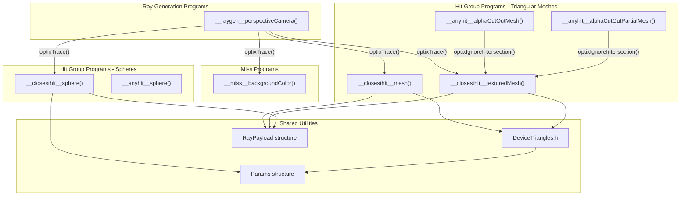
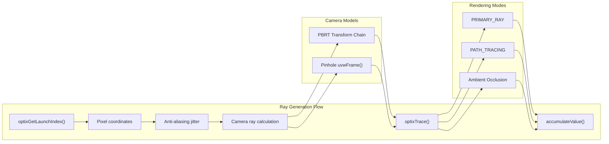
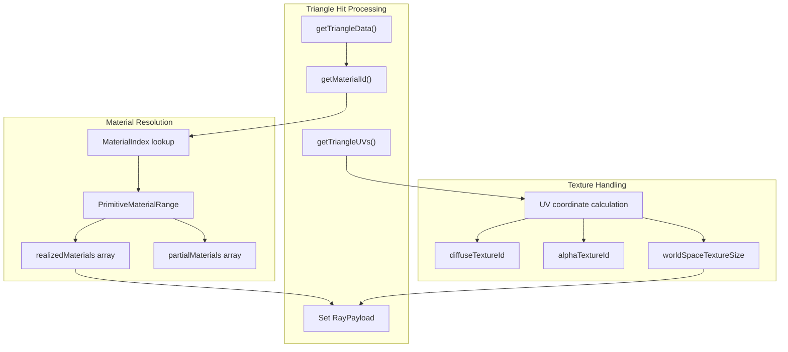
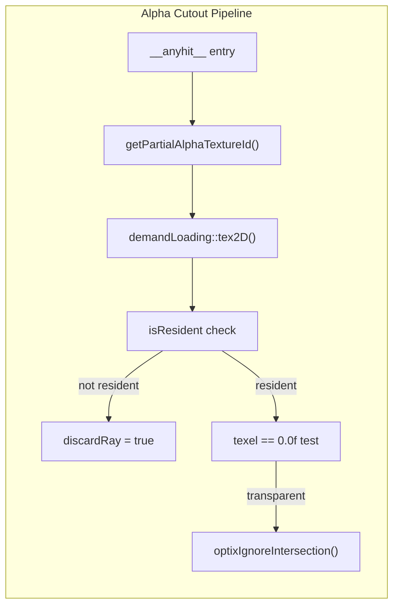
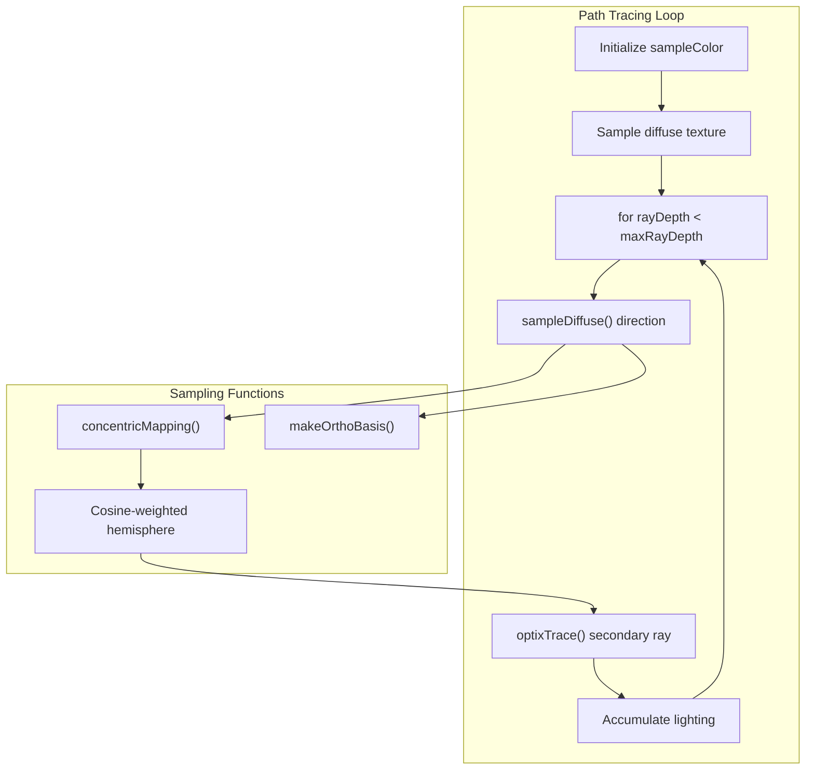
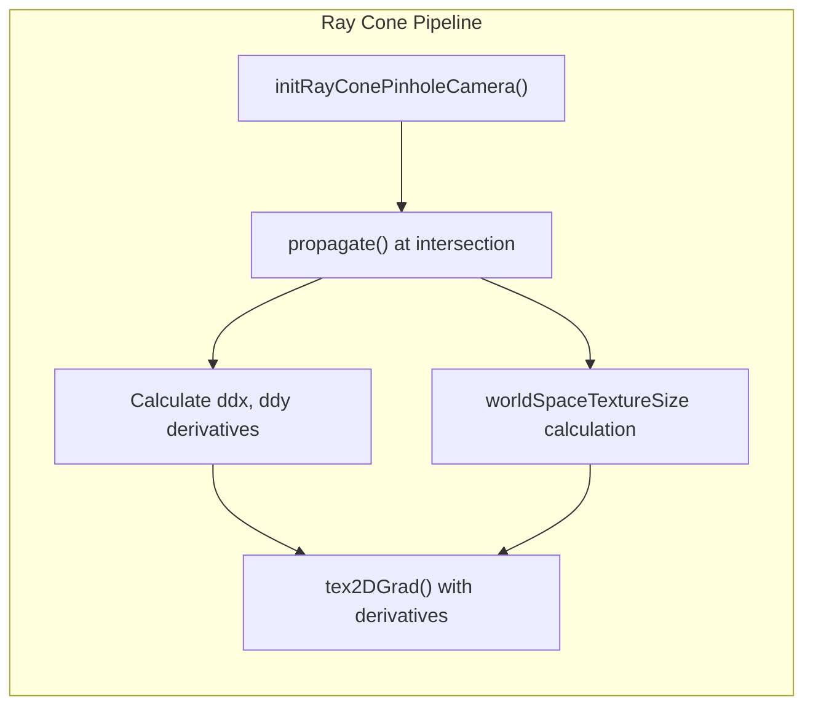
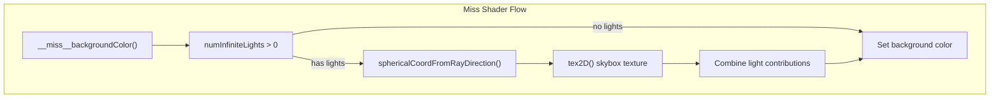

<!-- source: DeepWiki mcp.deepwiki.com · repo NVIDIA/optix-toolkit · extra page CUDA Kernels and Rendering · fetched 2026-10-26 -->

# CUDA Kernels and Rendering

Relevant source files

The following files were used as context for generating this wiki page:

- [DemandLoading/DemandLoading/tests/DeferredImageLoadingKernels.cu](DemandLoading/DemandLoading/tests/DeferredImageLoadingKernels.cu)
- [Memory/tests/TestDeviceMemoryPools.cu](Memory/tests/TestDeviceMemoryPools.cu)
- [ShaderUtil/tests/TestDebugLocation.cu](ShaderUtil/tests/TestDebugLocation.cu)
- [examples/DemandLoading/DemandGeometryViewer/Sphere.cu](examples/DemandLoading/DemandGeometryViewer/Sphere.cu)
- [examples/DemandLoading/DemandPbrtScene/DemandPbrtScene.cu](examples/DemandLoading/DemandPbrtScene/DemandPbrtScene.cu)
- [examples/DemandLoading/DemandPbrtScene/PhongMaterial.cu](examples/DemandLoading/DemandPbrtScene/PhongMaterial.cu)
- [examples/DemandLoading/DemandPbrtScene/include/DemandPbrtScene/DeviceTriangles.h](examples/DemandLoading/DemandPbrtScene/include/DemandPbrtScene/DeviceTriangles.h)
- [examples/DemandLoading/TexturePainting/CMakeLists.txt](examples/DemandLoading/TexturePainting/CMakeLists.txt)
- [examples/DemandLoading/TexturePainting/TexturePainting.cu](examples/DemandLoading/TexturePainting/TexturePainting.cu)
- [examples/DemandLoading/TexturePainting/TexturePaintingParams.h](examples/DemandLoading/TexturePainting/TexturePaintingParams.h)

This document covers the CUDA kernel implementation and rendering pipeline of the PbrtScene viewer, focusing on the OptiX ray tracing programs that handle camera ray generation, material shading, and intersection processing. The kernels implement multiple rendering modes including primary ray visualization, path tracing, and ambient occlusion.

For information about the scene proxy system and geometry management, see [Scene Proxy System](#5.1.1). For details about PBRT file parsing and scene loading, see [PBRT Scene Loading](#5.3).

## OptiX Program Architecture

The PbrtScene viewer implements a complete OptiX ray tracing pipeline with specialized programs for different ray types and geometry intersections. The kernel architecture follows OptiX's shader binding table (SBT) model with distinct program types for ray generation, material handling, and intersection processing.

**Sources:** [examples/DemandLoading/DemandPbrtScene/DemandPbrtScene.cu:138-808](), [examples/DemandLoading/DemandPbrtScene/PhongMaterial.cu:19-142]()

## Ray Generation and Camera Models

The `__raygen__perspectiveCamera` kernel serves as the entry point for all rays, supporting both PBRT-compatible camera transformations and simplified pinhole camera models. The kernel handles anti-aliasing through jittered sampling and implements different rendering modes.

### Camera Ray Computation

The ray generation kernel supports two camera models controlled by the `usePinholeCamera` parameter:

| Camera Model | Description | Implementation |
|--------------|-------------|----------------|
| **PBRT Camera** | Full camera transformation pipeline using `cameraToWorld` and `cameraToScreen` matrices | [DemandPbrtScene.cu:150-159]() |
| **Pinhole Camera** | Simplified model using `LookAtParams` with eye, lookAt, and up vectors | [DemandPbrtScene.cu:162-168]() |

**Sources:** [examples/DemandLoading/DemandPbrtScene/DemandPbrtScene.cu:138-369](), [examples/DemandLoading/DemandPbrtScene/DemandPbrtScene.cu:49-60]()

## Hit Group Programs and Material Processing

The viewer implements specialized hit group programs for different geometry types and material configurations. Each hit group extracts intersection data, processes materials, and updates the ray payload for subsequent rendering stages.

### Triangle Mesh Hit Groups

The triangle mesh hit groups handle both simple materials and textured surfaces with alpha cutout support:

**Sources:** [examples/DemandLoading/DemandPbrtScene/DemandPbrtScene.cu:816-859](), [examples/DemandLoading/DemandPbrtScene/PhongMaterial.cu:19-59](), [examples/DemandLoading/DemandPbrtScene/include/DemandPbrtScene/DeviceTriangles.h:35-64]()

### Alpha Cutout Processing

The any-hit programs implement alpha cutout functionality for transparent materials using demand-loaded alpha textures:

**Sources:** [examples/DemandLoading/DemandPbrtScene/DemandPbrtScene.cu:739-808](), [examples/DemandLoading/DemandPbrtScene/DemandPbrtScene.cu:687-714]()

## Rendering Modes and Shading

The kernel supports multiple rendering modes that determine how surface intersections are processed and shaded. Each mode implements different lighting models and ray tracing techniques.

### Primary Ray Mode

Primary ray mode implements Phong shading with demand-loaded diffuse textures and proper texture filtering:

| Component | Implementation | Location |
|-----------|---------------|----------|
| **Material Setup** | `PhongMaterial` structure with `Kd`, `Ka`, `Ks` components | [DemandPbrtScene.cu:277-292]() |
| **Texture Sampling** | `demandLoading::tex2DGrad<float4>()` with ray cone derivatives | [DemandPbrtScene.cu:284-285]() |
| **Shading** | `phongShade()` function with directional lighting | [DemandPbrtScene.cu:294]() |

### Path Tracing Mode

Path tracing mode implements global illumination using Monte Carlo sampling with cosine-weighted hemisphere sampling:

**Sources:** [examples/DemandLoading/DemandPbrtScene/DemandPbrtScene.cu:299-369](), [examples/DemandLoading/DemandPbrtScene/DemandPbrtScene.cu:77-115]()

## Demand Loading Integration

The kernels integrate tightly with the demand loading system to handle texture streaming and memory management. Texture access uses specialized functions that track residency and trigger loading requests.

### Texture Access Patterns

| Access Type | Function | Usage | Residency Handling |
|-------------|----------|-------|-------------------|
| **Basic Sampling** | `demandLoading::tex2D<float4>()` | Simple texture lookups without filtering | [DemandPbrtScene.cu:304]() |
| **Gradient Sampling** | `demandLoading::tex2DGrad<float4>()` | Filtered sampling with explicit derivatives | [DemandPbrtScene.cu:284-285]() |
| **Alpha Testing** | `demandLoading::tex2D<float>()` | Single-channel alpha cutout textures | [DemandPbrtScene.cu:745]() |

### Ray Cone Integration

The kernels implement ray cone tracking for proper texture level-of-detail calculation:

**Sources:** [examples/DemandLoading/DemandPbrtScene/DemandPbrtScene.cu:247-251](), [examples/DemandLoading/DemandPbrtScene/DemandPbrtScene.cu:280-282](), [examples/DemandLoading/DemandPbrtScene/DemandPbrtScene.cu:854-858]()

## Background and Miss Shading

The `__miss__backgroundColor` program handles rays that don't intersect geometry, implementing environment lighting and skybox rendering through infinite light sources.

### Infinite Light Processing

The miss shader supports multiple infinite light sources with optional skybox textures:

**Sources:** [examples/DemandLoading/DemandPbrtScene/DemandPbrtScene.cu:406-445](), [examples/DemandLoading/DemandPbrtScene/DemandPbrtScene.cu:371-391]()

## Debug and Visualization Infrastructure

The kernels include extensive debug support through the `DebugLocation` system, enabling pixel-specific debugging and visualization of intermediate rendering states.

### Debug Information System

| Debug Type | Structure | Purpose | Location |
|------------|-----------|---------|----------|
| **Triangle Debug** | `TriMeshMaterialDebugInfo` | Material and geometry inspection | [DeviceTriangles.h:66-176]() |
| **Sphere Debug** | `SphereMaterialDebugInfo` | Sphere intersection debugging | [PhongMaterial.cu:61-86]() |
| **Proxy Debug** | `ProxyClosestHitDebugInfo` | Demand geometry visualization | [DemandPbrtScene.cu:510-535]() |
| **Alpha Debug** | `AlphaCutOutDebugInfo` | Alpha cutout texture inspection | [DemandPbrtScene.cu:633-665]() |

The debug system uses a callback pattern where debug structures implement `dump()` and `setColor()` methods, allowing for comprehensive inspection of rendering state at specific pixels.

**Sources:** [examples/DemandLoading/DemandPbrtScene/include/DemandPbrtScene/DeviceTriangles.h:66-182](), [examples/DemandLoading/DemandPbrtScene/DemandPbrtScene.cu:510-673]()

---

