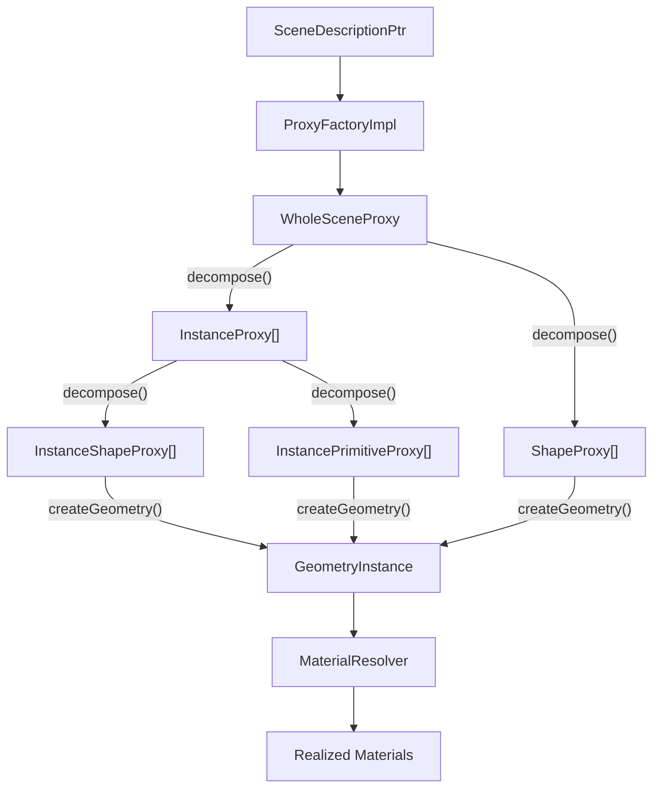
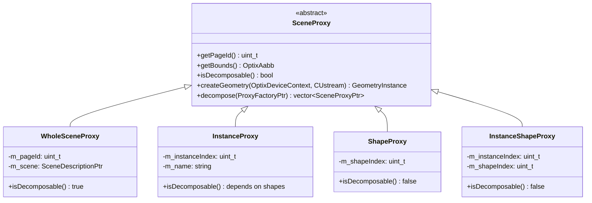
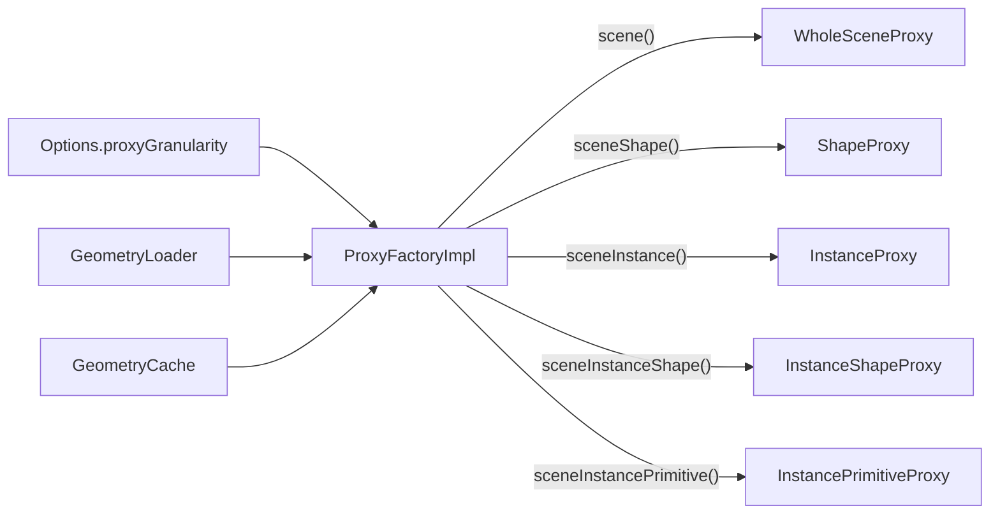
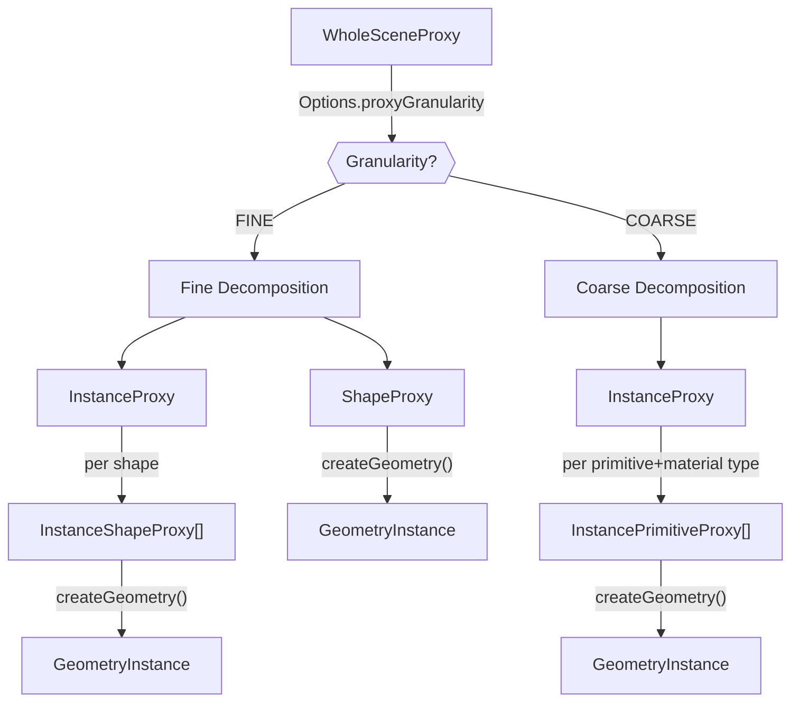
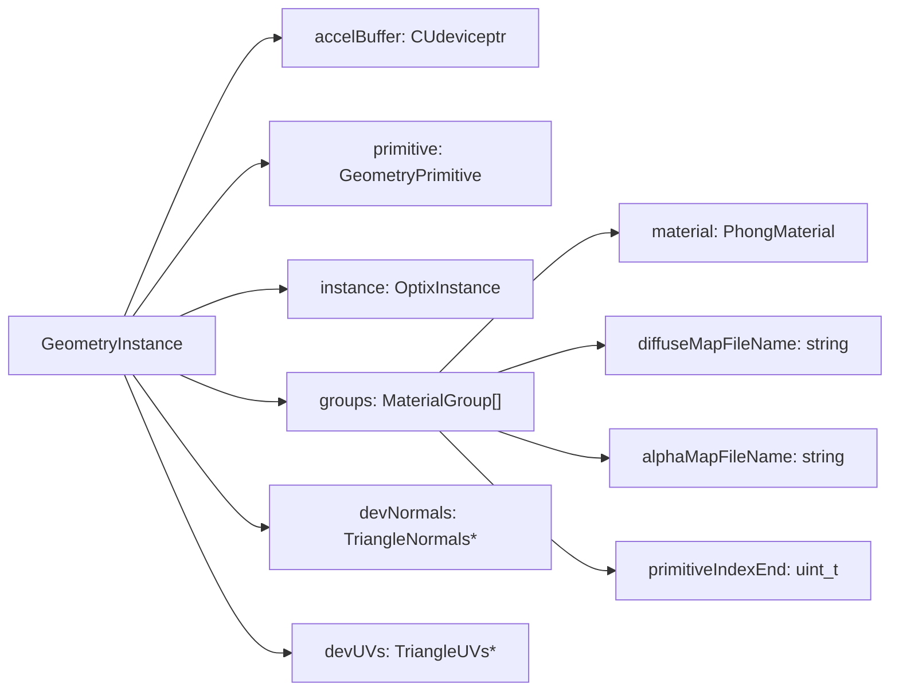
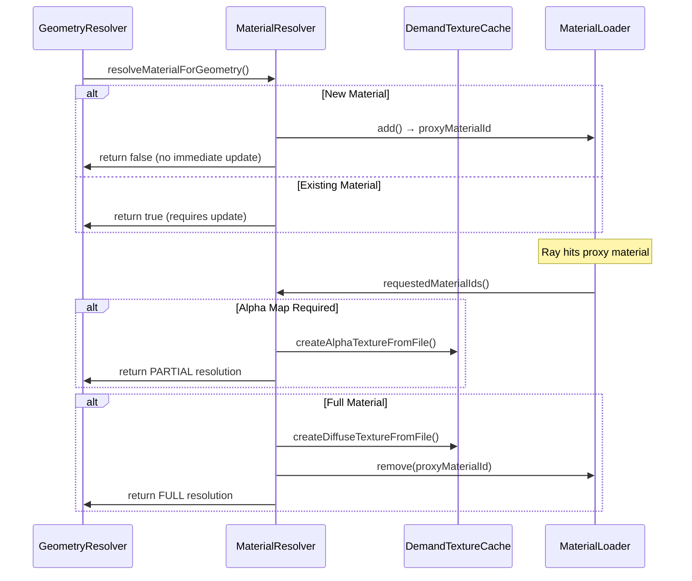
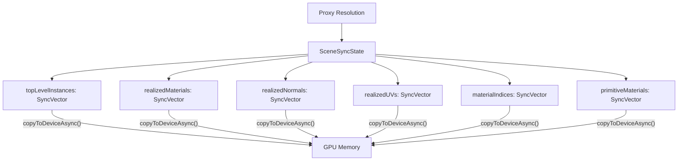

<!-- source: DeepWiki mcp.deepwiki.com · repo NVIDIA/optix-toolkit · extra page Scene Proxy System · fetched 2026-10-26 -->

# Scene Proxy System

Relevant source files

The following files were used as context for generating this wiki page:

- [examples/DemandLoading/DemandPbrtScene/GeometryResolver.cpp](examples/DemandLoading/DemandPbrtScene/GeometryResolver.cpp)
- [examples/DemandLoading/DemandPbrtScene/MaterialResolver.cpp](examples/DemandLoading/DemandPbrtScene/MaterialResolver.cpp)
- [examples/DemandLoading/DemandPbrtScene/ProgramGroups.cpp](examples/DemandLoading/DemandPbrtScene/ProgramGroups.cpp)
- [examples/DemandLoading/DemandPbrtScene/SceneProxy.cpp](examples/DemandLoading/DemandPbrtScene/SceneProxy.cpp)
- [examples/DemandLoading/DemandPbrtScene/include/DemandPbrtScene/Params.h](examples/DemandLoading/DemandPbrtScene/include/DemandPbrtScene/Params.h)
- [examples/DemandLoading/DemandPbrtScene/include/DemandPbrtScene/SceneGeometry.h](examples/DemandLoading/DemandPbrtScene/include/DemandPbrtScene/SceneGeometry.h)
- [examples/DemandLoading/DemandPbrtScene/include/DemandPbrtScene/SceneProxy.h](examples/DemandLoading/DemandPbrtScene/include/DemandPbrtScene/SceneProxy.h)
- [examples/DemandLoading/DemandPbrtScene/include/DemandPbrtScene/SceneSyncState.h](examples/DemandLoading/DemandPbrtScene/include/DemandPbrtScene/SceneSyncState.h)
- [examples/DemandLoading/DemandPbrtScene/tests/GeometryInstancePrinter.h](examples/DemandLoading/DemandPbrtScene/tests/GeometryInstancePrinter.h)
- [examples/DemandLoading/DemandPbrtScene/tests/MockRenderer.h](examples/DemandLoading/DemandPbrtScene/tests/MockRenderer.h)
- [examples/DemandLoading/DemandPbrtScene/tests/ParamsPrinters.h](examples/DemandLoading/DemandPbrtScene/tests/ParamsPrinters.h)
- [examples/DemandLoading/DemandPbrtScene/tests/TestGeometryResolver.cpp](examples/DemandLoading/DemandPbrtScene/tests/TestGeometryResolver.cpp)
- [examples/DemandLoading/DemandPbrtScene/tests/TestMaterialResolver.cpp](examples/DemandLoading/DemandPbrtScene/tests/TestMaterialResolver.cpp)
- [examples/DemandLoading/DemandPbrtScene/tests/TestProgramGroups.cpp](examples/DemandLoading/DemandPbrtScene/tests/TestProgramGroups.cpp)
- [examples/DemandLoading/DemandPbrtScene/tests/TestSceneProxy.cpp](examples/DemandLoading/DemandPbrtScene/tests/TestSceneProxy.cpp)

## Purpose and Scope

The Scene Proxy System is a hierarchical demand-loading mechanism used in the DemandPbrtScene example to efficiently render large scenes by decomposing them into manageable chunks. This system enables on-demand streaming of geometry and materials, allowing only visible portions of the scene to be realized in GPU memory during ray tracing.

The system operates at multiple levels of granularity, from whole-scene proxies down to individual primitive groups, and coordinates with the OptiX ray tracing pipeline to trigger decomposition and realization based on actual ray hits. For information about the underlying demand loading infrastructure, see [DemandLoading System](#3). For details about rendering and CUDA kernels, see [CUDA Kernels and Rendering](#5.1.2).

## System Architecture Overview

The Scene Proxy System implements a tree-like decomposition strategy where complex scene elements are initially represented as coarse bounding box proxies. When rays intersect these proxies during OptiX traversal, the system progressively decomposes them into finer-grained proxies or realizes them as actual geometry and materials.

**Sources:** [examples/DemandLoading/DemandPbrtScene/SceneProxy.cpp:416-427](), [examples/DemandLoading/DemandPbrtScene/SceneProxy.cpp:490-509]()

## Core Abstractions

### SceneProxy Interface

The `SceneProxy` abstract base class defines the contract for all proxy objects in the system:

| Method | Purpose |
|--------|---------|
| `getPageId()` | Returns the demand geometry page ID for OptiX integration |
| `getBounds()` | Provides world-space bounding box for culling |
| `isDecomposable()` | Indicates if proxy can be further decomposed |
| `createGeometry()` | Creates actual OptiX geometry for non-decomposable proxies |
| `decompose()` | Breaks proxy into sub-proxies for hierarchical loading |

**Sources:** [examples/DemandLoading/DemandPbrtScene/include/DemandPbrtScene/SceneProxy.h:44-63](), [examples/DemandLoading/DemandPbrtScene/SceneProxy.cpp:87-108]()

### ProxyFactory

The `ProxyFactory` creates appropriate proxy types based on scene structure and granularity settings:

**Sources:** [examples/DemandLoading/DemandPbrtScene/SceneProxy.cpp:464-488](), [examples/DemandLoading/DemandPbrtScene/SceneProxy.cpp:589-592]()

## Proxy Decomposition Hierarchy

The system supports multiple decomposition strategies based on the `ProxyGranularity` setting:

### Fine Granularity
In fine mode, decomposition proceeds to individual shapes:
- `WholeSceneProxy` → `InstanceProxy[]` + `ShapeProxy[]`  
- `InstanceProxy` → `InstanceShapeProxy[]`

### Coarse Granularity  
In coarse mode, shapes with similar properties are grouped:
- `InstanceProxy` → `InstancePrimitiveProxy[]` (grouped by `GeometryPrimitive` and `MaterialFlags`)

**Sources:** [examples/DemandLoading/DemandPbrtScene/SceneProxy.cpp:309-330](), [examples/DemandLoading/DemandPbrtScene/SceneProxy.cpp:382-409]()

## Geometry and Material Resolution

### GeometryInstance Structure

When a proxy is realized, it produces a `GeometryInstance` containing all data needed for OptiX:

**Sources:** [examples/DemandLoading/DemandPbrtScene/include/DemandPbrtScene/SceneProxy.h:34-42](), [examples/DemandLoading/DemandPbrtScene/include/DemandPbrtScene/SceneProxy.h:26-32]()

### Material Resolution Pipeline

Materials follow a two-phase resolution process coordinated by the `MaterialResolver`:

**Sources:** [examples/DemandLoading/DemandPbrtScene/MaterialResolver.cpp:380-423](), [examples/DemandLoading/DemandPbrtScene/MaterialResolver.cpp:239-285]()

## Integration with Demand Loading

The Scene Proxy System integrates tightly with the OptiX demand loading infrastructure:

### Page ID Management
- Each proxy receives a unique page ID from `GeometryLoader::add()`
- Page IDs map proxy bounding boxes to demand loading requests
- When rays hit proxies, the page ID triggers decomposition

### Synchronization Flow
The `SceneSyncState` coordinates updates between CPU proxy management and GPU rendering:

**Sources:** [examples/DemandLoading/DemandPbrtScene/include/DemandPbrtScene/SceneSyncState.h:17-33](), [examples/DemandLoading/DemandPbrtScene/GeometryResolver.cpp:220-234]()

## SBT Offset Management

The system manages Shader Binding Table (SBT) offsets to ensure correct hit group selection:

| Proxy Type | SBT Offset | Purpose |
|------------|------------|---------|
| Geometry Proxy | `HitGroupIndex::PROXY_GEOMETRY` | Triggers decomposition |
| Material Proxy Triangle | `HitGroupIndex::PROXY_MATERIAL_TRIANGLE` | Triggers material resolution |
| Material Proxy Triangle Alpha | `HitGroupIndex::PROXY_MATERIAL_TRIANGLE_ALPHA` | Alpha cutout support |
| Realized Material | Dynamic offset from `ProgramGroups` | Actual shading |

**Sources:** [examples/DemandLoading/DemandPbrtScene/include/DemandPbrtScene/Params.h:49-63](), [examples/DemandLoading/DemandPbrtScene/SceneProxy.cpp:73-85]()

---

