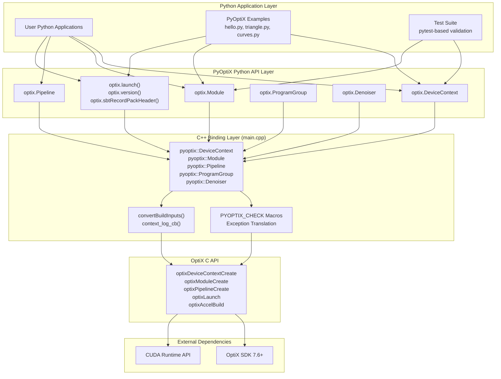
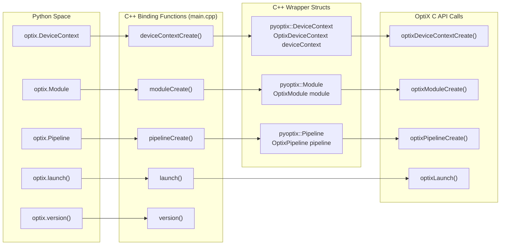
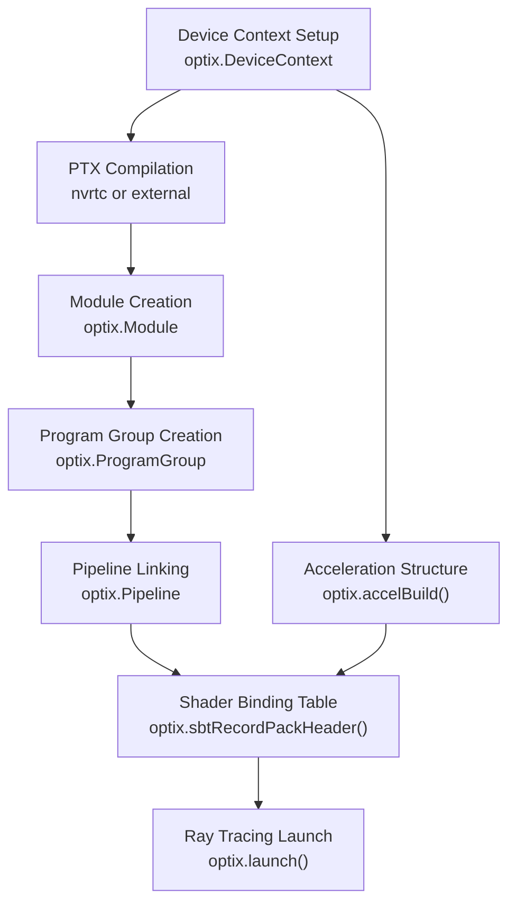

<!-- source: DeepWiki mcp.deepwiki.com · repo NVIDIA/otk-pyoptix · page 1 PyOptiX Overview · fetched 2026-10-26 -->

# PyOptiX Overview

Relevant source files

The following files were used as context for generating this wiki page:

- [README.md](README.md)
- [optix/main.cpp](optix/main.cpp)
- [optix/setup.py](optix/setup.py)

## Purpose and Scope

This document provides a high-level overview of PyOptiX, explaining its architecture, core components, and relationship to the NVIDIA OptiX ray tracing API. It covers the overall system design and the binding layer that enables Python applications to use OptiX functionality.

For detailed installation instructions, see [Installation and Dependencies](#2.1). For hands-on usage examples, see [Your First Ray Tracing Application](#2.2). For comprehensive API documentation, see [Core API Reference](#3).

## What is PyOptiX

PyOptiX is a Python binding library that provides Python access to NVIDIA's OptiX 7 ray tracing API. It enables Python developers to build high-performance ray tracing applications by wrapping the OptiX C API with Python-friendly interfaces using pybind11.

**Key characteristics:**
- **Python bindings for OptiX 7.6+**: Wraps the complete OptiX C API for Python use
- **pybind11-based implementation**: Uses modern C++ binding techniques for seamless Python integration  
- **Complete API coverage**: Supports device contexts, modules, pipelines, acceleration structures, and denoising
- **Cross-platform support**: Works on Linux and Windows with appropriate OptiX and CUDA installations

**Sources:** [README.md:1-96](), [optix/main.cpp:1-50]()

## System Architecture

PyOptiX follows a layered architecture that bridges Python applications with the OptiX C API through C++ bindings:

**Sources:** [optix/main.cpp:85-137](), [optix/main.cpp:1070-1096](), [README.md:20-27]()

## Python API to C++ Binding Mapping

The binding layer translates Python calls into OptiX C API calls through C++ wrapper objects:

**Sources:** [optix/main.cpp:1098-1114](), [optix/main.cpp:1348-1391](), [optix/main.cpp:1280-1315](), [optix/main.cpp:1555-1578]()

## Core Components

PyOptiX provides Python wrappers for the primary OptiX objects and operations:

| Python Class/Function | C++ Wrapper Struct | OptiX C API | Purpose |
|----------------------|-------------------|-------------|---------|
| `optix.DeviceContext` | `pyoptix::DeviceContext` | `OptixDeviceContext` | GPU context and configuration management |
| `optix.Module` | `pyoptix::Module` | `OptixModule` | Compiled PTX shader module container |
| `optix.ProgramGroup` | `pyoptix::ProgramGroup` | `OptixProgramGroup` | Collection of related shader programs |
| `optix.Pipeline` | `pyoptix::Pipeline` | `OptixPipeline` | Complete ray tracing pipeline |
| `optix.Denoiser` | `pyoptix::Denoiser` | `OptixDenoiser` | AI-based image denoising |
| `optix.launch()` | `launch()` function | `optixLaunch()` | Ray tracing execution |

**Error handling** is managed through `PYOPTIX_CHECK` macros that translate OptiX errors into Python exceptions, providing consistent error reporting across the binding layer.

**Sources:** [optix/main.cpp:105-136](), [optix/main.cpp:28-45]()

## Ray Tracing Pipeline Flow

PyOptiX applications follow the standard OptiX pipeline pattern:

This pipeline enables GPU-accelerated ray tracing with OptiX's dedicated RT cores for optimal performance.

**Sources:** [optix/main.cpp:1348-1391](), [optix/main.cpp:1450-1542](), [optix/main.cpp:1640-1688](), [optix/main.cpp:1555-1578]()

## Build System Integration

PyOptiX uses a CMake-based build system integrated with Python's setuptools:

- **CMake backend**: [optix/setup.py:16-88]() provides `CMakeExtension` and `CMakeBuild` classes
- **Environment configuration**: `PYOPTIX_CMAKE_ARGS` environment variable specifies OptiX SDK location  
- **Cross-platform support**: Handles Windows and Linux build differences
- **Dependency management**: Links against OptiX SDK, CUDA runtime, and pybind11

**Sources:** [optix/setup.py:38-75](), [README.md:57-78]()

## Integration Points

PyOptiX integrates with several related systems and tools:

- **CUDA ecosystem**: Uses CuPy arrays for GPU memory management and NVRTC for runtime PTX compilation
- **OptiX examples**: Demonstrates usage patterns for geometry rendering, motion blur, and denoising  
- **Testing framework**: Pytest-based validation ensures API correctness across OptiX versions

For detailed component documentation, see [Core API Reference](#3). For practical usage examples, see [Examples and Tutorials](#4). For build system details, see [Build System and Development](#6).

**Sources:** [README.md:20-27](), [optix/main.cpp:51-82]()

---

