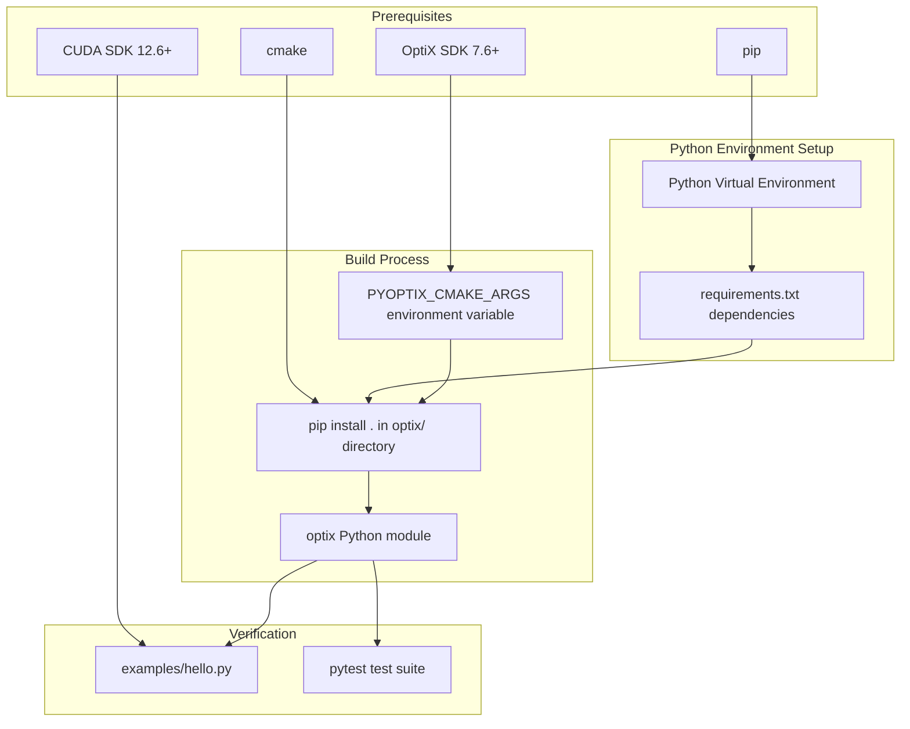
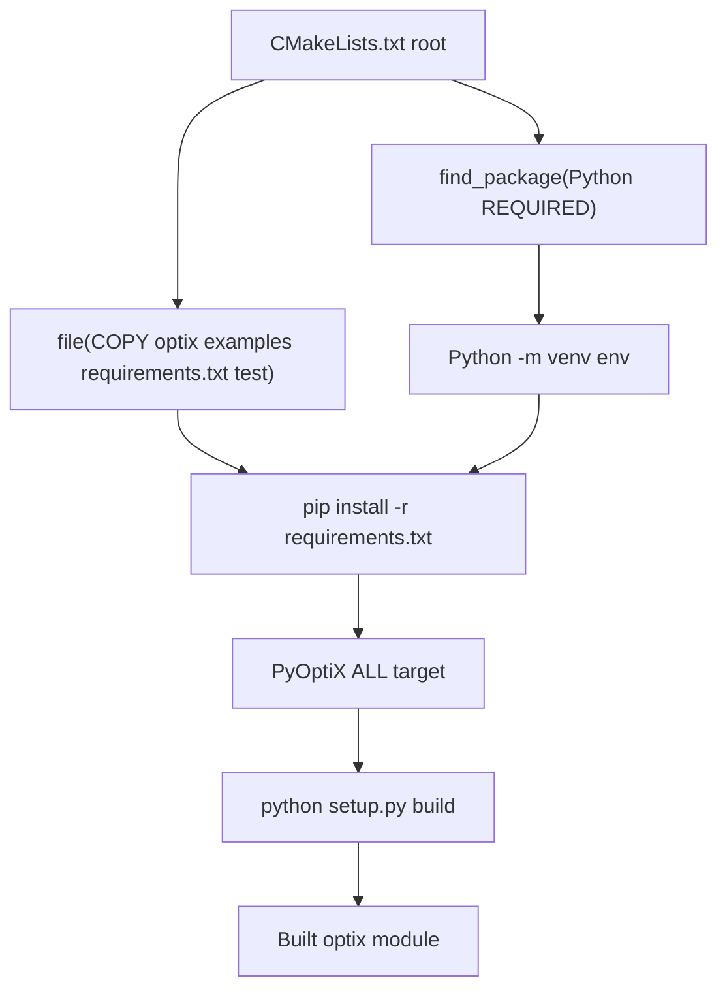

<!-- source: DeepWiki mcp.deepwiki.com · repo NVIDIA/otk-pyoptix · page 2 Getting Started · fetched 2026-10-26 -->

# Getting Started

<details>
<summary>Relevant source files</summary>

The following files were used as context for generating this wiki page:

- [CMakeLists.txt](CMakeLists.txt)
- [README.md](README.md)
- [requirements.txt](requirements.txt)

</details>


This document provides an overview of PyOptiX installation and initial setup procedures. It covers the high-level workflow for getting PyOptiX running on your system and introduces the basic concepts needed to begin ray tracing with PyOptiX.

For detailed installation instructions and dependency management, see [Installation and Dependencies](#2.1). For a step-by-step tutorial building your first ray tracing application, see [Your First Ray Tracing Application](#2.2).

## Overview

PyOptiX provides Python bindings for NVIDIA OptiX 7, enabling high-performance ray tracing applications to be developed in Python. The system consists of a C++ binding layer that wraps the OptiX C API using pybind11, exposing OptiX functionality through Python classes and functions.

The following diagram shows the key components involved in getting PyOptiX operational:

**PyOptiX Getting Started Architecture**



Sources: [README.md:1-96](), [CMakeLists.txt:29-60]()

## Installation Workflow

The PyOptiX installation process follows these high-level steps:

| Step | Component | Description |
|------|-----------|-------------|
| 1 | OptiX SDK | Install NVIDIA OptiX SDK 7.6 or newer |
| 2 | CUDA SDK | Install CUDA SDK 12.6 or newer |
| 3 | Python Environment | Create virtual environment using `venv` or `conda` |
| 4 | Dependencies | Install Python packages from `requirements.txt` |
| 5 | Build Configuration | Set `PYOPTIX_CMAKE_ARGS` environment variable |
| 6 | Module Build | Run `pip install .` in the `optix/` directory |
| 7 | Verification | Run `examples/hello.py` to test installation |

Sources: [README.md:10-72]()

## Core Dependencies

PyOptiX requires both system-level and Python-level dependencies:

**System Dependencies:**
- OptiX SDK 7.6+ (ray tracing API)
- CUDA SDK 12.6+ (GPU compute platform)
- cmake (build system)
- pip (Python package manager)

**Python Dependencies from `requirements.txt`:**
- `pytest` - testing framework
- `cupy` - GPU array operations
- `numpy` - CPU array operations  
- `Pillow` - image processing
- `cuda-python` - CUDA Python bindings

Sources: [README.md:10-26](), [requirements.txt:1-5]()

## Build System Integration

The PyOptiX build system uses CMake integration with Python setuptools. The root `CMakeLists.txt` creates a Python virtual environment and manages file copying, while the module-specific build occurs through setuptools:

**Build System Flow**



Sources: [CMakeLists.txt:29-60]()

## Environment Configuration

Before building PyOptiX, the `PYOPTIX_CMAKE_ARGS` environment variable must be configured to point to your OptiX SDK installation:

**Linux:**
```bash
export PYOPTIX_CMAKE_ARGS="-DOptiX_INSTALL_DIR=<optix install dir>"
```

**Windows:**
```cmd
set PYOPTIX_CMAKE_ARGS=-DOptiX_INSTALL_DIR=C:\ProgramData\NVIDIA Corporation\OptiX SDK 7.0.0
```

This environment variable is used by the build system at [CMakeLists.txt:57]() to locate OptiX headers and libraries during compilation.

Sources: [README.md:57-66](), [CMakeLists.txt:57]()

## Initial Verification

After successful installation, verify PyOptiX functionality by running the `hello.py` example:

```bash
cd examples
python hello.py
```

A successful run produces a green square image, confirming that:
- The `optix` Python module loads correctly
- OptiX device context creation succeeds
- Basic ray tracing pipeline execution works
- Image output generation functions properly

For comprehensive system validation, run the full test suite:

```bash
cd test
python -m pytest
```

Sources: [README.md:80-95]()

## Next Steps

Once PyOptiX is installed and verified:

1. **Explore Examples**: Review the examples in the `examples/` directory to understand different PyOptiX usage patterns
2. **Study API Documentation**: Examine the core API reference for detailed class and function documentation  
3. **Build Your Application**: Start with simple ray tracing scenarios and progressively add complexity

For detailed installation procedures and dependency troubleshooting, proceed to [Installation and Dependencies](#2.1). To build your first ray tracing application from scratch, see [Your First Ray Tracing Application](#2.2).

Sources: [README.md:80-96]()

---

