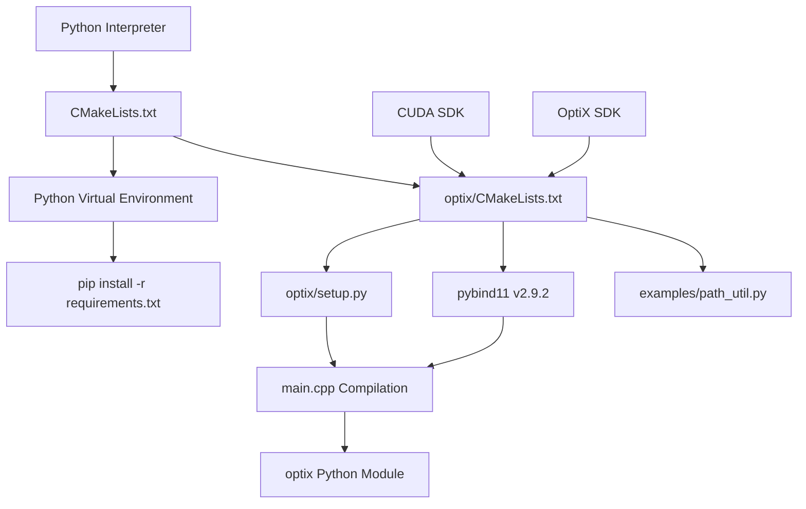
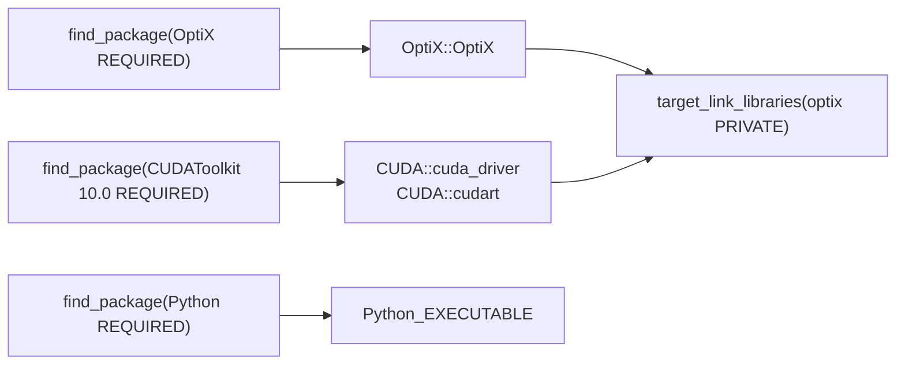
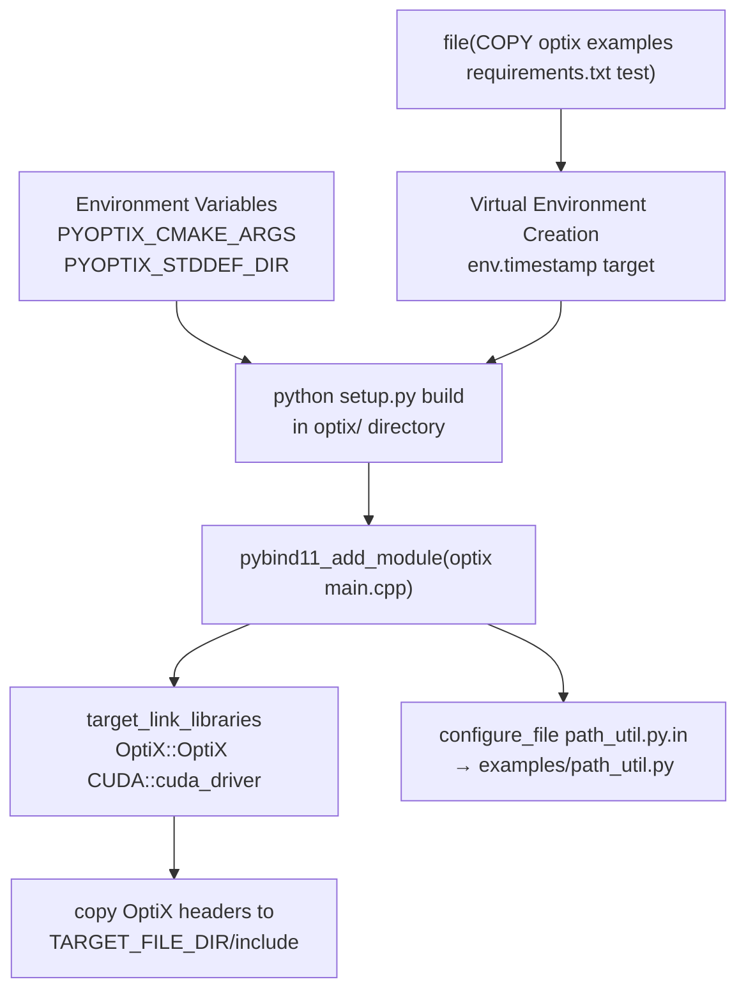

<!-- source: DeepWiki mcp.deepwiki.com · repo NVIDIA/otk-pyoptix · page 2.1 Installation and Dependencies · fetched 2026-10-26 -->

# Installation and Dependencies

<details>
<summary>Relevant source files</summary>

The following files were used as context for generating this wiki page:

- [CMakeLists.txt](CMakeLists.txt)
- [README.md](README.md)
- [optix/CMakeLists.txt](optix/CMakeLists.txt)
- [optix/path_util.py.in](optix/path_util.py.in)
- [requirements.txt](requirements.txt)

</details>


This page provides comprehensive instructions for installing PyOptiX and setting up all required dependencies. It covers system requirements, Python package dependencies, build system configuration, and the complete installation process from source.

For information about running your first PyOptiX application after installation, see [Your First Ray Tracing Application](#2.2). For details about the underlying build system architecture and development setup, see [Build System and Development](#6).

## System Requirements

PyOptiX requires specific versions of external SDKs and tools to function correctly. These dependencies form the foundation of the ray tracing capabilities.

### Required SDKs

| Component | Minimum Version | Purpose |
|-----------|-----------------|---------|
| OptiX SDK | 7.6+ | Core ray tracing functionality |
| CUDA SDK | 12.6+ | GPU compute and memory management |
| CMake | 3.17+ | Build system |
| Python | 3.x | Runtime environment |

The OptiX SDK must be installed from the [NVIDIA Developer Portal](https://developer.nvidia.com/designworks/optix/download). The CUDA SDK is available from [NVIDIA's CUDA downloads page](https://developer.nvidia.com/cuda-downloads).

**Sources:** [README.md:10-18](), [optix/CMakeLists.txt:5-6]()

### Version Compatibility

The build system includes version guards to ensure compatibility. OptiX versions greater than 7.7 are currently blocked pending version 8.0 fixes.

**Sources:** [CMakeLists.txt:31-34]()

## Python Dependencies

PyOptiX requires several Python packages for full functionality. These dependencies are managed through `requirements.txt` and support both example execution and testing.

### Core Dependencies

The following packages are required for PyOptiX operation:

```
pytest      - Testing framework
cupy        - GPU-accelerated NumPy alternative  
numpy       - Numerical computing
Pillow      - Image processing
cuda-python - CUDA Python bindings
```

For Conda environments, an additional dependency is needed:
- `pynvrtc` - NVIDIA Runtime Compiler Python bindings (pip only)

**Sources:** [requirements.txt:1-5](), [README.md:21-26](), [README.md:51-53]()

## Build System Architecture

The PyOptiX build system uses a two-stage CMake configuration with Python integration. Understanding this architecture helps troubleshoot build issues and customize the installation process.

### Build System Dependency Flow



**Sources:** [CMakeLists.txt:29-60](), [optix/CMakeLists.txt:13-24](), [optix/CMakeLists.txt:32-37]()

### CMake Module Resolution

The build system automatically locates required components through CMake's find_package mechanism:



**Sources:** [optix/CMakeLists.txt:32-37](), [optix/CMakeLists.txt:48-52]()

## Virtual Environment Setup

PyOptiX supports both `venv` and Conda virtual environments. The build system can automatically create and configure virtual environments during the build process.

### Automated Virtual Environment Creation

The root CMakeLists.txt includes platform-specific commands for virtual environment setup:

**Unix/Linux:**
- Creates virtual environment: `${Python_EXECUTABLE} -m venv env`
- Activates environment: `source ./env/bin/activate`
- Installs dependencies: `./env/bin/pip install -r requirements.txt`

**Windows:**
- Creates virtual environment: `${Python_EXECUTABLE} -m venv env`
- Activates environment: `powershell ./env/Scripts/Activate.ps1`
- Installs dependencies: `powershell ./env/Scripts/pip.exe install -r requirements.txt`

**Sources:** [CMakeLists.txt:38-54]()

### Manual Virtual Environment Setup

For manual setup, users can choose between venv and Conda approaches:

**venv approach:**
```bash
python3 -m venv env
source env/bin/activate
pip install -r requirements.txt
```

**Conda approach:**
```bash
conda create -n pyoptix python numpy conda-forge::cupy pillow pytest
conda activate pyoptix
pip install pynvrtc
```

**Sources:** [README.md:31-54]()

## Installation Process

The PyOptiX installation follows a multi-stage process involving environment configuration, dependency resolution, and module compilation.

### Environment Configuration

Before building, the OptiX SDK location must be specified through the `PYOPTIX_CMAKE_ARGS` environment variable:

**Linux/macOS:**
```bash
export PYOPTIX_CMAKE_ARGS="-DOptiX_INSTALL_DIR=<optix install dir>"
```

**Windows:**
```cmd
set PYOPTIX_CMAKE_ARGS=-DOptiX_INSTALL_DIR=C:\ProgramData\NVIDIA Corporation\OptiX SDK 7.0.0
```

For OptiX 7.0 SDK, an additional environment variable is required:
```bash
export PYOPTIX_STDDEF_DIR="/usr/include/linux"
```

**Sources:** [README.md:57-78]()

### Build Process Flow



**Sources:** [CMakeLists.txt:36-60](), [optix/CMakeLists.txt:39-61](), [optix/CMakeLists.txt:46-61]()

### Installation Commands

The complete installation process:

1. **Navigate to optix directory:** `cd optix`
2. **Install using pip:** `pip install .`

This triggers the CMake build system, which:
- Fetches pybind11 v2.9.2 from GitHub
- Compiles `main.cpp` with OptiX and CUDA linking
- Generates `path_util.py` with include paths
- Copies OptiX headers to the module directory
- Creates the installable Python module

**Sources:** [README.md:68-72](), [optix/CMakeLists.txt:14-24](), [optix/CMakeLists.txt:56-61]()

## Path Resolution and Include Management

PyOptiX automatically manages include paths for OptiX headers and CUDA toolkit components through a generated configuration file.

### Path Utility Generation

The build system generates `examples/path_util.py` from a template, providing runtime access to SDK paths:

```python
include_path = "${OptiX_INCLUDE_DIR}"
cuda_tk_path = "${CUDAToolkit_INCLUDE_DIRS}" 
stddef_path = "${OptiX_STDDEF_DIR}"
```

This file is generated at build time with actual resolved paths substituted for the CMake variables.

**Sources:** [optix/CMakeLists.txt:39](), [optix/path_util.py.in:1-7]()

### Header Copy Process

The build system copies OptiX headers to the module directory for distribution:

```cmake
add_custom_command(
    TARGET optix POST_BUILD
    COMMAND ${CMAKE_COMMAND} -E copy_directory
    ${OptiX_INCLUDE_DIR}
    $<TARGET_FILE_DIR:optix>/include
)
```

This ensures that the compiled module includes all necessary OptiX headers for proper operation.

**Sources:** [optix/CMakeLists.txt:56-61]()

---

