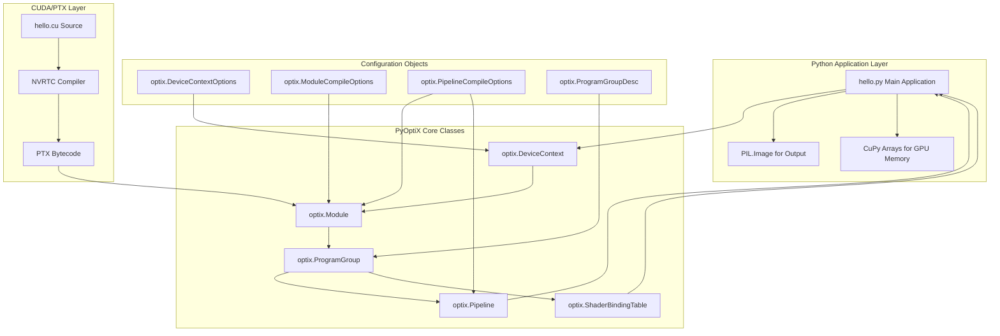
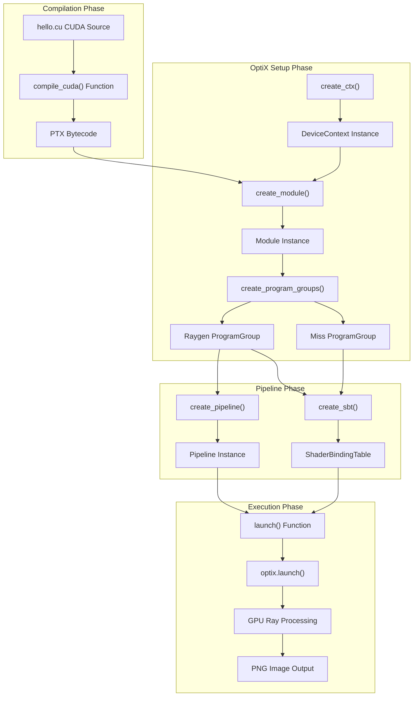
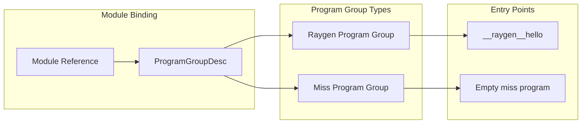

<!-- source: DeepWiki mcp.deepwiki.com · repo NVIDIA/otk-pyoptix · page 2.2 Your First Ray Tracing Application · fetched 2026-10-26 -->

# Your First Ray Tracing Application

Relevant source files

The following files were used as context for generating this wiki page:

- [examples/hello.cu](examples/hello.cu)
- [examples/hello.h](examples/hello.h)
- [examples/hello.py](examples/hello.py)

This document walks through the `hello.py` example to demonstrate fundamental PyOptiX usage patterns and the basic ray tracing pipeline. The example creates a simple colored output without complex geometry, focusing on the essential OptiX setup and execution flow.

For detailed API documentation of the PyOptiX classes used in this example, see [Core API Reference](#3). For information about writing CUDA kernels for OptiX, see [CUDA Kernel Development](#5).

## Hello World Example Overview

The `hello.py` example demonstrates the minimal viable ray tracing application using PyOptiX. Instead of rendering complex geometry, it generates a simple colored pattern by writing pixel values directly in the ray generation program. This approach illustrates all core PyOptiX concepts without the complexity of acceleration structures or geometric primitives.

**Key Components:**
- CUDA kernel compilation using NVRTC
- OptiX device context creation and management
- Module creation from PTX code
- Program group setup for ray generation
- Pipeline linking and configuration
- Shader Binding Table (SBT) construction
- Ray tracing launch and image output

Sources: [examples/hello.py:1-400]()

## PyOptiX Component Architecture

The following diagram shows how the major PyOptiX classes used in `hello.py` relate to each other:

Sources: [examples/hello.py:138-159](), [examples/hello.py:174-213](), [examples/hello.py:216-246](), [examples/hello.py:249-283]()

## Ray Tracing Execution Pipeline

This diagram illustrates the complete execution flow from CUDA compilation to image output:

Sources: [examples/hello.py:97-129](), [examples/hello.py:377-396]()

## Core Function Analysis

### Device Context Creation

The `create_ctx()` function establishes the OptiX runtime environment with logging capabilities:

| Component | Purpose | Key Configuration |
|-----------|---------|-------------------|
| `Logger` class | Callback for OptiX messages | Custom callable with message counting |
| `DeviceContextOptions` | Context configuration | Log level 4, validation mode (OptiX 7.2+) |
| `optix.deviceContextCreate()` | Context instantiation | Uses CUDA context 0 |

The function demonstrates PyOptiX's Python-centric approach by using a callable class instance instead of traditional C callback patterns.

Sources: [examples/hello.py:138-159]()

### Module Compilation

The `create_module()` function transforms PTX bytecode into an OptiX module with compile-time optimizations:

| Feature | Implementation | Version Dependency |
|---------|---------------|-------------------|
| Bound Values | Pipeline parameter binding | OptiX 7.2+ |
| Register Count | `COMPILE_DEFAULT_MAX_REGISTER_COUNT` | All versions |
| Optimization Level | `COMPILE_OPTIMIZATION_DEFAULT` | All versions |
| Debug Information | `COMPILE_DEBUG_LEVEL_DEFAULT` | All versions |

The bound values feature allows compile-time constants to be injected into the PTX code for optimization.

Sources: [examples/hello.py:174-213]()

### Program Group Setup

Program groups organize related OptiX programs and define entry points:

The example creates minimal program groups - a raygen program that writes pixels directly, and an empty miss program that's never called since no rays are traced.

Sources: [examples/hello.py:216-246]()

### Shader Binding Table Construction

The SBT maps program groups to their associated data using carefully aligned memory structures:

| Record Type | Data Structure | Alignment |
|-------------|----------------|-----------|
| Raygen | Header + RGB color values | `SBT_RECORD_ALIGNMENT` |
| Miss | Header + integer placeholder | `SBT_RECORD_ALIGNMENT` |

The `optix.sbtRecordPackHeader()` function populates the OptiX-specific header portion, while user data follows in the same memory allocation.

Sources: [examples/hello.py:286-329]()

### Launch Execution

The `launch()` function orchestrates GPU memory management and ray tracing execution:

1. **Memory Setup**: Creates CuPy device arrays for pixel data
2. **Parameter Packing**: Structures launch parameters with proper alignment
3. **OptiX Launch**: Calls `optix.launch()` with pipeline, SBT, and parameters
4. **Synchronization**: Waits for GPU completion and retrieves results

The launch dimensions (512x512x1) determine the number of GPU threads, with each thread executing the `__raygen__hello` kernel once.

Sources: [examples/hello.py:332-367]()

## CUDA Kernel Implementation

The `hello.cu` kernel demonstrates OptiX's GPU-side API:

| OptiX Function | Purpose | Usage in Example |
|----------------|---------|-------------------|
| `optixGetLaunchIndex()` | Get current thread coordinates | Calculate pixel position |
| `optixGetSbtDataPointer()` | Access SBT record data | Retrieve RGB color values |
| Global `params` | Access launch parameters | Write to image buffer |

The kernel writes colored pixels directly to the output buffer without tracing any rays, making it an ideal first example for understanding the OptiX execution model.

Sources: [examples/hello.cu:38-49](), [examples/hello.h:29-38]()

## Running the Example

To execute the hello world example:

1. **Prerequisites**: Ensure PyOptiX is built and installed per [Installation and Dependencies](#2.1)
2. **Execution**: Run `python examples/hello.py` from the repository root
3. **Output**: The program generates `my.png` (512x512 RGBA image) and displays it

**Expected Behavior:**
- Console output showing OptiX version and setup progress
- Log messages from OptiX operations
- Final message with total log count
- PNG file creation and display

The resulting image demonstrates that the ray tracing pipeline is functioning correctly, even without complex geometry or lighting calculations.

Sources: [examples/hello.py:377-399]()

---

