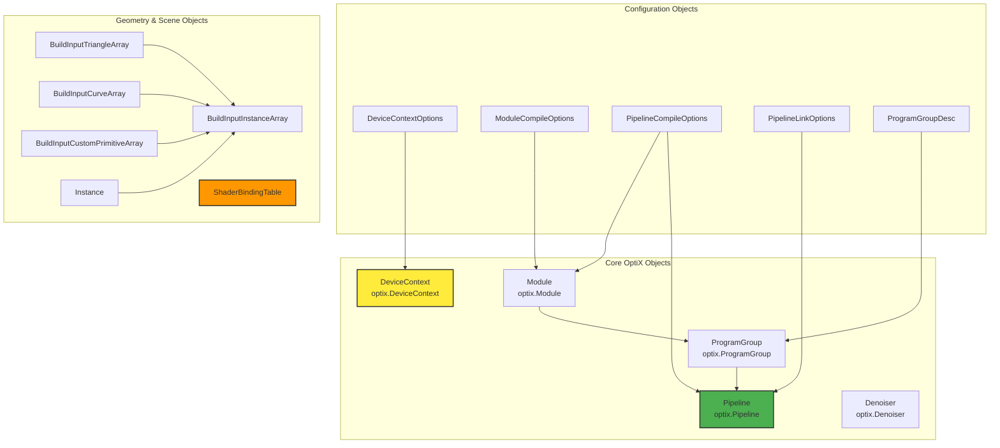
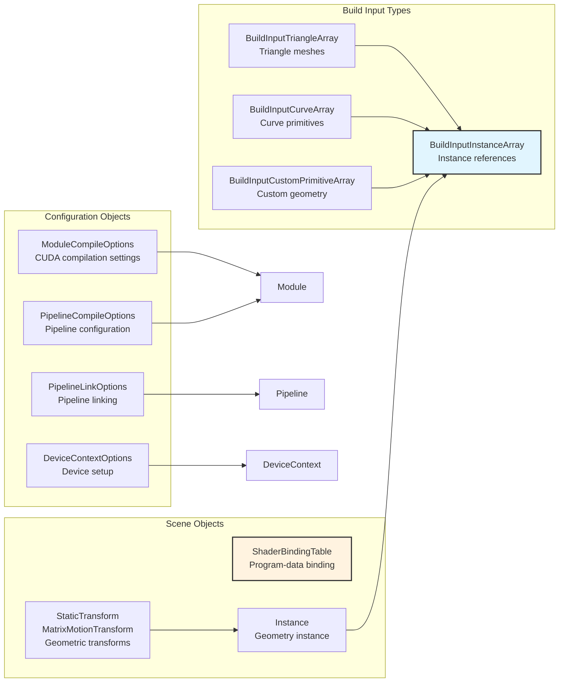
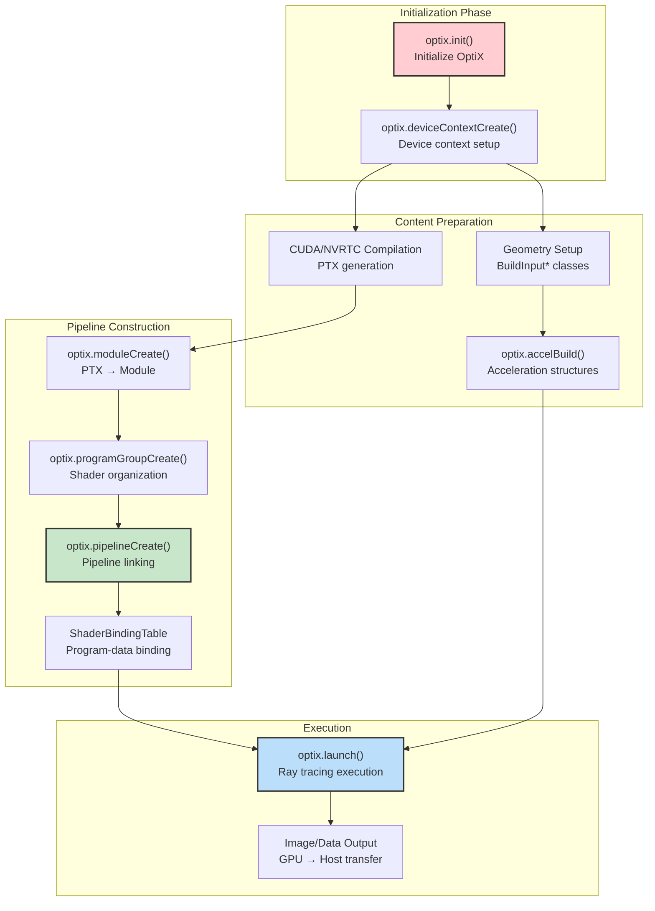
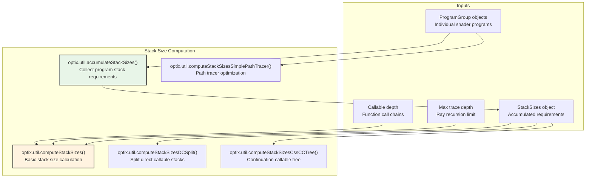
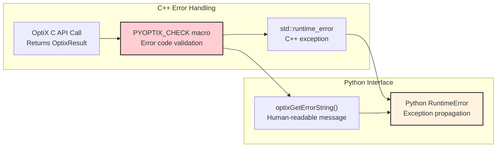

<!-- source: DeepWiki mcp.deepwiki.com · repo NVIDIA/otk-pyoptix · page 3 Core API Reference · fetched 2026-10-26 -->

# Core API Reference

Relevant source files

The following files were used as context for generating this wiki page:

- [optix/main.cpp](optix/main.cpp)
- [optix/setup.py](optix/setup.py)

This document provides a comprehensive reference for the PyOptiX Python API, covering all major classes, functions, and enumerations exposed by the Python bindings. PyOptiX wraps the NVIDIA OptiX C API using pybind11 to provide Pythonic access to GPU-accelerated ray tracing capabilities.

For specific implementation details about individual subsystems, see the dedicated pages: [Device Context Management](#3.1), [Modules and Program Groups](#3.2), [Pipeline Creation and Management](#3.3), [Acceleration Structures](#3.4), [Shader Binding Table and Launch](#3.5), and [OptiX Denoiser](#3.6).

## API Architecture Overview

The PyOptiX API follows the OptiX C API structure but provides Python-friendly interfaces through wrapper classes and helper functions. The core architecture centers around five main object types that represent OptiX handles.

### Core Object Model

**Sources:** [optix/main.cpp:105-137]()

## Core Classes

### Primary OptiX Handle Wrappers

The PyOptiX API wraps OptiX handles in Python classes that provide automatic resource management and Pythonic interfaces.

| Class | OptiX Handle | Purpose |
|-------|-------------|---------|
| `optix.DeviceContext` | `OptixDeviceContext` | GPU device management and OptiX context |
| `optix.Module` | `OptixModule` | Compiled CUDA/PTX code container |
| `optix.ProgramGroup` | `OptixProgramGroup` | Shader program organization |
| `optix.Pipeline` | `OptixPipeline` | Linked ray tracing pipeline |
| `optix.Denoiser` | `OptixDenoiser` | AI-based image denoising |

**Sources:** [optix/main.cpp:105-137]()

### Configuration and Input Classes

Configuration classes wrap OptiX parameter structures and provide Python-friendly constructors with automatic memory management.

**Sources:** [optix/main.cpp:144-167](), [optix/main.cpp:170-350](), [optix/main.cpp:558-671]()

## Module-Level Functions

PyOptiX exposes OptiX functionality through module-level functions that operate on the core objects.

### Device and Context Management

| Function | Purpose |
|----------|---------|
| `optix.init()` | Initialize OptiX library |
| `optix.version()` | Get OptiX version tuple |
| `optix.deviceContextCreate(context, options)` | Create device context |
| `optix.getErrorName(result)` | Get error name string |
| `optix.getErrorString(result)` | Get error description |

### Module and Program Operations

| Function | Purpose |
|----------|---------|
| `optix.moduleCreate(context, moduleOptions, pipelineOptions, ptx)` | Create module from PTX |
| `optix.programGroupCreate(context, descriptions, options)` | Create program groups |
| `optix.pipelineCreate(context, compileOptions, linkOptions, groups, log)` | Create pipeline |
| `optix.sbtRecordPackHeader(programGroup, record)` | Pack SBT record header |

### Ray Tracing and Acceleration

| Function | Purpose |
|----------|---------|
| `optix.launch(pipeline, stream, params, paramSize, sbt, width, height, depth)` | Launch ray tracing |
| `optix.accelBuild(context, stream, options, inputs, tempBuffer, outputBuffer, properties)` | Build acceleration structure |
| `optix.accelComputeMemoryUsage(context, options, inputs)` | Compute memory requirements |
| `optix.convertPointerToTraversableHandle(device, pointer, type)` | Create traversable handle |

**Sources:** [optix/main.cpp:1070-1073](), [optix/main.cpp:1098-1114](), [optix/main.cpp:1348-1391](), [optix/main.cpp:1450-1542](), [optix/main.cpp:1555-1578](), [optix/main.cpp:1640-1688]()

## Ray Tracing Pipeline Flow

The typical PyOptiX ray tracing workflow follows a structured pipeline from CUDA compilation through final image output.

**Sources:** [optix/main.cpp:1070-1073](), [optix/main.cpp:1098-1114](), [optix/main.cpp:1348-1391](), [optix/main.cpp:1450-1542](), [optix/main.cpp:1280-1315](), [optix/main.cpp:1555-1578]()

## Utility Functions

The `optix.util` submodule provides helper functions for stack size computation and pipeline optimization.

### Stack Size Management

**Sources:** [optix/main.cpp:2101-2114](), [optix/main.cpp:2116-2144](), [optix/main.cpp:2146-2179](), [optix/main.cpp:2183-2211](), [optix/main.cpp:2214-2257]()

## Enumerations and Constants

PyOptiX exposes all OptiX enumerations as Python enums with the same values as the C API.

### Key Enumeration Categories

| Category | Examples |
|----------|----------|
| **Results** | `OPTIX_SUCCESS`, `OPTIX_ERROR_INVALID_VALUE` |
| **Device Properties** | `OPTIX_DEVICE_PROPERTY_LIMIT_MAX_TRACE_DEPTH` |
| **Geometry Types** | `OPTIX_PRIMITIVE_TYPE_TRIANGLE`, `OPTIX_PRIMITIVE_TYPE_ROUND_LINEAR` |
| **Build Flags** | `OPTIX_BUILD_FLAG_ALLOW_COMPACTION`, `OPTIX_BUILD_FLAG_PREFER_FAST_TRACE` |
| **Ray Flags** | `OPTIX_RAY_FLAG_DISABLE_ANYHIT`, `OPTIX_RAY_FLAG_TERMINATE_ON_FIRST_HIT` |
| **Program Groups** | `OPTIX_PROGRAM_GROUP_KIND_RAYGEN`, `OPTIX_PROGRAM_GROUP_KIND_HITGROUP` |

### Important Constants

| Constant | Value | Purpose |
|----------|-------|---------|
| `optix.SBT_RECORD_HEADER_SIZE` | 32 | Size of SBT record headers |
| `optix.SBT_RECORD_ALIGNMENT` | 16 | SBT record alignment requirement |
| `optix.ACCEL_BUFFER_BYTE_ALIGNMENT` | 128 | Acceleration structure alignment |
| `optix.COMPILE_DEFAULT_MAX_REGISTER_COUNT` | 255 | Default register limit |

**Sources:** [optix/main.cpp:2369-2377](), [optix/main.cpp:2385-2734]()

## Error Handling

PyOptiX automatically converts OptiX error codes to Python exceptions using the `PYOPTIX_CHECK` and `PYOPTIX_CHECK_LOG` macros.

**Sources:** [optix/main.cpp:28-45](), [optix/main.cpp:1084-1096]()

## Version Compatibility

PyOptiX supports multiple OptiX versions through conditional compilation. Version-specific features are enabled using preprocessor macros.

| OptiX Version | Key Features |
|---------------|--------------|
| **7.1+** | Transform formats, primitive type flags, curve primitives |
| **7.2+** | Device context validation, bound values, average color computation |
| **7.3+** | Temporal denoising, denoiser model selection |
| **7.4+** | Payload types, program group options, curve endcap flags |
| **7.7+** | Updated module creation, pipeline-aware stack sizes |

**Sources:** [optix/main.cpp:51-82](), [optix/main.cpp:224-272](), [optix/main.cpp:674-771](), [optix/main.cpp:844-861]()

---

