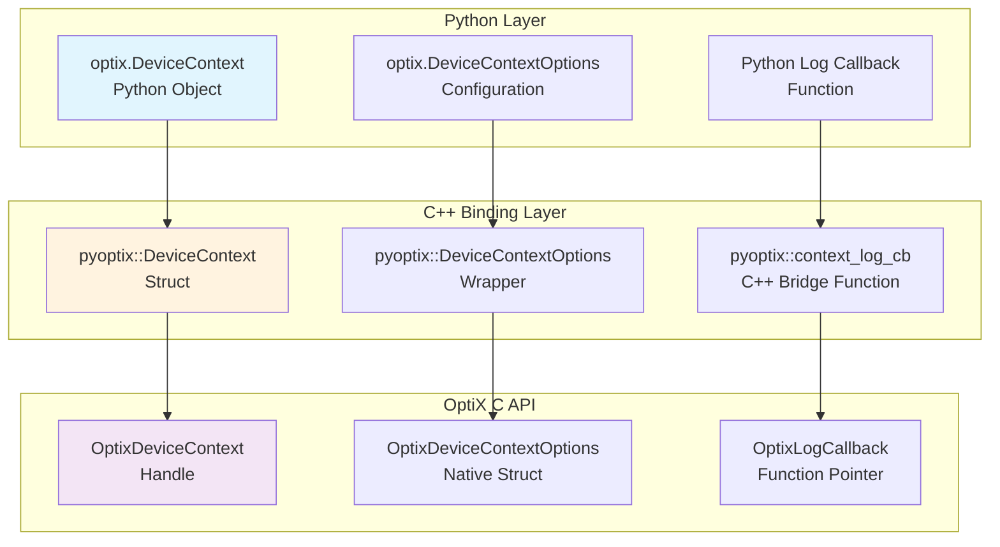
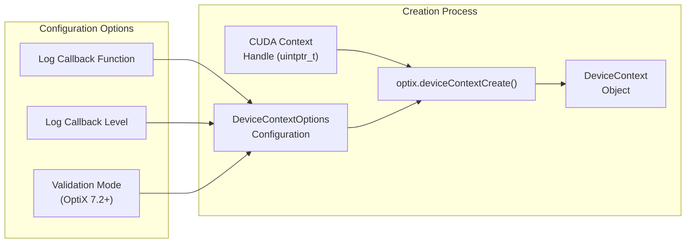
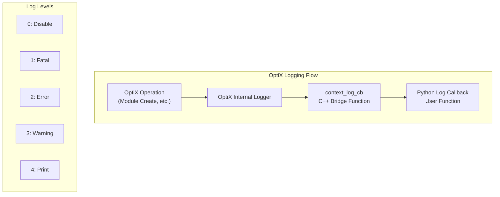
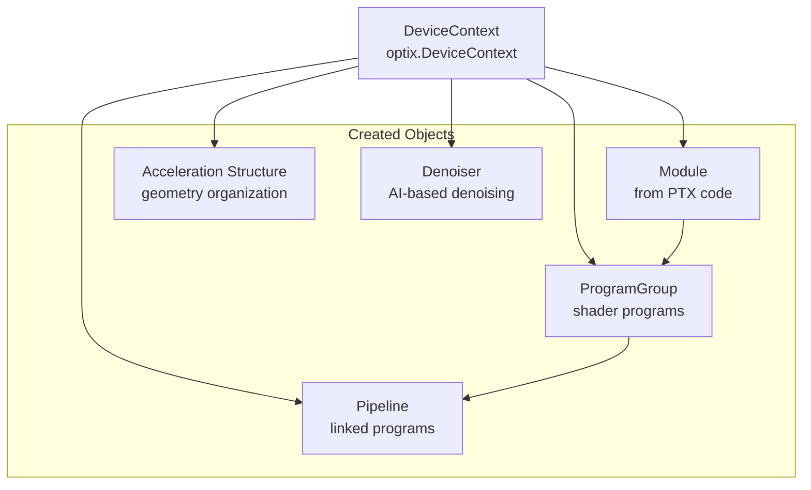
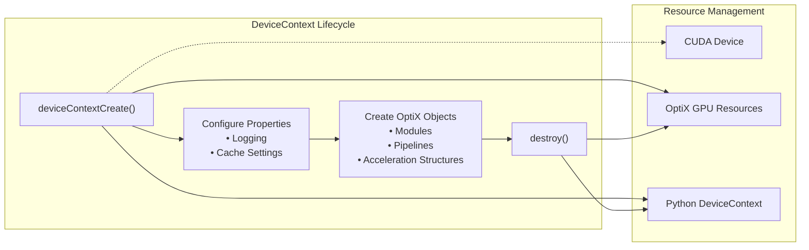

<!-- source: DeepWiki mcp.deepwiki.com · repo NVIDIA/otk-pyoptix · page 3.1 Device Context Management · fetched 2026-10-26 -->

# Device Context Management

<details>
<summary>Relevant source files</summary>

The following files were used as context for generating this wiki page:

- [optix/main.cpp](optix/main.cpp)
- [optix/setup.py](optix/setup.py)
- [test/test_module.py](test/test_module.py)
- [test/test_program_group.py](test/test_program_group.py)

</details>


This document covers the creation, configuration, and management of OptiX device contexts in PyOptiX. The device context serves as the primary entry point for OptiX operations and manages GPU resources, compilation caches, and logging functionality.

For information about using device contexts to create modules and pipelines, see [Modules and Program Groups](#3.2) and [Pipeline Creation and Management](#3.3).

## Overview

The `DeviceContext` is the fundamental OptiX object that represents a connection to a CUDA device and manages OptiX resources on that device. All OptiX operations require a valid device context, making it the first object that must be created in any PyOptiX application.

## DeviceContext Class Architecture

The PyOptiX `DeviceContext` wraps the underlying OptiX C API device context while providing Python-specific functionality such as callback handling.



**Sources:** [optix/main.cpp:105-111](), [optix/main.cpp:144-167]()

## Device Context Creation

Device contexts are created using the `deviceContextCreate` function, which takes a CUDA context handle and configuration options.



**Sources:** [optix/main.cpp:1098-1114]()

### Basic Creation Example

```python
import optix

# Create device context with default options
ctx = optix.deviceContextCreate(0, optix.DeviceContextOptions())
```

### Creation with Logging

```python
def log_callback(level, tag, message):
    print(f"[{level}] {tag}: {message}")

options = optix.DeviceContextOptions(
    logCallbackFunction=log_callback,
    logCallbackLevel=4  # Maximum verbosity
)
ctx = optix.deviceContextCreate(0, options)
```

**Sources:** [test/test_module.py:123](), [test/test_program_group.py:25]()

## Device Properties and Capabilities

The device context provides access to various device properties and capabilities through the `getProperty` method.

| Property | Type | Description |
|----------|------|-------------|
| `OPTIX_DEVICE_PROPERTY_LIMIT_MAX_TRACE_DEPTH` | uint32_t | Maximum ray trace depth |
| `OPTIX_DEVICE_PROPERTY_LIMIT_MAX_TRAVERSABLE_GRAPH_DEPTH` | uint32_t | Maximum traversable graph depth |
| `OPTIX_DEVICE_PROPERTY_LIMIT_MAX_PRIMITIVES_PER_GAS` | uint32_t | Maximum primitives per GAS |
| `OPTIX_DEVICE_PROPERTY_LIMIT_MAX_INSTANCES_PER_IAS` | uint32_t | Maximum instances per IAS |
| `OPTIX_DEVICE_PROPERTY_RTCORE_VERSION` | uint32_t | RT Core version |

**Sources:** [optix/main.cpp:1127-1163]()

## Logging and Debugging

The device context supports configurable logging through Python callback functions. The logging system bridges OptiX's C API logging to Python functions.



**Sources:** [optix/main.cpp:988-998](), [optix/main.cpp:1165-1188]()

### Logging Configuration

```python
# Set or update log callback after creation
def detailed_log_callback(level, tag, message):
    level_names = {0: "DISABLE", 1: "FATAL", 2: "ERROR", 3: "WARN", 4: "PRINT"}
    print(f"[{level_names.get(level, 'UNKNOWN')}] {tag}: {message}")

ctx.setLogCallback(detailed_log_callback, 4)
```

## Cache Management

OptiX provides compilation caching to improve performance across application runs. The device context manages cache settings and locations.

### Cache Operations

| Operation | Method | Description |
|-----------|--------|-------------|
| Enable/Disable | `setCacheEnabled(bool)` | Enable or disable compilation cache |
| Set Location | `setCacheLocation(path)` | Set cache directory path |
| Set Size Limits | `setCacheDatabaseSizes(low, high)` | Configure cache size watermarks |
| Query Status | `getCacheEnabled()` | Check if cache is enabled |
| Query Location | `getCacheLocation()` | Get current cache directory |
| Query Sizes | `getCacheDatabaseSizes()` | Get cache size limits |

**Sources:** [optix/main.cpp:1190-1276]()

### Cache Configuration Example

```python
# Configure compilation cache
ctx.setCacheEnabled(True)
ctx.setCacheLocation("/tmp/optix_cache")
ctx.setCacheDatabaseSizes(
    lowWaterMark=64 * 1024 * 1024,   # 64 MB
    highWaterMark=128 * 1024 * 1024  # 128 MB
)
```

## DeviceContext Integration with OptiX Pipeline

The device context serves as the factory for creating other OptiX objects and coordinating their lifecycle.



**Sources:** [optix/main.cpp:1348-1391](), [optix/main.cpp:1450-1553]()

## Lifecycle Management

Device contexts must be properly created and destroyed to manage GPU resources correctly.



**Sources:** [optix/main.cpp:1098-1125]()

### Proper Cleanup Pattern

```python
# Always destroy context to free resources
try:
    ctx = optix.deviceContextCreate(0, optix.DeviceContextOptions())
    # ... use context for OptiX operations
finally:
    ctx.destroy()

# Or use RAII-style management
class OptiXContext:
    def __init__(self):
        self.ctx = optix.deviceContextCreate(0, optix.DeviceContextOptions())
    
    def __del__(self):
        if hasattr(self, 'ctx'):
            self.ctx.destroy()
```

**Sources:** [test/test_module.py:142](), [test/test_program_group.py:38]()

---

