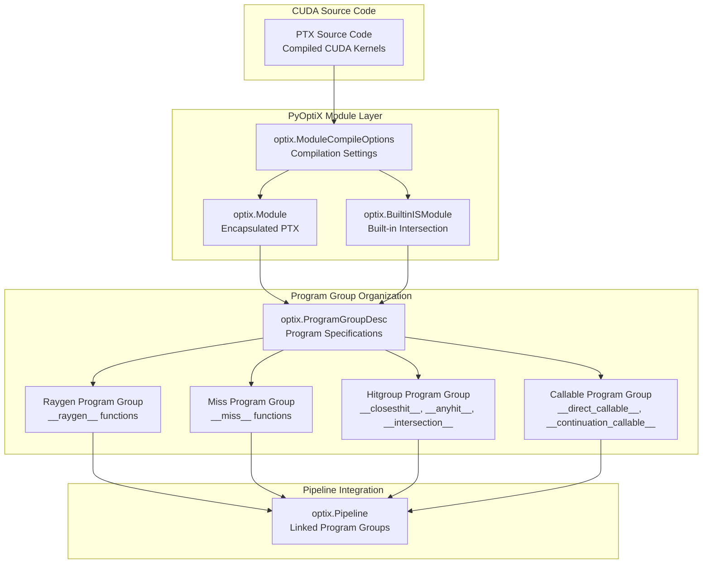
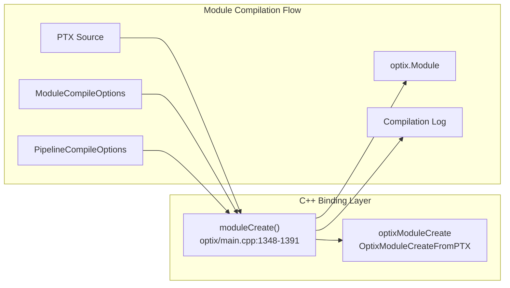
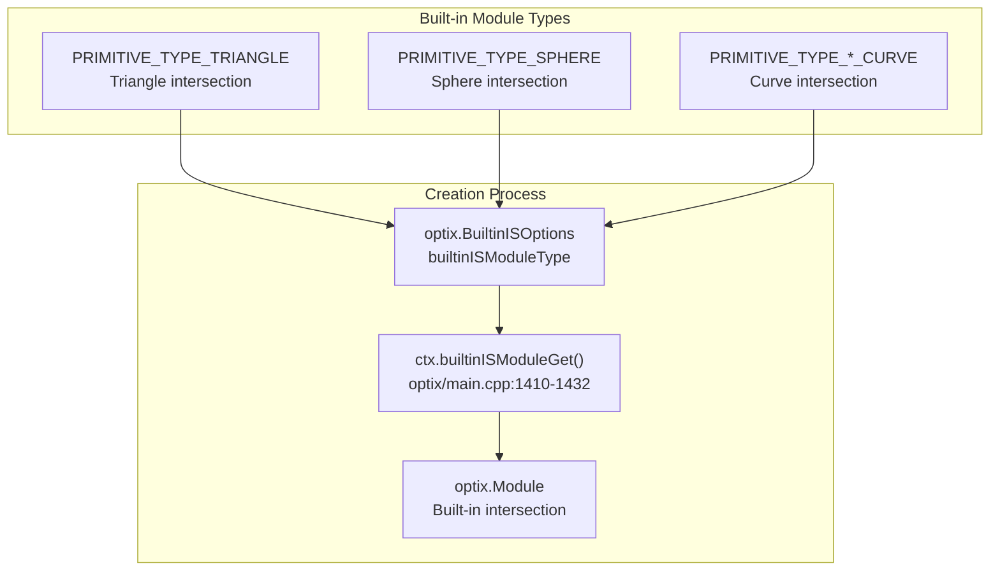
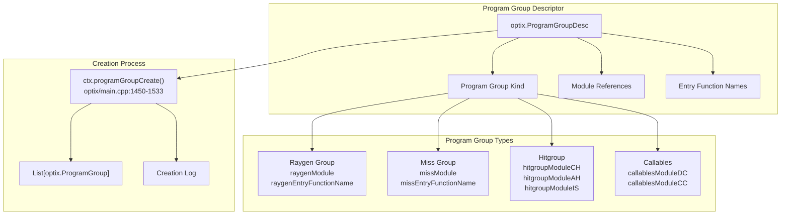
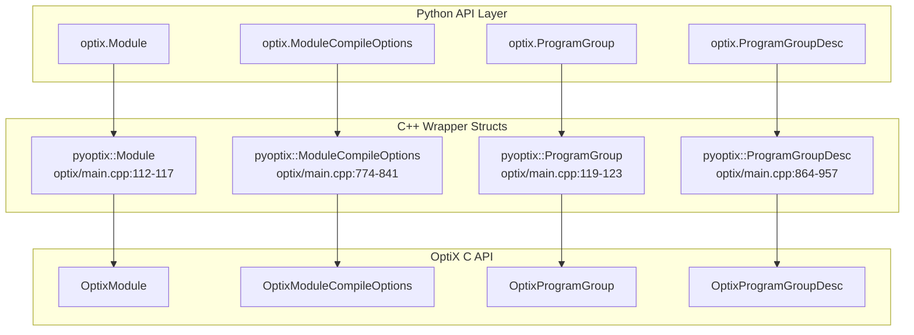
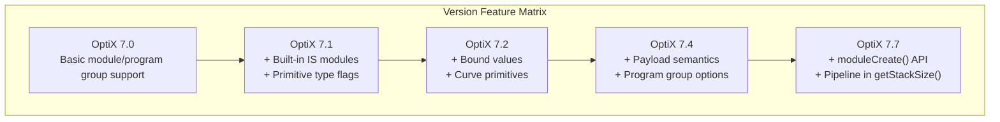

<!-- source: DeepWiki mcp.deepwiki.com · repo NVIDIA/otk-pyoptix · page 3.2 Modules and Program Groups · fetched 2026-10-26 -->

# Modules and Program Groups

Relevant source files

The following files were used as context for generating this wiki page:

- [optix/main.cpp](optix/main.cpp)
- [optix/setup.py](optix/setup.py)
- [test/test_module.py](test/test_module.py)
- [test/test_program_group.py](test/test_program_group.py)

This document covers the creation and management of OptiX modules and program groups in PyOptiX. Modules encapsulate compiled PTX code and represent the GPU programs, while program groups organize these programs into logical units for ray tracing operations. These components form the foundation of the OptiX ray tracing pipeline, bridging compiled CUDA code to executable ray tracing programs.

For information about pipeline creation using modules and program groups, see [Pipeline Creation and Management](#3.3). For details about compiling CUDA kernels to PTX, see [CUDA Kernel Development](#5).

## OptiX Module and Program Group Architecture

Sources: [optix/main.cpp:112-123](), [optix/main.cpp:864-957](), [test/test_module.py:122-143](), [test/test_program_group.py:56-135]()

## Module Creation and Management

OptiX modules are created from compiled PTX code and represent the compiled GPU programs that will execute during ray tracing. The `optix.Module` class wraps the underlying `OptixModule` handle.

### Module Compilation Options

The `optix.ModuleCompileOptions` class controls how PTX code is compiled into OptiX modules:

| Property | Type | Description |
|----------|------|-------------|
| `maxRegisterCount` | `int32_t` | Maximum register count per thread |
| `optLevel` | `OptixCompileOptimizationLevel` | Optimization level |
| `debugLevel` | `OptixCompileDebugLevel` | Debug information level |
| `boundValues` | `list` | Compile-time bound values (OptiX 7.2+) |
| `payloadTypes` | `list` | Payload type specifications (OptiX 7.4+) |

Sources: [optix/main.cpp:774-841](), [optix/main.cpp:1348-1391](), [test/test_module.py:52-121]()

### Built-in Intersection Modules

OptiX provides built-in intersection modules for common primitive types, accessible through `optix.BuiltinISModule`:

Sources: [optix/main.cpp:845-861](), [optix/main.cpp:1410-1432](), [test/test_module.py:208-224]()

## Program Group Creation and Management

Program groups organize modules and their entry points into logical units for different ray tracing operations. Each program group corresponds to a specific phase of ray tracing execution.

### Program Group Types

OptiX supports five types of program groups:

| Type | Purpose | Entry Functions |
|------|---------|----------------|
| `RAYGEN` | Ray generation | `__raygen__*` |
| `MISS` | Ray miss handling | `__miss__*` |
| `HITGROUP` | Ray-primitive intersection | `__closesthit__*`, `__anyhit__*`, `__intersection__*` |
| `CALLABLES` | Callable programs | `__direct_callable__*`, `__continuation_callable__*` |
| `EXCEPTION` | Exception handling | Exception handlers |

Sources: [optix/main.cpp:864-957](), [optix/main.cpp:1450-1533](), [test/test_program_group.py:41-136]()

### Program Group Stack Size Analysis

Program groups provide stack size information necessary for pipeline configuration:

```mermaid
graph LR
    subgraph "Stack Size Components"
        PROG_GROUP["optix.ProgramGroup"]
        STACK_CALL["getStackSize()<br/>optix/main.cpp:1434-1448"]
        STACK_SIZES["optix.StackSizes"]
    end
    
    subgraph "Stack Size Properties"
        CSS_RG["cssRG<br/>Continuation stack size"]
        CSS_MS["cssMS<br/>Miss stack size"] 
        CSS_CH["cssCH<br/>Closest hit stack size"]
        CSS_AH["cssAH<br/>Any hit stack size"]
        CSS_IS["cssIS<br/>Intersection stack size"]
        CSS_CC["cssCC<br/>Callable stack size"]
        DSS_DC["dssDC<br/>Direct callable stack size"]
    end
    
    PROG_GROUP --> STACK_CALL
    STACK_CALL --> STACK_SIZES
    STACK_SIZES --> CSS_RG
    STACK_SIZES --> CSS_MS
    STACK_SIZES --> CSS_CH
    STACK_SIZES --> CSS_AH
    STACK_SIZES --> CSS_IS
    STACK_SIZES --> CSS_CC
    STACK_SIZES --> DSS_DC
```

Sources: [optix/main.cpp:1434-1448](), [optix/main.cpp:647-671](), [test/test_program_group.py:152-159]()

## C++ Binding Architecture

The PyOptiX binding layer translates between Python objects and OptiX C API structures:

Sources: [optix/main.cpp:112-123](), [optix/main.cpp:774-841](), [optix/main.cpp:864-957]()

## Version-Specific Features

PyOptiX supports features introduced in different OptiX versions:

### OptiX 7.1+ Features
- Built-in intersection modules via `builtinISModuleGet()`
- Primitive type flags in pipeline compile options

### OptiX 7.2+ Features  
- Module compile bound values through `ModuleCompileBoundValueEntry`
- Curve primitive support in build inputs

### OptiX 7.4+ Features
- Payload type semantics through `PayloadType`
- Program group options via `ProgramGroupOptions`

### OptiX 7.7+ Features
- `moduleCreate()` replaces `moduleCreateFromPTX()`
- Pipeline parameter required for `getStackSize()`

Sources: [optix/main.cpp:51-82](), [test/test_module.py:15-16](), [test/test_program_group.py:16-17](), [test/test_module.py:126-137]()

---

