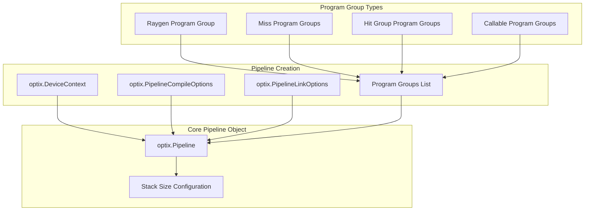
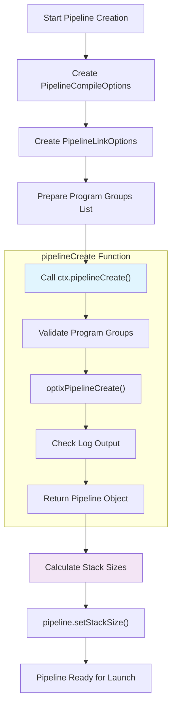
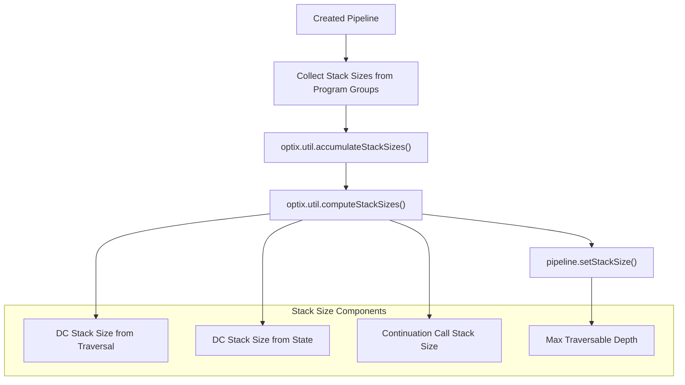
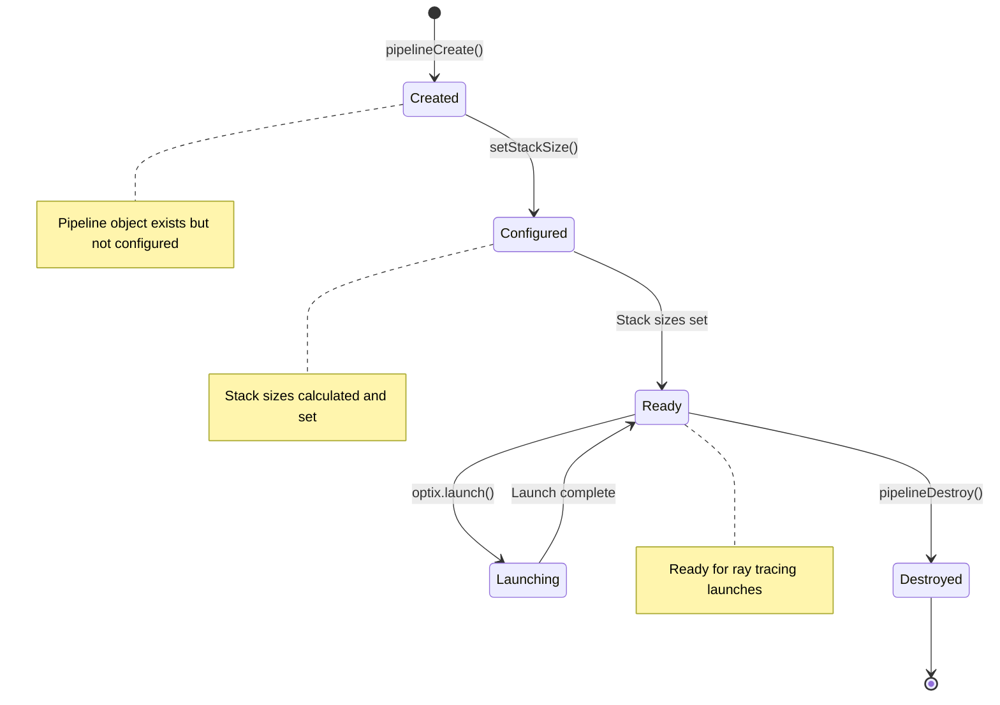

<!-- source: DeepWiki mcp.deepwiki.com · repo NVIDIA/otk-pyoptix · page 3.3 Pipeline Creation and Management · fetched 2026-10-26 -->

# Pipeline Creation and Management

<details>
<summary>Relevant source files</summary>

The following files were used as context for generating this wiki page:

- [examples/triangle.py](examples/triangle.py)
- [optix/main.cpp](optix/main.cpp)
- [optix/setup.py](optix/setup.py)

</details>


This document covers the creation, configuration, and management of OptiX ray tracing pipelines in PyOptiX. A pipeline represents the complete ray tracing program that combines multiple program groups (raygen, miss, hit, etc.) into an executable unit on the GPU.

For information about creating and managing program groups that make up the pipeline, see [Modules and Program Groups](#3.2). For details about launching ray tracing operations using pipelines, see [Shader Binding Table and Launch](#3.5).

## Overview

In OptiX, a pipeline combines compiled program groups into a single executable ray tracing program. The pipeline creation process involves specifying compilation options, linking options, and providing the program groups that will be combined. Once created, the pipeline must be configured with appropriate stack sizes and can then be used to launch ray tracing operations.

## Pipeline Components



Sources: [optix/main.cpp:126-130](), [optix/main.cpp:1280-1315](), [examples/triangle.py:278-314]()

## Pipeline Creation Workflow

The pipeline creation process follows a specific sequence of operations that combine program groups with configuration options:



Sources: [examples/triangle.py:278-314](), [optix/main.cpp:1280-1315](), [examples/triangle.py:292-312]()

## Pipeline Compile Options

The `optix.PipelineCompileOptions` class controls how the pipeline is compiled and optimized. This configuration affects the entire pipeline's behavior:

| Option | Type | Description |
|--------|------|-------------|
| `usesMotionBlur` | `bool` | Enable motion blur support |
| `traversableGraphFlags` | `uint32_t` | Specify allowed traversable types |
| `numPayloadValues` | `int32_t` | Number of payload values for ray-program communication |
| `numAttributeValues` | `int32_t` | Number of attribute values for primitive intersection |
| `exceptionFlags` | `uint32_t` | Exception handling configuration |
| `pipelineLaunchParamsVariableName` | `str` | Name of launch parameters variable in CUDA code |
| `usesPrimitiveTypeFlags` | `int32_t` | Primitive types used (OptiX 7.1+) |

Example configuration from the triangle example:

```python
pipeline_options = optix.PipelineCompileOptions(
    usesMotionBlur         = False,
    traversableGraphFlags  = int(optix.TRAVERSABLE_GRAPH_FLAG_ALLOW_SINGLE_GAS),
    numPayloadValues       = 3,
    numAttributeValues     = 3,
    exceptionFlags         = int(optix.EXCEPTION_FLAG_NONE),
    pipelineLaunchParamsVariableName = "params",
    usesPrimitiveTypeFlags = optix.PRIMITIVE_TYPE_FLAGS_TRIANGLE
)
```

Sources: [optix/main.cpp:558-592](), [examples/triangle.py:207-226]()

## Pipeline Link Options

The `optix.PipelineLinkOptions` class controls how program groups are linked together into the final pipeline:

| Option | Type | Description |
|--------|------|-------------|
| `maxTraceDepth` | `uint32_t` | Maximum recursion depth for ray tracing calls |
| `debugLevel` | `OptixCompileDebugLevel` | Debug information level (OptiX < 7.7) |

```python
pipeline_link_options = optix.PipelineLinkOptions()
pipeline_link_options.maxTraceDepth = 1
```

Sources: [optix/main.cpp:594-610](), [examples/triangle.py:282-283]()

## Stack Size Management

After pipeline creation, stack sizes must be calculated and configured based on the program groups and expected trace depth:



The stack size calculation process:

1. **Accumulate stack sizes** from each program group
2. **Compute optimal stack sizes** based on trace depth and call depth
3. **Set pipeline stack sizes** using the computed values

Example implementation:

```python
stack_sizes = optix.StackSizes()
for prog_group in program_groups:
    if optix_version_gte((7,7)):
        optix.util.accumulateStackSizes(prog_group, stack_sizes, pipeline)
    else: 
        optix.util.accumulateStackSizes(prog_group, stack_sizes)

(dc_stack_size_from_trav, dc_stack_size_from_state, cc_stack_size) = \
    optix.util.computeStackSizes(
        stack_sizes, 
        max_trace_depth,
        0,  # maxCCDepth
        0   # maxDCDepth
    )

pipeline.setStackSize(
    dc_stack_size_from_trav,
    dc_stack_size_from_state, 
    cc_stack_size,
    1  # maxTraversableDepth
)
```

Sources: [examples/triangle.py:292-312](), [optix/main.cpp:1328-1345]()

## Pipeline API Reference

### Pipeline Creation

The `deviceContext.pipelineCreate()` method combines program groups and configuration options:

```python
pipeline = ctx.pipelineCreate(
    pipeline_compile_options,  # PipelineCompileOptions
    pipeline_link_options,     # PipelineLinkOptions  
    program_groups,            # List of ProgramGroup objects
    log_string                 # Output parameter for compilation log
)
```

Sources: [optix/main.cpp:1280-1315]()

### Pipeline Configuration

Key methods for pipeline configuration:

| Method | Parameters | Description |
|--------|------------|-------------|
| `setStackSize()` | `dc_trav`, `dc_state`, `cc_stack`, `max_depth` | Configure stack sizes for ray tracing |

Sources: [optix/main.cpp:1328-1345]()

### Pipeline Lifecycle



The pipeline lifecycle management:

- **Creation**: Use `deviceContext.pipelineCreate()` with compile options, link options, and program groups
- **Configuration**: Calculate and set appropriate stack sizes using utility functions
- **Usage**: Pipeline can be used repeatedly for ray tracing launches
- **Destruction**: Use `pipelineDestroy()` to clean up resources

Sources: [optix/main.cpp:1280-1315](), [optix/main.cpp:1317-1326](), [examples/triangle.py:278-314]()

---

