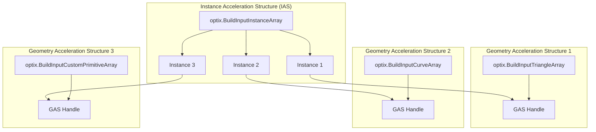
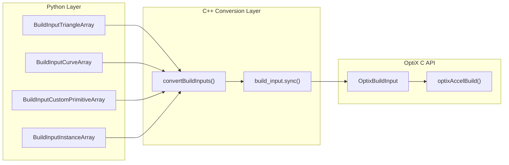
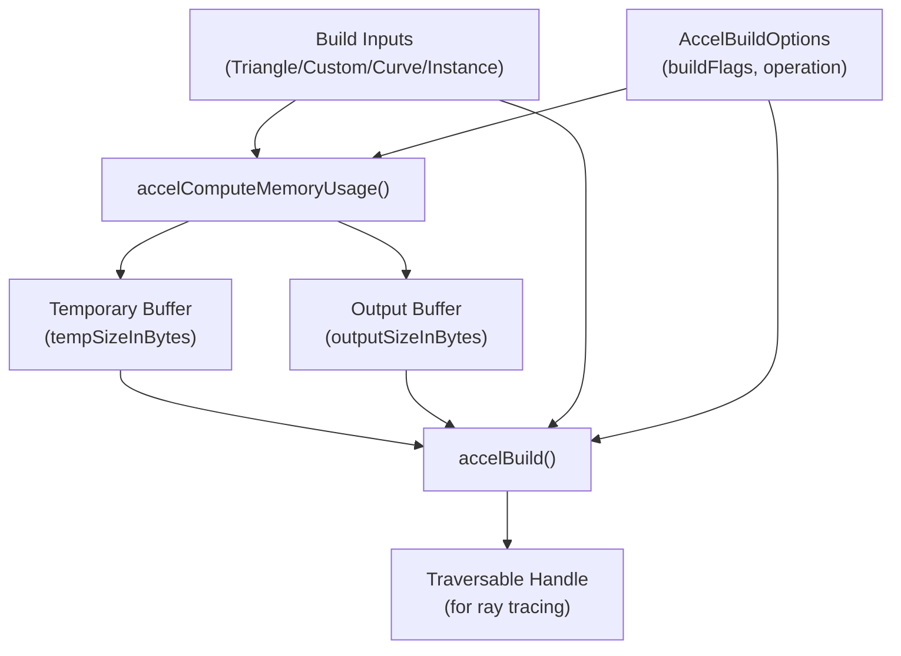
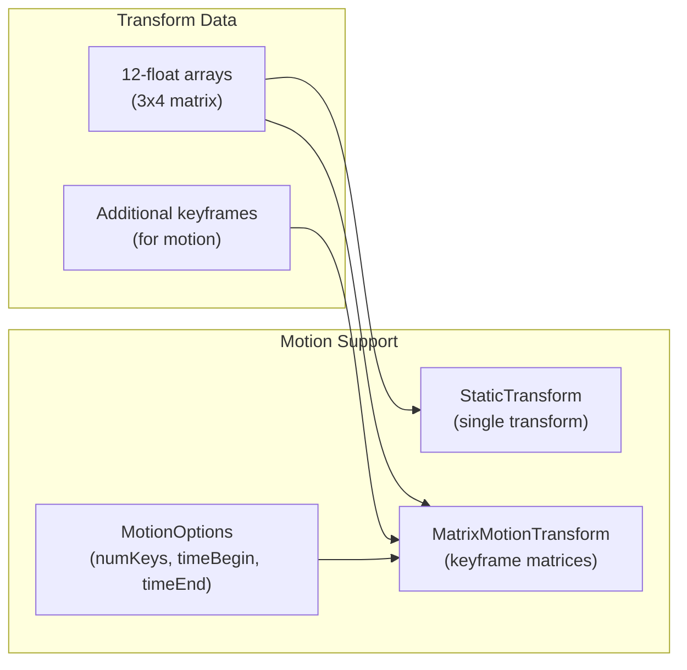
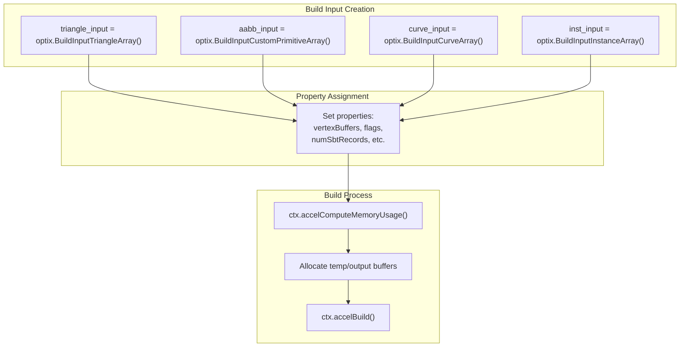

<!-- source: DeepWiki mcp.deepwiki.com · repo NVIDIA/otk-pyoptix · page 3.4 Acceleration Structures · fetched 2026-10-26 -->

# Acceleration Structures

<details>
<summary>Relevant source files</summary>

The following files were used as context for generating this wiki page:

- [examples/sphere.py](examples/sphere.py)
- [examples/triangle.py](examples/triangle.py)
- [optix/main.cpp](optix/main.cpp)
- [optix/setup.py](optix/setup.py)

</details>


Acceleration structures are spatial data structures that enable efficient ray tracing by organizing geometry in a hierarchical manner. This page covers the PyOptiX API for building and managing both Geometry Acceleration Structures (GAS) and Instance Acceleration Structures (IAS), including support for various primitive types, motion blur, and transforms. For information about using acceleration structures during ray tracing execution, see [Shader Binding Table and Launch](#3.5).

## Overview

OptiX supports a two-level acceleration structure hierarchy:

- **Geometry Acceleration Structure (GAS)**: Contains actual geometric primitives (triangles, curves, custom primitives)
- **Instance Acceleration Structure (IAS)**: Contains instances of GAS objects with transforms and other per-instance data



Sources: [optix/main.cpp:314-351](), [examples/triangle.py:166-204](), [examples/sphere.py:183-219]()

## Build Input Types

PyOptiX supports multiple primitive types through specialized build input classes:

### Triangle Arrays

The `BuildInputTriangleArray` class handles standard triangle meshes:

| Property | Type | Description |
|----------|------|-------------|
| `vertexBuffers` | `List[CUdeviceptr]` | Device pointers to vertex data arrays |
| `vertexFormat` | `OptixVertexFormat` | Format of vertex data (e.g., `VERTEX_FORMAT_FLOAT3`) |
| `indexBuffer` | `CUdeviceptr` | Device pointer to index buffer (optional) |
| `flags` | `List[int]` | Per-primitive geometry flags |
| `numSbtRecords` | `int` | Number of shader binding table records |

### Custom Primitive Arrays  

The `BuildInputCustomPrimitiveArray` class handles user-defined primitives using axis-aligned bounding boxes (AABBs):

| Property | Type | Description |
|----------|------|-------------|
| `aabbBuffers` | `List[CUdeviceptr]` | Device pointers to AABB data |
| `numPrimitives` | `int` | Number of primitives |
| `flags` | `List[int]` | Per-primitive geometry flags |

### Curve Arrays (OptiX 7.2+)

The `BuildInputCurveArray` class handles geometric curves:

| Property | Type | Description |
|----------|------|-------------|
| `curveType` | `OptixPrimitiveType` | Type of curve primitive |
| `vertexBuffers` | `List[CUdeviceptr]` | Control point data |
| `widthBuffers` | `List[CUdeviceptr]` | Width data for curves |
| `normalBuffers` | `List[CUdeviceptr]` | Normal data (optional) |

### Instance Arrays

The `BuildInputInstanceArray` class creates instance acceleration structures:

| Property | Type | Description |
|----------|------|-------------|
| `instances` | `CUdeviceptr` | Device pointer to instance data array |
| `instancePointers` | `CUdeviceptr` | Alternative: pointers to instances |
| `numInstances` | `int` | Number of instances |

Sources: [optix/main.cpp:170-351]()

## Build Input Processing Flow



Sources: [optix/main.cpp:1001-1052](), [optix/main.cpp:211-216](), [optix/main.cpp:259-264]()

## Building Acceleration Structures

### Memory Usage Calculation

Before building acceleration structures, calculate required memory using `DeviceContext.accelComputeMemoryUsage()`:

```python
accel_options = optix.AccelBuildOptions(
    buildFlags=optix.BUILD_FLAG_ALLOW_RANDOM_VERTEX_ACCESS,
    operation=optix.BUILD_OPERATION_BUILD
)

gas_buffer_sizes = ctx.accelComputeMemoryUsage([accel_options], [triangle_input])
```

### Building Process

The acceleration structure build process requires temporary and output buffers:



Sources: [examples/triangle.py:188-203](), [examples/sphere.py:203-218]()

## Advanced Features

### Motion Blur Support

PyOptiX supports motion blur through the `MotionOptions` class and motion transforms:



### Transform Types

| Class | Purpose | Key Methods |
|-------|---------|-------------|
| `StaticTransform` | Single transform matrix | `setTransform()`, `setInvTransform()`, `getBytes()` |
| `MatrixMotionTransform` | Keyframed motion transforms | `setTransform()`, `getBytes()` |
| `SRTData` | Scale-Rotate-Translate representation | Individual component setters |

Sources: [optix/main.cpp:423-556]()

## Instance Management

### Instance Class

The `Instance` class represents individual instances in an IAS:

| Property | Type | Description |
|----------|------|-------------|
| `transform` | `List[float]` | 3x4 transformation matrix (12 floats) |
| `instanceId` | `uint32_t` | User-defined instance identifier |
| `sbtOffset` | `uint32_t` | Offset into shader binding table |
| `visibilityMask` | `uint32_t` | 8-bit visibility mask |
| `flags` | `uint32_t` | Instance behavior flags |
| `traversableHandle` | `OptixTraversableHandle` | Handle to referenced GAS |

### Build Input Types Flow



Sources: [optix/main.cpp:353-382](), [examples/triangle.py:181-186](), [examples/sphere.py:196-201]()

## Error Handling and Validation

Acceleration structure operations use the `PYOPTIX_CHECK` macro system for error handling. Common validation includes:

- Proper buffer alignment and sizes
- Valid geometry flags combinations  
- Correct primitive counts and offsets
- Transform matrix validation (12-float arrays)

The `sync()` method on build input classes ensures proper pointer synchronization before passing to OptiX C API functions.

Sources: [optix/main.cpp:28-46](), [optix/main.cpp:211-216](), [optix/main.cpp:372-379]()

---

