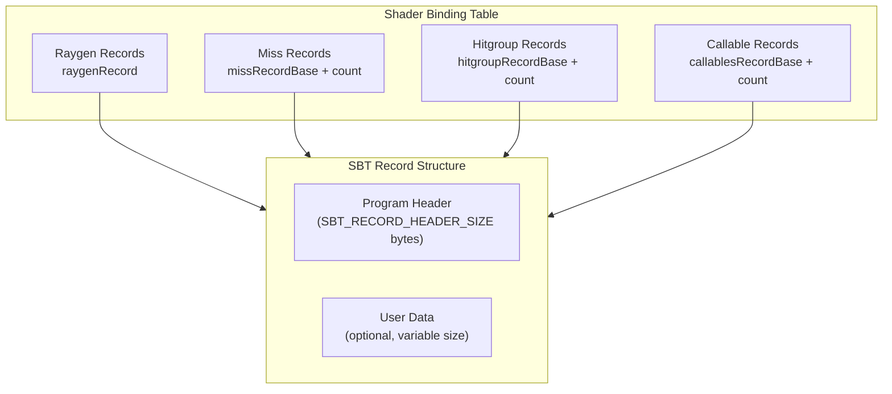
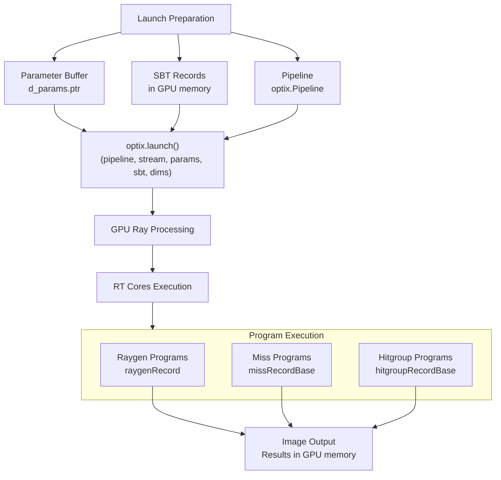
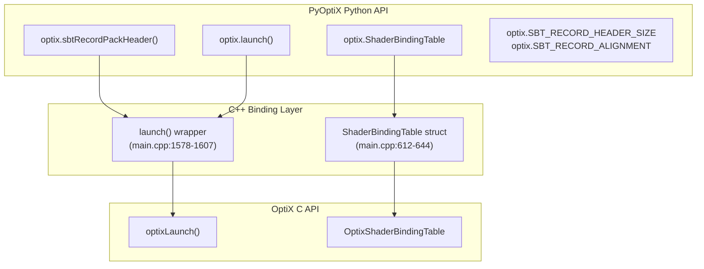

<!-- source: DeepWiki mcp.deepwiki.com · repo NVIDIA/otk-pyoptix · page 3.5 Shader Binding Table and Launch · fetched 2026-10-26 -->

# Shader Binding Table and Launch

<details>
<summary>Relevant source files</summary>

The following files were used as context for generating this wiki page:

- [examples/hello.py](examples/hello.py)
- [examples/triangle.py](examples/triangle.py)
- [optix/main.cpp](optix/main.cpp)
- [optix/setup.py](optix/setup.py)

</details>


This document covers the setup and usage of the Shader Binding Table (SBT) and the launch of ray tracing operations in PyOptiX. The SBT connects program groups to their associated data, enabling the OptiX runtime to invoke the correct shaders during ray tracing execution. For information about program groups and pipelines, see [Modules and Program Groups](#3.2) and [Pipeline Creation and Management](#3.3).

## Shader Binding Table Overview

The Shader Binding Table is a GPU memory structure that maps OptiX program groups to their associated data. Each record in the SBT contains a program header (identifying which program to execute) followed by optional user data that the program can access during execution.

## SBT Structure and Record Types

The SBT is organized into separate sections for different program types:



**Sources:** [optix/main.cpp:612-644]()

### SBT Record Structure

Each SBT record follows a standardized layout:

| Component | Size | Description |
|-----------|------|-------------|
| Program Header | `optix.SBT_RECORD_HEADER_SIZE` bytes | OptiX program identifier |
| User Data | Variable | Application-defined data accessible in shaders |

Records must be aligned to `optix.SBT_RECORD_ALIGNMENT` byte boundaries for optimal GPU performance.

**Sources:** [examples/triangle.py:325-383](), [examples/hello.py:292-329]()

## Creating SBT Records

### Record Header Packing

Use `optix.sbtRecordPackHeader()` to populate the program header portion of SBT records:

```python
# Create numpy array for SBT record
header_format = '{}B'.format(optix.SBT_RECORD_HEADER_SIZE)
formats = [header_format, 'f4', 'f4', 'f4']  # header + 3 floats
dtype = np.dtype({
    'names': ['header', 'r', 'g', 'b'],
    'formats': formats,
    'itemsize': aligned_size,
    'align': True
})
h_raygen_sbt = np.array([(0, 0.462, 0.725, 0.0)], dtype=dtype)

# Pack program group header into record
optix.sbtRecordPackHeader(raygen_prog_group, h_raygen_sbt)
```

**Sources:** [examples/hello.py:305-306](), [examples/triangle.py:339]()

### Memory Alignment Considerations

SBT records require proper alignment for GPU access. Use helper functions to calculate aligned sizes:

```python
def get_aligned_itemsize(formats, alignment):
    temp_dtype = np.dtype({
        'names': ['x' + str(i) for i in range(len(formats))],
        'formats': formats,
        'align': True
    })
    return round_up(temp_dtype.itemsize, alignment)
```

**Sources:** [examples/triangle.py:63-73](), [examples/hello.py:66-76]()

## SBT Configuration

### ShaderBindingTable Class

The `optix.ShaderBindingTable` class configures the complete SBT layout:

```mermaid
graph LR
    subgraph SBT_Config["ShaderBindingTable Configuration"]
        RG_PTR["raygenRecord<br/>(CUdeviceptr)"]
        MISS_BASE["missRecordBase<br/>(CUdeviceptr)"]
        MISS_STRIDE["missRecordStrideInBytes"]
        MISS_COUNT["missRecordCount"]
        HIT_BASE["hitgroupRecordBase<br/>(CUdeviceptr)"]
        HIT_STRIDE["hitgroupRecordStrideInBytes"]
        HIT_COUNT["hitgroupRecordCount"]
        EXC_PTR["exceptionRecord<br/>(CUdeviceptr)"]
        CALL_BASE["callablesRecordBase<br/>(CUdeviceptr)"]
        CALL_STRIDE["callablesRecordStrideInBytes"]
        CALL_COUNT["callablesRecordCount"]
    end
```



**Sources:** [optix/main.cpp:612-644]()

### SBT Construction Example

```python
sbt = optix.ShaderBindingTable(
    raygenRecord=d_raygen_sbt.ptr,
    missRecordBase=d_miss_sbt.ptr,
    missRecordStrideInBytes=miss_record_size,
    missRecordCount=1,
    hitgroupRecordBase=d_hitgroup_sbt.ptr,
    hitgroupRecordStrideInBytes=hitgroup_record_size,
    hitgroupRecordCount=1
)
```

**Sources:** [examples/triangle.py:375-383](), [examples/hello.py:324-329]()

## Launch Parameters

Launch parameters are passed to OptiX programs via a GPU memory buffer containing application-defined data structures:

### Parameter Buffer Creation

```python
# Define parameter structure
params_dtype = np.dtype({
    'names': ['image', 'image_width', 'image_height', 'trav_handle'],
    'formats': ['u8', 'u4', 'u4', 'u8'],
    'itemsize': aligned_size,
    'align': True
})

# Create and populate parameter buffer
h_params = np.array([(image_ptr, width, height, handle)], dtype=params_dtype)
d_params = array_to_device_memory(h_params)
```

**Sources:** [examples/triangle.py:415-426](), [examples/hello.py:343-350]()

## Ray Tracing Launch

### Launch Function

The `optix.launch()` function executes the ray tracing pipeline:

```python
optix.launch(
    pipeline,           # OptixPipeline
    stream.ptr,         # CUDA stream
    d_params.ptr,       # Launch parameters buffer
    params_size,        # Parameter buffer size
    sbt,               # Shader Binding Table
    width,             # Launch dimensions X
    height,            # Launch dimensions Y
    depth              # Launch dimensions Z
)
```

**Sources:** [examples/triangle.py:429-438](), [examples/hello.py:353-362]()

### Launch Execution Flow



**Sources:** [examples/triangle.py:386-443](), [examples/hello.py:332-367](), [optix/main.cpp:1578-1607]()

### CUDA Stream Synchronization

Ray tracing launches are asynchronous. Use CUDA stream synchronization to wait for completion:

```python
stream = cp.cuda.Stream()
optix.launch(pipeline, stream.ptr, d_params.ptr, params_size, sbt, width, height, depth)
stream.synchronize()  # Wait for completion
```

**Sources:** [examples/triangle.py:428-440](), [examples/hello.py:352-364]()

## Code Entity Mapping

The key PyOptiX classes and functions for SBT and launch operations:



**Sources:** [optix/main.cpp:612-644](), [optix/main.cpp:1578-1607]()

---

