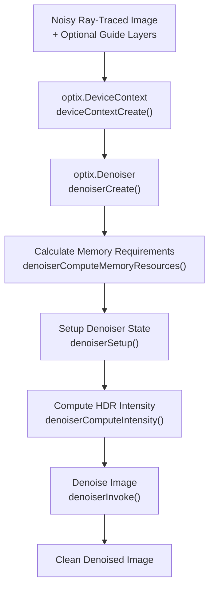
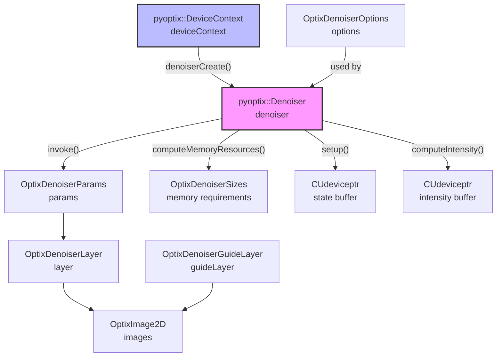
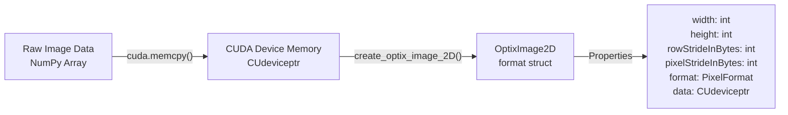
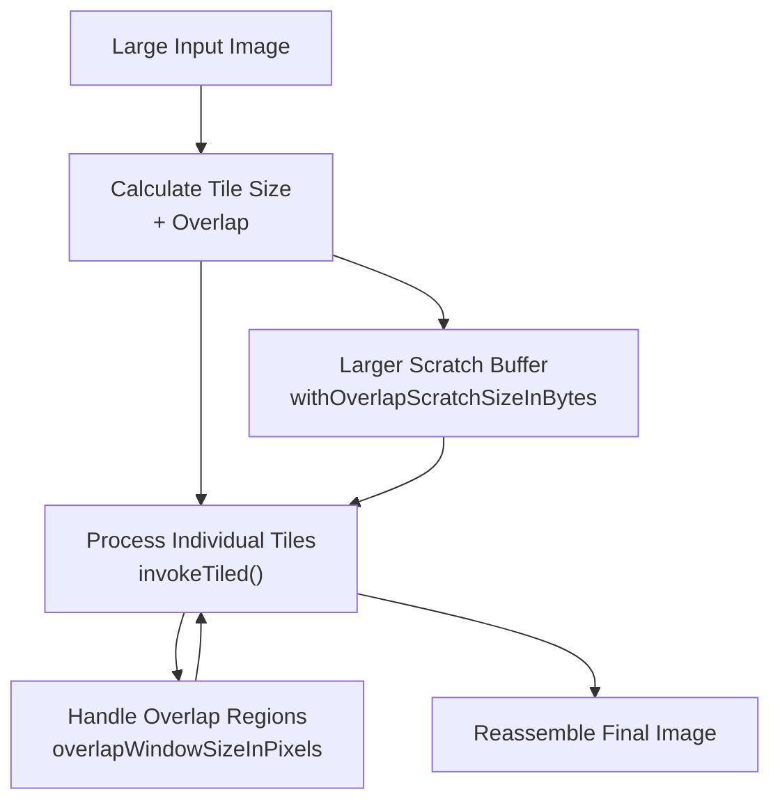

<!-- source: DeepWiki mcp.deepwiki.com · repo NVIDIA/otk-pyoptix · page 3.6 OptiX Denoiser · fetched 2026-10-26 -->

# OptiX Denoiser

<details>
<summary>Relevant source files</summary>

The following files were used as context for generating this wiki page:

- [examples/denoiser.py](examples/denoiser.py)
- [optix/main.cpp](optix/main.cpp)
- [optix/setup.py](optix/setup.py)

</details>


This page documents PyOptiX's AI-based image denoising capabilities through the OptiX Denoiser API. The denoiser uses machine learning models to remove noise from ray-traced images, particularly useful for improving image quality when using limited sampling in ray tracing.

For information about ray tracing pipeline setup and launch, see [Shader Binding Table and Launch](#3.5). For acceleration structure creation, see [Acceleration Structures](#3.4).

## Overview

The OptiX Denoiser is NVIDIA's AI-powered image denoising solution integrated into the OptiX ray tracing framework. It can significantly improve the visual quality of ray-traced images by removing Monte Carlo noise while preserving important visual details. The denoiser can operate on color images alone or use additional guide channels (albedo, surface normals) for enhanced quality.

**Denoiser Workflow**


Sources: [optix/main.cpp:1836-2056](), [examples/denoiser.py:244-308]()

## Core Components

### Denoiser Class

The `optix.Denoiser` class wraps the OptiX denoiser functionality and provides methods for memory management, setup, and execution.

| Method | Purpose | Returns |
|--------|---------|---------|
| `computeMemoryResources()` | Calculate required memory sizes | `OptixDenoiserSizes` |
| `setup()` | Initialize denoiser state | `None` |
| `computeIntensity()` | Calculate HDR intensity values | `None` |
| `computeAverageColor()` | Calculate average color (OptiX 7.2+) | `None` |
| `invoke()` | Execute denoising operation | `None` |

### Configuration Structures

**OptixDenoiserOptions**
- `guideAlbedo`: Enable albedo guide layer
- `guideNormal`: Enable normal guide layer

**OptixDenoiserParams**
- `denoiseAlpha`: Process alpha channel
- `hdrIntensity`: HDR intensity pointer
- `hdrAverageColor`: Average color pointer
- `blendFactor`: Blending factor for temporal denoising

**OptixDenoiserLayer**
- `input`: Input noisy image
- `previousOutput`: Previous frame for temporal denoising
- `output`: Output denoised image

**OptixDenoiserGuideLayer**
- `albedo`: Surface albedo guide image
- `normal`: Surface normal guide image
- `flow`: Motion vector guide image

Sources: [optix/main.cpp:132-136](), [examples/denoiser.py:38-40]()

## Denoiser API Reference

**Code Entity Relationships**


Sources: [optix/main.cpp:1836-2056]()

### Creating a Denoiser

```python
# OptiX 7.3+ with model kind parameter
denoiser = context.denoiserCreate(
    modelKind=optix.DENOISER_MODEL_KIND_HDR,
    options=optix.DenoiserOptions()
)

# OptiX 7.0-7.2 (model set separately)
denoiser = context.denoiserCreate(options=optix.DenoiserOptions())
```

**Available Model Kinds (OptiX 7.3+):**
- `DENOISER_MODEL_KIND_LDR`: Low Dynamic Range images
- `DENOISER_MODEL_KIND_HDR`: High Dynamic Range images
- `DENOISER_MODEL_KIND_AOV`: Arbitrary Output Variables

Sources: [optix/main.cpp:1835-1869]()

### Memory Management

The denoiser requires GPU memory for internal state and scratch operations:

```python
sizes = denoiser.computeMemoryResources(output_width, output_height)

# Allocate required buffers
state_buffer = cupy.empty(sizes.stateSizeInBytes, dtype='B')
scratch_buffer = cupy.empty(sizes.withoutOverlapScratchSizeInBytes, dtype='B')
intensity_buffer = cupy.empty(1, dtype='f4')
```

**OptixDenoiserSizes Fields:**
- `stateSizeInBytes`: Persistent state memory
- `withoutOverlapScratchSizeInBytes`: Scratch memory for full-image denoising
- `withOverlapScratchSizeInBytes`: Scratch memory for tiled denoising
- `overlapWindowSizeInPixels`: Required overlap for tiling

Sources: [optix/main.cpp:1903-1919](), [examples/denoiser.py:250-264]()

### Setup and Execution

**Denoiser Setup**
```python
denoiser.setup(
    stream=0,  # CUDA stream
    inputWidth=image_width + 2*overlap,
    inputHeight=image_height + 2*overlap,
    denoiserState=state_buffer.data.ptr,
    denoiserStateSizeInBytes=state_buffer.nbytes,
    scratch=scratch_buffer.data.ptr,
    scratchSizeInBytes=scratch_buffer.nbytes
)
```

**HDR Intensity Computation**
```python
denoiser.computeIntensity(
    stream=0,
    inputImage=color_image,
    outputIntensity=intensity_buffer.data.ptr,
    scratch=scratch_buffer.data.ptr,
    scratchSizeInBytes=scratch_buffer.nbytes
)
```

**Denoising Invocation**
```python
params = optix.DenoiserParams()
params.denoiseAlpha = 0
params.hdrIntensity = intensity_buffer.data.ptr
params.blendFactor = 0.0

denoiser.invoke(
    stream=0,
    params=params,
    denoiserState=state_buffer.data.ptr,
    denoiserStateSizeInBytes=state_buffer.nbytes,
    guideLayer=guide_layer,
    layers=[denoiser_layer],
    numLayers=1,
    inputOffsetX=0,
    inputOffsetY=0,
    scratch=scratch_buffer.data.ptr,
    scratchSizeInBytes=scratch_buffer.nbytes
)
```

Sources: [optix/main.cpp:1921-2012](), [examples/denoiser.py:278-308]()

## Image Data Management

**OptiX Image Format**


Sources: [examples/denoiser.py:66-84]()

### Image Creation Helper

The denoiser example provides a helper function for creating OptiX-compatible image structures:

```python
def create_optix_image_2D(w, h, image):
    oi = optix.Image2D()
    byte_size = w * h * 4 * 4  # RGBA, float32
    d_mem = cuda.malloc(byte_size)
    
    if image is not None:
        cuda.memcpy(d_mem, image.ctypes.data, byte_size, cuda.memcpyHostToDevice)
    
    oi.data = d_mem
    oi.width = w
    oi.height = h
    oi.rowStrideInBytes = w * 4 * 4
    oi.pixelStrideInBytes = 4 * 4
    oi.format = optix.PIXEL_FORMAT_FLOAT4
    return oi
```

**Supported Pixel Formats:**
- `PIXEL_FORMAT_FLOAT4`: 4-component 32-bit float (RGBA)
- `PIXEL_FORMAT_FLOAT3`: 3-component 32-bit float (RGB)
- `PIXEL_FORMAT_HALF4`: 4-component 16-bit float
- `PIXEL_FORMAT_HALF3`: 3-component 16-bit float

Sources: [examples/denoiser.py:66-84]()

## Tiled Denoising

For large images that exceed GPU memory capacity, the denoiser supports tiled processing with overlap handling:

**Tiled Denoising Workflow**


Sources: [examples/denoiser.py:295-307]()

## Version Compatibility

The denoiser API has evolved across OptiX versions:

| OptiX Version | Changes |
|---------------|---------|
| 7.0-7.2 | Basic denoiser with separate model setting |
| 7.2+ | Added `denoiserComputeAverageColor()` |
| 7.3+ | Model kind specified at creation time |
| 7.7+ | Enhanced tiling support |

**Version Detection Helper:**
```python
def optix_version_gte(version):
    current = optix.version()
    if current[0] > version[0]:
        return True
    if current[0] == version[0] and current[1] >= version[1]:
        return True
    return False
```

Sources: [optix/main.cpp:51-82](), [examples/denoiser.py:58-64]()

## Complete Example Usage

The denoiser example demonstrates a complete denoising pipeline:

1. **Load input images** (color, albedo, normal)
2. **Create OptiX context** with logging
3. **Initialize denoiser** with appropriate options
4. **Allocate GPU memory** for state and scratch buffers
5. **Compute HDR intensity** for proper exposure handling
6. **Execute denoising** with guide layers
7. **Save denoised result** to output file

The example supports command-line arguments for:
- Input color image (required)
- Optional albedo guide (`-a/--albedo`)
- Optional normal guide (`-n/--normal`)
- Output filename (`-o/--out`)
- Tile size for memory management (`-t/--tilesize`)
- Exposure adjustment (`-e/--exposure`)

Sources: [examples/denoiser.py:1-335]()

---

