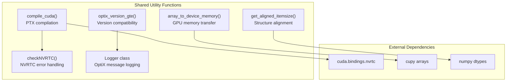
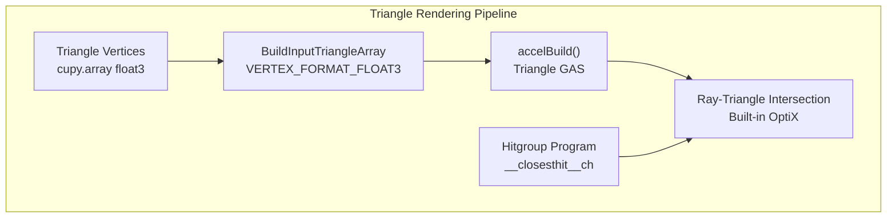
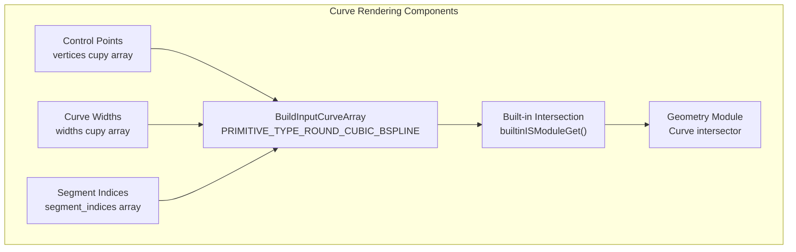
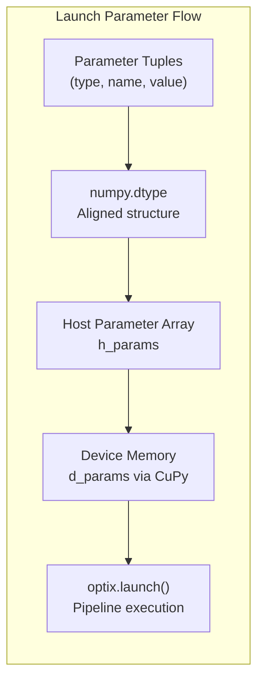

<!-- source: DeepWiki mcp.deepwiki.com · repo NVIDIA/otk-pyoptix · page 4 Examples and Tutorials · fetched 2026-10-26 -->

# Examples and Tutorials

Relevant source files

The following files were used as context for generating this wiki page:

- [examples/curves.py](examples/curves.py)
- [examples/hello.py](examples/hello.py)
- [examples/triangle.py](examples/triangle.py)

This document provides a comprehensive overview of the PyOptiX example applications, demonstrating practical implementations of ray tracing techniques using the PyOptiX Python bindings. The examples progress from basic pipeline setup to advanced rendering features, covering geometry rendering, curve primitives, and specialized OptiX capabilities.

For detailed API documentation of the classes and functions used in these examples, see [Core API Reference](#3). For information about writing custom CUDA kernels for use with these examples, see [CUDA Kernel Development](#5).

## Example Application Architecture

The PyOptiX examples follow a common architectural pattern that demonstrates the complete OptiX ray tracing pipeline. Each example implements the standard workflow from CUDA kernel compilation through final image output.

```mermaid
flowchart TD
    subgraph "Example Application Flow"
        INIT["Example Initialization"]
        COMPILE["CUDA Kernel Compilation<br/>compile_cuda()"]
        CTX["Device Context Creation<br/>create_ctx()"]
        ACCEL["Acceleration Structure<br/>create_accel()"]
        MODULE["Module Creation<br/>create_module()"]
        GROUPS["Program Groups<br/>create_program_groups()"]
        PIPELINE["Pipeline Creation<br/>create_pipeline()"]
        SBT["Shader Binding Table<br/>create_sbt()"]
        LAUNCH["Ray Tracing Launch<br/>launch()"]
        OUTPUT["Image Output<br/>PIL Image.save()"]
    end
    
    INIT --> COMPILE
    COMPILE --> CTX
    CTX --> ACCEL
    ACCEL --> MODULE
    MODULE --> GROUPS
    GROUPS --> PIPELINE
    PIPELINE --> SBT
    SBT --> LAUNCH
    LAUNCH --> OUTPUT
```

Sources: [examples/hello.py:377-399](), [examples/triangle.py:453-471](), [examples/curves.py:443-511]()

## Common Utility Functions

All examples share a set of utility functions that handle low-level operations including CUDA compilation, memory management, and OptiX version compatibility.

Sources: [examples/hello.py:32-129](), [examples/triangle.py:29-126](), [examples/curves.py:53-151]()

## Basic Ray Tracing Example

The `hello.py` example demonstrates the minimal PyOptiX pipeline without any geometry, using only raygen and miss shaders to generate procedural output.

| Component | Implementation | Purpose |
|-----------|---------------|---------|
| **Context Creation** | `optix.deviceContextCreate()` | Initialize OptiX device context with logging |
| **Module Creation** | `ctx.moduleCreate()` with PTX | Load compiled CUDA kernels |
| **Program Groups** | `__raygen__hello` shader only | Minimal shader program setup |
| **Pipeline** | Zero trace depth | No ray-geometry intersection |
| **Launch Parameters** | Image buffer and dimensions | Simple parameter passing |

The hello example creates a `optix.DeviceContext` with validation enabled and uses `optix.ModuleCompileBoundValueEntry` for compile-time parameter binding when available.

Sources: [examples/hello.py:138-159](), [examples/hello.py:174-213](), [examples/hello.py:216-246]()

## Triangle Geometry Rendering

The `triangle.py` example demonstrates fundamental geometry rendering with triangle primitives and acceleration structures.

The triangle example creates a `optix.BuildInputTriangleArray` with vertex data and builds a Geometry Acceleration Structure (GAS) using `ctx.accelBuild()`. It demonstrates the complete shader pipeline with raygen, miss, and closesthit programs.

Sources: [examples/triangle.py:166-204](), [examples/triangle.py:247-275](), [examples/triangle.py:317-383]()

## Curve Primitive Rendering

The `curves.py` example showcases OptiX's built-in curve primitive support for rendering smooth geometric curves.

The curves example uses `optix.BuildInputCurveArray` with `PRIMITIVE_TYPE_ROUND_CUBIC_BSPLINE` and leverages `ctx.builtinISModuleGet()` to obtain the built-in intersection module for curve primitives.

Sources: [examples/curves.py:189-242](), [examples/curves.py:258-295](), [examples/curves.py:318-329]()

## Shader Binding Table Structure

All examples implement a Shader Binding Table (SBT) that maps program groups to their associated data. The SBT structure varies based on the complexity of each example.

| Example | Raygen Record | Miss Record | Hitgroup Record |
|---------|---------------|-------------|-----------------|
| **hello.py** | Color data (RGB) | Placeholder data | Not used |
| **triangle.py** | Header only | Background color | Header only |
| **curves.py** | Header only | Background color | Header only |

The SBT records are created using `optix.sbtRecordPackHeader()` and aligned using the utility function `get_aligned_itemsize()` with `optix.SBT_RECORD_ALIGNMENT`.

Sources: [examples/hello.py:286-329](), [examples/triangle.py:317-383](), [examples/curves.py:373-440]()

## Parameter and Launch System

The launch system demonstrates how to pass structured parameters to OptiX kernels using numpy dtypes and CuPy device memory.

Each example defines camera parameters, image dimensions, and traversal handles as structured parameters passed to the OptiX launch function.

Sources: [examples/hello.py:332-367](), [examples/triangle.py:386-443](), [examples/curves.py:443-502]()

## Version Compatibility Handling

The examples include version-specific code paths to maintain compatibility across different OptiX SDK versions.

| Version Check | Feature | Implementation |
|---------------|---------|----------------|
| `optix_version_gte((7,1))` | stddef.h path | Compilation include path handling |
| `optix_version_gte((7,2))` | Bound values | `ModuleCompileBoundValueEntry` usage |
| `optix_version_gte((7,4))` | Program group options | `ProgramGroupOptions` parameter |
| `optix_version_gte((7,7))` | Stack size calculation | Pipeline parameter for `accumulateStackSizes` |

The version checking is implemented through the `optix_version_gte()` utility function that compares against `optix.version()` tuples.

Sources: [examples/hello.py:79-84](), [examples/triangle.py:76-81](), [examples/curves.py:109-114]()

---

