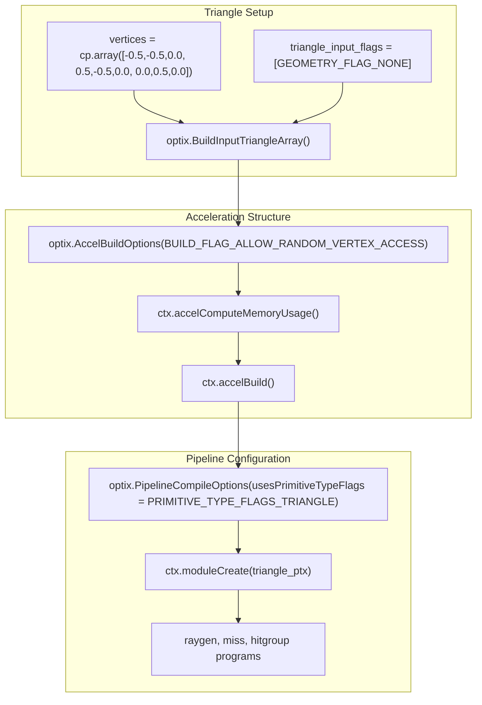
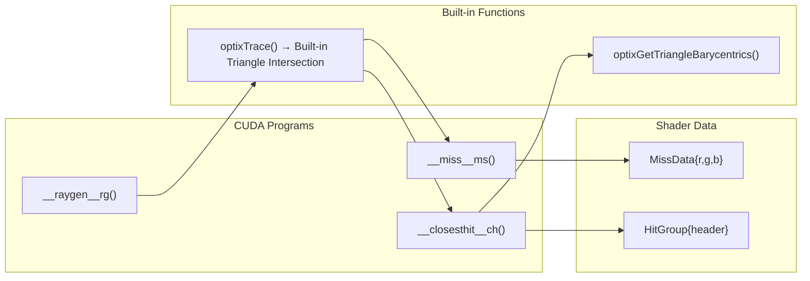
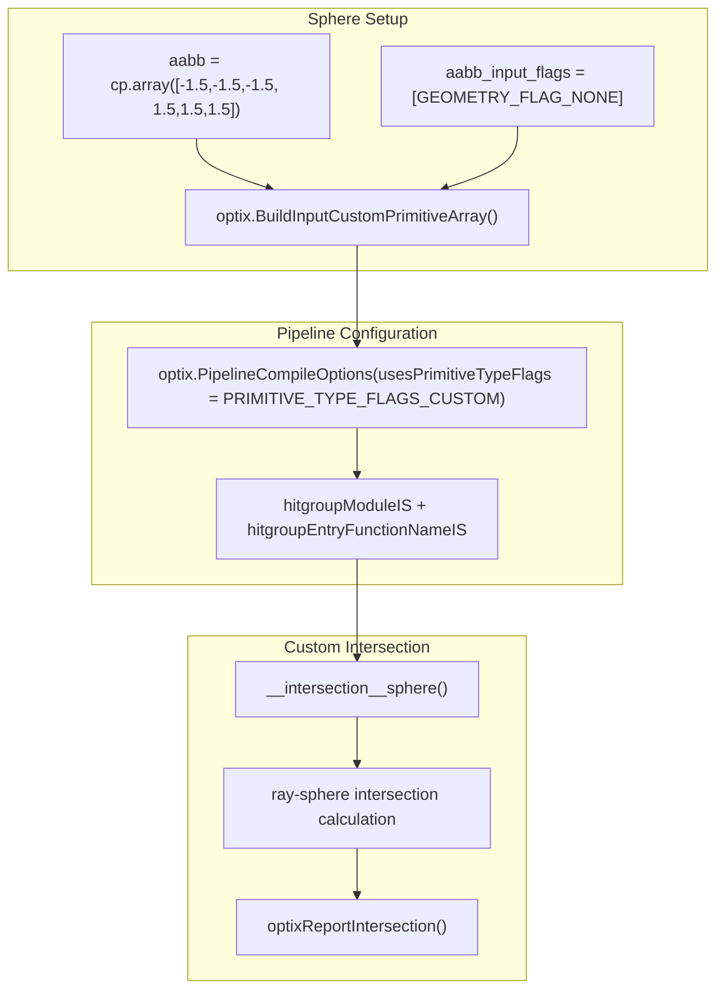
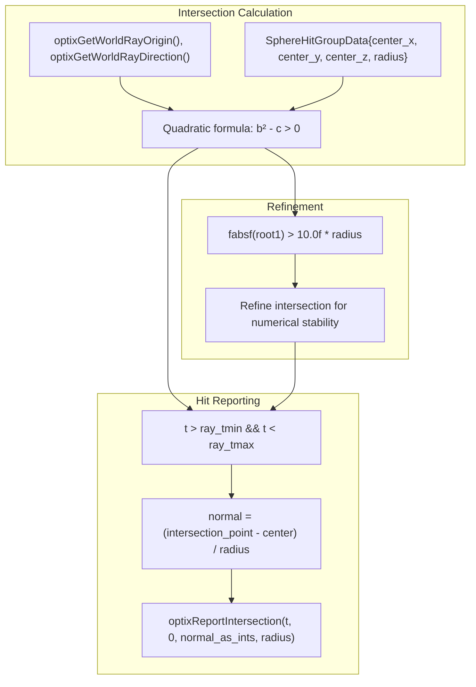
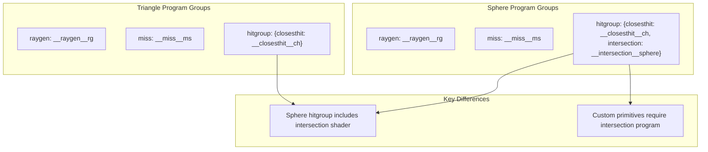
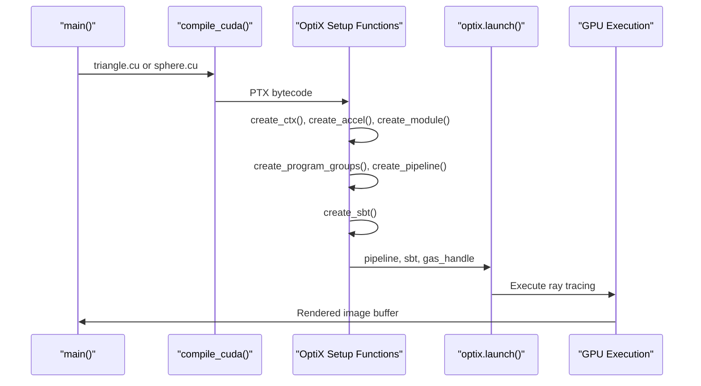

<!-- source: DeepWiki mcp.deepwiki.com · repo NVIDIA/otk-pyoptix · page 4.1 Basic Geometry Rendering · fetched 2026-10-26 -->

# Basic Geometry Rendering

Relevant source files

The following files were used as context for generating this wiki page:

- [examples/sphere.cu](examples/sphere.cu)
- [examples/sphere.py](examples/sphere.py)
- [examples/triangle.cu](examples/triangle.cu)
- [examples/triangle.py](examples/triangle.py)

This page demonstrates how to render basic geometric primitives using PyOptiX, covering both built-in triangle primitives and custom geometric shapes. The examples show the complete ray tracing pipeline setup, from geometry definition to final image output.

For more advanced curve rendering techniques, see [Curve Rendering](#4.2). For complex effects like motion blur, see [Motion Blur and Advanced Effects](#4.3).

## Triangle Rendering Pipeline

The triangle example demonstrates the simplest ray tracing setup using OptiX's built-in triangle primitive support. This approach leverages hardware-accelerated triangle intersection.

### Geometry Setup and Acceleration Structure

Triangle geometry uses `optix.BuildInputTriangleArray` to define vertex data and builds a Geometry Acceleration Structure (GAS) for efficient ray-triangle intersection testing.

Sources: [examples/triangle.py:166-204](), [examples/triangle.py:207-226]()

The triangle setup creates vertex data as a CuPy array and configures the acceleration structure build options to allow random vertex access. The key components include:

| Component | Configuration | Purpose |
|-----------|---------------|---------|
| `vertexFormat` | `optix.VERTEX_FORMAT_FLOAT3` | Specifies 3D float vertex format |
| `buildFlags` | `optix.BUILD_FLAG_ALLOW_RANDOM_VERTEX_ACCESS` | Enables vertex data access in shaders |
| `usesPrimitiveTypeFlags` | `optix.PRIMITIVE_TYPE_FLAGS_TRIANGLE` | Pipeline optimized for triangles |

### CUDA Kernel Implementation

The triangle example uses OptiX's built-in triangle intersection, requiring only raygen, miss, and closest-hit programs.

Sources: [examples/triangle.cu:64-97](), [examples/triangle.cu:100-114]()

The closest-hit shader for triangles uses `optixGetTriangleBarycentrics()` to obtain intersection coordinates, which are then converted to color values for visualization.

## Sphere Rendering with Custom Primitives

The sphere example demonstrates custom primitive rendering using Axis-Aligned Bounding Boxes (AABB) and custom intersection shaders. This approach is necessary for non-triangle geometry.

### Custom Primitive Setup

Sphere geometry requires `optix.BuildInputCustomPrimitiveArray` with AABB data to define the primitive's bounds, plus a custom intersection shader to compute ray-sphere intersections.

Sources: [examples/sphere.py:183-220](), [examples/sphere.py:222-241]()

The sphere setup differs from triangles in several key ways:

| Aspect | Triangle | Sphere |
|--------|----------|--------|
| Input Type | `BuildInputTriangleArray` | `BuildInputCustomPrimitiveArray` |
| Primitive Data | Vertex coordinates | AABB bounds |
| Intersection | Built-in hardware | Custom shader |
| Pipeline Flags | `PRIMITIVE_TYPE_FLAGS_TRIANGLE` | `PRIMITIVE_TYPE_FLAGS_CUSTOM` |

### Custom Intersection Shader

The sphere intersection shader implements analytical ray-sphere intersection using quadratic formula solving.

Sources: [examples/sphere.cu:143-205]()

The intersection shader performs several critical operations:
- Transforms ray to sphere's local coordinate system
- Solves quadratic equation for intersection points  
- Applies numerical refinement for improved precision
- Reports valid intersections with surface normals

## Program Group Configuration

Both examples require different program group configurations based on their intersection requirements.

Sources: [examples/triangle.py:247-275](), [examples/sphere.py:262-291]()

The sphere hitgroup requires both closest-hit and intersection shader specification via `hitgroupModuleIS` and `hitgroupEntryFunctionNameIS`, while triangles only need the closest-hit shader.

## Shader Binding Table Differences

The SBT records contain different data structures for each primitive type to support their respective shader requirements.

### Triangle SBT Records

| Record Type | Data Fields | Purpose |
|-------------|-------------|---------|
| Raygen | `header` only | Camera parameters stored in launch params |
| Miss | `header, r, g, b` | Background color data |
| Hitgroup | `header` only | No additional data needed |

### Sphere SBT Records  

| Record Type | Data Fields | Purpose |
|-------------|-------------|---------|
| Raygen | `header, eye_x/y/z, u_x/y/z, v_x/y/z, w_x/y/z` | Camera data in SBT |
| Miss | `header, r, g, b` | Background color data |
| Hitgroup | `header, center_x/y/z, radius` | Sphere geometry parameters |

Sources: [examples/triangle.py:317-383](), [examples/sphere.py:333-407]()

The sphere example stores camera parameters in the raygen SBT record and sphere geometry in the hitgroup record, while the triangle example uses launch parameters for camera data and minimal hitgroup data.

## Common Launch Pipeline

Both examples follow the same high-level launch sequence despite their implementation differences.

Sources: [examples/triangle.py:453-475](), [examples/sphere.py:466-487]()

Both examples produce 1024×768 RGBA images saved as PNG files, demonstrating successful ray tracing execution with their respective primitive types.

---

