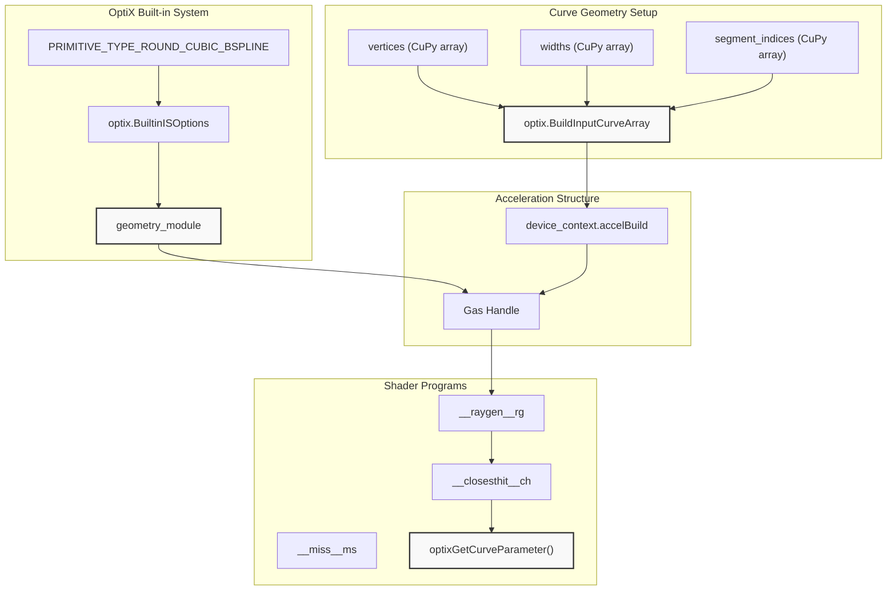
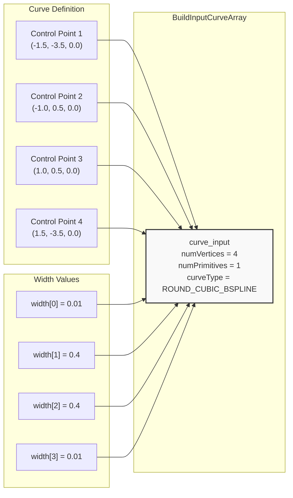
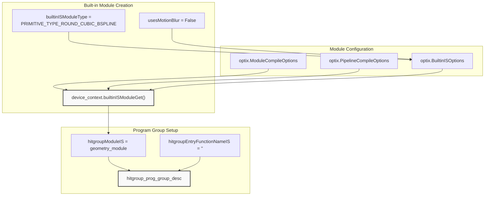
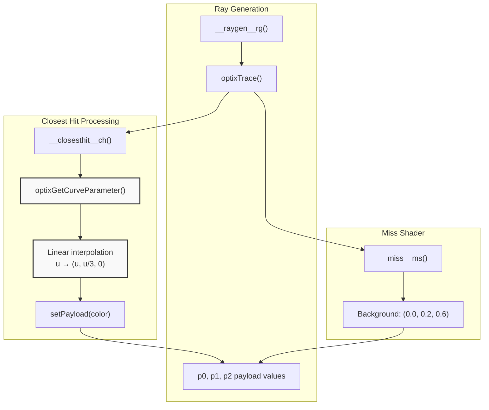
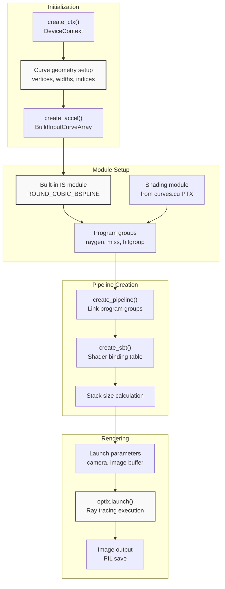

<!-- source: DeepWiki mcp.deepwiki.com · repo NVIDIA/otk-pyoptix · page 4.2 Curve Rendering · fetched 2026-10-26 -->

# Curve Rendering

Relevant source files

The following files were used as context for generating this wiki page:

- [examples/curves.cu](examples/curves.cu)
- [examples/curves.h](examples/curves.h)
- [examples/curves.py](examples/curves.py)

This document covers PyOptiX's advanced curve rendering capabilities, demonstrating how to render geometric curves using OptiX's built-in curve primitives and intersection acceleration. This example showcases OptiX's native support for cubic B-spline curves with hardware-accelerated intersection testing.

For information about basic geometry rendering with triangles and spheres, see [Basic Geometry Rendering](#4.1). For advanced motion blur effects, see [Motion Blur and Advanced Effects](#4.3).

## System Overview

The curve rendering system demonstrates OptiX's built-in curve primitive support, which provides hardware-accelerated intersection testing for cubic B-spline curves. The system consists of curve geometry definition, built-in intersection modules, and specialized shader programs that utilize curve parameters.

Sources: [examples/curves.py:189-242](), [examples/curves.cu:107-116]()

## Curve Geometry Definition

The curve rendering system defines curve geometry using control points, width values, and segment indices. OptiX supports cubic B-spline curves with varying radii along the curve length.

### Curve Data Structures

| Component | Type | Purpose |
|-----------|------|---------|
| `vertices` | `cupy.array` (float32) | Control points for B-spline curve in 3D space |
| `widths` | `cupy.array` (float32) | Radius values at each control point |
| `segment_indices` | `cupy.array` (int32) | Indices defining curve segments |

The curve geometry is set up with four control points creating a smooth B-spline curve that varies in width from thin endpoints (0.01) to thick middle sections (0.4).

Sources: [examples/curves.py:195-223]()

## OptiX Built-in Curve Intersection

OptiX provides built-in intersection acceleration for curve primitives, eliminating the need for custom intersection shaders. The system uses OptiX's geometry module for hardware-accelerated curve-ray intersection testing.

### Built-in Intersection Module Setup

The built-in intersection module requires no custom entry function name since OptiX provides the intersection logic internally. The `hitgroupEntryFunctionNameIS` is set to an empty string.

Sources: [examples/curves.py:267-291](), [examples/curves.py:318-325]()

## Shader Programs and Curve Parameters

The curve rendering system uses standard OptiX shader programs with special curve parameter access. The closest hit shader receives curve parameter `u` from OptiX's built-in intersection system.

### Curve Parameter Usage

The curve parameter `u` ranges from 0.0 to 1.0 along the curve segment, enabling parametric shading effects. The example uses linear interpolation to create a gradient from black to orange along the curve.

Sources: [examples/curves.cu:107-116](), [examples/curves.cu:100-104](), [examples/curves.cu:64-97]()

## Pipeline Configuration

The curve rendering pipeline requires specific configuration to enable curve primitive support and built-in intersection functionality.

### Pipeline Compile Options

| Option | Value | Purpose |
|--------|--------|---------|
| `usesPrimitiveTypeFlags` | `PRIMITIVE_TYPE_FLAGS_ROUND_CUBIC_BSPLINE` | Enable curve primitive support |
| `traversableGraphFlags` | `TRAVERSABLE_GRAPH_FLAG_ALLOW_SINGLE_GAS` | Allow single-level geometry |
| `numPayloadValues` | 3 | RGB color payload |
| `numAttributeValues` | 1 | Curve parameter attribute |

Sources: [examples/curves.py:245-254]()

## Complete Curve Rendering Workflow

The complete workflow demonstrates the integration of curve-specific geometry setup with OptiX's built-in intersection capabilities, resulting in efficient hardware-accelerated curve rendering.

Sources: [examples/curves.py:164-511]()

---

