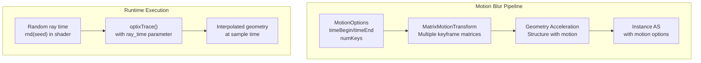
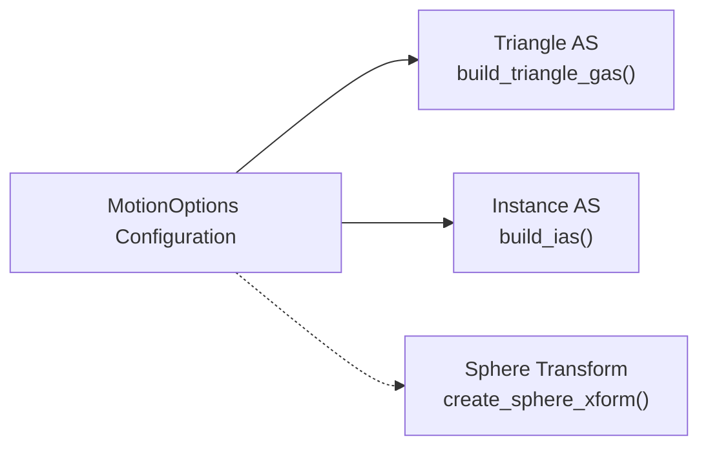
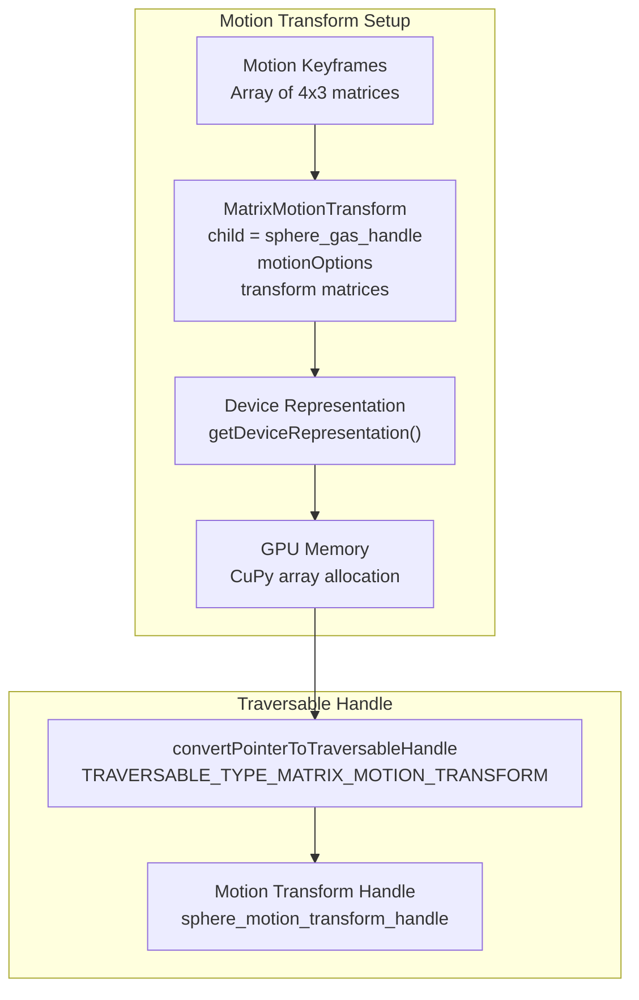
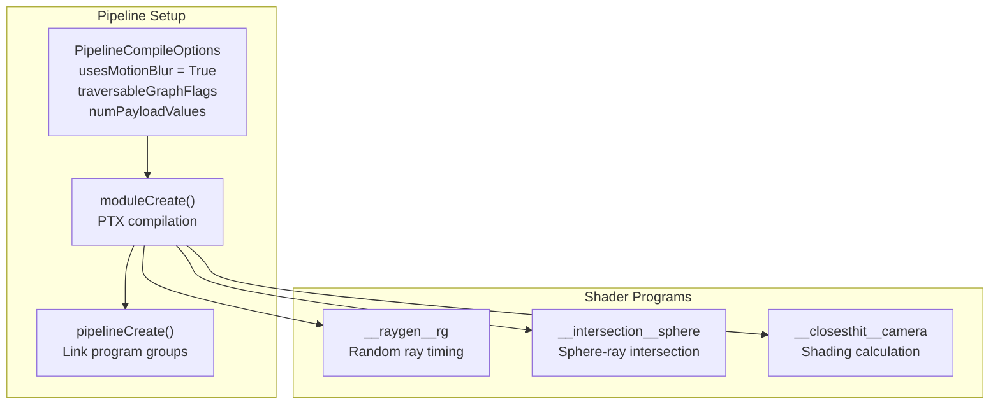
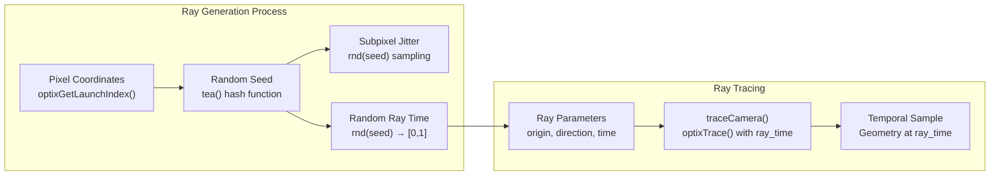
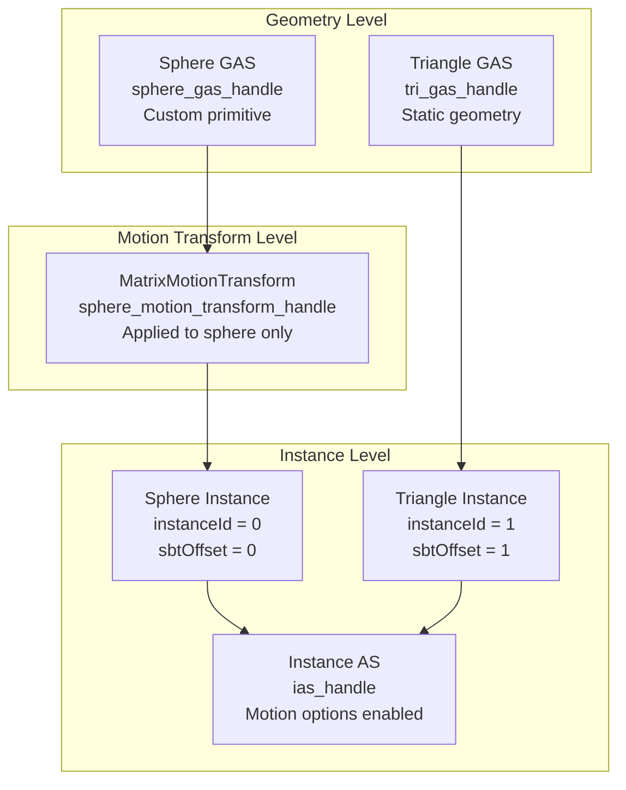

<!-- source: DeepWiki mcp.deepwiki.com · repo NVIDIA/otk-pyoptix · page 4.3 Motion Blur and Advanced Effects · fetched 2026-10-26 -->

# Motion Blur and Advanced Effects

Relevant source files

The following files were used as context for generating this wiki page:

- [examples/simpleMotionBlur.cu](examples/simpleMotionBlur.cu)
- [examples/simpleMotionBlur.h](examples/simpleMotionBlur.h)
- [examples/simpleMotionBlur.py](examples/simpleMotionBlur.py)

This document covers advanced rendering techniques in PyOptiX, with a focus on motion blur implementation. Motion blur enables realistic rendering of moving objects by sampling geometry at different time intervals during the shutter period.

For basic geometry rendering without temporal effects, see [Basic Geometry Rendering](#4.1). For information about OptiX denoising which can complement motion blur rendering, see [Image Denoising](#4.4).

## Motion Blur Overview

Motion blur in OptiX is achieved through temporal sampling of geometry at different time points during the camera's exposure period. PyOptiX provides motion transform functionality that interpolates geometry positions across multiple keyframes.

The motion blur system operates through several key components:

Sources: [examples/simpleMotionBlur.py:223-227](), [examples/simpleMotionBlur.py:384-388]()

## Motion Options Configuration

Motion blur begins with configuring `MotionOptions` that define the temporal sampling parameters:

| Parameter | Purpose | Typical Value |
|-----------|---------|---------------|
| `numKeys` | Number of keyframes | 2-3 keyframes |
| `timeBegin` | Start of motion period | 0.0 |
| `timeEnd` | End of motion period | 1.0 |
| `flags` | Motion behavior flags | `MOTION_FLAG_NONE` |

The motion options are applied to acceleration structure build operations:

Sources: [examples/simpleMotionBlur.py:223-227](), [examples/simpleMotionBlur.py:441-445]()

## Motion Transform Implementation

Motion transforms define how geometry moves over time by specifying transformation matrices for different keyframes:

The transformation matrices define object positions at different time samples. The example demonstrates translation motion:

- **Keyframe 0**: Identity matrix (original position)  
- **Keyframe 1**: Translation by (0, 0.5, 0) in Y-axis

Sources: [examples/simpleMotionBlur.py:372-403]()

## Pipeline Configuration for Motion Blur

Motion blur requires specific pipeline compilation options:

The key configuration parameter is `usesMotionBlur = True` in the pipeline compile options, which enables motion blur support in the OptiX pipeline.

Sources: [examples/simpleMotionBlur.py:479-486]()

## Shader Implementation

Motion blur is achieved in the ray generation shader through temporal sampling:

The critical implementation detail is passing a random time value to `optixTrace()`, which causes OptiX to sample the geometry at that specific temporal point.

Sources: [examples/simpleMotionBlur.cu:42-70](), [examples/simpleMotionBlur.cu:92-103]()

## Acceleration Structure Hierarchy

Motion blur with multiple geometry types requires careful acceleration structure organization:

The hierarchy allows mixing static and moving geometry within the same scene. Motion options are specified at both the geometry and instance acceleration structure levels.

Sources: [examples/simpleMotionBlur.py:406-469](), [examples/simpleMotionBlur.py:219-308]()

## Complete Example Analysis

The `simpleMotionBlur.py` example demonstrates a complete motion blur implementation:

| Component | Implementation | Key Parameters |
|-----------|----------------|----------------|
| **Triangle Geometry** | Static triangle with motion keys | 3 keyframes, time range 0-1 |
| **Sphere Geometry** | Custom primitive with intersection shader | AABB-based bounds |
| **Motion Transform** | Applied to sphere only | 2 keyframes with Y-translation |
| **Instance AS** | Contains both geometries | Motion options enabled |
| **Ray Generation** | Random temporal sampling | `rnd(seed)` for ray time |

The rendering process involves:

1. **Setup Phase**: Create geometry, motion transforms, and acceleration structures
2. **Pipeline Phase**: Compile shaders with motion blur enabled  
3. **Execution Phase**: Launch rays with random temporal sampling
4. **Result**: Motion-blurred rendering with realistic temporal artifacts

Sources: [examples/simpleMotionBlur.py:761-781]()

## Advanced Motion Blur Techniques

For production rendering, additional considerations include:

- **Multiple Motion Keys**: Using 3+ keyframes for complex motion paths
- **Motion Vectors**: Storing velocity information for post-processing
- **Adaptive Sampling**: Varying temporal sample density based on motion magnitude
- **Deformation Blur**: Combining with vertex animation for non-rigid motion

The PyOptiX motion blur system provides the foundation for these advanced techniques through its flexible motion transform and temporal sampling capabilities.

Sources: [examples/simpleMotionBlur.py](), [examples/simpleMotionBlur.cu]()

---

