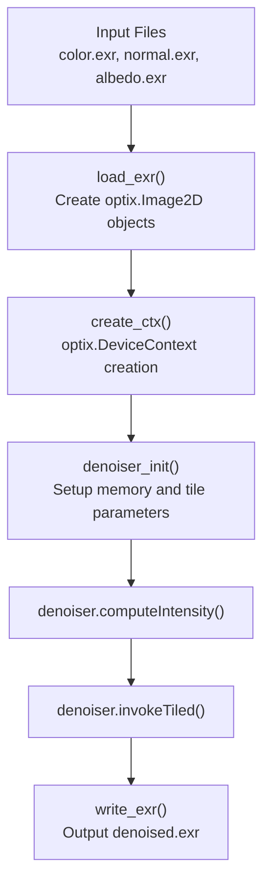
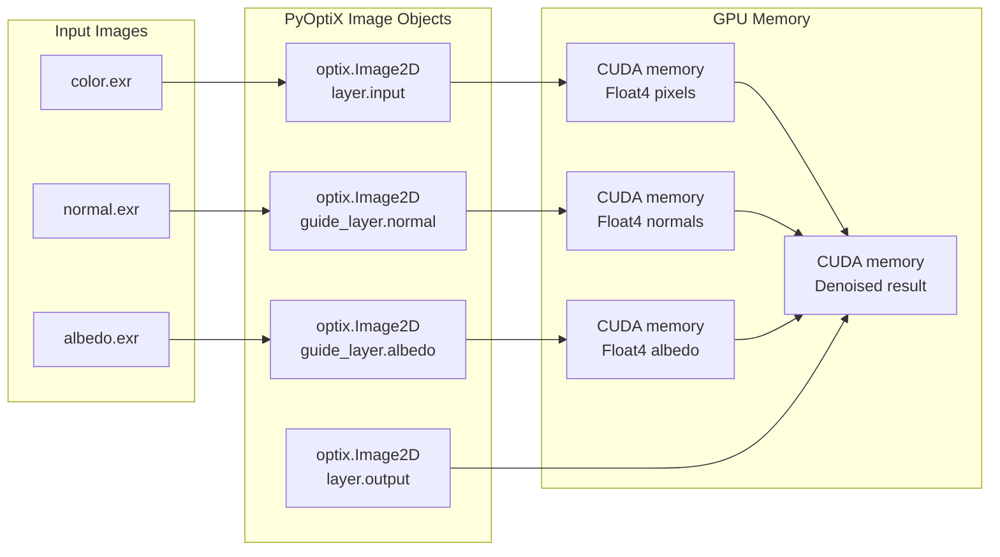
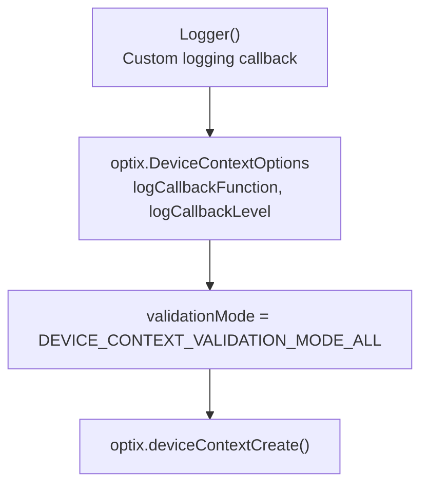
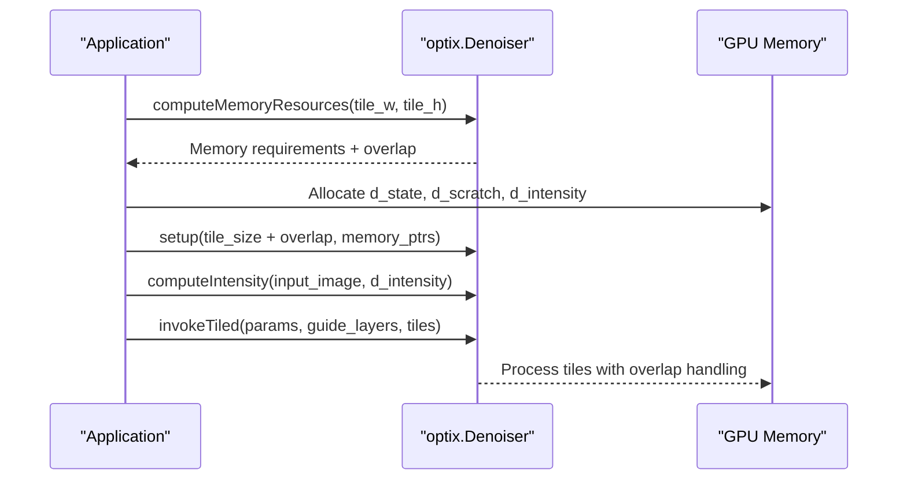

<!-- source: DeepWiki mcp.deepwiki.com · repo NVIDIA/otk-pyoptix · page 4.4 Image Denoising · fetched 2026-10-26 -->

# Image Denoising

Relevant source files

The following files were used as context for generating this wiki page:

- [examples/data/albedo.exr](examples/data/albedo.exr)
- [examples/data/beauty.exr](examples/data/beauty.exr)
- [examples/denoiser.py](examples/denoiser.py)

This document covers PyOptiX's AI-based image denoising capabilities, demonstrated through a complete example application. Image denoising in PyOptiX leverages NVIDIA's OptiX denoiser to reduce noise in rendered images using machine learning techniques. For general OptiX denoiser API documentation, see [OptiX Denoiser](#3.6).

## Overview

The image denoising example demonstrates how to use OptiX's built-in AI denoiser to post-process noisy rendered images. The denoiser can work with just a color image, but achieves better results when provided with additional guide layers such as surface normals and albedo information.

## Denoising Workflow

The denoising process follows a structured pipeline that prepares input data, configures the denoiser, and processes images in tiles for memory efficiency.

Sources: [examples/denoiser.py:316-333]()

## Core Components

### State Management

The `State` class manages all denoising parameters and GPU memory allocations:

| Component | Type | Purpose |
|-----------|------|---------|
| `layer` | `optix.DenoiserLayer` | Input/output color images |
| `guide_layer` | `optix.DenoiserGuideLayer` | Normal and albedo guide images |
| `tile_size` | `tuple` | Processing tile dimensions |
| `d_state` | `cupy.array` | GPU denoiser state memory |
| `d_scratch` | `cupy.array` | GPU scratch memory buffer |
| `d_intensity` | `cupy.array` | HDR intensity value |

Sources: [examples/denoiser.py:34-56]()

### Image Data Flow

Sources: [examples/denoiser.py:66-84](), [examples/denoiser.py:91-105]()

## Implementation Details

### OptiX Context Creation

The denoiser requires an OptiX device context with logging and validation configured:

Sources: [examples/denoiser.py:220-242]()

### Memory Management

The denoiser allocates GPU memory based on tile size and processing requirements:

| Memory Buffer | Purpose | Size Calculation |
|---------------|---------|------------------|
| `d_state` | Denoiser internal state | `sizes.stateSizeInBytes` |
| `d_scratch` | Temporary processing buffer | `sizes.withOverlapScratchSizeInBytes` |
| `d_intensity` | HDR intensity normalization | Single float value |

The memory sizes are computed by `denoiser.computeMemoryResources()` based on tile dimensions.

Sources: [examples/denoiser.py:250-263]()

### Tiled Processing

For large images or memory-constrained environments, the denoiser processes images in tiles:

Sources: [examples/denoiser.py:244-308]()

### Command Line Interface

The example provides a command-line interface for processing images:

| Argument | Purpose | Default |
|----------|---------|---------|
| `color` | Input noisy color image | Required |
| `-n, --normal` | Surface normals guide | Optional |
| `-a, --albedo` | Albedo guide image | Optional |
| `-o, --out` | Output filename | `denoised.exr` |
| `-t, --tilesize` | Tile dimensions | Full image size |
| `-e, --exposure` | Output exposure adjustment | 1.0 |

Sources: [examples/denoiser.py:125-172]()

## Integration with PyOptiX Pipeline

The denoising example demonstrates integration points with the broader PyOptiX system:

- **Device Context**: Uses the same `optix.DeviceContext` pattern as ray tracing applications
- **Memory Management**: Leverages CuPy for GPU memory allocation and CUDA interoperability  
- **Image Formats**: Supports EXR format commonly used in ray tracing workflows
- **Error Handling**: Uses OptiX logging callbacks for debugging and validation

This example can be adapted to work with images generated by PyOptiX ray tracing applications, providing a complete rendering and post-processing pipeline.

Sources: [examples/denoiser.py:1-335](), [examples/data/albedo.exr:1-10]()

---

