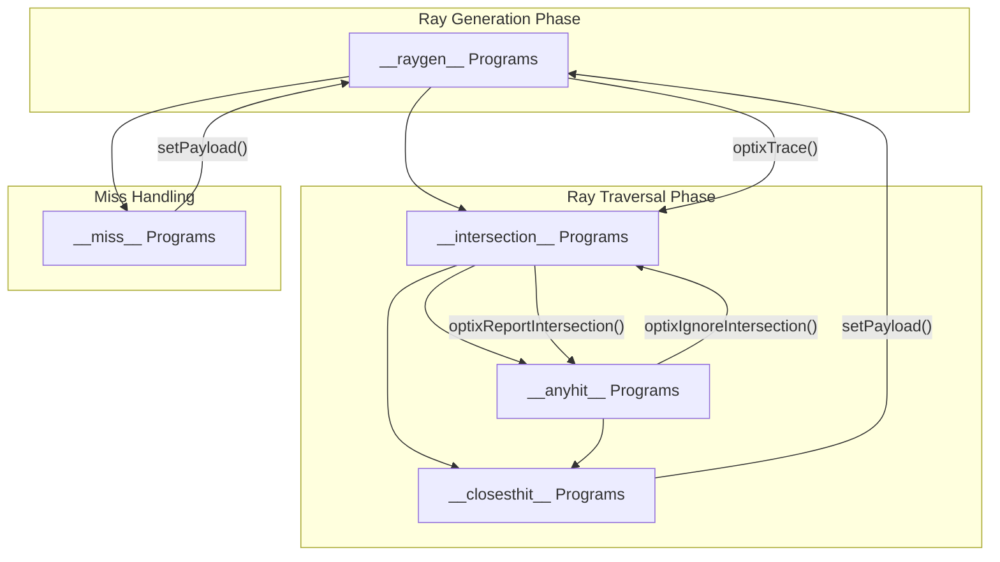
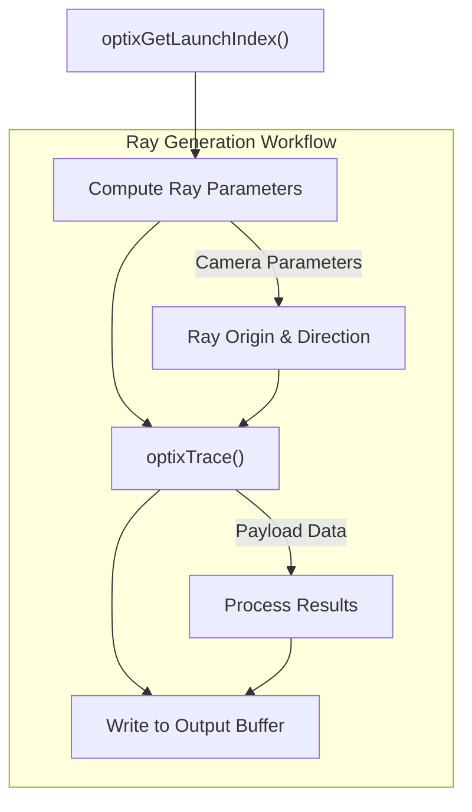
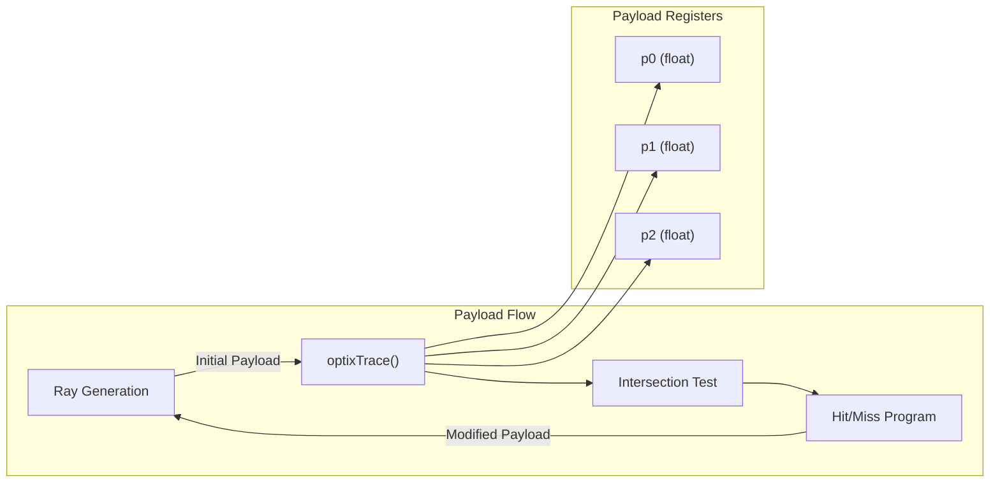
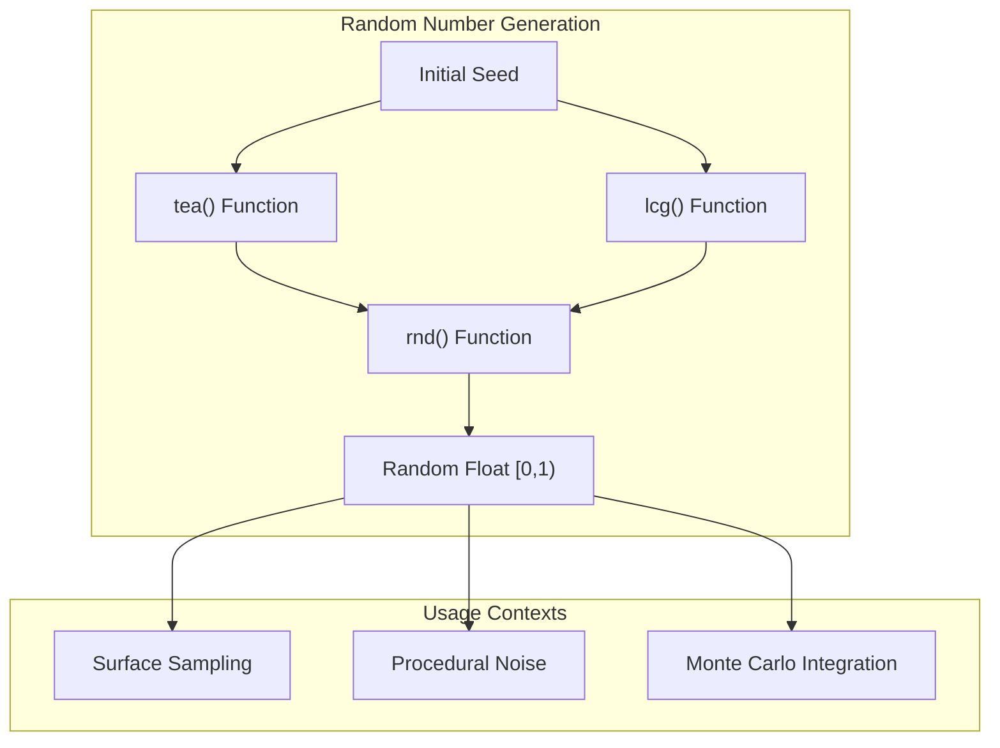
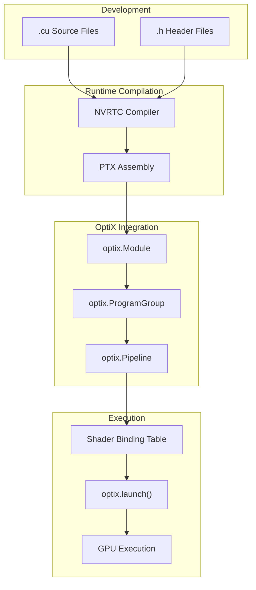

<!-- source: DeepWiki mcp.deepwiki.com · repo NVIDIA/otk-pyoptix · page 5 CUDA Kernel Development · fetched 2026-10-26 -->

# CUDA Kernel Development

<details>
<summary>Relevant source files</summary>

The following files were used as context for generating this wiki page:

- [examples/helpers.h](examples/helpers.h)
- [examples/random.h](examples/random.h)
- [examples/sphere.cu](examples/sphere.cu)
- [examples/triangle.cu](examples/triangle.cu)

</details>


This document covers writing CUDA kernels for use with PyOptiX, including OptiX program types, helper functions, and integration with the PyOptiX pipeline. These kernels implement the GPU-side ray tracing logic that gets executed during OptiX launches.

For information about the Python-side API for loading and managing these kernels, see [Core API Reference](#3). For details about the build system that compiles these kernels, see [Build System and Development](#6).

## OptiX Program Types

OptiX defines several specialized kernel types that handle different stages of the ray tracing pipeline. Each program type has specific responsibilities and access to different OptiX intrinsic functions.



### Ray Generation Programs

Ray generation programs (`__raygen__`) serve as the entry point for ray tracing operations. They execute once per launch thread and are responsible for generating primary rays and collecting results.

The `__raygen__rg` function in [examples/triangle.cu:64-97]() demonstrates the typical structure:
- Uses `optixGetLaunchIndex()` and `optixGetLaunchDimensions()` to determine pixel coordinates
- Computes ray origin and direction based on camera parameters
- Calls `optixTrace()` to initiate ray traversal
- Writes results to output buffers



Sources: [examples/triangle.cu:64-97](), [examples/sphere.cu:91-118]()

### Miss Programs

Miss programs (`__miss__`) execute when rays do not intersect any geometry. They typically set background colors or environment lighting.

The `__miss__ms` function in [examples/triangle.cu:100-104]() shows a simple implementation:
- Retrieves background color from SBT data using `optixGetSbtDataPointer()`
- Sets payload using helper functions

Sources: [examples/triangle.cu:100-104](), [examples/sphere.cu:121-126]()

### Closest Hit Programs

Closest hit programs (`__closesthit__`) execute at the closest intersection point found during ray traversal. They handle surface shading and material evaluation.

The implementation in [examples/triangle.cu:107-114]() demonstrates:
- Access to intersection attributes like barycentric coordinates via `optixGetTriangleBarycentrics()`
- Payload modification to return shading results

Sources: [examples/triangle.cu:107-114](), [examples/sphere.cu:129-138]()

### Intersection Programs

Intersection programs (`__intersection__`) implement custom primitive intersection tests. They are required for non-built-in geometry types.

The sphere intersection implementation in [examples/sphere.cu:143-205]() shows:
- Access to ray parameters via `optixGetWorldRayOrigin()` and `optixGetWorldRayDirection()`
- Custom intersection mathematics for sphere primitives
- Reporting intersections using `optixReportIntersection()`

Sources: [examples/sphere.cu:143-205]()

## Kernel Structure and Requirements

### Required Headers and Constants

OptiX kernels must include the OptiX header and declare constant parameter structures:

```cuda
#include <optix.h>
extern "C" {
__constant__ Params params;
}
```

The `Params` structure provides global parameters accessible to all program types, as shown in [examples/triangle.cu:36-38]() and [examples/sphere.cu:36-38]().

### Device Function Conventions

OptiX kernels use specific function attributes and calling conventions:

| Attribute | Purpose |
|-----------|---------|
| `extern "C" __global__` | OptiX program entry points |
| `__device__ __forceinline__` | Optimized device helper functions |
| `static __forceinline__ __device__` | Private device utilities |

Sources: [examples/triangle.cu:41-46](), [examples/sphere.cu:73-88]()

## Payload and Data Management

### Payload Handling

OptiX uses a payload system to pass data between program types during ray traversal. The examples demonstrate two approaches:

**Direct OptiX API Approach** (triangle.cu):
```cuda
optixTrace(handle, origin, direction, tmin, tmax, rayTime, 
          visibilityMask, rayFlags, sbtOffset, sbtStride, 
          missSBTIndex, p0, p1, p2);
```

**Helper Function Approach** (sphere.cu):
Functions like `setPayload()` and `getPayload()` in [examples/sphere.cu:73-88]() provide convenient wrappers around the payload registers.



Sources: [examples/sphere.cu:73-88](), [examples/triangle.cu:77-93]()

### Shader Binding Table Data

Programs access per-program data through the Shader Binding Table (SBT) using `optixGetSbtDataPointer()`. This allows different program instances to have unique parameters.

The sphere example in [examples/sphere.cu:145-152]() shows accessing sphere-specific data:
```cuda
const SphereHitGroupData* hit_group_data = 
    reinterpret_cast<SphereHitGroupData*>(optixGetSbtDataPointer());
```

Sources: [examples/sphere.cu:145-152](), [examples/triangle.cu:102]()

## Helper Functions and Utilities

### Color Processing

The [examples/helpers.h]() file provides essential color processing utilities:

| Function | Purpose |
|----------|---------|
| `toSRGB()` | Linear to sRGB color space conversion |
| `make_color()` | Convert float RGB to quantized RGBA |
| `quantizeUnsigned8Bits()` | Float to 8-bit integer conversion |

These functions handle gamma correction and color quantization required for image output.

Sources: [examples/helpers.h:35-66]()

### Random Number Generation

The [examples/random.h]() file provides GPU-friendly random number generators:

| Function | Purpose |
|----------|---------|
| `tea<N>()` | TEA (Tiny Encryption Algorithm) based PRNG |
| `lcg()` | Linear Congruential Generator |
| `rnd()` | Generate random float in [0,1) |

These are essential for Monte Carlo ray tracing techniques and sampling algorithms.



Sources: [examples/random.h:31-72]()

### Mathematical Operations

OptiX kernels rely on CUDA vector math operations provided through `vec_math.h`. Common operations include:
- Vector arithmetic (`make_float3`, `dot`, `normalize`)
- Ray-geometry intersection mathematics
- Coordinate transformations

Sources: [examples/sphere.cu:154-204](), [examples/triangle.cu:49-61]()

## Integration with PyOptiX Pipeline

### Compilation Workflow

CUDA kernel source files follow this compilation path in the PyOptiX ecosystem:



### Parameter Passing

The `__constant__ Params params` declaration creates a constant memory region accessible to all kernels. Python code populates this through CuPy arrays and memory management, as demonstrated in the examples' use of camera parameters and output buffers.

Sources: [examples/triangle.cu:36-38](), [examples/sphere.cu:36-38]()

## Best Practices

### Performance Considerations

1. **Memory Access Patterns**: Use coalesced memory access when possible
2. **Register Usage**: Minimize register pressure through efficient payload handling
3. **Divergence**: Avoid branching that causes thread divergence
4. **Constant Memory**: Use `__constant__` for read-only data accessed by all threads

### Error Handling

OptiX kernels should handle edge cases gracefully:
- Check ray parameter validity in intersection programs
- Handle degenerate geometry cases
- Validate SBT data pointer access

### Code Organization

- Separate device utilities into header files like `helpers.h`
- Use consistent naming conventions for program entry points
- Group related functionality (e.g., all sphere-related programs together)

Sources: [examples/sphere.cu:143-205](), [examples/triangle.cu:49-114](), [examples/helpers.h:35-66]()

---

