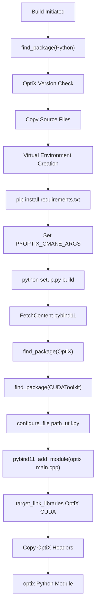
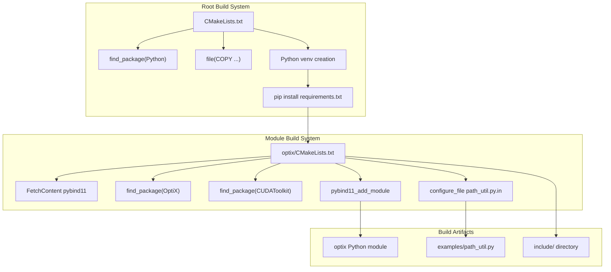
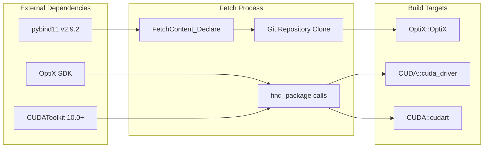

<!-- source: DeepWiki mcp.deepwiki.com · repo NVIDIA/otk-pyoptix · page 6 Build System and Development · fetched 2026-10-26 -->

# Build System and Development

<details>
<summary>Relevant source files</summary>

The following files were used as context for generating this wiki page:

- [CMakeLists.txt](CMakeLists.txt)
- [optix/CMakeLists.txt](optix/CMakeLists.txt)
- [optix/path_util.py.in](optix/path_util.py.in)

</details>


This page provides comprehensive documentation of the PyOptiX build system, CMake configuration, and development setup. It covers the multi-stage build process, dependency management, and the structure of the compilation pipeline that produces the PyOptiX Python module from C++ source code.

For information about running tests after building, see [Testing and Validation](#7). For installation instructions from a user perspective, see [Installation and Dependencies](#2.1).

## Build System Overview

PyOptiX uses a two-stage CMake build system that first establishes a Python virtual environment with dependencies, then compiles the C++ bindings into a Python module using pybind11.

### Build Process Flow



**Sources:** [CMakeLists.txt:29-60](), [optix/CMakeLists.txt:5-62]()

### Build System Architecture



**Sources:** [CMakeLists.txt:36-60](), [optix/CMakeLists.txt:13-62]()

## Root CMake Configuration

The root `CMakeLists.txt` handles environment setup and orchestrates the overall build process.

### Version Control and Guards

The build system includes a temporary guard to prevent building with OptiX versions greater than 7.7:

```cmake
if(OPTIX_VERSION VERSION_GREATER 7.7)
    return()
endif()
```

This guard ensures compatibility while awaiting fixes for OptiX 8.0 support.

### File Organization

The build system copies source directories to the build location for isolated compilation:

| Source Directory | Destination | Purpose |
|-----------------|-------------|---------|
| `optix/` | `${CMAKE_CURRENT_BINARY_DIR}/optix/` | C++ module source |
| `examples/` | `${CMAKE_CURRENT_BINARY_DIR}/examples/` | Python examples |
| `requirements.txt` | `${CMAKE_CURRENT_BINARY_DIR}/requirements.txt` | Python dependencies |
| `test/` | `${CMAKE_CURRENT_BINARY_DIR}/test/` | Test suite |

### Virtual Environment Management

The build system creates platform-specific virtual environments:

#### Unix/Linux Environment Setup
- Creates virtual environment using `python -m venv env`
- Activates environment with `source ./env/bin/activate`
- Installs dependencies with `./env/bin/pip install -r requirements.txt`

#### Windows Environment Setup  
- Creates virtual environment using `python -m venv env`
- Activates environment with PowerShell script `./env/Scripts/Activate.ps1`
- Installs dependencies with `./env/Scripts/pip.exe install -r requirements.txt`

**Sources:** [CMakeLists.txt:38-54]()

## Module CMake Configuration

The `optix/CMakeLists.txt` file handles the core C++ module compilation and dependency linking.

### External Dependencies

The module build system manages several key dependencies:



**Sources:** [optix/CMakeLists.txt:13-37]()

### pybind11 Integration

The build system fetches pybind11 directly from GitHub:

- Repository: `https://github.com/pybind/pybind11`
- Version: `v2.9.2`
- Method: Shallow git clone via `FetchContent`

### Module Compilation

The core PyOptiX module is built using pybind11's CMake integration:

```cmake
pybind11_add_module(optix main.cpp)
```

This creates a Python extension module from [optix/main.cpp]() with the following configuration:

| Setting | Value | Purpose |
|---------|-------|---------|
| C++ Standard | `cxx_std_17` | Modern C++ features |
| Target Libraries | `OptiX::OptiX`, `CUDA::cuda_driver`, `CUDA::cudart` | OptiX and CUDA functionality |
| Module Name | `optix` | Python import name |

### Path Configuration

The build system generates `path_util.py` from a template to provide include paths to examples:

- Template: [optix/path_util.py.in]()
- Output: `examples/path_util.py`
- Variables: `OptiX_INCLUDE_DIR`, `CUDAToolkit_INCLUDE_DIRS`, `OptiX_STDDEF_DIR`

**Sources:** [optix/CMakeLists.txt:39](), [optix/path_util.py.in:1-6]()

## Development Workflow

### Build Commands

The complete build process is orchestrated through the root CMake target:

1. **Environment Setup**: `add_custom_command(OUTPUT env.timestamp ...)`
2. **Module Build**: `add_custom_target(PyOptiX ALL ...)`
3. **CMake Arguments**: `PYOPTIX_CMAKE_ARGS="-DOptiX_INSTALL_DIR=${OptiX_INSTALL_DIR}"`

### Build Dependencies


### Environment Variables

| Variable | Purpose | Example Value |
|----------|---------|---------------|
| `PYOPTIX_CMAKE_ARGS` | Pass OptiX location to module build | `"-DOptiX_INSTALL_DIR=/opt/optix"` |
| `OptiX_INSTALL_DIR` | OptiX SDK installation directory | `/opt/optix` or `C:\ProgramData\NVIDIA Corporation\OptiX SDK 7.6.0` |

**Sources:** [CMakeLists.txt:57-59]()

## Build Artifacts

### Primary Outputs

The build system produces several key artifacts:

1. **optix Python Module**: Compiled pybind11 extension (`.so` on Linux, `.pyd` on Windows)
2. **path_util.py**: Generated path configuration for examples
3. **OptiX Headers**: Copied to module directory for runtime access
4. **Virtual Environment**: Isolated Python environment with dependencies

### Module Structure

After compilation, the optix module directory contains:

```
optix/
├── optix.so (or optix.pyd on Windows)
├── include/
│   └── [OptiX headers copied from SDK]
└── [other build artifacts]
```

### Header Management

The build system automatically copies OptiX headers to the module directory:

```cmake
add_custom_command(
    TARGET optix POST_BUILD
    COMMAND ${CMAKE_COMMAND} -E copy_directory
    ${OptiX_INCLUDE_DIR}
    $<TARGET_FILE_DIR:optix>/include
)
```

This ensures the compiled module has access to OptiX headers for runtime operations.

**Sources:** [optix/CMakeLists.txt:56-61]()

---

