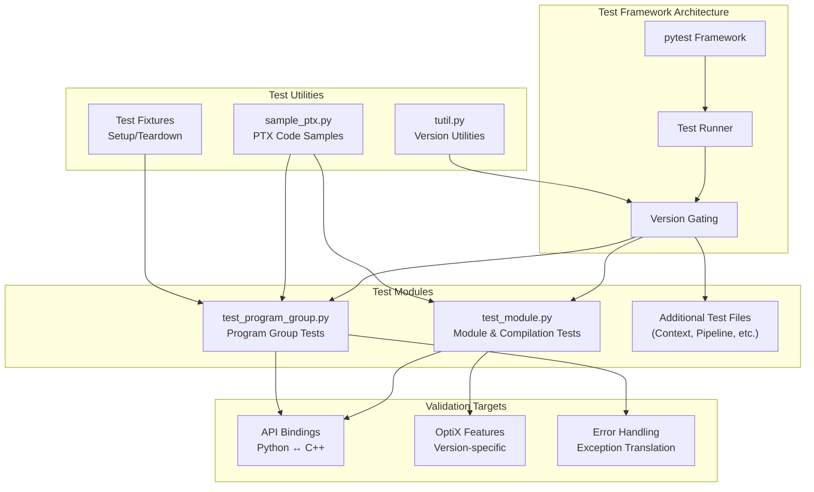
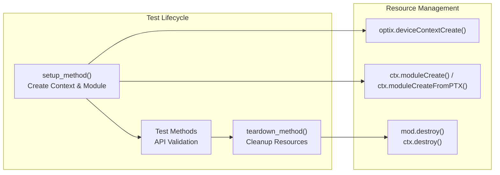
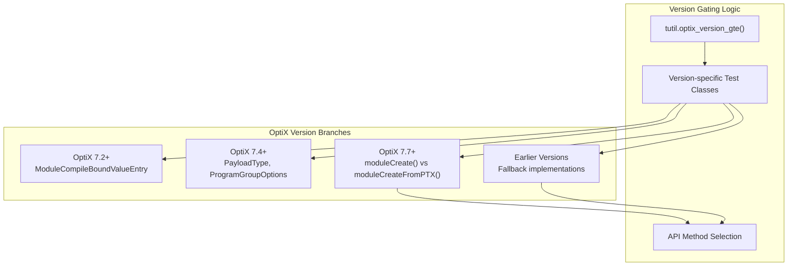
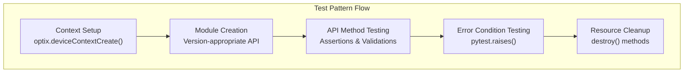

<!-- source: DeepWiki mcp.deepwiki.com · repo NVIDIA/otk-pyoptix · page 7 Testing and Validation · fetched 2026-10-26 -->

# Testing and Validation

<details>
<summary>Relevant source files</summary>

The following files were used as context for generating this wiki page:

- [test/test_module.py](test/test_module.py)
- [test/test_program_group.py](test/test_program_group.py)

</details>


## Purpose and Scope

This document covers PyOptiX's testing infrastructure, validation procedures, and how to run the test suite to ensure proper functionality of the Python bindings for NVIDIA OptiX. The test suite validates API bindings, OptiX functionality across different versions, and ensures compatibility with various CUDA configurations.

For information about the build system that enables testing, see [Build System and Development](#6). For examples demonstrating PyOptiX usage patterns, see [Examples and Tutorials](#4).

## Test Framework Overview

PyOptiX uses pytest as its primary testing framework, organized into focused test modules that validate specific API components. The test suite is designed to work across multiple OptiX versions with version-specific feature testing.



Sources: [test/test_module.py:1-224](), [test/test_program_group.py:1-159]()

## Test Organization and Structure

### Class-Based Test Organization

Tests are organized into classes that group related functionality, with descriptive names that map directly to OptiX API components:

| Test Class | Purpose | Target API Components |
|------------|---------|----------------------|
| `TestModule` | Module creation and management | `optix.Module`, `optix.ModuleCompileOptions` |
| `TestModuleCompileBoundValueEntry` | Bound value compilation features | `optix.ModuleCompileBoundValueEntry` |
| `TestModuleCompilePayloadType` | Payload type handling | `optix.PayloadType` |
| `TestProgramGroup` | Program group operations | `optix.ProgramGroup`, `optix.ProgramGroupDesc` |
| `TestProgramGroupBase` | Base class with common fixtures | Setup/teardown for program group tests |

### Test Fixture Management

Test classes use setup and teardown methods to manage OptiX resources:



Sources: [test/test_program_group.py:24-38]()

### Version Compatibility Testing

Tests use version gating to ensure compatibility across OptiX versions:



Sources: [test/test_module.py:15-16](), [test/test_module.py:39-40](), [test/test_module.py:126-137](), [test/test_program_group.py:65-69]()

## Running Tests

### Prerequisites

The test suite requires:
- PyOptiX properly installed and built
- CUDA runtime environment
- OptiX SDK available
- Python dependencies: `pytest`, `cupy`, `numpy`

### Test Execution Commands

```bash
# Run all tests
pytest test/

# Run specific test module  
pytest test/test_module.py

# Run specific test class
pytest test/test_module.py::TestModule

# Run with verbose output
pytest -v test/

# Run with detailed output and no capture
pytest -v -s test/
```

## Test Categories

### API Binding Validation

Tests verify that Python API correctly wraps C++ OptiX functionality:

- **Object Creation**: Validates constructors and factory methods
- **Attribute Access**: Tests getter/setter operations and read-only properties  
- **Method Invocation**: Verifies method calls and return values
- **Resource Management**: Tests object lifecycle and cleanup

### OptiX Feature Testing

Version-specific features are tested with appropriate gating:

| OptiX Version | Features Tested |
|---------------|----------------|
| 7.1+ | `builtinISModuleGet()`, basic module operations |
| 7.2+ | `ModuleCompileBoundValueEntry`, bound values |
| 7.4+ | `PayloadType`, `ProgramGroupOptions`, payload semantics |
| 7.6+ | Stack size operations with pipeline arguments |
| 7.7+ | `moduleCreate()` API (vs deprecated `moduleCreateFromPTX()`) |

### Error Handling Validation

Tests ensure proper exception handling and error translation from C++ to Python:

```python
# Example from test suite
with pytest.raises(AttributeError):
    print(bound_value_entry.boundValue)  # Write-only property
```

Sources: [test/test_module.py:29-30](), [test/test_module.py:65-66]()

## Test Utilities and Helpers

### Version Utility Module (`tutil`)

Provides version checking and default configurations:

- `tutil.optix_version_gte(version_tuple)`: Version comparison for conditional testing
- `tutil.default_debug_level()`: Returns appropriate debug level for OptiX version

### Sample PTX Module (`sample_ptx`)

Provides pre-compiled PTX code for testing:

- `sample_ptx.hello_ptx`: Basic raygen and miss programs
- `sample_ptx.triangle_ptx`: Triangle intersection and shading programs

### Common Test Patterns



Sources: [test/test_module.py:122-142](), [test/test_program_group.py:57-73]()

## Validation Procedures

### Continuous Integration Validation

The test suite is designed for automated validation across:

- Multiple OptiX versions (7.0+ through 7.7+)
- Different CUDA toolkit versions
- Various GPU architectures
- Python version compatibility

### Manual Validation Steps

1. **Environment Verification**: Ensure OptiX SDK and CUDA are properly installed
2. **Build Verification**: Confirm PyOptiX module compiles and loads
3. **Test Execution**: Run full test suite and verify all tests pass
4. **Example Validation**: Verify example applications run successfully
5. **Version Compatibility**: Test against target OptiX versions

### Test Coverage Areas

- **Core API Bindings**: Device context, modules, pipelines, program groups
- **Memory Management**: Resource creation, destruction, and lifecycle
- **Error Handling**: Exception translation and error reporting
- **Version Compatibility**: Feature availability across OptiX versions
- **Integration**: End-to-end workflows from PTX to execution

Sources: [test/test_module.py:1-224](), [test/test_program_group.py:1-159]()