# Page: PyOptiX Overview

# PyOptiX Overview

<details>
<summary>Relevant source files</summary>

The following files were used as context for generating this wiki page:

- [README.md](README.md)
- [optix/main.cpp](optix/main.cpp)
- [optix/setup.py](optix/setup.py)

</details>


## Purpose and Scope

This document provides a high-level overview of PyOptiX, explaining its architecture, core components, and relationship to the NVIDIA OptiX ray tracing API. It covers the overall system design and the binding layer that enables Python applications to use OptiX functionality.

For detailed installation instructions, see [Installation and Dependencies](#2.1). For hands-on usage examples, see [Your First Ray Tracing Application](#2.2). For comprehensive API documentation, see [Core API Reference](#3).

## What is PyOptiX

PyOptiX is a Python binding library that provides Python access to NVIDIA's OptiX 7 ray tracing API. It enables Python developers to build high-performance ray tracing applications by wrapping the OptiX C API with Python-friendly interfaces using pybind11.

**Key characteristics:**
- **Python bindings for OptiX 7.6+**: Wraps the complete OptiX C API for Python use
- **pybind11-based implementation**: Uses modern C++ binding techniques for seamless Python integration  
- **Complete API coverage**: Supports device contexts, modules, pipelines, acceleration structures, and denoising
- **Cross-platform support**: Works on Linux and Windows with appropriate OptiX and CUDA installations

**Sources:** [README.md:1-96](), [optix/main.cpp:1-50]()

## System Architecture

PyOptiX follows a layered architecture that bridges Python applications with the OptiX C API through C++ bindings:

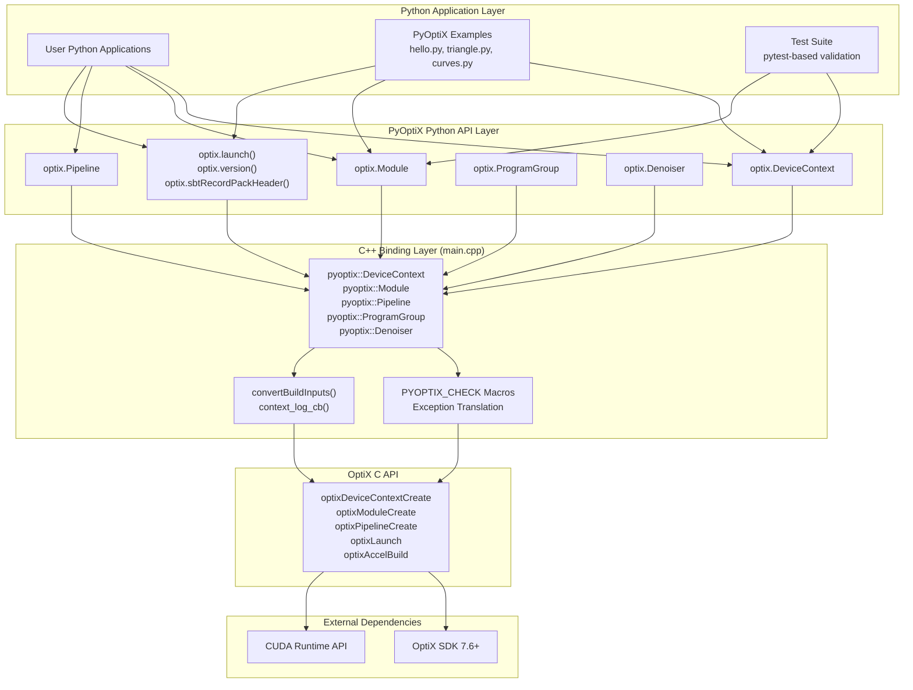

**Sources:** [optix/main.cpp:85-137](), [optix/main.cpp:1070-1096](), [README.md:20-27]()

## Python API to C++ Binding Mapping

The binding layer translates Python calls into OptiX C API calls through C++ wrapper objects:

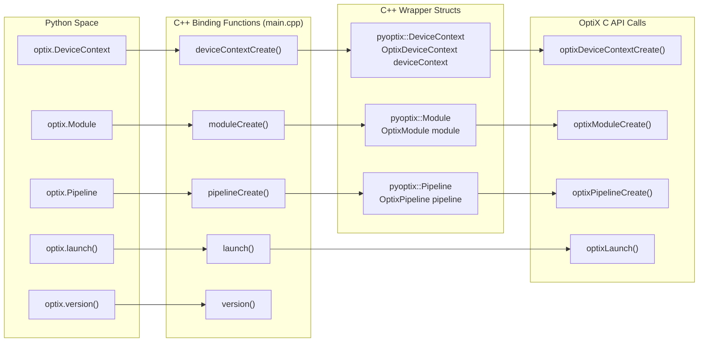

**Sources:** [optix/main.cpp:1098-1114](), [optix/main.cpp:1348-1391](), [optix/main.cpp:1280-1315](), [optix/main.cpp:1555-1578]()

## Core Components

PyOptiX provides Python wrappers for the primary OptiX objects and operations:

| Python Class/Function | C++ Wrapper Struct | OptiX C API | Purpose |
|----------------------|-------------------|-------------|---------|
| `optix.DeviceContext` | `pyoptix::DeviceContext` | `OptixDeviceContext` | GPU context and configuration management |
| `optix.Module` | `pyoptix::Module` | `OptixModule` | Compiled PTX shader module container |
| `optix.ProgramGroup` | `pyoptix::ProgramGroup` | `OptixProgramGroup` | Collection of related shader programs |
| `optix.Pipeline` | `pyoptix::Pipeline` | `OptixPipeline` | Complete ray tracing pipeline |
| `optix.Denoiser` | `pyoptix::Denoiser` | `OptixDenoiser` | AI-based image denoising |
| `optix.launch()` | `launch()` function | `optixLaunch()` | Ray tracing execution |

**Error handling** is managed through `PYOPTIX_CHECK` macros that translate OptiX errors into Python exceptions, providing consistent error reporting across the binding layer.

**Sources:** [optix/main.cpp:105-136](), [optix/main.cpp:28-45]()

## Ray Tracing Pipeline Flow

PyOptiX applications follow the standard OptiX pipeline pattern:

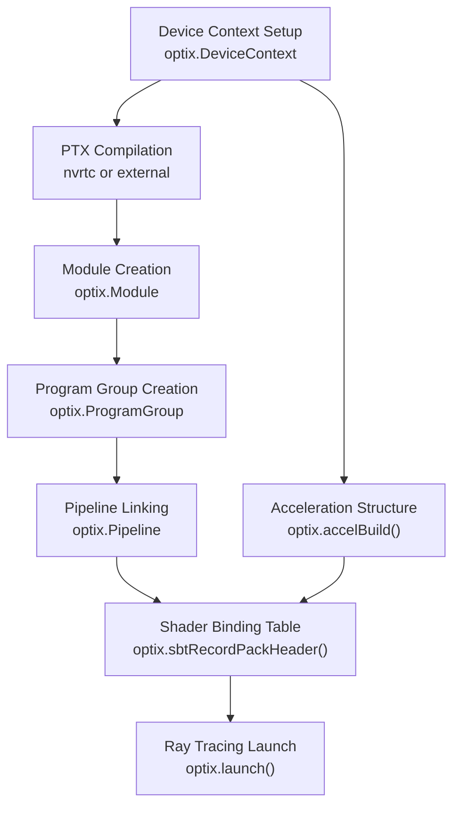

This pipeline enables GPU-accelerated ray tracing with OptiX's dedicated RT cores for optimal performance.

**Sources:** [optix/main.cpp:1348-1391](), [optix/main.cpp:1450-1542](), [optix/main.cpp:1640-1688](), [optix/main.cpp:1555-1578]()

## Build System Integration

PyOptiX uses a CMake-based build system integrated with Python's setuptools:

- **CMake backend**: [optix/setup.py:16-88]() provides `CMakeExtension` and `CMakeBuild` classes
- **Environment configuration**: `PYOPTIX_CMAKE_ARGS` environment variable specifies OptiX SDK location  
- **Cross-platform support**: Handles Windows and Linux build differences
- **Dependency management**: Links against OptiX SDK, CUDA runtime, and pybind11

**Sources:** [optix/setup.py:38-75](), [README.md:57-78]()

## Integration Points

PyOptiX integrates with several related systems and tools:

- **CUDA ecosystem**: Uses CuPy arrays for GPU memory management and NVRTC for runtime PTX compilation
- **OptiX examples**: Demonstrates usage patterns for geometry rendering, motion blur, and denoising  
- **Testing framework**: Pytest-based validation ensures API correctness across OptiX versions

For detailed component documentation, see [Core API Reference](#3). For practical usage examples, see [Examples and Tutorials](#4). For build system details, see [Build System and Development](#6).

**Sources:** [README.md:20-27](), [optix/main.cpp:51-82]()

---

# Page: Getting Started

# Getting Started

<details>
<summary>Relevant source files</summary>

The following files were used as context for generating this wiki page:

- [CMakeLists.txt](CMakeLists.txt)
- [README.md](README.md)
- [requirements.txt](requirements.txt)

</details>


This document provides an overview of PyOptiX installation and initial setup procedures. It covers the high-level workflow for getting PyOptiX running on your system and introduces the basic concepts needed to begin ray tracing with PyOptiX.

For detailed installation instructions and dependency management, see [Installation and Dependencies](#2.1). For a step-by-step tutorial building your first ray tracing application, see [Your First Ray Tracing Application](#2.2).

## Overview

PyOptiX provides Python bindings for NVIDIA OptiX 7, enabling high-performance ray tracing applications to be developed in Python. The system consists of a C++ binding layer that wraps the OptiX C API using pybind11, exposing OptiX functionality through Python classes and functions.

The following diagram shows the key components involved in getting PyOptiX operational:

**PyOptiX Getting Started Architecture**

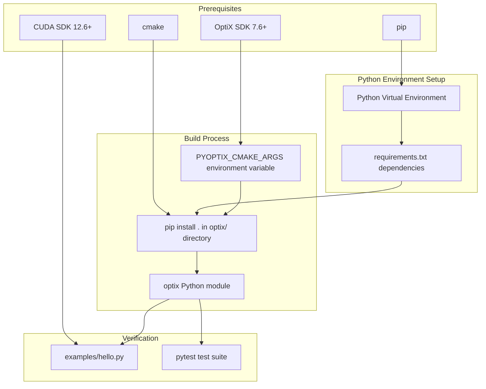

Sources: [README.md:1-96](), [CMakeLists.txt:29-60]()

## Installation Workflow

The PyOptiX installation process follows these high-level steps:

| Step | Component | Description |
|------|-----------|-------------|
| 1 | OptiX SDK | Install NVIDIA OptiX SDK 7.6 or newer |
| 2 | CUDA SDK | Install CUDA SDK 12.6 or newer |
| 3 | Python Environment | Create virtual environment using `venv` or `conda` |
| 4 | Dependencies | Install Python packages from `requirements.txt` |
| 5 | Build Configuration | Set `PYOPTIX_CMAKE_ARGS` environment variable |
| 6 | Module Build | Run `pip install .` in the `optix/` directory |
| 7 | Verification | Run `examples/hello.py` to test installation |

Sources: [README.md:10-72]()

## Core Dependencies

PyOptiX requires both system-level and Python-level dependencies:

**System Dependencies:**
- OptiX SDK 7.6+ (ray tracing API)
- CUDA SDK 12.6+ (GPU compute platform)
- cmake (build system)
- pip (Python package manager)

**Python Dependencies from `requirements.txt`:**
- `pytest` - testing framework
- `cupy` - GPU array operations
- `numpy` - CPU array operations  
- `Pillow` - image processing
- `cuda-python` - CUDA Python bindings

Sources: [README.md:10-26](), [requirements.txt:1-5]()

## Build System Integration

The PyOptiX build system uses CMake integration with Python setuptools. The root `CMakeLists.txt` creates a Python virtual environment and manages file copying, while the module-specific build occurs through setuptools:

**Build System Flow**

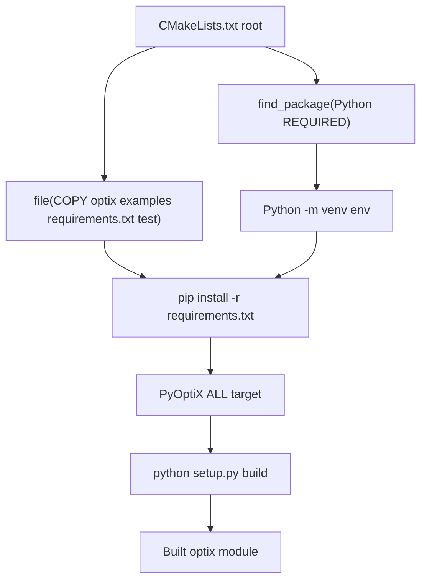

Sources: [CMakeLists.txt:29-60]()

## Environment Configuration

Before building PyOptiX, the `PYOPTIX_CMAKE_ARGS` environment variable must be configured to point to your OptiX SDK installation:

**Linux:**
```bash
export PYOPTIX_CMAKE_ARGS="-DOptiX_INSTALL_DIR=<optix install dir>"
```

**Windows:**
```cmd
set PYOPTIX_CMAKE_ARGS=-DOptiX_INSTALL_DIR=C:\ProgramData\NVIDIA Corporation\OptiX SDK 7.0.0
```

This environment variable is used by the build system at [CMakeLists.txt:57]() to locate OptiX headers and libraries during compilation.

Sources: [README.md:57-66](), [CMakeLists.txt:57]()

## Initial Verification

After successful installation, verify PyOptiX functionality by running the `hello.py` example:

```bash
cd examples
python hello.py
```

A successful run produces a green square image, confirming that:
- The `optix` Python module loads correctly
- OptiX device context creation succeeds
- Basic ray tracing pipeline execution works
- Image output generation functions properly

For comprehensive system validation, run the full test suite:

```bash
cd test
python -m pytest
```

Sources: [README.md:80-95]()

## Next Steps

Once PyOptiX is installed and verified:

1. **Explore Examples**: Review the examples in the `examples/` directory to understand different PyOptiX usage patterns
2. **Study API Documentation**: Examine the core API reference for detailed class and function documentation  
3. **Build Your Application**: Start with simple ray tracing scenarios and progressively add complexity

For detailed installation procedures and dependency troubleshooting, proceed to [Installation and Dependencies](#2.1). To build your first ray tracing application from scratch, see [Your First Ray Tracing Application](#2.2).

Sources: [README.md:80-96]()

---

# Page: Installation and Dependencies

# Installation and Dependencies

<details>
<summary>Relevant source files</summary>

The following files were used as context for generating this wiki page:

- [CMakeLists.txt](CMakeLists.txt)
- [README.md](README.md)
- [optix/CMakeLists.txt](optix/CMakeLists.txt)
- [optix/path_util.py.in](optix/path_util.py.in)
- [requirements.txt](requirements.txt)

</details>


This page provides comprehensive instructions for installing PyOptiX and setting up all required dependencies. It covers system requirements, Python package dependencies, build system configuration, and the complete installation process from source.

For information about running your first PyOptiX application after installation, see [Your First Ray Tracing Application](#2.2). For details about the underlying build system architecture and development setup, see [Build System and Development](#6).

## System Requirements

PyOptiX requires specific versions of external SDKs and tools to function correctly. These dependencies form the foundation of the ray tracing capabilities.

### Required SDKs

| Component | Minimum Version | Purpose |
|-----------|-----------------|---------|
| OptiX SDK | 7.6+ | Core ray tracing functionality |
| CUDA SDK | 12.6+ | GPU compute and memory management |
| CMake | 3.17+ | Build system |
| Python | 3.x | Runtime environment |

The OptiX SDK must be installed from the [NVIDIA Developer Portal](https://developer.nvidia.com/designworks/optix/download). The CUDA SDK is available from [NVIDIA's CUDA downloads page](https://developer.nvidia.com/cuda-downloads).

**Sources:** [README.md:10-18](), [optix/CMakeLists.txt:5-6]()

### Version Compatibility

The build system includes version guards to ensure compatibility. OptiX versions greater than 7.7 are currently blocked pending version 8.0 fixes.

**Sources:** [CMakeLists.txt:31-34]()

## Python Dependencies

PyOptiX requires several Python packages for full functionality. These dependencies are managed through `requirements.txt` and support both example execution and testing.

### Core Dependencies

The following packages are required for PyOptiX operation:

```
pytest      - Testing framework
cupy        - GPU-accelerated NumPy alternative  
numpy       - Numerical computing
Pillow      - Image processing
cuda-python - CUDA Python bindings
```

For Conda environments, an additional dependency is needed:
- `pynvrtc` - NVIDIA Runtime Compiler Python bindings (pip only)

**Sources:** [requirements.txt:1-5](), [README.md:21-26](), [README.md:51-53]()

## Build System Architecture

The PyOptiX build system uses a two-stage CMake configuration with Python integration. Understanding this architecture helps troubleshoot build issues and customize the installation process.

### Build System Dependency Flow

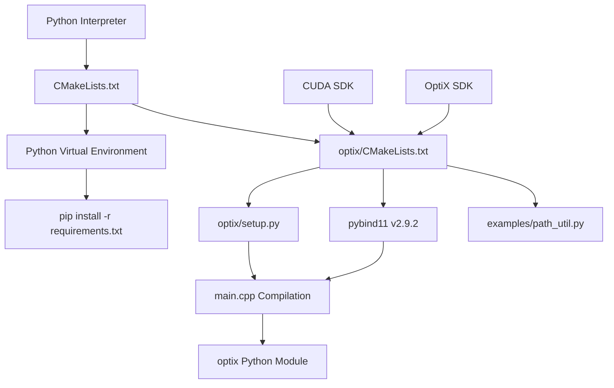

**Sources:** [CMakeLists.txt:29-60](), [optix/CMakeLists.txt:13-24](), [optix/CMakeLists.txt:32-37]()

### CMake Module Resolution

The build system automatically locates required components through CMake's find_package mechanism:

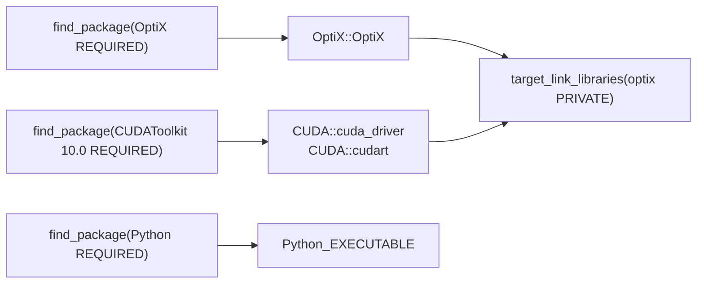

**Sources:** [optix/CMakeLists.txt:32-37](), [optix/CMakeLists.txt:48-52]()

## Virtual Environment Setup

PyOptiX supports both `venv` and Conda virtual environments. The build system can automatically create and configure virtual environments during the build process.

### Automated Virtual Environment Creation

The root CMakeLists.txt includes platform-specific commands for virtual environment setup:

**Unix/Linux:**
- Creates virtual environment: `${Python_EXECUTABLE} -m venv env`
- Activates environment: `source ./env/bin/activate`
- Installs dependencies: `./env/bin/pip install -r requirements.txt`

**Windows:**
- Creates virtual environment: `${Python_EXECUTABLE} -m venv env`
- Activates environment: `powershell ./env/Scripts/Activate.ps1`
- Installs dependencies: `powershell ./env/Scripts/pip.exe install -r requirements.txt`

**Sources:** [CMakeLists.txt:38-54]()

### Manual Virtual Environment Setup

For manual setup, users can choose between venv and Conda approaches:

**venv approach:**
```bash
python3 -m venv env
source env/bin/activate
pip install -r requirements.txt
```

**Conda approach:**
```bash
conda create -n pyoptix python numpy conda-forge::cupy pillow pytest
conda activate pyoptix
pip install pynvrtc
```

**Sources:** [README.md:31-54]()

## Installation Process

The PyOptiX installation follows a multi-stage process involving environment configuration, dependency resolution, and module compilation.

### Environment Configuration

Before building, the OptiX SDK location must be specified through the `PYOPTIX_CMAKE_ARGS` environment variable:

**Linux/macOS:**
```bash
export PYOPTIX_CMAKE_ARGS="-DOptiX_INSTALL_DIR=<optix install dir>"
```

**Windows:**
```cmd
set PYOPTIX_CMAKE_ARGS=-DOptiX_INSTALL_DIR=C:\ProgramData\NVIDIA Corporation\OptiX SDK 7.0.0
```

For OptiX 7.0 SDK, an additional environment variable is required:
```bash
export PYOPTIX_STDDEF_DIR="/usr/include/linux"
```

**Sources:** [README.md:57-78]()

### Build Process Flow

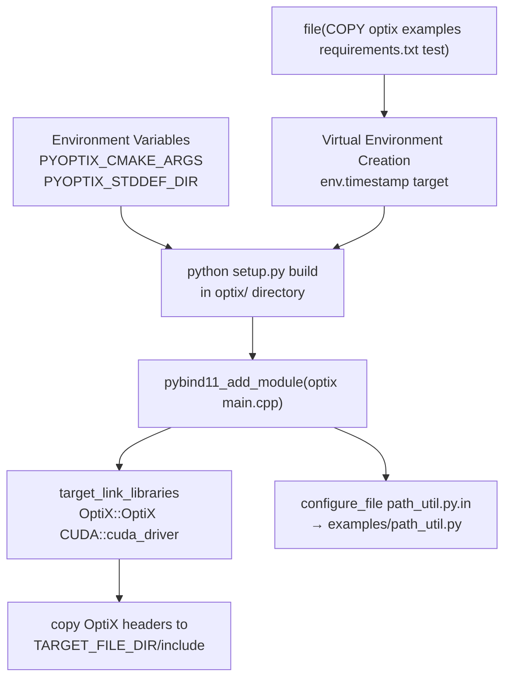

**Sources:** [CMakeLists.txt:36-60](), [optix/CMakeLists.txt:39-61](), [optix/CMakeLists.txt:46-61]()

### Installation Commands

The complete installation process:

1. **Navigate to optix directory:** `cd optix`
2. **Install using pip:** `pip install .`

This triggers the CMake build system, which:
- Fetches pybind11 v2.9.2 from GitHub
- Compiles `main.cpp` with OptiX and CUDA linking
- Generates `path_util.py` with include paths
- Copies OptiX headers to the module directory
- Creates the installable Python module

**Sources:** [README.md:68-72](), [optix/CMakeLists.txt:14-24](), [optix/CMakeLists.txt:56-61]()

## Path Resolution and Include Management

PyOptiX automatically manages include paths for OptiX headers and CUDA toolkit components through a generated configuration file.

### Path Utility Generation

The build system generates `examples/path_util.py` from a template, providing runtime access to SDK paths:

```python
include_path = "${OptiX_INCLUDE_DIR}"
cuda_tk_path = "${CUDAToolkit_INCLUDE_DIRS}" 
stddef_path = "${OptiX_STDDEF_DIR}"
```

This file is generated at build time with actual resolved paths substituted for the CMake variables.

**Sources:** [optix/CMakeLists.txt:39](), [optix/path_util.py.in:1-7]()

### Header Copy Process

The build system copies OptiX headers to the module directory for distribution:

```cmake
add_custom_command(
    TARGET optix POST_BUILD
    COMMAND ${CMAKE_COMMAND} -E copy_directory
    ${OptiX_INCLUDE_DIR}
    $<TARGET_FILE_DIR:optix>/include
)
```

This ensures that the compiled module includes all necessary OptiX headers for proper operation.

**Sources:** [optix/CMakeLists.txt:56-61]()

---

# Page: Your First Ray Tracing Application

# Your First Ray Tracing Application

<details>
<summary>Relevant source files</summary>

The following files were used as context for generating this wiki page:

- [examples/hello.cu](examples/hello.cu)
- [examples/hello.h](examples/hello.h)
- [examples/hello.py](examples/hello.py)

</details>


This document walks through the `hello.py` example to demonstrate fundamental PyOptiX usage patterns and the basic ray tracing pipeline. The example creates a simple colored output without complex geometry, focusing on the essential OptiX setup and execution flow.

For detailed API documentation of the PyOptiX classes used in this example, see [Core API Reference](#3). For information about writing CUDA kernels for OptiX, see [CUDA Kernel Development](#5).

## Hello World Example Overview

The `hello.py` example demonstrates the minimal viable ray tracing application using PyOptiX. Instead of rendering complex geometry, it generates a simple colored pattern by writing pixel values directly in the ray generation program. This approach illustrates all core PyOptiX concepts without the complexity of acceleration structures or geometric primitives.

**Key Components:**
- CUDA kernel compilation using NVRTC
- OptiX device context creation and management
- Module creation from PTX code
- Program group setup for ray generation
- Pipeline linking and configuration
- Shader Binding Table (SBT) construction
- Ray tracing launch and image output

Sources: [examples/hello.py:1-400]()

## PyOptiX Component Architecture

The following diagram shows how the major PyOptiX classes used in `hello.py` relate to each other:

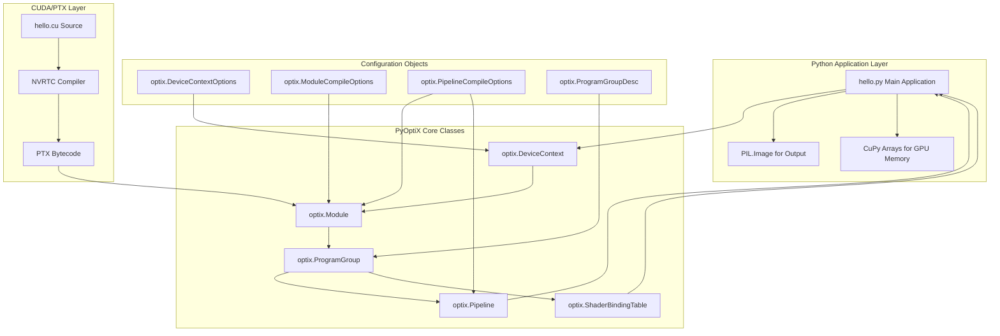

Sources: [examples/hello.py:138-159](), [examples/hello.py:174-213](), [examples/hello.py:216-246](), [examples/hello.py:249-283]()

## Ray Tracing Execution Pipeline

This diagram illustrates the complete execution flow from CUDA compilation to image output:

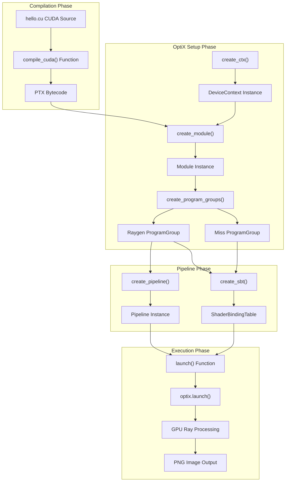

Sources: [examples/hello.py:97-129](), [examples/hello.py:377-396]()

## Core Function Analysis

### Device Context Creation

The `create_ctx()` function establishes the OptiX runtime environment with logging capabilities:

| Component | Purpose | Key Configuration |
|-----------|---------|-------------------|
| `Logger` class | Callback for OptiX messages | Custom callable with message counting |
| `DeviceContextOptions` | Context configuration | Log level 4, validation mode (OptiX 7.2+) |
| `optix.deviceContextCreate()` | Context instantiation | Uses CUDA context 0 |

The function demonstrates PyOptiX's Python-centric approach by using a callable class instance instead of traditional C callback patterns.

Sources: [examples/hello.py:138-159]()

### Module Compilation

The `create_module()` function transforms PTX bytecode into an OptiX module with compile-time optimizations:

| Feature | Implementation | Version Dependency |
|---------|---------------|-------------------|
| Bound Values | Pipeline parameter binding | OptiX 7.2+ |
| Register Count | `COMPILE_DEFAULT_MAX_REGISTER_COUNT` | All versions |
| Optimization Level | `COMPILE_OPTIMIZATION_DEFAULT` | All versions |
| Debug Information | `COMPILE_DEBUG_LEVEL_DEFAULT` | All versions |

The bound values feature allows compile-time constants to be injected into the PTX code for optimization.

Sources: [examples/hello.py:174-213]()

### Program Group Setup

Program groups organize related OptiX programs and define entry points:

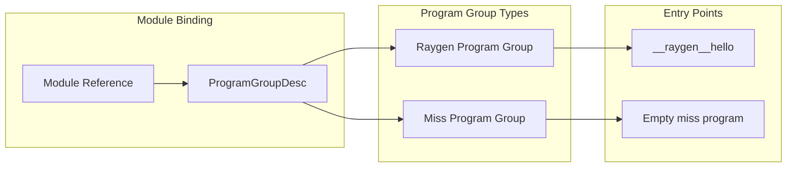

The example creates minimal program groups - a raygen program that writes pixels directly, and an empty miss program that's never called since no rays are traced.

Sources: [examples/hello.py:216-246]()

### Shader Binding Table Construction

The SBT maps program groups to their associated data using carefully aligned memory structures:

| Record Type | Data Structure | Alignment |
|-------------|----------------|-----------|
| Raygen | Header + RGB color values | `SBT_RECORD_ALIGNMENT` |
| Miss | Header + integer placeholder | `SBT_RECORD_ALIGNMENT` |

The `optix.sbtRecordPackHeader()` function populates the OptiX-specific header portion, while user data follows in the same memory allocation.

Sources: [examples/hello.py:286-329]()

### Launch Execution

The `launch()` function orchestrates GPU memory management and ray tracing execution:

1. **Memory Setup**: Creates CuPy device arrays for pixel data
2. **Parameter Packing**: Structures launch parameters with proper alignment
3. **OptiX Launch**: Calls `optix.launch()` with pipeline, SBT, and parameters
4. **Synchronization**: Waits for GPU completion and retrieves results

The launch dimensions (512x512x1) determine the number of GPU threads, with each thread executing the `__raygen__hello` kernel once.

Sources: [examples/hello.py:332-367]()

## CUDA Kernel Implementation

The `hello.cu` kernel demonstrates OptiX's GPU-side API:

| OptiX Function | Purpose | Usage in Example |
|----------------|---------|-------------------|
| `optixGetLaunchIndex()` | Get current thread coordinates | Calculate pixel position |
| `optixGetSbtDataPointer()` | Access SBT record data | Retrieve RGB color values |
| Global `params` | Access launch parameters | Write to image buffer |

The kernel writes colored pixels directly to the output buffer without tracing any rays, making it an ideal first example for understanding the OptiX execution model.

Sources: [examples/hello.cu:38-49](), [examples/hello.h:29-38]()

## Running the Example

To execute the hello world example:

1. **Prerequisites**: Ensure PyOptiX is built and installed per [Installation and Dependencies](#2.1)
2. **Execution**: Run `python examples/hello.py` from the repository root
3. **Output**: The program generates `my.png` (512x512 RGBA image) and displays it

**Expected Behavior:**
- Console output showing OptiX version and setup progress
- Log messages from OptiX operations
- Final message with total log count
- PNG file creation and display

The resulting image demonstrates that the ray tracing pipeline is functioning correctly, even without complex geometry or lighting calculations.

Sources: [examples/hello.py:377-399]()

---

# Page: Core API Reference

# Core API Reference

<details>
<summary>Relevant source files</summary>

The following files were used as context for generating this wiki page:

- [optix/main.cpp](optix/main.cpp)
- [optix/setup.py](optix/setup.py)

</details>


This document provides a comprehensive reference for the PyOptiX Python API, covering all major classes, functions, and enumerations exposed by the Python bindings. PyOptiX wraps the NVIDIA OptiX C API using pybind11 to provide Pythonic access to GPU-accelerated ray tracing capabilities.

For specific implementation details about individual subsystems, see the dedicated pages: [Device Context Management](#3.1), [Modules and Program Groups](#3.2), [Pipeline Creation and Management](#3.3), [Acceleration Structures](#3.4), [Shader Binding Table and Launch](#3.5), and [OptiX Denoiser](#3.6).

## API Architecture Overview

The PyOptiX API follows the OptiX C API structure but provides Python-friendly interfaces through wrapper classes and helper functions. The core architecture centers around five main object types that represent OptiX handles.

### Core Object Model

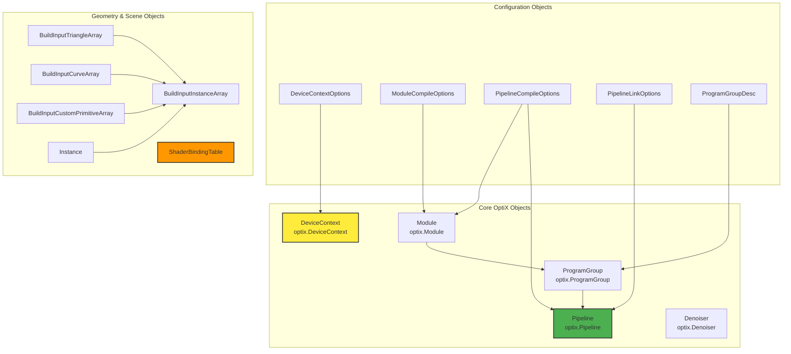

**Sources:** [optix/main.cpp:105-137]()

## Core Classes

### Primary OptiX Handle Wrappers

The PyOptiX API wraps OptiX handles in Python classes that provide automatic resource management and Pythonic interfaces.

| Class | OptiX Handle | Purpose |
|-------|-------------|---------|
| `optix.DeviceContext` | `OptixDeviceContext` | GPU device management and OptiX context |
| `optix.Module` | `OptixModule` | Compiled CUDA/PTX code container |
| `optix.ProgramGroup` | `OptixProgramGroup` | Shader program organization |
| `optix.Pipeline` | `OptixPipeline` | Linked ray tracing pipeline |
| `optix.Denoiser` | `OptixDenoiser` | AI-based image denoising |

**Sources:** [optix/main.cpp:105-137]()

### Configuration and Input Classes

Configuration classes wrap OptiX parameter structures and provide Python-friendly constructors with automatic memory management.

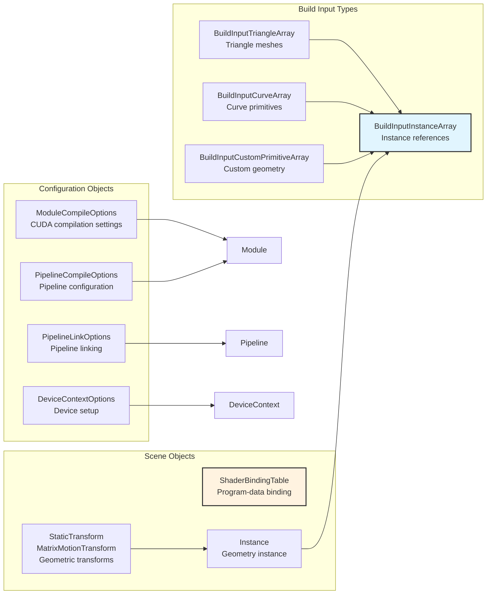

**Sources:** [optix/main.cpp:144-167](), [optix/main.cpp:170-350](), [optix/main.cpp:558-671]()

## Module-Level Functions

PyOptiX exposes OptiX functionality through module-level functions that operate on the core objects.

### Device and Context Management

| Function | Purpose |
|----------|---------|
| `optix.init()` | Initialize OptiX library |
| `optix.version()` | Get OptiX version tuple |
| `optix.deviceContextCreate(context, options)` | Create device context |
| `optix.getErrorName(result)` | Get error name string |
| `optix.getErrorString(result)` | Get error description |

### Module and Program Operations

| Function | Purpose |
|----------|---------|
| `optix.moduleCreate(context, moduleOptions, pipelineOptions, ptx)` | Create module from PTX |
| `optix.programGroupCreate(context, descriptions, options)` | Create program groups |
| `optix.pipelineCreate(context, compileOptions, linkOptions, groups, log)` | Create pipeline |
| `optix.sbtRecordPackHeader(programGroup, record)` | Pack SBT record header |

### Ray Tracing and Acceleration

| Function | Purpose |
|----------|---------|
| `optix.launch(pipeline, stream, params, paramSize, sbt, width, height, depth)` | Launch ray tracing |
| `optix.accelBuild(context, stream, options, inputs, tempBuffer, outputBuffer, properties)` | Build acceleration structure |
| `optix.accelComputeMemoryUsage(context, options, inputs)` | Compute memory requirements |
| `optix.convertPointerToTraversableHandle(device, pointer, type)` | Create traversable handle |

**Sources:** [optix/main.cpp:1070-1073](), [optix/main.cpp:1098-1114](), [optix/main.cpp:1348-1391](), [optix/main.cpp:1450-1542](), [optix/main.cpp:1555-1578](), [optix/main.cpp:1640-1688]()

## Ray Tracing Pipeline Flow

The typical PyOptiX ray tracing workflow follows a structured pipeline from CUDA compilation through final image output.

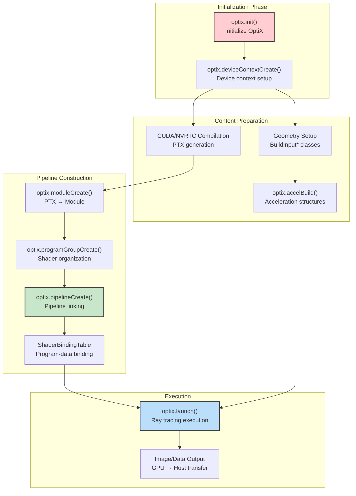

**Sources:** [optix/main.cpp:1070-1073](), [optix/main.cpp:1098-1114](), [optix/main.cpp:1348-1391](), [optix/main.cpp:1450-1542](), [optix/main.cpp:1280-1315](), [optix/main.cpp:1555-1578]()

## Utility Functions

The `optix.util` submodule provides helper functions for stack size computation and pipeline optimization.

### Stack Size Management

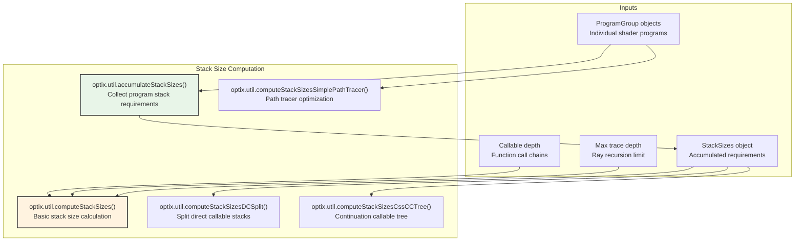

**Sources:** [optix/main.cpp:2101-2114](), [optix/main.cpp:2116-2144](), [optix/main.cpp:2146-2179](), [optix/main.cpp:2183-2211](), [optix/main.cpp:2214-2257]()

## Enumerations and Constants

PyOptiX exposes all OptiX enumerations as Python enums with the same values as the C API.

### Key Enumeration Categories

| Category | Examples |
|----------|----------|
| **Results** | `OPTIX_SUCCESS`, `OPTIX_ERROR_INVALID_VALUE` |
| **Device Properties** | `OPTIX_DEVICE_PROPERTY_LIMIT_MAX_TRACE_DEPTH` |
| **Geometry Types** | `OPTIX_PRIMITIVE_TYPE_TRIANGLE`, `OPTIX_PRIMITIVE_TYPE_ROUND_LINEAR` |
| **Build Flags** | `OPTIX_BUILD_FLAG_ALLOW_COMPACTION`, `OPTIX_BUILD_FLAG_PREFER_FAST_TRACE` |
| **Ray Flags** | `OPTIX_RAY_FLAG_DISABLE_ANYHIT`, `OPTIX_RAY_FLAG_TERMINATE_ON_FIRST_HIT` |
| **Program Groups** | `OPTIX_PROGRAM_GROUP_KIND_RAYGEN`, `OPTIX_PROGRAM_GROUP_KIND_HITGROUP` |

### Important Constants

| Constant | Value | Purpose |
|----------|-------|---------|
| `optix.SBT_RECORD_HEADER_SIZE` | 32 | Size of SBT record headers |
| `optix.SBT_RECORD_ALIGNMENT` | 16 | SBT record alignment requirement |
| `optix.ACCEL_BUFFER_BYTE_ALIGNMENT` | 128 | Acceleration structure alignment |
| `optix.COMPILE_DEFAULT_MAX_REGISTER_COUNT` | 255 | Default register limit |

**Sources:** [optix/main.cpp:2369-2377](), [optix/main.cpp:2385-2734]()

## Error Handling

PyOptiX automatically converts OptiX error codes to Python exceptions using the `PYOPTIX_CHECK` and `PYOPTIX_CHECK_LOG` macros.

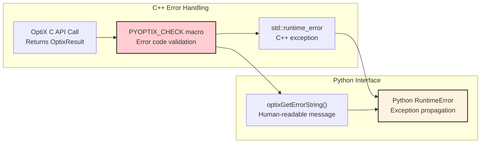

**Sources:** [optix/main.cpp:28-45](), [optix/main.cpp:1084-1096]()

## Version Compatibility

PyOptiX supports multiple OptiX versions through conditional compilation. Version-specific features are enabled using preprocessor macros.

| OptiX Version | Key Features |
|---------------|--------------|
| **7.1+** | Transform formats, primitive type flags, curve primitives |
| **7.2+** | Device context validation, bound values, average color computation |
| **7.3+** | Temporal denoising, denoiser model selection |
| **7.4+** | Payload types, program group options, curve endcap flags |
| **7.7+** | Updated module creation, pipeline-aware stack sizes |

**Sources:** [optix/main.cpp:51-82](), [optix/main.cpp:224-272](), [optix/main.cpp:674-771](), [optix/main.cpp:844-861]()

---

# Page: Device Context Management

# Device Context Management

<details>
<summary>Relevant source files</summary>

The following files were used as context for generating this wiki page:

- [optix/main.cpp](optix/main.cpp)
- [optix/setup.py](optix/setup.py)
- [test/test_module.py](test/test_module.py)
- [test/test_program_group.py](test/test_program_group.py)

</details>


This document covers the creation, configuration, and management of OptiX device contexts in PyOptiX. The device context serves as the primary entry point for OptiX operations and manages GPU resources, compilation caches, and logging functionality.

For information about using device contexts to create modules and pipelines, see [Modules and Program Groups](#3.2) and [Pipeline Creation and Management](#3.3).

## Overview

The `DeviceContext` is the fundamental OptiX object that represents a connection to a CUDA device and manages OptiX resources on that device. All OptiX operations require a valid device context, making it the first object that must be created in any PyOptiX application.

## DeviceContext Class Architecture

The PyOptiX `DeviceContext` wraps the underlying OptiX C API device context while providing Python-specific functionality such as callback handling.

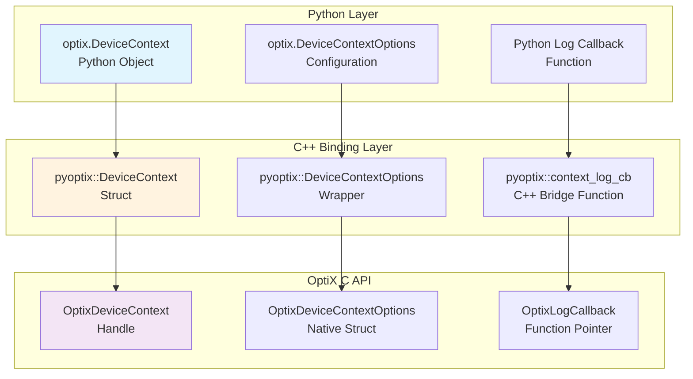

**Sources:** [optix/main.cpp:105-111](), [optix/main.cpp:144-167]()

## Device Context Creation

Device contexts are created using the `deviceContextCreate` function, which takes a CUDA context handle and configuration options.

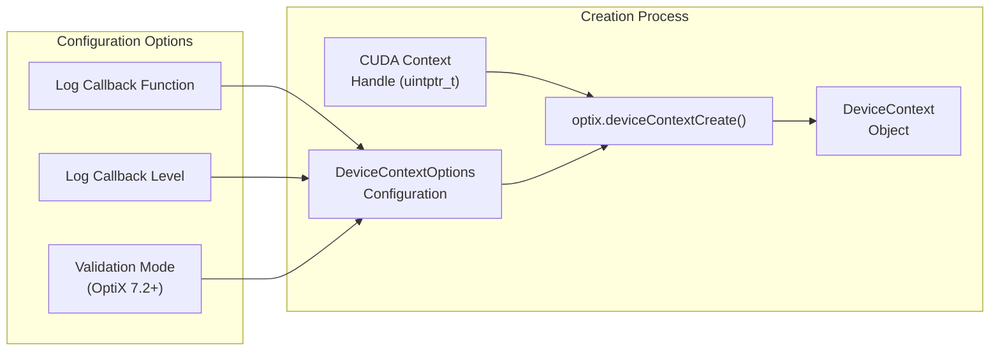

**Sources:** [optix/main.cpp:1098-1114]()

### Basic Creation Example

```python
import optix

# Create device context with default options
ctx = optix.deviceContextCreate(0, optix.DeviceContextOptions())
```

### Creation with Logging

```python
def log_callback(level, tag, message):
    print(f"[{level}] {tag}: {message}")

options = optix.DeviceContextOptions(
    logCallbackFunction=log_callback,
    logCallbackLevel=4  # Maximum verbosity
)
ctx = optix.deviceContextCreate(0, options)
```

**Sources:** [test/test_module.py:123](), [test/test_program_group.py:25]()

## Device Properties and Capabilities

The device context provides access to various device properties and capabilities through the `getProperty` method.

| Property | Type | Description |
|----------|------|-------------|
| `OPTIX_DEVICE_PROPERTY_LIMIT_MAX_TRACE_DEPTH` | uint32_t | Maximum ray trace depth |
| `OPTIX_DEVICE_PROPERTY_LIMIT_MAX_TRAVERSABLE_GRAPH_DEPTH` | uint32_t | Maximum traversable graph depth |
| `OPTIX_DEVICE_PROPERTY_LIMIT_MAX_PRIMITIVES_PER_GAS` | uint32_t | Maximum primitives per GAS |
| `OPTIX_DEVICE_PROPERTY_LIMIT_MAX_INSTANCES_PER_IAS` | uint32_t | Maximum instances per IAS |
| `OPTIX_DEVICE_PROPERTY_RTCORE_VERSION` | uint32_t | RT Core version |

**Sources:** [optix/main.cpp:1127-1163]()

## Logging and Debugging

The device context supports configurable logging through Python callback functions. The logging system bridges OptiX's C API logging to Python functions.

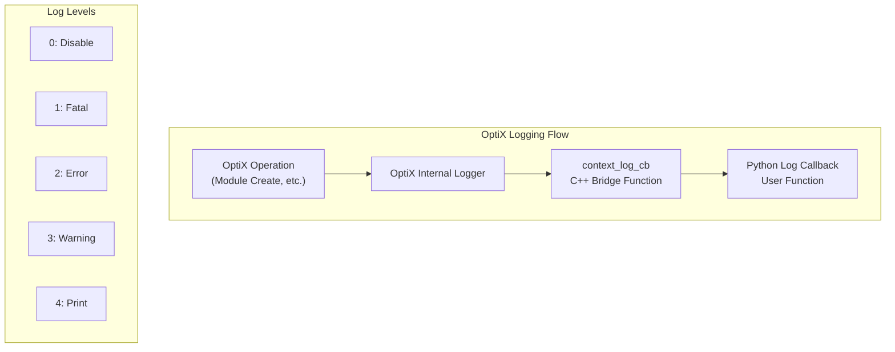

**Sources:** [optix/main.cpp:988-998](), [optix/main.cpp:1165-1188]()

### Logging Configuration

```python
# Set or update log callback after creation
def detailed_log_callback(level, tag, message):
    level_names = {0: "DISABLE", 1: "FATAL", 2: "ERROR", 3: "WARN", 4: "PRINT"}
    print(f"[{level_names.get(level, 'UNKNOWN')}] {tag}: {message}")

ctx.setLogCallback(detailed_log_callback, 4)
```

## Cache Management

OptiX provides compilation caching to improve performance across application runs. The device context manages cache settings and locations.

### Cache Operations

| Operation | Method | Description |
|-----------|--------|-------------|
| Enable/Disable | `setCacheEnabled(bool)` | Enable or disable compilation cache |
| Set Location | `setCacheLocation(path)` | Set cache directory path |
| Set Size Limits | `setCacheDatabaseSizes(low, high)` | Configure cache size watermarks |
| Query Status | `getCacheEnabled()` | Check if cache is enabled |
| Query Location | `getCacheLocation()` | Get current cache directory |
| Query Sizes | `getCacheDatabaseSizes()` | Get cache size limits |

**Sources:** [optix/main.cpp:1190-1276]()

### Cache Configuration Example

```python
# Configure compilation cache
ctx.setCacheEnabled(True)
ctx.setCacheLocation("/tmp/optix_cache")
ctx.setCacheDatabaseSizes(
    lowWaterMark=64 * 1024 * 1024,   # 64 MB
    highWaterMark=128 * 1024 * 1024  # 128 MB
)
```

## DeviceContext Integration with OptiX Pipeline

The device context serves as the factory for creating other OptiX objects and coordinating their lifecycle.

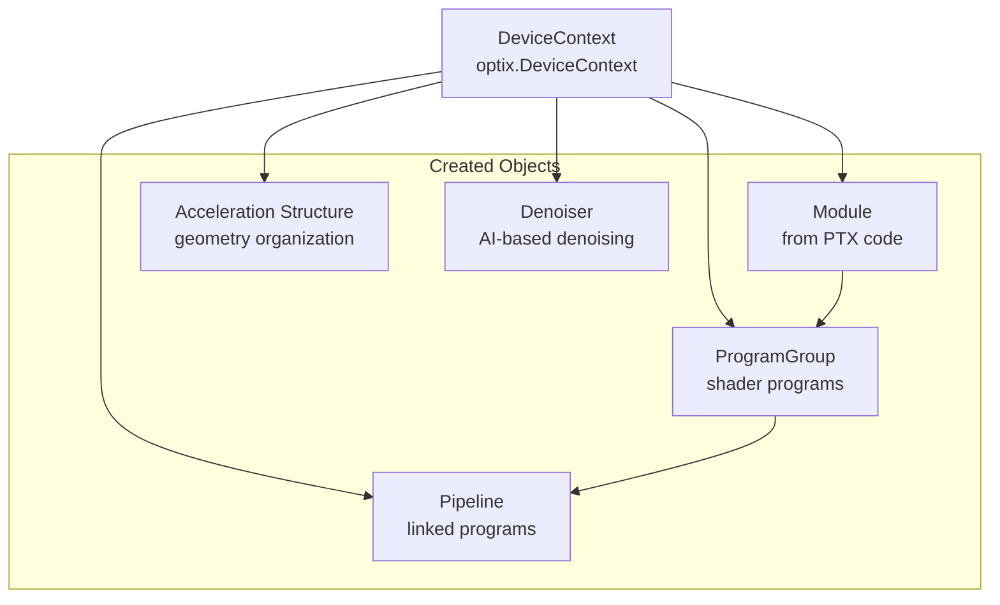

**Sources:** [optix/main.cpp:1348-1391](), [optix/main.cpp:1450-1553]()

## Lifecycle Management

Device contexts must be properly created and destroyed to manage GPU resources correctly.

```mermaid
graph LR
    subgraph "DeviceContext Lifecycle"
        Create["deviceContextCreate()"]
        Configure["Configure Properties<br/>• Logging<br/>• Cache Settings"]
        Use["Create OptiX Objects<br/>• Modules<br/>• Pipelines<br/>• Acceleration Structures"]
        Destroy["destroy()"]
    end
    
    Create --> Configure
    Configure --> Use
    Use --> Destroy
    
    subgraph "Resource Management"
        CudaDevice["CUDA Device"]
        OptiXResources["OptiX GPU Resources"]
        PythonObject["Python DeviceContext"]
    end
    
    Create -.-> CudaDevice
    Create --> OptiXResources
    Create --> PythonObject
    Destroy --> OptiXResources
    Destroy --> PythonObject
```

**Sources:** [optix/main.cpp:1098-1125]()

### Proper Cleanup Pattern

```python
# Always destroy context to free resources
try:
    ctx = optix.deviceContextCreate(0, optix.DeviceContextOptions())
    # ... use context for OptiX operations
finally:
    ctx.destroy()

# Or use RAII-style management
class OptiXContext:
    def __init__(self):
        self.ctx = optix.deviceContextCreate(0, optix.DeviceContextOptions())
    
    def __del__(self):
        if hasattr(self, 'ctx'):
            self.ctx.destroy()
```

**Sources:** [test/test_module.py:142](), [test/test_program_group.py:38]()

---

# Page: Modules and Program Groups

# Modules and Program Groups

<details>
<summary>Relevant source files</summary>

The following files were used as context for generating this wiki page:

- [optix/main.cpp](optix/main.cpp)
- [optix/setup.py](optix/setup.py)
- [test/test_module.py](test/test_module.py)
- [test/test_program_group.py](test/test_program_group.py)

</details>


This document covers the creation and management of OptiX modules and program groups in PyOptiX. Modules encapsulate compiled PTX code and represent the GPU programs, while program groups organize these programs into logical units for ray tracing operations. These components form the foundation of the OptiX ray tracing pipeline, bridging compiled CUDA code to executable ray tracing programs.

For information about pipeline creation using modules and program groups, see [Pipeline Creation and Management](#3.3). For details about compiling CUDA kernels to PTX, see [CUDA Kernel Development](#5).

## OptiX Module and Program Group Architecture

```mermaid
graph TB
    subgraph "CUDA Source Code"
        PTX_CODE["PTX Source Code<br/>Compiled CUDA Kernels"]
    end
    
    subgraph "PyOptiX Module Layer"
        MODULE_OPTS["optix.ModuleCompileOptions<br/>Compilation Settings"]
        MODULE["optix.Module<br/>Encapsulated PTX"]
        BUILTIN_MODULE["optix.BuiltinISModule<br/>Built-in Intersection"]
    end
    
    subgraph "Program Group Organization"
        PG_DESC["optix.ProgramGroupDesc<br/>Program Specifications"]
        RAYGEN_PG["Raygen Program Group<br/>__raygen__ functions"]
        MISS_PG["Miss Program Group<br/>__miss__ functions"] 
        HITGROUP_PG["Hitgroup Program Group<br/>__closesthit__, __anyhit__, __intersection__"]
        CALLABLE_PG["Callable Program Group<br/>__direct_callable__, __continuation_callable__"]
    end
    
    subgraph "Pipeline Integration"
        PIPELINE["optix.Pipeline<br/>Linked Program Groups"]
    end
    
    PTX_CODE --> MODULE_OPTS
    MODULE_OPTS --> MODULE
    MODULE_OPTS --> BUILTIN_MODULE
    
    MODULE --> PG_DESC
    BUILTIN_MODULE --> PG_DESC
    PG_DESC --> RAYGEN_PG
    PG_DESC --> MISS_PG
    PG_DESC --> HITGROUP_PG
    PG_DESC --> CALLABLE_PG
    
    RAYGEN_PG --> PIPELINE
    MISS_PG --> PIPELINE
    HITGROUP_PG --> PIPELINE
    CALLABLE_PG --> PIPELINE
```

Sources: [optix/main.cpp:112-123](), [optix/main.cpp:864-957](), [test/test_module.py:122-143](), [test/test_program_group.py:56-135]()

## Module Creation and Management

OptiX modules are created from compiled PTX code and represent the compiled GPU programs that will execute during ray tracing. The `optix.Module` class wraps the underlying `OptixModule` handle.

### Module Compilation Options

The `optix.ModuleCompileOptions` class controls how PTX code is compiled into OptiX modules:

| Property | Type | Description |
|----------|------|-------------|
| `maxRegisterCount` | `int32_t` | Maximum register count per thread |
| `optLevel` | `OptixCompileOptimizationLevel` | Optimization level |
| `debugLevel` | `OptixCompileDebugLevel` | Debug information level |
| `boundValues` | `list` | Compile-time bound values (OptiX 7.2+) |
| `payloadTypes` | `list` | Payload type specifications (OptiX 7.4+) |

```mermaid
graph LR
    subgraph "Module Compilation Flow"
        PTX["PTX Source"]
        MOD_OPTS["ModuleCompileOptions"]
        PIPE_OPTS["PipelineCompileOptions"] 
        MODULE["optix.Module"]
        LOG["Compilation Log"]
    end
    
    subgraph "C++ Binding Layer"
        MODULE_CREATE["moduleCreate()<br/>optix/main.cpp:1348-1391"]
        OPTIX_API["optixModuleCreate<br/>OptixModuleCreateFromPTX"]
    end
    
    PTX --> MODULE_CREATE
    MOD_OPTS --> MODULE_CREATE
    PIPE_OPTS --> MODULE_CREATE
    MODULE_CREATE --> OPTIX_API
    MODULE_CREATE --> MODULE
    MODULE_CREATE --> LOG
```

Sources: [optix/main.cpp:774-841](), [optix/main.cpp:1348-1391](), [test/test_module.py:52-121]()

### Built-in Intersection Modules

OptiX provides built-in intersection modules for common primitive types, accessible through `optix.BuiltinISModule`:

```mermaid
graph TB
    subgraph "Built-in Module Types"
        TRIANGLE["PRIMITIVE_TYPE_TRIANGLE<br/>Triangle intersection"]
        SPHERE["PRIMITIVE_TYPE_SPHERE<br/>Sphere intersection"] 
        CURVE["PRIMITIVE_TYPE_*_CURVE<br/>Curve intersection"]
    end
    
    subgraph "Creation Process"
        BUILTIN_OPTS["optix.BuiltinISOptions<br/>builtinISModuleType"]
        GET_MODULE["ctx.builtinISModuleGet()<br/>optix/main.cpp:1410-1432"]
        BUILTIN_MODULE["optix.Module<br/>Built-in intersection"]
    end
    
    TRIANGLE --> BUILTIN_OPTS
    SPHERE --> BUILTIN_OPTS  
    CURVE --> BUILTIN_OPTS
    BUILTIN_OPTS --> GET_MODULE
    GET_MODULE --> BUILTIN_MODULE
```

Sources: [optix/main.cpp:845-861](), [optix/main.cpp:1410-1432](), [test/test_module.py:208-224]()

## Program Group Creation and Management

Program groups organize modules and their entry points into logical units for different ray tracing operations. Each program group corresponds to a specific phase of ray tracing execution.

### Program Group Types

OptiX supports five types of program groups:

| Type | Purpose | Entry Functions |
|------|---------|----------------|
| `RAYGEN` | Ray generation | `__raygen__*` |
| `MISS` | Ray miss handling | `__miss__*` |
| `HITGROUP` | Ray-primitive intersection | `__closesthit__*`, `__anyhit__*`, `__intersection__*` |
| `CALLABLES` | Callable programs | `__direct_callable__*`, `__continuation_callable__*` |
| `EXCEPTION` | Exception handling | Exception handlers |

```mermaid
graph TB
    subgraph "Program Group Descriptor"
        PGD["optix.ProgramGroupDesc"]
        KIND["Program Group Kind"]
        MODULE_REF["Module References"]
        ENTRY_NAMES["Entry Function Names"]
    end
    
    subgraph "Program Group Types"
        RAYGEN["Raygen Group<br/>raygenModule<br/>raygenEntryFunctionName"]
        MISS["Miss Group<br/>missModule<br/>missEntryFunctionName"]
        HITGROUP["Hitgroup<br/>hitgroupModuleCH<br/>hitgroupModuleAH<br/>hitgroupModuleIS"]
        CALLABLES["Callables<br/>callablesModuleDC<br/>callablesModuleCC"]
    end
    
    subgraph "Creation Process"
        CREATE_CALL["ctx.programGroupCreate()<br/>optix/main.cpp:1450-1533"]
        PROGRAM_GROUPS["List[optix.ProgramGroup]"]
        CREATE_LOG["Creation Log"]
    end
    
    PGD --> KIND
    PGD --> MODULE_REF
    PGD --> ENTRY_NAMES
    
    KIND --> RAYGEN
    KIND --> MISS
    KIND --> HITGROUP
    KIND --> CALLABLES
    
    PGD --> CREATE_CALL
    CREATE_CALL --> PROGRAM_GROUPS
    CREATE_CALL --> CREATE_LOG
```

Sources: [optix/main.cpp:864-957](), [optix/main.cpp:1450-1533](), [test/test_program_group.py:41-136]()

### Program Group Stack Size Analysis

Program groups provide stack size information necessary for pipeline configuration:

```mermaid
graph LR
    subgraph "Stack Size Components"
        PROG_GROUP["optix.ProgramGroup"]
        STACK_CALL["getStackSize()<br/>optix/main.cpp:1434-1448"]
        STACK_SIZES["optix.StackSizes"]
    end
    
    subgraph "Stack Size Properties"
        CSS_RG["cssRG<br/>Continuation stack size"]
        CSS_MS["cssMS<br/>Miss stack size"] 
        CSS_CH["cssCH<br/>Closest hit stack size"]
        CSS_AH["cssAH<br/>Any hit stack size"]
        CSS_IS["cssIS<br/>Intersection stack size"]
        CSS_CC["cssCC<br/>Callable stack size"]
        DSS_DC["dssDC<br/>Direct callable stack size"]
    end
    
    PROG_GROUP --> STACK_CALL
    STACK_CALL --> STACK_SIZES
    STACK_SIZES --> CSS_RG
    STACK_SIZES --> CSS_MS
    STACK_SIZES --> CSS_CH
    STACK_SIZES --> CSS_AH
    STACK_SIZES --> CSS_IS
    STACK_SIZES --> CSS_CC
    STACK_SIZES --> DSS_DC
```

Sources: [optix/main.cpp:1434-1448](), [optix/main.cpp:647-671](), [test/test_program_group.py:152-159]()

## C++ Binding Architecture

The PyOptiX binding layer translates between Python objects and OptiX C API structures:

```mermaid
graph TB
    subgraph "Python API Layer"
        PY_MODULE["optix.Module"]
        PY_MODULE_OPTS["optix.ModuleCompileOptions"]
        PY_PROG_GROUP["optix.ProgramGroup"]
        PY_PROG_DESC["optix.ProgramGroupDesc"]
    end
    
    subgraph "C++ Wrapper Structs"
        CPP_MODULE["pyoptix::Module<br/>optix/main.cpp:112-117"]
        CPP_MODULE_OPTS["pyoptix::ModuleCompileOptions<br/>optix/main.cpp:774-841"]
        CPP_PROG_GROUP["pyoptix::ProgramGroup<br/>optix/main.cpp:119-123"]
        CPP_PROG_DESC["pyoptix::ProgramGroupDesc<br/>optix/main.cpp:864-957"]
    end
    
    subgraph "OptiX C API"
        OPTIX_MODULE["OptixModule"]
        OPTIX_MODULE_OPTS["OptixModuleCompileOptions"]
        OPTIX_PROG_GROUP["OptixProgramGroup"] 
        OPTIX_PROG_DESC["OptixProgramGroupDesc"]
    end
    
    PY_MODULE --> CPP_MODULE
    PY_MODULE_OPTS --> CPP_MODULE_OPTS
    PY_PROG_GROUP --> CPP_PROG_GROUP
    PY_PROG_DESC --> CPP_PROG_DESC
    
    CPP_MODULE --> OPTIX_MODULE
    CPP_MODULE_OPTS --> OPTIX_MODULE_OPTS
    CPP_PROG_GROUP --> OPTIX_PROG_GROUP
    CPP_PROG_DESC --> OPTIX_PROG_DESC
```

Sources: [optix/main.cpp:112-123](), [optix/main.cpp:774-841](), [optix/main.cpp:864-957]()

## Version-Specific Features

PyOptiX supports features introduced in different OptiX versions:

### OptiX 7.1+ Features
- Built-in intersection modules via `builtinISModuleGet()`
- Primitive type flags in pipeline compile options

### OptiX 7.2+ Features  
- Module compile bound values through `ModuleCompileBoundValueEntry`
- Curve primitive support in build inputs

### OptiX 7.4+ Features
- Payload type semantics through `PayloadType`
- Program group options via `ProgramGroupOptions`

### OptiX 7.7+ Features
- `moduleCreate()` replaces `moduleCreateFromPTX()`
- Pipeline parameter required for `getStackSize()`

```mermaid
graph TB
    subgraph "Version Feature Matrix"
        V70["OptiX 7.0<br/>Basic module/program group support"]
        V71["OptiX 7.1<br/>+ Built-in IS modules<br/>+ Primitive type flags"]
        V72["OptiX 7.2<br/>+ Bound values<br/>+ Curve primitives"]  
        V74["OptiX 7.4<br/>+ Payload semantics<br/>+ Program group options"]
        V77["OptiX 7.7<br/>+ moduleCreate() API<br/>+ Pipeline in getStackSize()"]
    end
    
    V70 --> V71
    V71 --> V72
    V72 --> V74
    V74 --> V77
```

Sources: [optix/main.cpp:51-82](), [test/test_module.py:15-16](), [test/test_program_group.py:16-17](), [test/test_module.py:126-137]()

---

# Page: Pipeline Creation and Management

# Pipeline Creation and Management

<details>
<summary>Relevant source files</summary>

The following files were used as context for generating this wiki page:

- [examples/triangle.py](examples/triangle.py)
- [optix/main.cpp](optix/main.cpp)
- [optix/setup.py](optix/setup.py)

</details>


This document covers the creation, configuration, and management of OptiX ray tracing pipelines in PyOptiX. A pipeline represents the complete ray tracing program that combines multiple program groups (raygen, miss, hit, etc.) into an executable unit on the GPU.

For information about creating and managing program groups that make up the pipeline, see [Modules and Program Groups](#3.2). For details about launching ray tracing operations using pipelines, see [Shader Binding Table and Launch](#3.5).

## Overview

In OptiX, a pipeline combines compiled program groups into a single executable ray tracing program. The pipeline creation process involves specifying compilation options, linking options, and providing the program groups that will be combined. Once created, the pipeline must be configured with appropriate stack sizes and can then be used to launch ray tracing operations.

## Pipeline Components

```mermaid
graph TD
    subgraph "Pipeline Creation"
        PCO["`optix.PipelineCompileOptions`"]
        PLO["`optix.PipelineLinkOptions`"]
        PGS["`Program Groups List`"]
        CTX["`optix.DeviceContext`"]
    end
    
    subgraph "Core Pipeline Object"
        PIPELINE["`optix.Pipeline`"]
        STACK["`Stack Size Configuration`"]
    end
    
    subgraph "Program Group Types"
        RAYGEN["`Raygen Program Group`"]
        MISS["`Miss Program Groups`"]
        HITGROUP["`Hit Group Program Groups`"]
        CALLABLE["`Callable Program Groups`"]
    end
    
    CTX --> PIPELINE
    PCO --> PIPELINE
    PLO --> PIPELINE
    PGS --> PIPELINE
    
    RAYGEN --> PGS
    MISS --> PGS
    HITGROUP --> PGS
    CALLABLE --> PGS
    
    PIPELINE --> STACK
```

Sources: [optix/main.cpp:126-130](), [optix/main.cpp:1280-1315](), [examples/triangle.py:278-314]()

## Pipeline Creation Workflow

The pipeline creation process follows a specific sequence of operations that combine program groups with configuration options:

```mermaid
flowchart TD
    START["`Start Pipeline Creation`"] --> COMPILE_OPTS["`Create PipelineCompileOptions`"]
    COMPILE_OPTS --> LINK_OPTS["`Create PipelineLinkOptions`"]
    LINK_OPTS --> PROG_GROUPS["`Prepare Program Groups List`"]
    PROG_GROUPS --> CREATE["`Call ctx.pipelineCreate()`"]
    
    subgraph "pipelineCreate Function"
        CREATE --> VALIDATE["`Validate Program Groups`"]
        VALIDATE --> OPTIX_CALL["`optixPipelineCreate()`"]
        OPTIX_CALL --> LOG_CHECK["`Check Log Output`"]
        LOG_CHECK --> RETURN_PIPELINE["`Return Pipeline Object`"]
    end
    
    RETURN_PIPELINE --> STACK_CALC["`Calculate Stack Sizes`"]
    STACK_CALC --> SET_STACK["`pipeline.setStackSize()`"]
    SET_STACK --> READY["`Pipeline Ready for Launch`"]
    
    style CREATE fill:#e1f5fe
    style STACK_CALC fill:#f3e5f5
```

Sources: [examples/triangle.py:278-314](), [optix/main.cpp:1280-1315](), [examples/triangle.py:292-312]()

## Pipeline Compile Options

The `optix.PipelineCompileOptions` class controls how the pipeline is compiled and optimized. This configuration affects the entire pipeline's behavior:

| Option | Type | Description |
|--------|------|-------------|
| `usesMotionBlur` | `bool` | Enable motion blur support |
| `traversableGraphFlags` | `uint32_t` | Specify allowed traversable types |
| `numPayloadValues` | `int32_t` | Number of payload values for ray-program communication |
| `numAttributeValues` | `int32_t` | Number of attribute values for primitive intersection |
| `exceptionFlags` | `uint32_t` | Exception handling configuration |
| `pipelineLaunchParamsVariableName` | `str` | Name of launch parameters variable in CUDA code |
| `usesPrimitiveTypeFlags` | `int32_t` | Primitive types used (OptiX 7.1+) |

Example configuration from the triangle example:

```python
pipeline_options = optix.PipelineCompileOptions(
    usesMotionBlur         = False,
    traversableGraphFlags  = int(optix.TRAVERSABLE_GRAPH_FLAG_ALLOW_SINGLE_GAS),
    numPayloadValues       = 3,
    numAttributeValues     = 3,
    exceptionFlags         = int(optix.EXCEPTION_FLAG_NONE),
    pipelineLaunchParamsVariableName = "params",
    usesPrimitiveTypeFlags = optix.PRIMITIVE_TYPE_FLAGS_TRIANGLE
)
```

Sources: [optix/main.cpp:558-592](), [examples/triangle.py:207-226]()

## Pipeline Link Options

The `optix.PipelineLinkOptions` class controls how program groups are linked together into the final pipeline:

| Option | Type | Description |
|--------|------|-------------|
| `maxTraceDepth` | `uint32_t` | Maximum recursion depth for ray tracing calls |
| `debugLevel` | `OptixCompileDebugLevel` | Debug information level (OptiX < 7.7) |

```python
pipeline_link_options = optix.PipelineLinkOptions()
pipeline_link_options.maxTraceDepth = 1
```

Sources: [optix/main.cpp:594-610](), [examples/triangle.py:282-283]()

## Stack Size Management

After pipeline creation, stack sizes must be calculated and configured based on the program groups and expected trace depth:

```mermaid
flowchart TD
    PIPELINE["`Created Pipeline`"] --> COLLECT["`Collect Stack Sizes from Program Groups`"]
    COLLECT --> ACCUMULATE["`optix.util.accumulateStackSizes()`"]
    ACCUMULATE --> COMPUTE["`optix.util.computeStackSizes()`"]
    COMPUTE --> SET["`pipeline.setStackSize()`"]
    
    subgraph "Stack Size Components"
        DC_TRAV["`DC Stack Size from Traversal`"]
        DC_STATE["`DC Stack Size from State`"]
        CC_STACK["`Continuation Call Stack Size`"]
        MAX_DEPTH["`Max Traversable Depth`"]
    end
    
    COMPUTE --> DC_TRAV
    COMPUTE --> DC_STATE
    COMPUTE --> CC_STACK
    SET --> MAX_DEPTH
```

The stack size calculation process:

1. **Accumulate stack sizes** from each program group
2. **Compute optimal stack sizes** based on trace depth and call depth
3. **Set pipeline stack sizes** using the computed values

Example implementation:

```python
stack_sizes = optix.StackSizes()
for prog_group in program_groups:
    if optix_version_gte((7,7)):
        optix.util.accumulateStackSizes(prog_group, stack_sizes, pipeline)
    else: 
        optix.util.accumulateStackSizes(prog_group, stack_sizes)

(dc_stack_size_from_trav, dc_stack_size_from_state, cc_stack_size) = \
    optix.util.computeStackSizes(
        stack_sizes, 
        max_trace_depth,
        0,  # maxCCDepth
        0   # maxDCDepth
    )

pipeline.setStackSize(
    dc_stack_size_from_trav,
    dc_stack_size_from_state, 
    cc_stack_size,
    1  # maxTraversableDepth
)
```

Sources: [examples/triangle.py:292-312](), [optix/main.cpp:1328-1345]()

## Pipeline API Reference

### Pipeline Creation

The `deviceContext.pipelineCreate()` method combines program groups and configuration options:

```python
pipeline = ctx.pipelineCreate(
    pipeline_compile_options,  # PipelineCompileOptions
    pipeline_link_options,     # PipelineLinkOptions  
    program_groups,            # List of ProgramGroup objects
    log_string                 # Output parameter for compilation log
)
```

Sources: [optix/main.cpp:1280-1315]()

### Pipeline Configuration

Key methods for pipeline configuration:

| Method | Parameters | Description |
|--------|------------|-------------|
| `setStackSize()` | `dc_trav`, `dc_state`, `cc_stack`, `max_depth` | Configure stack sizes for ray tracing |

Sources: [optix/main.cpp:1328-1345]()

### Pipeline Lifecycle

```mermaid
stateDiagram-v2
    [*] --> Created: pipelineCreate()
    Created --> Configured: setStackSize()
    Configured --> Ready: Stack sizes set
    Ready --> Launching: optix.launch()
    Launching --> Ready: Launch complete
    Ready --> Destroyed: pipelineDestroy()
    Destroyed --> [*]
    
    note right of Created: Pipeline object exists but not configured
    note right of Configured: Stack sizes calculated and set
    note right of Ready: Ready for ray tracing launches
```

The pipeline lifecycle management:

- **Creation**: Use `deviceContext.pipelineCreate()` with compile options, link options, and program groups
- **Configuration**: Calculate and set appropriate stack sizes using utility functions
- **Usage**: Pipeline can be used repeatedly for ray tracing launches
- **Destruction**: Use `pipelineDestroy()` to clean up resources

Sources: [optix/main.cpp:1280-1315](), [optix/main.cpp:1317-1326](), [examples/triangle.py:278-314]()

---

# Page: Acceleration Structures

# Acceleration Structures

<details>
<summary>Relevant source files</summary>

The following files were used as context for generating this wiki page:

- [examples/sphere.py](examples/sphere.py)
- [examples/triangle.py](examples/triangle.py)
- [optix/main.cpp](optix/main.cpp)
- [optix/setup.py](optix/setup.py)

</details>


Acceleration structures are spatial data structures that enable efficient ray tracing by organizing geometry in a hierarchical manner. This page covers the PyOptiX API for building and managing both Geometry Acceleration Structures (GAS) and Instance Acceleration Structures (IAS), including support for various primitive types, motion blur, and transforms. For information about using acceleration structures during ray tracing execution, see [Shader Binding Table and Launch](#3.5).

## Overview

OptiX supports a two-level acceleration structure hierarchy:

- **Geometry Acceleration Structure (GAS)**: Contains actual geometric primitives (triangles, curves, custom primitives)
- **Instance Acceleration Structure (IAS)**: Contains instances of GAS objects with transforms and other per-instance data

```mermaid
graph TB
    subgraph "Instance Acceleration Structure (IAS)"
        IAS["optix.BuildInputInstanceArray"]
        INST1["Instance 1"]
        INST2["Instance 2"]
        INST3["Instance 3"]
    end
    
    subgraph "Geometry Acceleration Structure 1"
        GAS1["GAS Handle"]
        TRI["optix.BuildInputTriangleArray"]
    end
    
    subgraph "Geometry Acceleration Structure 2"
        GAS2["GAS Handle"]
        CURVE["optix.BuildInputCurveArray"]
    end
    
    subgraph "Geometry Acceleration Structure 3"
        GAS3["GAS Handle"]
        CUSTOM["optix.BuildInputCustomPrimitiveArray"]
    end
    
    IAS --> INST1
    IAS --> INST2 
    IAS --> INST3
    
    INST1 --> GAS1
    INST2 --> GAS2
    INST3 --> GAS3
    
    TRI --> GAS1
    CURVE --> GAS2
    CUSTOM --> GAS3
```

Sources: [optix/main.cpp:314-351](), [examples/triangle.py:166-204](), [examples/sphere.py:183-219]()

## Build Input Types

PyOptiX supports multiple primitive types through specialized build input classes:

### Triangle Arrays

The `BuildInputTriangleArray` class handles standard triangle meshes:

| Property | Type | Description |
|----------|------|-------------|
| `vertexBuffers` | `List[CUdeviceptr]` | Device pointers to vertex data arrays |
| `vertexFormat` | `OptixVertexFormat` | Format of vertex data (e.g., `VERTEX_FORMAT_FLOAT3`) |
| `indexBuffer` | `CUdeviceptr` | Device pointer to index buffer (optional) |
| `flags` | `List[int]` | Per-primitive geometry flags |
| `numSbtRecords` | `int` | Number of shader binding table records |

### Custom Primitive Arrays  

The `BuildInputCustomPrimitiveArray` class handles user-defined primitives using axis-aligned bounding boxes (AABBs):

| Property | Type | Description |
|----------|------|-------------|
| `aabbBuffers` | `List[CUdeviceptr]` | Device pointers to AABB data |
| `numPrimitives` | `int` | Number of primitives |
| `flags` | `List[int]` | Per-primitive geometry flags |

### Curve Arrays (OptiX 7.2+)

The `BuildInputCurveArray` class handles geometric curves:

| Property | Type | Description |
|----------|------|-------------|
| `curveType` | `OptixPrimitiveType` | Type of curve primitive |
| `vertexBuffers` | `List[CUdeviceptr]` | Control point data |
| `widthBuffers` | `List[CUdeviceptr]` | Width data for curves |
| `normalBuffers` | `List[CUdeviceptr]` | Normal data (optional) |

### Instance Arrays

The `BuildInputInstanceArray` class creates instance acceleration structures:

| Property | Type | Description |
|----------|------|-------------|
| `instances` | `CUdeviceptr` | Device pointer to instance data array |
| `instancePointers` | `CUdeviceptr` | Alternative: pointers to instances |
| `numInstances` | `int` | Number of instances |

Sources: [optix/main.cpp:170-351]()

## Build Input Processing Flow

```mermaid
graph LR
    subgraph "Python Layer"
        PY_TRI["BuildInputTriangleArray"]
        PY_CURVE["BuildInputCurveArray"] 
        PY_CUSTOM["BuildInputCustomPrimitiveArray"]
        PY_INST["BuildInputInstanceArray"]
    end
    
    subgraph "C++ Conversion Layer"
        CONVERT["convertBuildInputs()"]
        SYNC["build_input.sync()"]
    end
    
    subgraph "OptiX C API"
        OPTIX_BUILD["OptixBuildInput"]
        ACCEL_BUILD["optixAccelBuild()"]
    end
    
    PY_TRI --> CONVERT
    PY_CURVE --> CONVERT
    PY_CUSTOM --> CONVERT
    PY_INST --> CONVERT
    
    CONVERT --> SYNC
    SYNC --> OPTIX_BUILD
    OPTIX_BUILD --> ACCEL_BUILD
```

Sources: [optix/main.cpp:1001-1052](), [optix/main.cpp:211-216](), [optix/main.cpp:259-264]()

## Building Acceleration Structures

### Memory Usage Calculation

Before building acceleration structures, calculate required memory using `DeviceContext.accelComputeMemoryUsage()`:

```python
accel_options = optix.AccelBuildOptions(
    buildFlags=optix.BUILD_FLAG_ALLOW_RANDOM_VERTEX_ACCESS,
    operation=optix.BUILD_OPERATION_BUILD
)

gas_buffer_sizes = ctx.accelComputeMemoryUsage([accel_options], [triangle_input])
```

### Building Process

The acceleration structure build process requires temporary and output buffers:

```mermaid
graph TD
    INPUT["Build Inputs\n(Triangle/Custom/Curve/Instance)"]
    OPTIONS["AccelBuildOptions\n(buildFlags, operation)"]
    MEMORY["accelComputeMemoryUsage()"]
    TEMP["Temporary Buffer\n(tempSizeInBytes)"]
    OUTPUT["Output Buffer\n(outputSizeInBytes)"]
    BUILD["accelBuild()"]
    HANDLE["Traversable Handle\n(for ray tracing)"]
    
    INPUT --> MEMORY
    OPTIONS --> MEMORY
    MEMORY --> TEMP
    MEMORY --> OUTPUT
    TEMP --> BUILD
    OUTPUT --> BUILD
    INPUT --> BUILD
    OPTIONS --> BUILD
    BUILD --> HANDLE
```

Sources: [examples/triangle.py:188-203](), [examples/sphere.py:203-218]()

## Advanced Features

### Motion Blur Support

PyOptiX supports motion blur through the `MotionOptions` class and motion transforms:

```mermaid
graph LR
    subgraph "Motion Support"
        MOTION_OPT["MotionOptions\n(numKeys, timeBegin, timeEnd)"]
        MATRIX_TRANSFORM["MatrixMotionTransform\n(keyframe matrices)"]
        STATIC_TRANSFORM["StaticTransform\n(single transform)"]
    end
    
    subgraph "Transform Data"
        TRANSFORM_DATA["12-float arrays\n(3x4 matrix)"]
        EXTRA_KEYS["Additional keyframes\n(for motion)"]
    end
    
    MOTION_OPT --> MATRIX_TRANSFORM
    TRANSFORM_DATA --> MATRIX_TRANSFORM
    TRANSFORM_DATA --> STATIC_TRANSFORM
    EXTRA_KEYS --> MATRIX_TRANSFORM
```

### Transform Types

| Class | Purpose | Key Methods |
|-------|---------|-------------|
| `StaticTransform` | Single transform matrix | `setTransform()`, `setInvTransform()`, `getBytes()` |
| `MatrixMotionTransform` | Keyframed motion transforms | `setTransform()`, `getBytes()` |
| `SRTData` | Scale-Rotate-Translate representation | Individual component setters |

Sources: [optix/main.cpp:423-556]()

## Instance Management

### Instance Class

The `Instance` class represents individual instances in an IAS:

| Property | Type | Description |
|----------|------|-------------|
| `transform` | `List[float]` | 3x4 transformation matrix (12 floats) |
| `instanceId` | `uint32_t` | User-defined instance identifier |
| `sbtOffset` | `uint32_t` | Offset into shader binding table |
| `visibilityMask` | `uint32_t` | 8-bit visibility mask |
| `flags` | `uint32_t` | Instance behavior flags |
| `traversableHandle` | `OptixTraversableHandle` | Handle to referenced GAS |

### Build Input Types Flow

```mermaid
graph TD
    subgraph "Build Input Creation"
        CREATE_TRI["triangle_input = optix.BuildInputTriangleArray()"]
        CREATE_CUSTOM["aabb_input = optix.BuildInputCustomPrimitiveArray()"]
        CREATE_CURVE["curve_input = optix.BuildInputCurveArray()"]
        CREATE_INST["inst_input = optix.BuildInputInstanceArray()"]
    end
    
    subgraph "Property Assignment"
        SET_PROPS["Set properties:\nvertexBuffers, flags,\nnumSbtRecords, etc."]
    end
    
    subgraph "Build Process"
        MEMORY_CALC["ctx.accelComputeMemoryUsage()"]
        ALLOC_BUFFERS["Allocate temp/output buffers"]
        ACCEL_BUILD["ctx.accelBuild()"]
    end
    
    CREATE_TRI --> SET_PROPS
    CREATE_CUSTOM --> SET_PROPS
    CREATE_CURVE --> SET_PROPS
    CREATE_INST --> SET_PROPS
    
    SET_PROPS --> MEMORY_CALC
    MEMORY_CALC --> ALLOC_BUFFERS
    ALLOC_BUFFERS --> ACCEL_BUILD
```

Sources: [optix/main.cpp:353-382](), [examples/triangle.py:181-186](), [examples/sphere.py:196-201]()

## Error Handling and Validation

Acceleration structure operations use the `PYOPTIX_CHECK` macro system for error handling. Common validation includes:

- Proper buffer alignment and sizes
- Valid geometry flags combinations  
- Correct primitive counts and offsets
- Transform matrix validation (12-float arrays)

The `sync()` method on build input classes ensures proper pointer synchronization before passing to OptiX C API functions.

Sources: [optix/main.cpp:28-46](), [optix/main.cpp:211-216](), [optix/main.cpp:372-379]()

---

# Page: Shader Binding Table and Launch

# Shader Binding Table and Launch

<details>
<summary>Relevant source files</summary>

The following files were used as context for generating this wiki page:

- [examples/hello.py](examples/hello.py)
- [examples/triangle.py](examples/triangle.py)
- [optix/main.cpp](optix/main.cpp)
- [optix/setup.py](optix/setup.py)

</details>


This document covers the setup and usage of the Shader Binding Table (SBT) and the launch of ray tracing operations in PyOptiX. The SBT connects program groups to their associated data, enabling the OptiX runtime to invoke the correct shaders during ray tracing execution. For information about program groups and pipelines, see [Modules and Program Groups](#3.2) and [Pipeline Creation and Management](#3.3).

## Shader Binding Table Overview

The Shader Binding Table is a GPU memory structure that maps OptiX program groups to their associated data. Each record in the SBT contains a program header (identifying which program to execute) followed by optional user data that the program can access during execution.

## SBT Structure and Record Types

The SBT is organized into separate sections for different program types:

```mermaid
graph TB
    subgraph SBT["Shader Binding Table"]
        RG["Raygen Records<br/>raygenRecord"]
        MISS["Miss Records<br/>missRecordBase + count"]
        HIT["Hitgroup Records<br/>hitgroupRecordBase + count"]  
        CALL["Callable Records<br/>callablesRecordBase + count"]
    end
    
    subgraph Record["SBT Record Structure"]
        HDR["Program Header<br/>(SBT_RECORD_HEADER_SIZE bytes)"]
        DATA["User Data<br/>(optional, variable size)"]
    end
    
    RG --> Record
    MISS --> Record
    HIT --> Record
    CALL --> Record
```

**Sources:** [optix/main.cpp:612-644]()

### SBT Record Structure

Each SBT record follows a standardized layout:

| Component | Size | Description |
|-----------|------|-------------|
| Program Header | `optix.SBT_RECORD_HEADER_SIZE` bytes | OptiX program identifier |
| User Data | Variable | Application-defined data accessible in shaders |

Records must be aligned to `optix.SBT_RECORD_ALIGNMENT` byte boundaries for optimal GPU performance.

**Sources:** [examples/triangle.py:325-383](), [examples/hello.py:292-329]()

## Creating SBT Records

### Record Header Packing

Use `optix.sbtRecordPackHeader()` to populate the program header portion of SBT records:

```python
# Create numpy array for SBT record
header_format = '{}B'.format(optix.SBT_RECORD_HEADER_SIZE)
formats = [header_format, 'f4', 'f4', 'f4']  # header + 3 floats
dtype = np.dtype({
    'names': ['header', 'r', 'g', 'b'],
    'formats': formats,
    'itemsize': aligned_size,
    'align': True
})
h_raygen_sbt = np.array([(0, 0.462, 0.725, 0.0)], dtype=dtype)

# Pack program group header into record
optix.sbtRecordPackHeader(raygen_prog_group, h_raygen_sbt)
```

**Sources:** [examples/hello.py:305-306](), [examples/triangle.py:339]()

### Memory Alignment Considerations

SBT records require proper alignment for GPU access. Use helper functions to calculate aligned sizes:

```python
def get_aligned_itemsize(formats, alignment):
    temp_dtype = np.dtype({
        'names': ['x' + str(i) for i in range(len(formats))],
        'formats': formats,
        'align': True
    })
    return round_up(temp_dtype.itemsize, alignment)
```

**Sources:** [examples/triangle.py:63-73](), [examples/hello.py:66-76]()

## SBT Configuration

### ShaderBindingTable Class

The `optix.ShaderBindingTable` class configures the complete SBT layout:

```mermaid
graph LR
    subgraph SBT_Config["ShaderBindingTable Configuration"]
        RG_PTR["raygenRecord<br/>(CUdeviceptr)"]
        MISS_BASE["missRecordBase<br/>(CUdeviceptr)"]
        MISS_STRIDE["missRecordStrideInBytes"]
        MISS_COUNT["missRecordCount"]
        HIT_BASE["hitgroupRecordBase<br/>(CUdeviceptr)"]
        HIT_STRIDE["hitgroupRecordStrideInBytes"]
        HIT_COUNT["hitgroupRecordCount"]
        EXC_PTR["exceptionRecord<br/>(CUdeviceptr)"]
        CALL_BASE["callablesRecordBase<br/>(CUdeviceptr)"]
        CALL_STRIDE["callablesRecordStrideInBytes"]
        CALL_COUNT["callablesRecordCount"]
    end
```

**Sources:** [optix/main.cpp:612-644]()

### SBT Construction Example

```python
sbt = optix.ShaderBindingTable(
    raygenRecord=d_raygen_sbt.ptr,
    missRecordBase=d_miss_sbt.ptr,
    missRecordStrideInBytes=miss_record_size,
    missRecordCount=1,
    hitgroupRecordBase=d_hitgroup_sbt.ptr,
    hitgroupRecordStrideInBytes=hitgroup_record_size,
    hitgroupRecordCount=1
)
```

**Sources:** [examples/triangle.py:375-383](), [examples/hello.py:324-329]()

## Launch Parameters

Launch parameters are passed to OptiX programs via a GPU memory buffer containing application-defined data structures:

### Parameter Buffer Creation

```python
# Define parameter structure
params_dtype = np.dtype({
    'names': ['image', 'image_width', 'image_height', 'trav_handle'],
    'formats': ['u8', 'u4', 'u4', 'u8'],
    'itemsize': aligned_size,
    'align': True
})

# Create and populate parameter buffer
h_params = np.array([(image_ptr, width, height, handle)], dtype=params_dtype)
d_params = array_to_device_memory(h_params)
```

**Sources:** [examples/triangle.py:415-426](), [examples/hello.py:343-350]()

## Ray Tracing Launch

### Launch Function

The `optix.launch()` function executes the ray tracing pipeline:

```python
optix.launch(
    pipeline,           # OptixPipeline
    stream.ptr,         # CUDA stream
    d_params.ptr,       # Launch parameters buffer
    params_size,        # Parameter buffer size
    sbt,               # Shader Binding Table
    width,             # Launch dimensions X
    height,            # Launch dimensions Y
    depth              # Launch dimensions Z
)
```

**Sources:** [examples/triangle.py:429-438](), [examples/hello.py:353-362]()

### Launch Execution Flow

```mermaid
flowchart TD
    PREP["Launch Preparation"]
    PARAMS["Parameter Buffer<br/>d_params.ptr"]
    SBT_READY["SBT Records<br/>in GPU memory"]
    PIPELINE_READY["Pipeline<br/>optix.Pipeline"]
    
    LAUNCH["optix.launch()<br/>(pipeline, stream, params, sbt, dims)"]
    
    GPU_EXEC["GPU Ray Processing"]
    RT_CORES["RT Cores Execution"]
    
    subgraph PROGRAMS["Program Execution"]
        RAYGEN["Raygen Programs<br/>raygenRecord"]
        MISS["Miss Programs<br/>missRecordBase"]
        HITGROUP["Hitgroup Programs<br/>hitgroupRecordBase"]
    end
    
    OUTPUT["Image Output<br/>Results in GPU memory"]
    
    PREP --> PARAMS
    PREP --> SBT_READY
    PREP --> PIPELINE_READY
    
    PARAMS --> LAUNCH
    SBT_READY --> LAUNCH
    PIPELINE_READY --> LAUNCH
    
    LAUNCH --> GPU_EXEC
    GPU_EXEC --> RT_CORES
    RT_CORES --> PROGRAMS
    
    RAYGEN --> OUTPUT
    MISS --> OUTPUT
    HITGROUP --> OUTPUT
```

**Sources:** [examples/triangle.py:386-443](), [examples/hello.py:332-367](), [optix/main.cpp:1578-1607]()

### CUDA Stream Synchronization

Ray tracing launches are asynchronous. Use CUDA stream synchronization to wait for completion:

```python
stream = cp.cuda.Stream()
optix.launch(pipeline, stream.ptr, d_params.ptr, params_size, sbt, width, height, depth)
stream.synchronize()  # Wait for completion
```

**Sources:** [examples/triangle.py:428-440](), [examples/hello.py:352-364]()

## Code Entity Mapping

The key PyOptiX classes and functions for SBT and launch operations:

```mermaid
graph TB
    subgraph Python_API["PyOptiX Python API"]
        SBT_CLASS["optix.ShaderBindingTable"]
        PACK_FUNC["optix.sbtRecordPackHeader()"]
        LAUNCH_FUNC["optix.launch()"]
        CONSTS["optix.SBT_RECORD_HEADER_SIZE<br/>optix.SBT_RECORD_ALIGNMENT"]
    end
    
    subgraph CPP_Bindings["C++ Binding Layer"]
        SBT_STRUCT["ShaderBindingTable struct<br/>(main.cpp:612-644)"]
        LAUNCH_WRAPPER["launch() wrapper<br/>(main.cpp:1578-1607)"]
    end
    
    subgraph OptiX_API["OptiX C API"]
        OPTIX_LAUNCH["optixLaunch()"]
        SBT_NATIVE["OptixShaderBindingTable"]
    end
    
    SBT_CLASS --> SBT_STRUCT
    PACK_FUNC --> LAUNCH_WRAPPER
    LAUNCH_FUNC --> LAUNCH_WRAPPER
    
    SBT_STRUCT --> SBT_NATIVE
    LAUNCH_WRAPPER --> OPTIX_LAUNCH
```

**Sources:** [optix/main.cpp:612-644](), [optix/main.cpp:1578-1607]()

---

# Page: OptiX Denoiser

# OptiX Denoiser

<details>
<summary>Relevant source files</summary>

The following files were used as context for generating this wiki page:

- [examples/denoiser.py](examples/denoiser.py)
- [optix/main.cpp](optix/main.cpp)
- [optix/setup.py](optix/setup.py)

</details>


This page documents PyOptiX's AI-based image denoising capabilities through the OptiX Denoiser API. The denoiser uses machine learning models to remove noise from ray-traced images, particularly useful for improving image quality when using limited sampling in ray tracing.

For information about ray tracing pipeline setup and launch, see [Shader Binding Table and Launch](#3.5). For acceleration structure creation, see [Acceleration Structures](#3.4).

## Overview

The OptiX Denoiser is NVIDIA's AI-powered image denoising solution integrated into the OptiX ray tracing framework. It can significantly improve the visual quality of ray-traced images by removing Monte Carlo noise while preserving important visual details. The denoiser can operate on color images alone or use additional guide channels (albedo, surface normals) for enhanced quality.

**Denoiser Workflow**
```mermaid
flowchart TD
    INPUT["Noisy Ray-Traced Image<br/>+ Optional Guide Layers"]
    CONTEXT["optix.DeviceContext<br/>deviceContextCreate()"]
    DENOISER_CREATE["optix.Denoiser<br/>denoiserCreate()"]
    MEMORY_CALC["Calculate Memory Requirements<br/>denoiserComputeMemoryResources()"]
    SETUP["Setup Denoiser State<br/>denoiserSetup()"]
    INTENSITY["Compute HDR Intensity<br/>denoiserComputeIntensity()"]
    DENOISE["Denoise Image<br/>denoiserInvoke()"]
    OUTPUT["Clean Denoised Image"]
    
    INPUT --> CONTEXT
    CONTEXT --> DENOISER_CREATE
    DENOISER_CREATE --> MEMORY_CALC
    MEMORY_CALC --> SETUP
    SETUP --> INTENSITY
    INTENSITY --> DENOISE
    DENOISE --> OUTPUT
```

Sources: [optix/main.cpp:1836-2056](), [examples/denoiser.py:244-308]()

## Core Components

### Denoiser Class

The `optix.Denoiser` class wraps the OptiX denoiser functionality and provides methods for memory management, setup, and execution.

| Method | Purpose | Returns |
|--------|---------|---------|
| `computeMemoryResources()` | Calculate required memory sizes | `OptixDenoiserSizes` |
| `setup()` | Initialize denoiser state | `None` |
| `computeIntensity()` | Calculate HDR intensity values | `None` |
| `computeAverageColor()` | Calculate average color (OptiX 7.2+) | `None` |
| `invoke()` | Execute denoising operation | `None` |

### Configuration Structures

**OptixDenoiserOptions**
- `guideAlbedo`: Enable albedo guide layer
- `guideNormal`: Enable normal guide layer

**OptixDenoiserParams**
- `denoiseAlpha`: Process alpha channel
- `hdrIntensity`: HDR intensity pointer
- `hdrAverageColor`: Average color pointer
- `blendFactor`: Blending factor for temporal denoising

**OptixDenoiserLayer**
- `input`: Input noisy image
- `previousOutput`: Previous frame for temporal denoising
- `output`: Output denoised image

**OptixDenoiserGuideLayer**
- `albedo`: Surface albedo guide image
- `normal`: Surface normal guide image
- `flow`: Motion vector guide image

Sources: [optix/main.cpp:132-136](), [examples/denoiser.py:38-40]()

## Denoiser API Reference

**Code Entity Relationships**
```mermaid
graph TB
    DeviceContext["pyoptix::DeviceContext<br/>deviceContext"]
    Denoiser["pyoptix::Denoiser<br/>denoiser"]
    DenoiserOptions["OptixDenoiserOptions<br/>options"]
    DenoiserParams["OptixDenoiserParams<br/>params"]
    DenoiserLayer["OptixDenoiserLayer<br/>layer"]
    GuideLayer["OptixDenoiserGuideLayer<br/>guideLayer"]
    Image2D["OptixImage2D<br/>images"]
    
    DeviceContext --> |"denoiserCreate()"| Denoiser
    DenoiserOptions --> |"used by"| Denoiser
    Denoiser --> |"computeMemoryResources()"| DenoiserSizes["OptixDenoiserSizes<br/>memory requirements"]
    Denoiser --> |"setup()"| StateBuffer["CUdeviceptr<br/>state buffer"]
    Denoiser --> |"computeIntensity()"| IntensityBuffer["CUdeviceptr<br/>intensity buffer"]
    Denoiser --> |"invoke()"| DenoiserParams
    DenoiserParams --> DenoiserLayer
    DenoiserLayer --> Image2D
    GuideLayer --> Image2D
    
    style Denoiser fill:#f9f,stroke:#333,stroke-width:2px
    style DeviceContext fill:#bbf,stroke:#333,stroke-width:2px
```

Sources: [optix/main.cpp:1836-2056]()

### Creating a Denoiser

```python
# OptiX 7.3+ with model kind parameter
denoiser = context.denoiserCreate(
    modelKind=optix.DENOISER_MODEL_KIND_HDR,
    options=optix.DenoiserOptions()
)

# OptiX 7.0-7.2 (model set separately)
denoiser = context.denoiserCreate(options=optix.DenoiserOptions())
```

**Available Model Kinds (OptiX 7.3+):**
- `DENOISER_MODEL_KIND_LDR`: Low Dynamic Range images
- `DENOISER_MODEL_KIND_HDR`: High Dynamic Range images
- `DENOISER_MODEL_KIND_AOV`: Arbitrary Output Variables

Sources: [optix/main.cpp:1835-1869]()

### Memory Management

The denoiser requires GPU memory for internal state and scratch operations:

```python
sizes = denoiser.computeMemoryResources(output_width, output_height)

# Allocate required buffers
state_buffer = cupy.empty(sizes.stateSizeInBytes, dtype='B')
scratch_buffer = cupy.empty(sizes.withoutOverlapScratchSizeInBytes, dtype='B')
intensity_buffer = cupy.empty(1, dtype='f4')
```

**OptixDenoiserSizes Fields:**
- `stateSizeInBytes`: Persistent state memory
- `withoutOverlapScratchSizeInBytes`: Scratch memory for full-image denoising
- `withOverlapScratchSizeInBytes`: Scratch memory for tiled denoising
- `overlapWindowSizeInPixels`: Required overlap for tiling

Sources: [optix/main.cpp:1903-1919](), [examples/denoiser.py:250-264]()

### Setup and Execution

**Denoiser Setup**
```python
denoiser.setup(
    stream=0,  # CUDA stream
    inputWidth=image_width + 2*overlap,
    inputHeight=image_height + 2*overlap,
    denoiserState=state_buffer.data.ptr,
    denoiserStateSizeInBytes=state_buffer.nbytes,
    scratch=scratch_buffer.data.ptr,
    scratchSizeInBytes=scratch_buffer.nbytes
)
```

**HDR Intensity Computation**
```python
denoiser.computeIntensity(
    stream=0,
    inputImage=color_image,
    outputIntensity=intensity_buffer.data.ptr,
    scratch=scratch_buffer.data.ptr,
    scratchSizeInBytes=scratch_buffer.nbytes
)
```

**Denoising Invocation**
```python
params = optix.DenoiserParams()
params.denoiseAlpha = 0
params.hdrIntensity = intensity_buffer.data.ptr
params.blendFactor = 0.0

denoiser.invoke(
    stream=0,
    params=params,
    denoiserState=state_buffer.data.ptr,
    denoiserStateSizeInBytes=state_buffer.nbytes,
    guideLayer=guide_layer,
    layers=[denoiser_layer],
    numLayers=1,
    inputOffsetX=0,
    inputOffsetY=0,
    scratch=scratch_buffer.data.ptr,
    scratchSizeInBytes=scratch_buffer.nbytes
)
```

Sources: [optix/main.cpp:1921-2012](), [examples/denoiser.py:278-308]()

## Image Data Management

**OptiX Image Format**
```mermaid
graph LR
    RawImage["Raw Image Data<br/>NumPy Array"]
    CudaMemory["CUDA Device Memory<br/>CUdeviceptr"]
    OptixImage["OptixImage2D<br/>format struct"]
    
    RawImage --> |"cuda.memcpy()"| CudaMemory
    CudaMemory --> |"create_optix_image_2D()"| OptixImage
    
    OptixImage --> |"Properties"| ImageProps["width: int<br/>height: int<br/>rowStrideInBytes: int<br/>pixelStrideInBytes: int<br/>format: PixelFormat<br/>data: CUdeviceptr"]
```

Sources: [examples/denoiser.py:66-84]()

### Image Creation Helper

The denoiser example provides a helper function for creating OptiX-compatible image structures:

```python
def create_optix_image_2D(w, h, image):
    oi = optix.Image2D()
    byte_size = w * h * 4 * 4  # RGBA, float32
    d_mem = cuda.malloc(byte_size)
    
    if image is not None:
        cuda.memcpy(d_mem, image.ctypes.data, byte_size, cuda.memcpyHostToDevice)
    
    oi.data = d_mem
    oi.width = w
    oi.height = h
    oi.rowStrideInBytes = w * 4 * 4
    oi.pixelStrideInBytes = 4 * 4
    oi.format = optix.PIXEL_FORMAT_FLOAT4
    return oi
```

**Supported Pixel Formats:**
- `PIXEL_FORMAT_FLOAT4`: 4-component 32-bit float (RGBA)
- `PIXEL_FORMAT_FLOAT3`: 3-component 32-bit float (RGB)
- `PIXEL_FORMAT_HALF4`: 4-component 16-bit float
- `PIXEL_FORMAT_HALF3`: 3-component 16-bit float

Sources: [examples/denoiser.py:66-84]()

## Tiled Denoising

For large images that exceed GPU memory capacity, the denoiser supports tiled processing with overlap handling:

**Tiled Denoising Workflow**
```mermaid
flowchart TD
    LargeImage["Large Input Image"]
    TileCalc["Calculate Tile Size<br/>+ Overlap"]
    ProcessTile["Process Individual Tiles<br/>invokeTiled()"]
    Overlap["Handle Overlap Regions<br/>overlapWindowSizeInPixels"]
    Reassemble["Reassemble Final Image"]
    
    LargeImage --> TileCalc
    TileCalc --> ProcessTile
    ProcessTile --> Overlap
    Overlap --> ProcessTile
    ProcessTile --> Reassemble
    
    TileCalc --> ScratchMemory["Larger Scratch Buffer<br/>withOverlapScratchSizeInBytes"]
    ScratchMemory --> ProcessTile
```

Sources: [examples/denoiser.py:295-307]()

## Version Compatibility

The denoiser API has evolved across OptiX versions:

| OptiX Version | Changes |
|---------------|---------|
| 7.0-7.2 | Basic denoiser with separate model setting |
| 7.2+ | Added `denoiserComputeAverageColor()` |
| 7.3+ | Model kind specified at creation time |
| 7.7+ | Enhanced tiling support |

**Version Detection Helper:**
```python
def optix_version_gte(version):
    current = optix.version()
    if current[0] > version[0]:
        return True
    if current[0] == version[0] and current[1] >= version[1]:
        return True
    return False
```

Sources: [optix/main.cpp:51-82](), [examples/denoiser.py:58-64]()

## Complete Example Usage

The denoiser example demonstrates a complete denoising pipeline:

1. **Load input images** (color, albedo, normal)
2. **Create OptiX context** with logging
3. **Initialize denoiser** with appropriate options
4. **Allocate GPU memory** for state and scratch buffers
5. **Compute HDR intensity** for proper exposure handling
6. **Execute denoising** with guide layers
7. **Save denoised result** to output file

The example supports command-line arguments for:
- Input color image (required)
- Optional albedo guide (`-a/--albedo`)
- Optional normal guide (`-n/--normal`)
- Output filename (`-o/--out`)
- Tile size for memory management (`-t/--tilesize`)
- Exposure adjustment (`-e/--exposure`)

Sources: [examples/denoiser.py:1-335]()

---

# Page: Examples and Tutorials

# Examples and Tutorials

<details>
<summary>Relevant source files</summary>

The following files were used as context for generating this wiki page:

- [examples/curves.py](examples/curves.py)
- [examples/hello.py](examples/hello.py)
- [examples/triangle.py](examples/triangle.py)

</details>


This document provides a comprehensive overview of the PyOptiX example applications, demonstrating practical implementations of ray tracing techniques using the PyOptiX Python bindings. The examples progress from basic pipeline setup to advanced rendering features, covering geometry rendering, curve primitives, and specialized OptiX capabilities.

For detailed API documentation of the classes and functions used in these examples, see [Core API Reference](#3). For information about writing custom CUDA kernels for use with these examples, see [CUDA Kernel Development](#5).

## Example Application Architecture

The PyOptiX examples follow a common architectural pattern that demonstrates the complete OptiX ray tracing pipeline. Each example implements the standard workflow from CUDA kernel compilation through final image output.

```mermaid
flowchart TD
    subgraph "Example Application Flow"
        INIT["Example Initialization"]
        COMPILE["CUDA Kernel Compilation<br/>compile_cuda()"]
        CTX["Device Context Creation<br/>create_ctx()"]
        ACCEL["Acceleration Structure<br/>create_accel()"]
        MODULE["Module Creation<br/>create_module()"]
        GROUPS["Program Groups<br/>create_program_groups()"]
        PIPELINE["Pipeline Creation<br/>create_pipeline()"]
        SBT["Shader Binding Table<br/>create_sbt()"]
        LAUNCH["Ray Tracing Launch<br/>launch()"]
        OUTPUT["Image Output<br/>PIL Image.save()"]
    end
    
    INIT --> COMPILE
    COMPILE --> CTX
    CTX --> ACCEL
    ACCEL --> MODULE
    MODULE --> GROUPS
    GROUPS --> PIPELINE
    PIPELINE --> SBT
    SBT --> LAUNCH
    LAUNCH --> OUTPUT
```

Sources: [examples/hello.py:377-399](), [examples/triangle.py:453-471](), [examples/curves.py:443-511]()

## Common Utility Functions

All examples share a set of utility functions that handle low-level operations including CUDA compilation, memory management, and OptiX version compatibility.

```mermaid
graph TB
    subgraph "Shared Utility Functions"
        NVRTC["checkNVRTC()<br/>NVRTC error handling"]
        LOGGER["Logger class<br/>OptiX message logging"]
        COMPILE["compile_cuda()<br/>PTX compilation"]
        MEMORY["array_to_device_memory()<br/>GPU memory transfer"]
        ALIGN["get_aligned_itemsize()<br/>Structure alignment"]
        VERSION["optix_version_gte()<br/>Version compatibility"]
    end
    
    subgraph "External Dependencies"
        NVRTC_LIB["cuda.bindings.nvrtc"]
        CUPY["cupy arrays"]
        NUMPY["numpy dtypes"]
    end
    
    COMPILE --> NVRTC
    COMPILE --> NVRTC_LIB
    MEMORY --> CUPY
    ALIGN --> NUMPY
    VERSION --> LOGGER
```

Sources: [examples/hello.py:32-129](), [examples/triangle.py:29-126](), [examples/curves.py:53-151]()

## Basic Ray Tracing Example

The `hello.py` example demonstrates the minimal PyOptiX pipeline without any geometry, using only raygen and miss shaders to generate procedural output.

| Component | Implementation | Purpose |
|-----------|---------------|---------|
| **Context Creation** | `optix.deviceContextCreate()` | Initialize OptiX device context with logging |
| **Module Creation** | `ctx.moduleCreate()` with PTX | Load compiled CUDA kernels |
| **Program Groups** | `__raygen__hello` shader only | Minimal shader program setup |
| **Pipeline** | Zero trace depth | No ray-geometry intersection |
| **Launch Parameters** | Image buffer and dimensions | Simple parameter passing |

The hello example creates a `optix.DeviceContext` with validation enabled and uses `optix.ModuleCompileBoundValueEntry` for compile-time parameter binding when available.

Sources: [examples/hello.py:138-159](), [examples/hello.py:174-213](), [examples/hello.py:216-246]()

## Triangle Geometry Rendering

The `triangle.py` example demonstrates fundamental geometry rendering with triangle primitives and acceleration structures.

```mermaid
graph TD
    subgraph "Triangle Rendering Pipeline"
        VERTICES["Triangle Vertices<br/>cupy.array float3"]
        GAS_INPUT["BuildInputTriangleArray<br/>VERTEX_FORMAT_FLOAT3"]
        GAS_BUILD["accelBuild()<br/>Triangle GAS"]
        HITGROUP["Hitgroup Program<br/>__closesthit__ch"]
        INTERSECTION["Ray-Triangle Intersection<br/>Built-in OptiX"]
    end
    
    VERTICES --> GAS_INPUT
    GAS_INPUT --> GAS_BUILD
    GAS_BUILD --> INTERSECTION
    HITGROUP --> INTERSECTION
```

The triangle example creates a `optix.BuildInputTriangleArray` with vertex data and builds a Geometry Acceleration Structure (GAS) using `ctx.accelBuild()`. It demonstrates the complete shader pipeline with raygen, miss, and closesthit programs.

Sources: [examples/triangle.py:166-204](), [examples/triangle.py:247-275](), [examples/triangle.py:317-383]()

## Curve Primitive Rendering

The `curves.py` example showcases OptiX's built-in curve primitive support for rendering smooth geometric curves.

```mermaid
graph TB
    subgraph "Curve Rendering Components"
        CONTROL_PTS["Control Points<br/>vertices cupy array"]
        WIDTHS["Curve Widths<br/>widths cupy array"]
        SEGMENTS["Segment Indices<br/>segment_indices array"]
        CURVE_INPUT["BuildInputCurveArray<br/>PRIMITIVE_TYPE_ROUND_CUBIC_BSPLINE"]
        BUILTIN_IS["Built-in Intersection<br/>builtinISModuleGet()"]
        GEOM_MODULE["Geometry Module<br/>Curve intersector"]
    end
    
    CONTROL_PTS --> CURVE_INPUT
    WIDTHS --> CURVE_INPUT
    SEGMENTS --> CURVE_INPUT
    CURVE_INPUT --> BUILTIN_IS
    BUILTIN_IS --> GEOM_MODULE
```

The curves example uses `optix.BuildInputCurveArray` with `PRIMITIVE_TYPE_ROUND_CUBIC_BSPLINE` and leverages `ctx.builtinISModuleGet()` to obtain the built-in intersection module for curve primitives.

Sources: [examples/curves.py:189-242](), [examples/curves.py:258-295](), [examples/curves.py:318-329]()

## Shader Binding Table Structure

All examples implement a Shader Binding Table (SBT) that maps program groups to their associated data. The SBT structure varies based on the complexity of each example.

| Example | Raygen Record | Miss Record | Hitgroup Record |
|---------|---------------|-------------|-----------------|
| **hello.py** | Color data (RGB) | Placeholder data | Not used |
| **triangle.py** | Header only | Background color | Header only |
| **curves.py** | Header only | Background color | Header only |

The SBT records are created using `optix.sbtRecordPackHeader()` and aligned using the utility function `get_aligned_itemsize()` with `optix.SBT_RECORD_ALIGNMENT`.

Sources: [examples/hello.py:286-329](), [examples/triangle.py:317-383](), [examples/curves.py:373-440]()

## Parameter and Launch System

The launch system demonstrates how to pass structured parameters to OptiX kernels using numpy dtypes and CuPy device memory.

```mermaid
graph LR
    subgraph "Launch Parameter Flow"
        PARAMS["Parameter Tuples<br/>(type, name, value)"]
        NUMPY_DTYPE["numpy.dtype<br/>Aligned structure"]
        HOST_ARRAY["Host Parameter Array<br/>h_params"]
        DEVICE_MEM["Device Memory<br/>d_params via CuPy"]
        LAUNCH["optix.launch()<br/>Pipeline execution"]
    end
    
    PARAMS --> NUMPY_DTYPE
    NUMPY_DTYPE --> HOST_ARRAY
    HOST_ARRAY --> DEVICE_MEM
    DEVICE_MEM --> LAUNCH
```

Each example defines camera parameters, image dimensions, and traversal handles as structured parameters passed to the OptiX launch function.

Sources: [examples/hello.py:332-367](), [examples/triangle.py:386-443](), [examples/curves.py:443-502]()

## Version Compatibility Handling

The examples include version-specific code paths to maintain compatibility across different OptiX SDK versions.

| Version Check | Feature | Implementation |
|---------------|---------|----------------|
| `optix_version_gte((7,1))` | stddef.h path | Compilation include path handling |
| `optix_version_gte((7,2))` | Bound values | `ModuleCompileBoundValueEntry` usage |
| `optix_version_gte((7,4))` | Program group options | `ProgramGroupOptions` parameter |
| `optix_version_gte((7,7))` | Stack size calculation | Pipeline parameter for `accumulateStackSizes` |

The version checking is implemented through the `optix_version_gte()` utility function that compares against `optix.version()` tuples.

Sources: [examples/hello.py:79-84](), [examples/triangle.py:76-81](), [examples/curves.py:109-114]()

---

# Page: Basic Geometry Rendering

# Basic Geometry Rendering

<details>
<summary>Relevant source files</summary>

The following files were used as context for generating this wiki page:

- [examples/sphere.cu](examples/sphere.cu)
- [examples/sphere.py](examples/sphere.py)
- [examples/triangle.cu](examples/triangle.cu)
- [examples/triangle.py](examples/triangle.py)

</details>


This page demonstrates how to render basic geometric primitives using PyOptiX, covering both built-in triangle primitives and custom geometric shapes. The examples show the complete ray tracing pipeline setup, from geometry definition to final image output.

For more advanced curve rendering techniques, see [Curve Rendering](#4.2). For complex effects like motion blur, see [Motion Blur and Advanced Effects](#4.3).

## Triangle Rendering Pipeline

The triangle example demonstrates the simplest ray tracing setup using OptiX's built-in triangle primitive support. This approach leverages hardware-accelerated triangle intersection.

### Geometry Setup and Acceleration Structure

Triangle geometry uses `optix.BuildInputTriangleArray` to define vertex data and builds a Geometry Acceleration Structure (GAS) for efficient ray-triangle intersection testing.

```mermaid
flowchart TD
    subgraph "Triangle Setup"
        VERTS["vertices = cp.array([-0.5,-0.5,0.0, 0.5,-0.5,0.0, 0.0,0.5,0.0])"]
        TRI_INPUT["optix.BuildInputTriangleArray()"]
        TRI_FLAGS["triangle_input_flags = [GEOMETRY_FLAG_NONE]"]
    end
    
    subgraph "Acceleration Structure"
        ACCEL_OPTIONS["optix.AccelBuildOptions(BUILD_FLAG_ALLOW_RANDOM_VERTEX_ACCESS)"]
        GAS_SIZES["ctx.accelComputeMemoryUsage()"]
        GAS_BUILD["ctx.accelBuild()"]
    end
    
    subgraph "Pipeline Configuration"
        PIPELINE_OPT["optix.PipelineCompileOptions(usesPrimitiveTypeFlags = PRIMITIVE_TYPE_FLAGS_TRIANGLE)"]
        MODULE_CREATE["ctx.moduleCreate(triangle_ptx)"]
        PROG_GROUPS["raygen, miss, hitgroup programs"]
    end
    
    VERTS --> TRI_INPUT
    TRI_FLAGS --> TRI_INPUT
    TRI_INPUT --> ACCEL_OPTIONS
    ACCEL_OPTIONS --> GAS_SIZES
    GAS_SIZES --> GAS_BUILD
    
    GAS_BUILD --> PIPELINE_OPT
    PIPELINE_OPT --> MODULE_CREATE
    MODULE_CREATE --> PROG_GROUPS
```

Sources: [examples/triangle.py:166-204](), [examples/triangle.py:207-226]()

The triangle setup creates vertex data as a CuPy array and configures the acceleration structure build options to allow random vertex access. The key components include:

| Component | Configuration | Purpose |
|-----------|---------------|---------|
| `vertexFormat` | `optix.VERTEX_FORMAT_FLOAT3` | Specifies 3D float vertex format |
| `buildFlags` | `optix.BUILD_FLAG_ALLOW_RANDOM_VERTEX_ACCESS` | Enables vertex data access in shaders |
| `usesPrimitiveTypeFlags` | `optix.PRIMITIVE_TYPE_FLAGS_TRIANGLE` | Pipeline optimized for triangles |

### CUDA Kernel Implementation

The triangle example uses OptiX's built-in triangle intersection, requiring only raygen, miss, and closest-hit programs.

```mermaid
graph LR
    subgraph "CUDA Programs"
        RAYGEN["__raygen__rg()"]
        MISS["__miss__ms()"] 
        CLOSESTHIT["__closesthit__ch()"]
    end
    
    subgraph "Built-in Functions"
        TRI_INTERSECT["optixTrace() → Built-in Triangle Intersection"]
        BARYCENTRICS["optixGetTriangleBarycentrics()"]
    end
    
    subgraph "Shader Data"
        MISS_DATA["MissData{r,g,b}"]
        HIT_DATA["HitGroup{header}"]
    end
    
    RAYGEN --> TRI_INTERSECT
    TRI_INTERSECT --> MISS
    TRI_INTERSECT --> CLOSESTHIT
    CLOSESTHIT --> BARYCENTRICS
    MISS --> MISS_DATA
    CLOSESTHIT --> HIT_DATA
```

Sources: [examples/triangle.cu:64-97](), [examples/triangle.cu:100-114]()

The closest-hit shader for triangles uses `optixGetTriangleBarycentrics()` to obtain intersection coordinates, which are then converted to color values for visualization.

## Sphere Rendering with Custom Primitives

The sphere example demonstrates custom primitive rendering using Axis-Aligned Bounding Boxes (AABB) and custom intersection shaders. This approach is necessary for non-triangle geometry.

### Custom Primitive Setup

Sphere geometry requires `optix.BuildInputCustomPrimitiveArray` with AABB data to define the primitive's bounds, plus a custom intersection shader to compute ray-sphere intersections.

```mermaid
flowchart TD
    subgraph "Sphere Setup"
        AABB["aabb = cp.array([-1.5,-1.5,-1.5, 1.5,1.5,1.5])"]
        CUSTOM_INPUT["optix.BuildInputCustomPrimitiveArray()"]
        CUSTOM_FLAGS["aabb_input_flags = [GEOMETRY_FLAG_NONE]"]
    end
    
    subgraph "Custom Intersection"
        INTERSECT_SHADER["__intersection__sphere()"]
        SPHERE_MATH["ray-sphere intersection calculation"]
        REPORT_HIT["optixReportIntersection()"]
    end
    
    subgraph "Pipeline Configuration" 
        CUSTOM_PIPELINE["optix.PipelineCompileOptions(usesPrimitiveTypeFlags = PRIMITIVE_TYPE_FLAGS_CUSTOM)"]
        HITGROUP_IS["hitgroupModuleIS + hitgroupEntryFunctionNameIS"]
    end
    
    AABB --> CUSTOM_INPUT
    CUSTOM_FLAGS --> CUSTOM_INPUT
    CUSTOM_INPUT --> CUSTOM_PIPELINE
    CUSTOM_PIPELINE --> HITGROUP_IS
    HITGROUP_IS --> INTERSECT_SHADER
    INTERSECT_SHADER --> SPHERE_MATH
    SPHERE_MATH --> REPORT_HIT
```

Sources: [examples/sphere.py:183-220](), [examples/sphere.py:222-241]()

The sphere setup differs from triangles in several key ways:

| Aspect | Triangle | Sphere |
|--------|----------|--------|
| Input Type | `BuildInputTriangleArray` | `BuildInputCustomPrimitiveArray` |
| Primitive Data | Vertex coordinates | AABB bounds |
| Intersection | Built-in hardware | Custom shader |
| Pipeline Flags | `PRIMITIVE_TYPE_FLAGS_TRIANGLE` | `PRIMITIVE_TYPE_FLAGS_CUSTOM` |

### Custom Intersection Shader

The sphere intersection shader implements analytical ray-sphere intersection using quadratic formula solving.

```mermaid
graph TD
    subgraph "Intersection Calculation"
        RAY_DATA["optixGetWorldRayOrigin(), optixGetWorldRayDirection()"]
        SPHERE_DATA["SphereHitGroupData{center_x, center_y, center_z, radius}"]
        QUAD_SOLVE["Quadratic formula: b² - c > 0"]
    end
    
    subgraph "Hit Reporting"
        HIT_TEST["t > ray_tmin && t < ray_tmax"]
        NORMAL_CALC["normal = (intersection_point - center) / radius"]
        REPORT["optixReportIntersection(t, 0, normal_as_ints, radius)"]
    end
    
    subgraph "Refinement"
        PRECISION_CHECK["fabsf(root1) > 10.0f * radius"]
        REFINE["Refine intersection for numerical stability"]
    end
    
    RAY_DATA --> QUAD_SOLVE
    SPHERE_DATA --> QUAD_SOLVE
    QUAD_SOLVE --> HIT_TEST
    HIT_TEST --> NORMAL_CALC
    NORMAL_CALC --> REPORT
    QUAD_SOLVE --> PRECISION_CHECK
    PRECISION_CHECK --> REFINE
    REFINE --> HIT_TEST
```

Sources: [examples/sphere.cu:143-205]()

The intersection shader performs several critical operations:
- Transforms ray to sphere's local coordinate system
- Solves quadratic equation for intersection points  
- Applies numerical refinement for improved precision
- Reports valid intersections with surface normals

## Program Group Configuration

Both examples require different program group configurations based on their intersection requirements.

```mermaid
graph TB
    subgraph "Triangle Program Groups"
        TRI_RAYGEN["raygen: __raygen__rg"]
        TRI_MISS["miss: __miss__ms"] 
        TRI_HIT["hitgroup: {closesthit: __closesthit__ch}"]
    end
    
    subgraph "Sphere Program Groups"
        SPH_RAYGEN["raygen: __raygen__rg"]
        SPH_MISS["miss: __miss__ms"]
        SPH_HIT["hitgroup: {closesthit: __closesthit__ch, intersection: __intersection__sphere}"]
    end
    
    subgraph "Key Differences"
        DIFF["Sphere hitgroup includes intersection shader"]
        IS_REQ["Custom primitives require intersection program"]
    end
    
    TRI_HIT --> DIFF
    SPH_HIT --> DIFF
    SPH_HIT --> IS_REQ
```

Sources: [examples/triangle.py:247-275](), [examples/sphere.py:262-291]()

The sphere hitgroup requires both closest-hit and intersection shader specification via `hitgroupModuleIS` and `hitgroupEntryFunctionNameIS`, while triangles only need the closest-hit shader.

## Shader Binding Table Differences

The SBT records contain different data structures for each primitive type to support their respective shader requirements.

### Triangle SBT Records

| Record Type | Data Fields | Purpose |
|-------------|-------------|---------|
| Raygen | `header` only | Camera parameters stored in launch params |
| Miss | `header, r, g, b` | Background color data |
| Hitgroup | `header` only | No additional data needed |

### Sphere SBT Records  

| Record Type | Data Fields | Purpose |
|-------------|-------------|---------|
| Raygen | `header, eye_x/y/z, u_x/y/z, v_x/y/z, w_x/y/z` | Camera data in SBT |
| Miss | `header, r, g, b` | Background color data |
| Hitgroup | `header, center_x/y/z, radius` | Sphere geometry parameters |

Sources: [examples/triangle.py:317-383](), [examples/sphere.py:333-407]()

The sphere example stores camera parameters in the raygen SBT record and sphere geometry in the hitgroup record, while the triangle example uses launch parameters for camera data and minimal hitgroup data.

## Common Launch Pipeline

Both examples follow the same high-level launch sequence despite their implementation differences.

```mermaid
sequenceDiagram
    participant Main as "main()"
    participant Compile as "compile_cuda()"
    participant Setup as "OptiX Setup Functions"
    participant Launch as "optix.launch()"
    participant GPU as "GPU Execution"
    
    Main->>Compile: triangle.cu or sphere.cu
    Compile->>Setup: PTX bytecode
    Setup->>Setup: create_ctx(), create_accel(), create_module()
    Setup->>Setup: create_program_groups(), create_pipeline()
    Setup->>Setup: create_sbt()
    Setup->>Launch: pipeline, sbt, gas_handle
    Launch->>GPU: Execute ray tracing
    GPU->>Main: Rendered image buffer
```

Sources: [examples/triangle.py:453-475](), [examples/sphere.py:466-487]()

Both examples produce 1024×768 RGBA images saved as PNG files, demonstrating successful ray tracing execution with their respective primitive types.

---

# Page: Curve Rendering

# Curve Rendering

<details>
<summary>Relevant source files</summary>

The following files were used as context for generating this wiki page:

- [examples/curves.cu](examples/curves.cu)
- [examples/curves.h](examples/curves.h)
- [examples/curves.py](examples/curves.py)

</details>


This document covers PyOptiX's advanced curve rendering capabilities, demonstrating how to render geometric curves using OptiX's built-in curve primitives and intersection acceleration. This example showcases OptiX's native support for cubic B-spline curves with hardware-accelerated intersection testing.

For information about basic geometry rendering with triangles and spheres, see [Basic Geometry Rendering](#4.1). For advanced motion blur effects, see [Motion Blur and Advanced Effects](#4.3).

## System Overview

The curve rendering system demonstrates OptiX's built-in curve primitive support, which provides hardware-accelerated intersection testing for cubic B-spline curves. The system consists of curve geometry definition, built-in intersection modules, and specialized shader programs that utilize curve parameters.

```mermaid
graph TD
    subgraph "Curve Geometry Setup"
        VERTICES["vertices (CuPy array)"]
        WIDTHS["widths (CuPy array)"] 
        INDICES["segment_indices (CuPy array)"]
        CURVE_INPUT["optix.BuildInputCurveArray"]
    end
    
    subgraph "OptiX Built-in System"
        BUILTIN_IS["optix.BuiltinISOptions"]
        GEOMETRY_MODULE["geometry_module"]
        BSPLINE_TYPE["PRIMITIVE_TYPE_ROUND_CUBIC_BSPLINE"]
    end
    
    subgraph "Shader Programs"
        RAYGEN["__raygen__rg"]
        MISS["__miss__ms"]  
        CLOSESTHIT["__closesthit__ch"]
        CURVE_PARAM["optixGetCurveParameter()"]
    end
    
    subgraph "Acceleration Structure"
        GAS["Gas Handle"]
        ACCEL_BUILD["device_context.accelBuild"]
    end
    
    VERTICES --> CURVE_INPUT
    WIDTHS --> CURVE_INPUT
    INDICES --> CURVE_INPUT
    CURVE_INPUT --> ACCEL_BUILD
    
    BUILTIN_IS --> GEOMETRY_MODULE
    BSPLINE_TYPE --> BUILTIN_IS
    
    GEOMETRY_MODULE --> GAS
    ACCEL_BUILD --> GAS
    
    GAS --> RAYGEN
    RAYGEN --> CLOSESTHIT
    CLOSESTHIT --> CURVE_PARAM
    
    style CURVE_INPUT fill:#f9f9f9,stroke:#333,stroke-width:2px
    style GEOMETRY_MODULE fill:#f9f9f9,stroke:#333,stroke-width:2px
    style CURVE_PARAM fill:#f9f9f9,stroke:#333,stroke-width:2px
```

Sources: [examples/curves.py:189-242](), [examples/curves.cu:107-116]()

## Curve Geometry Definition

The curve rendering system defines curve geometry using control points, width values, and segment indices. OptiX supports cubic B-spline curves with varying radii along the curve length.

### Curve Data Structures

| Component | Type | Purpose |
|-----------|------|---------|
| `vertices` | `cupy.array` (float32) | Control points for B-spline curve in 3D space |
| `widths` | `cupy.array` (float32) | Radius values at each control point |
| `segment_indices` | `cupy.array` (int32) | Indices defining curve segments |

```mermaid
graph LR
    subgraph "Curve Definition"
        CP1["Control Point 1<br/>(-1.5, -3.5, 0.0)"]
        CP2["Control Point 2<br/>(-1.0, 0.5, 0.0)"]
        CP3["Control Point 3<br/>(1.0, 0.5, 0.0)"]
        CP4["Control Point 4<br/>(1.5, -3.5, 0.0)"]
    end
    
    subgraph "Width Values"
        W1["width[0] = 0.01"]
        W2["width[1] = 0.4"]  
        W3["width[2] = 0.4"]
        W4["width[3] = 0.01"]
    end
    
    subgraph "BuildInputCurveArray"
        CURVE_ARRAY["curve_input<br/>numVertices = 4<br/>numPrimitives = 1<br/>curveType = ROUND_CUBIC_BSPLINE"]
    end
    
    CP1 --> CURVE_ARRAY
    CP2 --> CURVE_ARRAY
    CP3 --> CURVE_ARRAY
    CP4 --> CURVE_ARRAY
    
    W1 --> CURVE_ARRAY
    W2 --> CURVE_ARRAY
    W3 --> CURVE_ARRAY
    W4 --> CURVE_ARRAY
    
    style CURVE_ARRAY fill:#f9f9f9,stroke:#333,stroke-width:2px
```

The curve geometry is set up with four control points creating a smooth B-spline curve that varies in width from thin endpoints (0.01) to thick middle sections (0.4).

Sources: [examples/curves.py:195-223]()

## OptiX Built-in Curve Intersection

OptiX provides built-in intersection acceleration for curve primitives, eliminating the need for custom intersection shaders. The system uses OptiX's geometry module for hardware-accelerated curve-ray intersection testing.

### Built-in Intersection Module Setup

```mermaid
graph TD
    subgraph "Module Configuration"
        MODULE_OPTIONS["optix.ModuleCompileOptions"]
        PIPELINE_OPTIONS["optix.PipelineCompileOptions"]
        INTERSECTOR_OPTIONS["optix.BuiltinISOptions"]
    end
    
    subgraph "Built-in Module Creation"
        BUILTIN_TYPE["builtinISModuleType =<br/>PRIMITIVE_TYPE_ROUND_CUBIC_BSPLINE"]
        GEOMETRY_MODULE["device_context.builtinISModuleGet()"]
        MOTION_BLUR["usesMotionBlur = False"]
    end
    
    subgraph "Program Group Setup"
        HITGROUP_DESC["hitgroup_prog_group_desc"]
        HITGROUP_IS["hitgroupModuleIS = geometry_module"]
        HITGROUP_ENTRY["hitgroupEntryFunctionNameIS = ''"]
    end
    
    MODULE_OPTIONS --> GEOMETRY_MODULE
    PIPELINE_OPTIONS --> GEOMETRY_MODULE
    INTERSECTOR_OPTIONS --> GEOMETRY_MODULE
    
    BUILTIN_TYPE --> INTERSECTOR_OPTIONS
    MOTION_BLUR --> INTERSECTOR_OPTIONS
    
    GEOMETRY_MODULE --> HITGROUP_IS
    HITGROUP_IS --> HITGROUP_DESC
    HITGROUP_ENTRY --> HITGROUP_DESC
    
    style GEOMETRY_MODULE fill:#f9f9f9,stroke:#333,stroke-width:2px
    style HITGROUP_DESC fill:#f9f9f9,stroke:#333,stroke-width:2px
```

The built-in intersection module requires no custom entry function name since OptiX provides the intersection logic internally. The `hitgroupEntryFunctionNameIS` is set to an empty string.

Sources: [examples/curves.py:267-291](), [examples/curves.py:318-325]()

## Shader Programs and Curve Parameters

The curve rendering system uses standard OptiX shader programs with special curve parameter access. The closest hit shader receives curve parameter `u` from OptiX's built-in intersection system.

### Curve Parameter Usage

```mermaid
graph TD
    subgraph "Ray Generation"
        RAYGEN_FUNC["__raygen__rg()"]
        RAY_TRACE["optixTrace()"]
        PAYLOAD_RETRIEVE["p0, p1, p2 payload values"]
    end
    
    subgraph "Closest Hit Processing"
        CLOSESTHIT_FUNC["__closesthit__ch()"]
        CURVE_U_PARAM["optixGetCurveParameter()"]
        COLOR_INTERP["Linear interpolation<br/>u → (u, u/3, 0)"]
        PAYLOAD_SET["setPayload(color)"]
    end
    
    subgraph "Miss Shader"
        MISS_FUNC["__miss__ms()"]
        BG_COLOR["Background: (0.0, 0.2, 0.6)"]
    end
    
    RAYGEN_FUNC --> RAY_TRACE
    RAY_TRACE --> CLOSESTHIT_FUNC
    RAY_TRACE --> MISS_FUNC
    
    CLOSESTHIT_FUNC --> CURVE_U_PARAM
    CURVE_U_PARAM --> COLOR_INTERP
    COLOR_INTERP --> PAYLOAD_SET
    PAYLOAD_SET --> PAYLOAD_RETRIEVE
    
    MISS_FUNC --> BG_COLOR
    BG_COLOR --> PAYLOAD_RETRIEVE
    
    style CURVE_U_PARAM fill:#f9f9f9,stroke:#333,stroke-width:2px
    style COLOR_INTERP fill:#f9f9f9,stroke:#333,stroke-width:2px
```

The curve parameter `u` ranges from 0.0 to 1.0 along the curve segment, enabling parametric shading effects. The example uses linear interpolation to create a gradient from black to orange along the curve.

Sources: [examples/curves.cu:107-116](), [examples/curves.cu:100-104](), [examples/curves.cu:64-97]()

## Pipeline Configuration

The curve rendering pipeline requires specific configuration to enable curve primitive support and built-in intersection functionality.

### Pipeline Compile Options

| Option | Value | Purpose |
|--------|--------|---------|
| `usesPrimitiveTypeFlags` | `PRIMITIVE_TYPE_FLAGS_ROUND_CUBIC_BSPLINE` | Enable curve primitive support |
| `traversableGraphFlags` | `TRAVERSABLE_GRAPH_FLAG_ALLOW_SINGLE_GAS` | Allow single-level geometry |
| `numPayloadValues` | 3 | RGB color payload |
| `numAttributeValues` | 1 | Curve parameter attribute |

Sources: [examples/curves.py:245-254]()

## Complete Curve Rendering Workflow

```mermaid
flowchart TD
    subgraph "Initialization"
        CTX_CREATE["create_ctx()<br/>DeviceContext"]
        CURVE_DATA["Curve geometry setup<br/>vertices, widths, indices"]
        ACCEL_CREATE["create_accel()<br/>BuildInputCurveArray"]
    end
    
    subgraph "Module Setup"  
        BUILTIN_MODULE["Built-in IS module<br/>ROUND_CUBIC_BSPLINE"]
        SHADING_MODULE["Shading module<br/>from curves.cu PTX"]
        PROGRAM_GROUPS["Program groups<br/>raygen, miss, hitgroup"]
    end
    
    subgraph "Pipeline Creation"
        PIPELINE_CREATE["create_pipeline()<br/>Link program groups"]
        SBT_CREATE["create_sbt()<br/>Shader binding table"]
        STACK_SIZE["Stack size calculation"]
    end
    
    subgraph "Rendering"
        LAUNCH_PARAMS["Launch parameters<br/>camera, image buffer"]
        OPTIX_LAUNCH["optix.launch()<br/>Ray tracing execution"]
        IMAGE_OUTPUT["Image output<br/>PIL save"]
    end
    
    CTX_CREATE --> CURVE_DATA
    CURVE_DATA --> ACCEL_CREATE
    ACCEL_CREATE --> BUILTIN_MODULE
    
    BUILTIN_MODULE --> PROGRAM_GROUPS
    SHADING_MODULE --> PROGRAM_GROUPS
    PROGRAM_GROUPS --> PIPELINE_CREATE
    
    PIPELINE_CREATE --> SBT_CREATE
    SBT_CREATE --> STACK_SIZE
    STACK_SIZE --> LAUNCH_PARAMS
    
    LAUNCH_PARAMS --> OPTIX_LAUNCH
    OPTIX_LAUNCH --> IMAGE_OUTPUT
    
    style BUILTIN_MODULE fill:#f9f9f9,stroke:#333,stroke-width:2px
    style OPTIX_LAUNCH fill:#f9f9f9,stroke:#333,stroke-width:2px
    style CURVE_DATA fill:#f9f9f9,stroke:#333,stroke-width:2px
```

The complete workflow demonstrates the integration of curve-specific geometry setup with OptiX's built-in intersection capabilities, resulting in efficient hardware-accelerated curve rendering.

Sources: [examples/curves.py:164-511]()

---

# Page: Motion Blur and Advanced Effects

# Motion Blur and Advanced Effects

<details>
<summary>Relevant source files</summary>

The following files were used as context for generating this wiki page:

- [examples/simpleMotionBlur.cu](examples/simpleMotionBlur.cu)
- [examples/simpleMotionBlur.h](examples/simpleMotionBlur.h)
- [examples/simpleMotionBlur.py](examples/simpleMotionBlur.py)

</details>


This document covers advanced rendering techniques in PyOptiX, with a focus on motion blur implementation. Motion blur enables realistic rendering of moving objects by sampling geometry at different time intervals during the shutter period.

For basic geometry rendering without temporal effects, see [Basic Geometry Rendering](#4.1). For information about OptiX denoising which can complement motion blur rendering, see [Image Denoising](#4.4).

## Motion Blur Overview

Motion blur in OptiX is achieved through temporal sampling of geometry at different time points during the camera's exposure period. PyOptiX provides motion transform functionality that interpolates geometry positions across multiple keyframes.

The motion blur system operates through several key components:

```mermaid
graph TD
    subgraph "Motion Blur Pipeline"
        MOTION_OPTIONS["MotionOptions<br/>timeBegin/timeEnd<br/>numKeys"]
        MOTION_TRANSFORM["MatrixMotionTransform<br/>Multiple keyframe matrices"]
        GEOMETRY_AS["Geometry Acceleration<br/>Structure with motion"]
        INSTANCE_AS["Instance AS<br/>with motion options"]
    end
    
    subgraph "Runtime Execution"
        RAY_TIME["Random ray time<br/>rnd(seed) in shader"]
        OPTIX_TRACE["optixTrace()<br/>with ray_time parameter"]
        INTERPOLATED_GEOM["Interpolated geometry<br/>at sample time"]
    end
    
    MOTION_OPTIONS --> MOTION_TRANSFORM
    MOTION_TRANSFORM --> GEOMETRY_AS
    GEOMETRY_AS --> INSTANCE_AS
    RAY_TIME --> OPTIX_TRACE
    OPTIX_TRACE --> INTERPOLATED_GEOM
```

Sources: [examples/simpleMotionBlur.py:223-227](), [examples/simpleMotionBlur.py:384-388]()

## Motion Options Configuration

Motion blur begins with configuring `MotionOptions` that define the temporal sampling parameters:

| Parameter | Purpose | Typical Value |
|-----------|---------|---------------|
| `numKeys` | Number of keyframes | 2-3 keyframes |
| `timeBegin` | Start of motion period | 0.0 |
| `timeEnd` | End of motion period | 1.0 |
| `flags` | Motion behavior flags | `MOTION_FLAG_NONE` |

The motion options are applied to acceleration structure build operations:

```mermaid
graph LR
    CONFIG["MotionOptions Configuration"]
    TRIANGLE_AS["Triangle AS<br/>build_triangle_gas()"]
    INSTANCE_AS["Instance AS<br/>build_ias()"]
    
    CONFIG --> TRIANGLE_AS
    CONFIG --> INSTANCE_AS
    
    CONFIG -.-> SPHERE_XFORM["Sphere Transform<br/>create_sphere_xform()"]
```

Sources: [examples/simpleMotionBlur.py:223-227](), [examples/simpleMotionBlur.py:441-445]()

## Motion Transform Implementation

Motion transforms define how geometry moves over time by specifying transformation matrices for different keyframes:

```mermaid
graph TB
    subgraph "Motion Transform Setup"
        KEYFRAMES["Motion Keyframes<br/>Array of 4x3 matrices"]
        MOTION_XFORM["MatrixMotionTransform<br/>child = sphere_gas_handle<br/>motionOptions<br/>transform matrices"]
        DEVICE_REP["Device Representation<br/>getDeviceRepresentation()"]
        GPU_MEMORY["GPU Memory<br/>CuPy array allocation"]
    end
    
    subgraph "Traversable Handle"
        POINTER_CONVERT["convertPointerToTraversableHandle<br/>TRAVERSABLE_TYPE_MATRIX_MOTION_TRANSFORM"]
        MOTION_HANDLE["Motion Transform Handle<br/>sphere_motion_transform_handle"]
    end
    
    KEYFRAMES --> MOTION_XFORM
    MOTION_XFORM --> DEVICE_REP
    DEVICE_REP --> GPU_MEMORY
    GPU_MEMORY --> POINTER_CONVERT
    POINTER_CONVERT --> MOTION_HANDLE
```

The transformation matrices define object positions at different time samples. The example demonstrates translation motion:

- **Keyframe 0**: Identity matrix (original position)  
- **Keyframe 1**: Translation by (0, 0.5, 0) in Y-axis

Sources: [examples/simpleMotionBlur.py:372-403]()

## Pipeline Configuration for Motion Blur

Motion blur requires specific pipeline compilation options:

```mermaid
graph TD
    subgraph "Pipeline Setup"
        COMPILE_OPTIONS["PipelineCompileOptions<br/>usesMotionBlur = True<br/>traversableGraphFlags<br/>numPayloadValues"]
        MODULE_CREATE["moduleCreate()<br/>PTX compilation"]
        PIPELINE_CREATE["pipelineCreate()<br/>Link program groups"]
    end
    
    subgraph "Shader Programs" 
        RAYGEN["__raygen__rg<br/>Random ray timing"]
        INTERSECTION["__intersection__sphere<br/>Sphere-ray intersection"]
        CLOSESTHIT["__closesthit__camera<br/>Shading calculation"]
    end
    
    COMPILE_OPTIONS --> MODULE_CREATE
    MODULE_CREATE --> RAYGEN
    MODULE_CREATE --> INTERSECTION  
    MODULE_CREATE --> CLOSESTHIT
    MODULE_CREATE --> PIPELINE_CREATE
```

The key configuration parameter is `usesMotionBlur = True` in the pipeline compile options, which enables motion blur support in the OptiX pipeline.

Sources: [examples/simpleMotionBlur.py:479-486]()

## Shader Implementation

Motion blur is achieved in the ray generation shader through temporal sampling:

```mermaid
graph LR
    subgraph "Ray Generation Process"
        PIXEL_COORD["Pixel Coordinates<br/>optixGetLaunchIndex()"]
        RANDOM_SEED["Random Seed<br/>tea() hash function"]
        SUBPIXEL_JITTER["Subpixel Jitter<br/>rnd(seed) sampling"]
        RAY_TIME["Random Ray Time<br/>rnd(seed) → [0,1]"]
    end
    
    subgraph "Ray Tracing"
        RAY_PARAMS["Ray Parameters<br/>origin, direction, time"]
        OPTIX_TRACE["traceCamera()<br/>optixTrace() with ray_time"]
        TEMPORAL_SAMPLE["Temporal Sample<br/>Geometry at ray_time"]
    end
    
    PIXEL_COORD --> RANDOM_SEED
    RANDOM_SEED --> SUBPIXEL_JITTER
    RANDOM_SEED --> RAY_TIME
    RAY_TIME --> RAY_PARAMS
    RAY_PARAMS --> OPTIX_TRACE
    OPTIX_TRACE --> TEMPORAL_SAMPLE
```

The critical implementation detail is passing a random time value to `optixTrace()`, which causes OptiX to sample the geometry at that specific temporal point.

Sources: [examples/simpleMotionBlur.cu:42-70](), [examples/simpleMotionBlur.cu:92-103]()

## Acceleration Structure Hierarchy

Motion blur with multiple geometry types requires careful acceleration structure organization:

```mermaid
graph TB
    subgraph "Geometry Level"
        TRIANGLE_GAS["Triangle GAS<br/>tri_gas_handle<br/>Static geometry"]
        SPHERE_GAS["Sphere GAS<br/>sphere_gas_handle<br/>Custom primitive"]
    end
    
    subgraph "Motion Transform Level"
        SPHERE_MOTION["MatrixMotionTransform<br/>sphere_motion_transform_handle<br/>Applied to sphere only"]
    end
    
    subgraph "Instance Level" 
        SPHERE_INSTANCE["Sphere Instance<br/>instanceId = 0<br/>sbtOffset = 0"]
        TRIANGLE_INSTANCE["Triangle Instance<br/>instanceId = 1<br/>sbtOffset = 1"]
        IAS["Instance AS<br/>ias_handle<br/>Motion options enabled"]
    end
    
    TRIANGLE_GAS --> TRIANGLE_INSTANCE
    SPHERE_GAS --> SPHERE_MOTION
    SPHERE_MOTION --> SPHERE_INSTANCE
    SPHERE_INSTANCE --> IAS
    TRIANGLE_INSTANCE --> IAS
```

The hierarchy allows mixing static and moving geometry within the same scene. Motion options are specified at both the geometry and instance acceleration structure levels.

Sources: [examples/simpleMotionBlur.py:406-469](), [examples/simpleMotionBlur.py:219-308]()

## Complete Example Analysis

The `simpleMotionBlur.py` example demonstrates a complete motion blur implementation:

| Component | Implementation | Key Parameters |
|-----------|----------------|----------------|
| **Triangle Geometry** | Static triangle with motion keys | 3 keyframes, time range 0-1 |
| **Sphere Geometry** | Custom primitive with intersection shader | AABB-based bounds |
| **Motion Transform** | Applied to sphere only | 2 keyframes with Y-translation |
| **Instance AS** | Contains both geometries | Motion options enabled |
| **Ray Generation** | Random temporal sampling | `rnd(seed)` for ray time |

The rendering process involves:

1. **Setup Phase**: Create geometry, motion transforms, and acceleration structures
2. **Pipeline Phase**: Compile shaders with motion blur enabled  
3. **Execution Phase**: Launch rays with random temporal sampling
4. **Result**: Motion-blurred rendering with realistic temporal artifacts

Sources: [examples/simpleMotionBlur.py:761-781]()

## Advanced Motion Blur Techniques

For production rendering, additional considerations include:

- **Multiple Motion Keys**: Using 3+ keyframes for complex motion paths
- **Motion Vectors**: Storing velocity information for post-processing
- **Adaptive Sampling**: Varying temporal sample density based on motion magnitude
- **Deformation Blur**: Combining with vertex animation for non-rigid motion

The PyOptiX motion blur system provides the foundation for these advanced techniques through its flexible motion transform and temporal sampling capabilities.

Sources: [examples/simpleMotionBlur.py](), [examples/simpleMotionBlur.cu]()

---

# Page: Image Denoising

# Image Denoising

<details>
<summary>Relevant source files</summary>

The following files were used as context for generating this wiki page:

- [examples/data/albedo.exr](examples/data/albedo.exr)
- [examples/data/beauty.exr](examples/data/beauty.exr)
- [examples/denoiser.py](examples/denoiser.py)

</details>


This document covers PyOptiX's AI-based image denoising capabilities, demonstrated through a complete example application. Image denoising in PyOptiX leverages NVIDIA's OptiX denoiser to reduce noise in rendered images using machine learning techniques. For general OptiX denoiser API documentation, see [OptiX Denoiser](#3.6).

## Overview

The image denoising example demonstrates how to use OptiX's built-in AI denoiser to post-process noisy rendered images. The denoiser can work with just a color image, but achieves better results when provided with additional guide layers such as surface normals and albedo information.

## Denoising Workflow

The denoising process follows a structured pipeline that prepares input data, configures the denoiser, and processes images in tiles for memory efficiency.

```mermaid
flowchart TD
    INPUT_FILES["Input Files<br/>color.exr, normal.exr, albedo.exr"]
    LOAD_IMAGES["load_exr()<br/>Create optix.Image2D objects"]
    CREATE_CTX["create_ctx()<br/>optix.DeviceContext creation"]
    INIT_DENOISER["denoiser_init()<br/>Setup memory and tile parameters"]
    COMPUTE_INTENSITY["denoiser.computeIntensity()"]
    INVOKE_TILED["denoiser.invokeTiled()"]
    OUTPUT_FILE["write_exr()<br/>Output denoised.exr"]
    
    INPUT_FILES --> LOAD_IMAGES
    LOAD_IMAGES --> CREATE_CTX
    CREATE_CTX --> INIT_DENOISER
    INIT_DENOISER --> COMPUTE_INTENSITY
    COMPUTE_INTENSITY --> INVOKE_TILED
    INVOKE_TILED --> OUTPUT_FILE
```

Sources: [examples/denoiser.py:316-333]()

## Core Components

### State Management

The `State` class manages all denoising parameters and GPU memory allocations:

| Component | Type | Purpose |
|-----------|------|---------|
| `layer` | `optix.DenoiserLayer` | Input/output color images |
| `guide_layer` | `optix.DenoiserGuideLayer` | Normal and albedo guide images |
| `tile_size` | `tuple` | Processing tile dimensions |
| `d_state` | `cupy.array` | GPU denoiser state memory |
| `d_scratch` | `cupy.array` | GPU scratch memory buffer |
| `d_intensity` | `cupy.array` | HDR intensity value |

Sources: [examples/denoiser.py:34-56]()

### Image Data Flow

```mermaid
graph LR
    subgraph "Input Images"
        COLOR_EXR["color.exr"]
        NORMAL_EXR["normal.exr"]
        ALBEDO_EXR["albedo.exr"]
    end
    
    subgraph "PyOptiX Image Objects"
        COLOR_IMG["optix.Image2D<br/>layer.input"]
        NORMAL_IMG["optix.Image2D<br/>guide_layer.normal"]
        ALBEDO_IMG["optix.Image2D<br/>guide_layer.albedo"]
        OUTPUT_IMG["optix.Image2D<br/>layer.output"]
    end
    
    subgraph "GPU Memory"
        GPU_COLOR["CUDA memory<br/>Float4 pixels"]
        GPU_NORMAL["CUDA memory<br/>Float4 normals"]
        GPU_ALBEDO["CUDA memory<br/>Float4 albedo"]
        GPU_OUTPUT["CUDA memory<br/>Denoised result"]
    end
    
    COLOR_EXR --> COLOR_IMG
    NORMAL_EXR --> NORMAL_IMG
    ALBEDO_EXR --> ALBEDO_IMG
    
    COLOR_IMG --> GPU_COLOR
    NORMAL_IMG --> GPU_NORMAL
    ALBEDO_IMG --> GPU_ALBEDO
    
    GPU_COLOR --> GPU_OUTPUT
    GPU_NORMAL --> GPU_OUTPUT
    GPU_ALBEDO --> GPU_OUTPUT
    
    OUTPUT_IMG --> GPU_OUTPUT
```

Sources: [examples/denoiser.py:66-84](), [examples/denoiser.py:91-105]()

## Implementation Details

### OptiX Context Creation

The denoiser requires an OptiX device context with logging and validation configured:

```mermaid
flowchart TD
    LOGGER["Logger()<br/>Custom logging callback"]
    CTX_OPTIONS["optix.DeviceContextOptions<br/>logCallbackFunction, logCallbackLevel"]
    VALIDATION["validationMode = DEVICE_CONTEXT_VALIDATION_MODE_ALL"]
    CTX["optix.deviceContextCreate()"]
    
    LOGGER --> CTX_OPTIONS
    CTX_OPTIONS --> VALIDATION
    VALIDATION --> CTX
```

Sources: [examples/denoiser.py:220-242]()

### Memory Management

The denoiser allocates GPU memory based on tile size and processing requirements:

| Memory Buffer | Purpose | Size Calculation |
|---------------|---------|------------------|
| `d_state` | Denoiser internal state | `sizes.stateSizeInBytes` |
| `d_scratch` | Temporary processing buffer | `sizes.withOverlapScratchSizeInBytes` |
| `d_intensity` | HDR intensity normalization | Single float value |

The memory sizes are computed by `denoiser.computeMemoryResources()` based on tile dimensions.

Sources: [examples/denoiser.py:250-263]()

### Tiled Processing

For large images or memory-constrained environments, the denoiser processes images in tiles:

```mermaid
sequenceDiagram
    participant App as "Application"
    participant Denoiser as "optix.Denoiser"
    participant GPU as "GPU Memory"
    
    App->>Denoiser: computeMemoryResources(tile_w, tile_h)
    Denoiser-->>App: Memory requirements + overlap
    App->>GPU: Allocate d_state, d_scratch, d_intensity
    App->>Denoiser: setup(tile_size + overlap, memory_ptrs)
    App->>Denoiser: computeIntensity(input_image, d_intensity)
    App->>Denoiser: invokeTiled(params, guide_layers, tiles)
    Denoiser-->>GPU: Process tiles with overlap handling
```

Sources: [examples/denoiser.py:244-308]()

### Command Line Interface

The example provides a command-line interface for processing images:

| Argument | Purpose | Default |
|----------|---------|---------|
| `color` | Input noisy color image | Required |
| `-n, --normal` | Surface normals guide | Optional |
| `-a, --albedo` | Albedo guide image | Optional |
| `-o, --out` | Output filename | `denoised.exr` |
| `-t, --tilesize` | Tile dimensions | Full image size |
| `-e, --exposure` | Output exposure adjustment | 1.0 |

Sources: [examples/denoiser.py:125-172]()

## Integration with PyOptiX Pipeline

The denoising example demonstrates integration points with the broader PyOptiX system:

- **Device Context**: Uses the same `optix.DeviceContext` pattern as ray tracing applications
- **Memory Management**: Leverages CuPy for GPU memory allocation and CUDA interoperability  
- **Image Formats**: Supports EXR format commonly used in ray tracing workflows
- **Error Handling**: Uses OptiX logging callbacks for debugging and validation

This example can be adapted to work with images generated by PyOptiX ray tracing applications, providing a complete rendering and post-processing pipeline.

Sources: [examples/denoiser.py:1-335](), [examples/data/albedo.exr:1-10]()

---

# Page: CUDA Kernel Development

# CUDA Kernel Development

<details>
<summary>Relevant source files</summary>

The following files were used as context for generating this wiki page:

- [examples/helpers.h](examples/helpers.h)
- [examples/random.h](examples/random.h)
- [examples/sphere.cu](examples/sphere.cu)
- [examples/triangle.cu](examples/triangle.cu)

</details>


This document covers writing CUDA kernels for use with PyOptiX, including OptiX program types, helper functions, and integration with the PyOptiX pipeline. These kernels implement the GPU-side ray tracing logic that gets executed during OptiX launches.

For information about the Python-side API for loading and managing these kernels, see [Core API Reference](#3). For details about the build system that compiles these kernels, see [Build System and Development](#6).

## OptiX Program Types

OptiX defines several specialized kernel types that handle different stages of the ray tracing pipeline. Each program type has specific responsibilities and access to different OptiX intrinsic functions.

```mermaid
graph TD
    subgraph "Ray Generation Phase"
        RAYGEN["__raygen__ Programs"]
    end
    
    subgraph "Ray Traversal Phase"  
        INTERSECTION["__intersection__ Programs"]
        ANYHIT["__anyhit__ Programs"]
        CLOSESTHIT["__closesthit__ Programs"]
    end
    
    subgraph "Miss Handling"
        MISS["__miss__ Programs"]
    end
    
    RAYGEN --> INTERSECTION
    RAYGEN --> MISS
    INTERSECTION --> ANYHIT
    INTERSECTION --> CLOSESTHIT
    ANYHIT --> CLOSESTHIT
    
    RAYGEN --> |"optixTrace()"| INTERSECTION
    INTERSECTION --> |"optixReportIntersection()"| ANYHIT
    ANYHIT --> |"optixIgnoreIntersection()"| INTERSECTION
    CLOSESTHIT --> |"setPayload()"| RAYGEN
    MISS --> |"setPayload()"| RAYGEN
```

### Ray Generation Programs

Ray generation programs (`__raygen__`) serve as the entry point for ray tracing operations. They execute once per launch thread and are responsible for generating primary rays and collecting results.

The `__raygen__rg` function in [examples/triangle.cu:64-97]() demonstrates the typical structure:
- Uses `optixGetLaunchIndex()` and `optixGetLaunchDimensions()` to determine pixel coordinates
- Computes ray origin and direction based on camera parameters
- Calls `optixTrace()` to initiate ray traversal
- Writes results to output buffers

```mermaid
flowchart TD
    START["optixGetLaunchIndex()"] --> COMPUTE["Compute Ray Parameters"]
    COMPUTE --> TRACE["optixTrace()"]
    TRACE --> WRITE["Write to Output Buffer"]
    
    subgraph "Ray Generation Workflow"
        COMPUTE --> |"Camera Parameters"| RAY_CALC["Ray Origin & Direction"]
        RAY_CALC --> TRACE
        TRACE --> |"Payload Data"| RESULT["Process Results"]
        RESULT --> WRITE
    end
```

Sources: [examples/triangle.cu:64-97](), [examples/sphere.cu:91-118]()

### Miss Programs

Miss programs (`__miss__`) execute when rays do not intersect any geometry. They typically set background colors or environment lighting.

The `__miss__ms` function in [examples/triangle.cu:100-104]() shows a simple implementation:
- Retrieves background color from SBT data using `optixGetSbtDataPointer()`
- Sets payload using helper functions

Sources: [examples/triangle.cu:100-104](), [examples/sphere.cu:121-126]()

### Closest Hit Programs

Closest hit programs (`__closesthit__`) execute at the closest intersection point found during ray traversal. They handle surface shading and material evaluation.

The implementation in [examples/triangle.cu:107-114]() demonstrates:
- Access to intersection attributes like barycentric coordinates via `optixGetTriangleBarycentrics()`
- Payload modification to return shading results

Sources: [examples/triangle.cu:107-114](), [examples/sphere.cu:129-138]()

### Intersection Programs

Intersection programs (`__intersection__`) implement custom primitive intersection tests. They are required for non-built-in geometry types.

The sphere intersection implementation in [examples/sphere.cu:143-205]() shows:
- Access to ray parameters via `optixGetWorldRayOrigin()` and `optixGetWorldRayDirection()`
- Custom intersection mathematics for sphere primitives
- Reporting intersections using `optixReportIntersection()`

Sources: [examples/sphere.cu:143-205]()

## Kernel Structure and Requirements

### Required Headers and Constants

OptiX kernels must include the OptiX header and declare constant parameter structures:

```cuda
#include <optix.h>
extern "C" {
__constant__ Params params;
}
```

The `Params` structure provides global parameters accessible to all program types, as shown in [examples/triangle.cu:36-38]() and [examples/sphere.cu:36-38]().

### Device Function Conventions

OptiX kernels use specific function attributes and calling conventions:

| Attribute | Purpose |
|-----------|---------|
| `extern "C" __global__` | OptiX program entry points |
| `__device__ __forceinline__` | Optimized device helper functions |
| `static __forceinline__ __device__` | Private device utilities |

Sources: [examples/triangle.cu:41-46](), [examples/sphere.cu:73-88]()

## Payload and Data Management

### Payload Handling

OptiX uses a payload system to pass data between program types during ray traversal. The examples demonstrate two approaches:

**Direct OptiX API Approach** (triangle.cu):
```cuda
optixTrace(handle, origin, direction, tmin, tmax, rayTime, 
          visibilityMask, rayFlags, sbtOffset, sbtStride, 
          missSBTIndex, p0, p1, p2);
```

**Helper Function Approach** (sphere.cu):
Functions like `setPayload()` and `getPayload()` in [examples/sphere.cu:73-88]() provide convenient wrappers around the payload registers.

```mermaid
graph LR
    subgraph "Payload Flow"
        RAYGEN["Ray Generation"] --> |"Initial Payload"| TRACE["optixTrace()"]
        TRACE --> INTERSECTION["Intersection Test"]
        INTERSECTION --> HIT["Hit/Miss Program"]
        HIT --> |"Modified Payload"| RAYGEN
    end
    
    subgraph "Payload Registers"
        P0["p0 (float)"]
        P1["p1 (float)"] 
        P2["p2 (float)"]
    end
    
    TRACE --> P0
    TRACE --> P1  
    TRACE --> P2
```

Sources: [examples/sphere.cu:73-88](), [examples/triangle.cu:77-93]()

### Shader Binding Table Data

Programs access per-program data through the Shader Binding Table (SBT) using `optixGetSbtDataPointer()`. This allows different program instances to have unique parameters.

The sphere example in [examples/sphere.cu:145-152]() shows accessing sphere-specific data:
```cuda
const SphereHitGroupData* hit_group_data = 
    reinterpret_cast<SphereHitGroupData*>(optixGetSbtDataPointer());
```

Sources: [examples/sphere.cu:145-152](), [examples/triangle.cu:102]()

## Helper Functions and Utilities

### Color Processing

The [examples/helpers.h]() file provides essential color processing utilities:

| Function | Purpose |
|----------|---------|
| `toSRGB()` | Linear to sRGB color space conversion |
| `make_color()` | Convert float RGB to quantized RGBA |
| `quantizeUnsigned8Bits()` | Float to 8-bit integer conversion |

These functions handle gamma correction and color quantization required for image output.

Sources: [examples/helpers.h:35-66]()

### Random Number Generation

The [examples/random.h]() file provides GPU-friendly random number generators:

| Function | Purpose |
|----------|---------|
| `tea<N>()` | TEA (Tiny Encryption Algorithm) based PRNG |
| `lcg()` | Linear Congruential Generator |
| `rnd()` | Generate random float in [0,1) |

These are essential for Monte Carlo ray tracing techniques and sampling algorithms.

```mermaid
graph TD
    subgraph "Random Number Generation"
        SEED["Initial Seed"] --> TEA["tea() Function"]
        SEED --> LCG["lcg() Function"]
        TEA --> RND["rnd() Function"]
        LCG --> RND
        RND --> FLOAT["Random Float [0,1)"]
    end
    
    subgraph "Usage Contexts"
        FLOAT --> SAMPLING["Surface Sampling"]
        FLOAT --> NOISE["Procedural Noise"]
        FLOAT --> MC["Monte Carlo Integration"]
    end
```

Sources: [examples/random.h:31-72]()

### Mathematical Operations

OptiX kernels rely on CUDA vector math operations provided through `vec_math.h`. Common operations include:
- Vector arithmetic (`make_float3`, `dot`, `normalize`)
- Ray-geometry intersection mathematics
- Coordinate transformations

Sources: [examples/sphere.cu:154-204](), [examples/triangle.cu:49-61]()

## Integration with PyOptiX Pipeline

### Compilation Workflow

CUDA kernel source files follow this compilation path in the PyOptiX ecosystem:

```mermaid
flowchart TD
    subgraph "Development"
        CUDA_SRC[".cu Source Files"]
        HEADERS[".h Header Files"]
    end
    
    subgraph "Runtime Compilation"
        NVRTC["NVRTC Compiler"]
        PTX["PTX Assembly"]
    end
    
    subgraph "OptiX Integration"
        MODULE["optix.Module"]
        PROGRAM_GROUP["optix.ProgramGroup"]
        PIPELINE["optix.Pipeline"]
    end
    
    subgraph "Execution"
        SBT["Shader Binding Table"]
        LAUNCH["optix.launch()"]
        GPU["GPU Execution"]
    end
    
    CUDA_SRC --> NVRTC
    HEADERS --> NVRTC
    NVRTC --> PTX
    PTX --> MODULE
    MODULE --> PROGRAM_GROUP
    PROGRAM_GROUP --> PIPELINE
    PIPELINE --> SBT
    SBT --> LAUNCH
    LAUNCH --> GPU
```

### Parameter Passing

The `__constant__ Params params` declaration creates a constant memory region accessible to all kernels. Python code populates this through CuPy arrays and memory management, as demonstrated in the examples' use of camera parameters and output buffers.

Sources: [examples/triangle.cu:36-38](), [examples/sphere.cu:36-38]()

## Best Practices

### Performance Considerations

1. **Memory Access Patterns**: Use coalesced memory access when possible
2. **Register Usage**: Minimize register pressure through efficient payload handling
3. **Divergence**: Avoid branching that causes thread divergence
4. **Constant Memory**: Use `__constant__` for read-only data accessed by all threads

### Error Handling

OptiX kernels should handle edge cases gracefully:
- Check ray parameter validity in intersection programs
- Handle degenerate geometry cases
- Validate SBT data pointer access

### Code Organization

- Separate device utilities into header files like `helpers.h`
- Use consistent naming conventions for program entry points
- Group related functionality (e.g., all sphere-related programs together)

Sources: [examples/sphere.cu:143-205](), [examples/triangle.cu:49-114](), [examples/helpers.h:35-66]()

---

# Page: Build System and Development

# Build System and Development

<details>
<summary>Relevant source files</summary>

The following files were used as context for generating this wiki page:

- [CMakeLists.txt](CMakeLists.txt)
- [optix/CMakeLists.txt](optix/CMakeLists.txt)
- [optix/path_util.py.in](optix/path_util.py.in)

</details>


This page provides comprehensive documentation of the PyOptiX build system, CMake configuration, and development setup. It covers the multi-stage build process, dependency management, and the structure of the compilation pipeline that produces the PyOptiX Python module from C++ source code.

For information about running tests after building, see [Testing and Validation](#7). For installation instructions from a user perspective, see [Installation and Dependencies](#2.1).

## Build System Overview

PyOptiX uses a two-stage CMake build system that first establishes a Python virtual environment with dependencies, then compiles the C++ bindings into a Python module using pybind11.

### Build Process Flow

```mermaid
flowchart TD
    START["Build Initiated"] --> FIND_PYTHON["find_package(Python)"]
    FIND_PYTHON --> VERSION_CHECK["OptiX Version Check"]
    VERSION_CHECK --> COPY_FILES["Copy Source Files"]
    COPY_FILES --> VENV_SETUP["Virtual Environment Creation"]
    VENV_SETUP --> DEPS_INSTALL["pip install requirements.txt"]
    DEPS_INSTALL --> CMAKE_ARGS["Set PYOPTIX_CMAKE_ARGS"]
    CMAKE_ARGS --> SETUP_PY["python setup.py build"]
    SETUP_PY --> PYBIND11_FETCH["FetchContent pybind11"]
    PYBIND11_FETCH --> FIND_OPTIX["find_package(OptiX)"]
    FIND_OPTIX --> FIND_CUDA["find_package(CUDAToolkit)"]
    FIND_CUDA --> CONFIG_PATHS["configure_file path_util.py"]
    CONFIG_PATHS --> MODULE_BUILD["pybind11_add_module(optix main.cpp)"]
    MODULE_BUILD --> LINK_LIBS["target_link_libraries OptiX CUDA"]
    LINK_LIBS --> COPY_HEADERS["Copy OptiX Headers"]
    COPY_HEADERS --> OUTPUT["optix Python Module"]
```

**Sources:** [CMakeLists.txt:29-60](), [optix/CMakeLists.txt:5-62]()

### Build System Architecture

```mermaid
graph TB
    subgraph "Root Build System"
        ROOT_CMAKE["CMakeLists.txt"]
        PYTHON_FINDER["find_package(Python)"]
        FILE_COPIER["file(COPY ...)"]
        VENV_CREATOR["Python venv creation"]
        PIP_INSTALLER["pip install requirements.txt"]
    end
    
    subgraph "Module Build System"
        OPTIX_CMAKE["optix/CMakeLists.txt"]
        PYBIND11_FETCH["FetchContent pybind11"]
        OPTIX_FINDER["find_package(OptiX)"]
        CUDA_FINDER["find_package(CUDAToolkit)"]
        PATH_CONFIG["configure_file path_util.py.in"]
        MODULE_BUILDER["pybind11_add_module"]
    end
    
    subgraph "Build Artifacts"
        OPTIX_MODULE["optix Python module"]
        PATH_UTIL["examples/path_util.py"]
        OPTIX_HEADERS["include/ directory"]
    end
    
    ROOT_CMAKE --> PYTHON_FINDER
    ROOT_CMAKE --> FILE_COPIER
    ROOT_CMAKE --> VENV_CREATOR
    VENV_CREATOR --> PIP_INSTALLER
    PIP_INSTALLER --> OPTIX_CMAKE
    
    OPTIX_CMAKE --> PYBIND11_FETCH
    OPTIX_CMAKE --> OPTIX_FINDER
    OPTIX_CMAKE --> CUDA_FINDER
    OPTIX_CMAKE --> PATH_CONFIG
    OPTIX_CMAKE --> MODULE_BUILDER
    
    MODULE_BUILDER --> OPTIX_MODULE
    PATH_CONFIG --> PATH_UTIL
    OPTIX_CMAKE --> OPTIX_HEADERS
```

**Sources:** [CMakeLists.txt:36-60](), [optix/CMakeLists.txt:13-62]()

## Root CMake Configuration

The root `CMakeLists.txt` handles environment setup and orchestrates the overall build process.

### Version Control and Guards

The build system includes a temporary guard to prevent building with OptiX versions greater than 7.7:

```cmake
if(OPTIX_VERSION VERSION_GREATER 7.7)
    return()
endif()
```

This guard ensures compatibility while awaiting fixes for OptiX 8.0 support.

### File Organization

The build system copies source directories to the build location for isolated compilation:

| Source Directory | Destination | Purpose |
|-----------------|-------------|---------|
| `optix/` | `${CMAKE_CURRENT_BINARY_DIR}/optix/` | C++ module source |
| `examples/` | `${CMAKE_CURRENT_BINARY_DIR}/examples/` | Python examples |
| `requirements.txt` | `${CMAKE_CURRENT_BINARY_DIR}/requirements.txt` | Python dependencies |
| `test/` | `${CMAKE_CURRENT_BINARY_DIR}/test/` | Test suite |

### Virtual Environment Management

The build system creates platform-specific virtual environments:

#### Unix/Linux Environment Setup
- Creates virtual environment using `python -m venv env`
- Activates environment with `source ./env/bin/activate`
- Installs dependencies with `./env/bin/pip install -r requirements.txt`

#### Windows Environment Setup  
- Creates virtual environment using `python -m venv env`
- Activates environment with PowerShell script `./env/Scripts/Activate.ps1`
- Installs dependencies with `./env/Scripts/pip.exe install -r requirements.txt`

**Sources:** [CMakeLists.txt:38-54]()

## Module CMake Configuration

The `optix/CMakeLists.txt` file handles the core C++ module compilation and dependency linking.

### External Dependencies

The module build system manages several key dependencies:

```mermaid
graph LR
    subgraph "External Dependencies"
        PYBIND11["pybind11 v2.9.2"]
        OPTIX_SDK["OptiX SDK"]
        CUDA_TOOLKIT["CUDAToolkit 10.0+"]
    end
    
    subgraph "Fetch Process"
        FETCHCONTENT["FetchContent_Declare"]
        GIT_CLONE["Git Repository Clone"]
        FIND_PACKAGE["find_package calls"]
    end
    
    subgraph "Build Targets"
        OPTIX_TARGET["OptiX::OptiX"]
        CUDA_DRIVER["CUDA::cuda_driver"] 
        CUDA_RUNTIME["CUDA::cudart"]
    end
    
    PYBIND11 --> FETCHCONTENT
    FETCHCONTENT --> GIT_CLONE
    OPTIX_SDK --> FIND_PACKAGE
    CUDA_TOOLKIT --> FIND_PACKAGE
    
    GIT_CLONE --> OPTIX_TARGET
    FIND_PACKAGE --> CUDA_DRIVER
    FIND_PACKAGE --> CUDA_RUNTIME
```

**Sources:** [optix/CMakeLists.txt:13-37]()

### pybind11 Integration

The build system fetches pybind11 directly from GitHub:

- Repository: `https://github.com/pybind/pybind11`
- Version: `v2.9.2`
- Method: Shallow git clone via `FetchContent`

### Module Compilation

The core PyOptiX module is built using pybind11's CMake integration:

```cmake
pybind11_add_module(optix main.cpp)
```

This creates a Python extension module from [optix/main.cpp]() with the following configuration:

| Setting | Value | Purpose |
|---------|-------|---------|
| C++ Standard | `cxx_std_17` | Modern C++ features |
| Target Libraries | `OptiX::OptiX`, `CUDA::cuda_driver`, `CUDA::cudart` | OptiX and CUDA functionality |
| Module Name | `optix` | Python import name |

### Path Configuration

The build system generates `path_util.py` from a template to provide include paths to examples:

- Template: [optix/path_util.py.in]()
- Output: `examples/path_util.py`
- Variables: `OptiX_INCLUDE_DIR`, `CUDAToolkit_INCLUDE_DIRS`, `OptiX_STDDEF_DIR`

**Sources:** [optix/CMakeLists.txt:39](), [optix/path_util.py.in:1-6]()

## Development Workflow

### Build Commands

The complete build process is orchestrated through the root CMake target:

1. **Environment Setup**: `add_custom_command(OUTPUT env.timestamp ...)`
2. **Module Build**: `add_custom_target(PyOptiX ALL ...)`
3. **CMake Arguments**: `PYOPTIX_CMAKE_ARGS="-DOptiX_INSTALL_DIR=${OptiX_INSTALL_DIR}"`

### Build Dependencies

```mermaid
graph TD
    subgraph "Build Dependency Chain"
        ENV_TIMESTAMP["env.timestamp"]
        PYOPTIX_TARGET["PyOptiX target"]
        SETUP_PY["setup.py build"]
        OPTIX_MODULE["optix module compilation"]
        HEADER_COPY["OptiX header copy"]
    end
    
    ENV_TIMESTAMP --> PYOPTIX_TARGET
    PYOPTIX_TARGET --> SETUP_PY
    SETUP_PY --> OPTIX_MODULE
    OPTIX_MODULE --> HEADER_COPY
```

### Environment Variables

| Variable | Purpose | Example Value |
|----------|---------|---------------|
| `PYOPTIX_CMAKE_ARGS` | Pass OptiX location to module build | `"-DOptiX_INSTALL_DIR=/opt/optix"` |
| `OptiX_INSTALL_DIR` | OptiX SDK installation directory | `/opt/optix` or `C:\ProgramData\NVIDIA Corporation\OptiX SDK 7.6.0` |

**Sources:** [CMakeLists.txt:57-59]()

## Build Artifacts

### Primary Outputs

The build system produces several key artifacts:

1. **optix Python Module**: Compiled pybind11 extension (`.so` on Linux, `.pyd` on Windows)
2. **path_util.py**: Generated path configuration for examples
3. **OptiX Headers**: Copied to module directory for runtime access
4. **Virtual Environment**: Isolated Python environment with dependencies

### Module Structure

After compilation, the optix module directory contains:

```
optix/
├── optix.so (or optix.pyd on Windows)
├── include/
│   └── [OptiX headers copied from SDK]
└── [other build artifacts]
```

### Header Management

The build system automatically copies OptiX headers to the module directory:

```cmake
add_custom_command(
    TARGET optix POST_BUILD
    COMMAND ${CMAKE_COMMAND} -E copy_directory
    ${OptiX_INCLUDE_DIR}
    $<TARGET_FILE_DIR:optix>/include
)
```

This ensures the compiled module has access to OptiX headers for runtime operations.

**Sources:** [optix/CMakeLists.txt:56-61]()

---

# Page: Testing and Validation

# Testing and Validation

<details>
<summary>Relevant source files</summary>

The following files were used as context for generating this wiki page:

- [test/test_module.py](test/test_module.py)
- [test/test_program_group.py](test/test_program_group.py)

</details>


## Purpose and Scope

This document covers PyOptiX's testing infrastructure, validation procedures, and how to run the test suite to ensure proper functionality of the Python bindings for NVIDIA OptiX. The test suite validates API bindings, OptiX functionality across different versions, and ensures compatibility with various CUDA configurations.

For information about the build system that enables testing, see [Build System and Development](#6). For examples demonstrating PyOptiX usage patterns, see [Examples and Tutorials](#4).

## Test Framework Overview

PyOptiX uses pytest as its primary testing framework, organized into focused test modules that validate specific API components. The test suite is designed to work across multiple OptiX versions with version-specific feature testing.

```mermaid
graph TB
    subgraph "Test Framework Architecture"
        pytest["pytest Framework"]
        test_runner["Test Runner"]
        version_gating["Version Gating"]
    end
    
    subgraph "Test Modules"
        test_module["test_module.py<br/>Module & Compilation Tests"]
        test_program_group["test_program_group.py<br/>Program Group Tests"]
        test_other["Additional Test Files<br/>(Context, Pipeline, etc.)"]
    end
    
    subgraph "Test Utilities"
        tutil["tutil.py<br/>Version Utilities"]
        sample_ptx["sample_ptx.py<br/>PTX Code Samples"]
        test_fixtures["Test Fixtures<br/>Setup/Teardown"]
    end
    
    subgraph "Validation Targets"
        api_bindings["API Bindings<br/>Python ↔ C++"]
        optix_features["OptiX Features<br/>Version-specific"]
        error_handling["Error Handling<br/>Exception Translation"]
    end
    
    pytest --> test_runner
    test_runner --> version_gating
    version_gating --> test_module
    version_gating --> test_program_group
    version_gating --> test_other
    
    tutil --> version_gating
    sample_ptx --> test_module
    sample_ptx --> test_program_group
    test_fixtures --> test_program_group
    
    test_module --> api_bindings
    test_module --> optix_features
    test_program_group --> api_bindings
    test_program_group --> error_handling
```

Sources: [test/test_module.py:1-224](), [test/test_program_group.py:1-159]()

## Test Organization and Structure

### Class-Based Test Organization

Tests are organized into classes that group related functionality, with descriptive names that map directly to OptiX API components:

| Test Class | Purpose | Target API Components |
|------------|---------|----------------------|
| `TestModule` | Module creation and management | `optix.Module`, `optix.ModuleCompileOptions` |
| `TestModuleCompileBoundValueEntry` | Bound value compilation features | `optix.ModuleCompileBoundValueEntry` |
| `TestModuleCompilePayloadType` | Payload type handling | `optix.PayloadType` |
| `TestProgramGroup` | Program group operations | `optix.ProgramGroup`, `optix.ProgramGroupDesc` |
| `TestProgramGroupBase` | Base class with common fixtures | Setup/teardown for program group tests |

### Test Fixture Management

Test classes use setup and teardown methods to manage OptiX resources:

```mermaid
graph LR
    subgraph "Test Lifecycle"
        setup["setup_method()<br/>Create Context & Module"]
        test_execution["Test Methods<br/>API Validation"]
        teardown["teardown_method()<br/>Cleanup Resources"]
    end
    
    subgraph "Resource Management"
        ctx_create["optix.deviceContextCreate()"]
        module_create["ctx.moduleCreate() / ctx.moduleCreateFromPTX()"]
        resource_cleanup["mod.destroy()<br/>ctx.destroy()"]
    end
    
    setup --> ctx_create
    setup --> module_create
    setup --> test_execution
    test_execution --> teardown
    teardown --> resource_cleanup
```

Sources: [test/test_program_group.py:24-38]()

### Version Compatibility Testing

Tests use version gating to ensure compatibility across OptiX versions:

```mermaid
graph TD
    subgraph "Version Gating Logic"
        version_check["tutil.optix_version_gte()"]
        conditional_tests["Version-specific Test Classes"]
        api_selection["API Method Selection"]
    end
    
    subgraph "OptiX Version Branches"
        v72_plus["OptiX 7.2+<br/>ModuleCompileBoundValueEntry"]
        v74_plus["OptiX 7.4+<br/>PayloadType, ProgramGroupOptions"]
        v77_plus["OptiX 7.7+<br/>moduleCreate() vs moduleCreateFromPTX()"]
        legacy["Earlier Versions<br/>Fallback implementations"]
    end
    
    version_check --> conditional_tests
    conditional_tests --> v72_plus
    conditional_tests --> v74_plus  
    conditional_tests --> v77_plus
    conditional_tests --> legacy
    
    v77_plus --> api_selection
    legacy --> api_selection
```

Sources: [test/test_module.py:15-16](), [test/test_module.py:39-40](), [test/test_module.py:126-137](), [test/test_program_group.py:65-69]()

## Running Tests

### Prerequisites

The test suite requires:
- PyOptiX properly installed and built
- CUDA runtime environment
- OptiX SDK available
- Python dependencies: `pytest`, `cupy`, `numpy`

### Test Execution Commands

```bash
# Run all tests
pytest test/

# Run specific test module  
pytest test/test_module.py

# Run specific test class
pytest test/test_module.py::TestModule

# Run with verbose output
pytest -v test/

# Run with detailed output and no capture
pytest -v -s test/
```

## Test Categories

### API Binding Validation

Tests verify that Python API correctly wraps C++ OptiX functionality:

- **Object Creation**: Validates constructors and factory methods
- **Attribute Access**: Tests getter/setter operations and read-only properties  
- **Method Invocation**: Verifies method calls and return values
- **Resource Management**: Tests object lifecycle and cleanup

### OptiX Feature Testing

Version-specific features are tested with appropriate gating:

| OptiX Version | Features Tested |
|---------------|----------------|
| 7.1+ | `builtinISModuleGet()`, basic module operations |
| 7.2+ | `ModuleCompileBoundValueEntry`, bound values |
| 7.4+ | `PayloadType`, `ProgramGroupOptions`, payload semantics |
| 7.6+ | Stack size operations with pipeline arguments |
| 7.7+ | `moduleCreate()` API (vs deprecated `moduleCreateFromPTX()`) |

### Error Handling Validation

Tests ensure proper exception handling and error translation from C++ to Python:

```python
# Example from test suite
with pytest.raises(AttributeError):
    print(bound_value_entry.boundValue)  # Write-only property
```

Sources: [test/test_module.py:29-30](), [test/test_module.py:65-66]()

## Test Utilities and Helpers

### Version Utility Module (`tutil`)

Provides version checking and default configurations:

- `tutil.optix_version_gte(version_tuple)`: Version comparison for conditional testing
- `tutil.default_debug_level()`: Returns appropriate debug level for OptiX version

### Sample PTX Module (`sample_ptx`)

Provides pre-compiled PTX code for testing:

- `sample_ptx.hello_ptx`: Basic raygen and miss programs
- `sample_ptx.triangle_ptx`: Triangle intersection and shading programs

### Common Test Patterns

```mermaid
graph TB
    subgraph "Test Pattern Flow"
        context_setup["Context Setup<br/>optix.deviceContextCreate()"]
        module_creation["Module Creation<br/>Version-appropriate API"]
        api_testing["API Method Testing<br/>Assertions & Validations"]
        error_testing["Error Condition Testing<br/>pytest.raises()"]
        cleanup["Resource Cleanup<br/>destroy() methods"]
    end
    
    context_setup --> module_creation
    module_creation --> api_testing
    api_testing --> error_testing
    error_testing --> cleanup
```

Sources: [test/test_module.py:122-142](), [test/test_program_group.py:57-73]()

## Validation Procedures

### Continuous Integration Validation

The test suite is designed for automated validation across:

- Multiple OptiX versions (7.0+ through 7.7+)
- Different CUDA toolkit versions
- Various GPU architectures
- Python version compatibility

### Manual Validation Steps

1. **Environment Verification**: Ensure OptiX SDK and CUDA are properly installed
2. **Build Verification**: Confirm PyOptiX module compiles and loads
3. **Test Execution**: Run full test suite and verify all tests pass
4. **Example Validation**: Verify example applications run successfully
5. **Version Compatibility**: Test against target OptiX versions

### Test Coverage Areas

- **Core API Bindings**: Device context, modules, pipelines, program groups
- **Memory Management**: Resource creation, destruction, and lifecycle
- **Error Handling**: Exception translation and error reporting
- **Version Compatibility**: Feature availability across OptiX versions
- **Integration**: End-to-end workflows from PTX to execution

Sources: [test/test_module.py:1-224](), [test/test_program_group.py:1-159]()