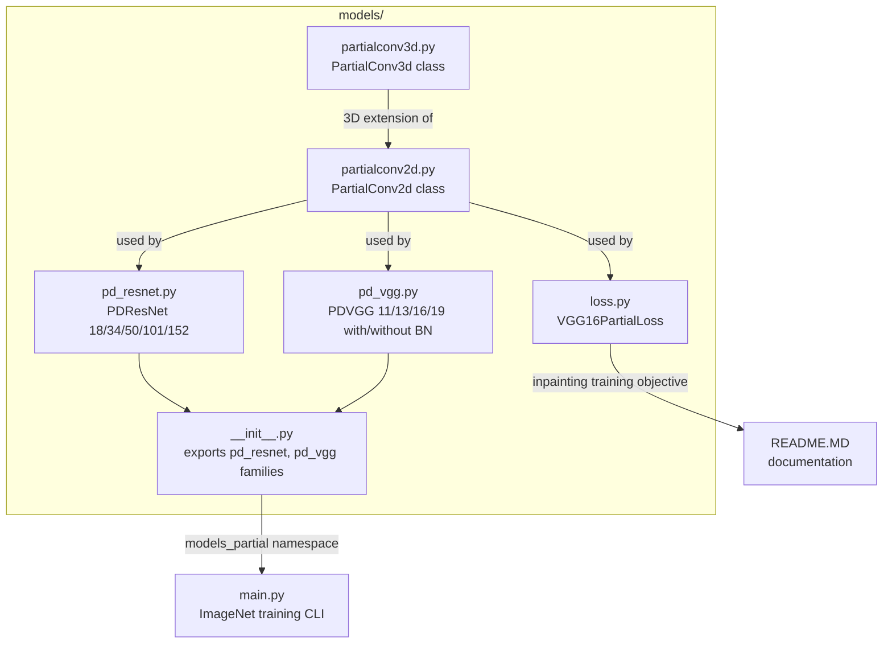
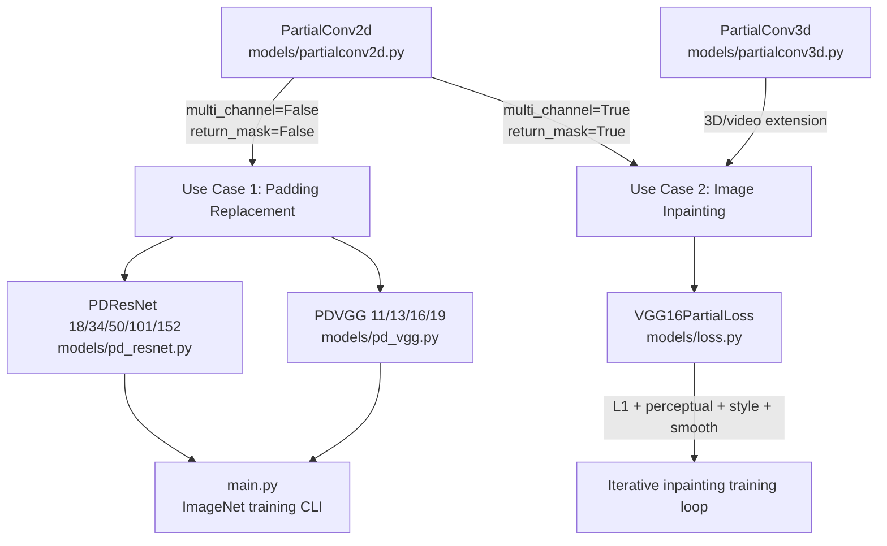

<!-- source: DeepWiki mcp.deepwiki.com · repo NVIDIA/partialconv · page 1 Overview · fetched 2026-10-26 -->

# Overview

<details>
<summary>Relevant source files</summary>

The following files were used as context for generating this wiki page:

- [README.MD](README.MD)
- [models/partialconv2d.py](models/partialconv2d.py)

</details>


This page introduces the `NVIDIA/partialconv` repository: its motivation, the single core mechanism it provides, and the two distinct use cases built on top of it. For detailed reference on specific systems, follow the links in each section to the appropriate sub-pages.

---

## Purpose

The repository provides a PyTorch implementation of **partial convolution**, a convolution variant that conditions its output on a binary validity mask. It is described in two NVIDIA research publications:

- **Padding**: *Partial Convolution based Padding* (arXiv 2018) — replaces zero/reflection/replication padding at image boundaries.
- **Inpainting**: *Image Inpainting for Irregular Holes Using Partial Convolutions* (ECCV 2018) — fills missing image regions by propagating a mask through layers.

Both use cases share a single implementation: [models/partialconv2d.py]().

---

## Why Partial Convolution?

Standard `nn.Conv2d` with zero padding introduces boundary artifacts because padded pixels carry no real signal but are treated identically to valid pixels during convolution. Partial convolution conditions each output on only the valid (non-padded, non-missing) pixels within the receptive field, then re-normalizes the result.

The repository includes benchmark comparisons showing consistent top-1 accuracy improvements over zero, reflection, and replication padding across ResNet and VGG architectures on ImageNet (see `imgs/compare_all_padding.png`, `imgs/compare_with_zero_padding_bar.png`).

| Padding type | Description |
|---|---|
| Zero padding | Pads with 0; introduces boundary bias |
| Reflection padding | Mirrors image content at borders |
| Replication padding | Repeats edge pixels at borders |
| **Partial conv padding** | Conditions on valid pixels only; re-normalizes |

---

## Repository Structure

**Repository file map: roles of every significant file**



Sources: [README.MD:1-138](), [models/partialconv2d.py:1-84]()

---

## The Two Primary Use Cases

Both use cases are controlled by two constructor flags on `PartialConv2d`: `multi_channel` and `return_mask`.

| Flag | Default | Use case |
|---|---|---|
| `multi_channel=False` | `False` | Padding replacement — single-channel mask applied uniformly |
| `multi_channel=True` | `False` | Inpainting — per-channel mask tracks each channel independently |
| `return_mask=False` | `False` | Padding replacement — mask is not passed to next layer |
| `return_mask=True` | `False` | Inpainting — updated mask propagates to the next layer |

**How PartialConv2d maps to use cases and downstream components**



Sources: [models/partialconv2d.py:14-83](), [README.MD:32-46]()

---

## Core Mechanism: PartialConv2d

`PartialConv2d` (in [models/partialconv2d.py:14]()) extends `nn.Conv2d`. The forward pass has three stages:

1. **Mask path** — count valid pixels per receptive field, compute normalization ratio, update the mask to binary (clamped 0→1).
2. **Data path** — zero out invalid input positions, apply standard convolution weights via `super().forward()`.
3. **Output assembly** — multiply by the mask ratio and re-add bias to normalize for the fraction of valid pixels used.

```
output = (raw_conv(input × mask) − bias) × mask_ratio + bias   [if bias]
output = raw_conv(input × mask) × mask_ratio                    [no bias]
```

The mask ratio is: `slide_winsize / (update_mask + 1e-8)`, where `slide_winsize = kernel_h × kernel_w` (or `in_channels × kernel_h × kernel_w` in multi-channel mode).

For a full technical breakdown, see the [PartialConv2d reference](#2) and [Mask Propagation Mechanics](#2.1).

---

## Use Case 1: Padding Replacement

Replace `nn.Conv2d` with `PartialConv2d` (default flags) at layer boundaries to eliminate padding artifacts:

```
# before
nn.Conv2d(3, 16, kernel_size=3, stride=1, padding=1, bias=False)

# after
PartialConv2d(3, 16, kernel_size=3, stride=1, padding=1, bias=False)
```

This substitution is applied throughout the `PDResNet` and `PDVGG` model families. Training against ImageNet is handled by `main.py`. For details, see:
- [Use Case: Padding Replacement](#4)
- [PDResNet Architectures](#4.1)
- [PDVGG Architectures](#4.2)
- [Training on ImageNet](#6)

---

## Use Case 2: Image Inpainting

With `multi_channel=True, return_mask=True`, each layer receives the updated mask from the previous layer. This allows the model to track which spatial positions have been filled at each stage of the network. The training objective is defined in `VGG16PartialLoss` ([models/loss.py]()) and combines:

| Component | Weight (default) |
|---|---|
| L1 reconstruction loss | 5.0 |
| Perceptual (VGG feature) loss | 0.05 |
| Style (Gram matrix) loss | 120 |
| Smoothness regularizer | 0 |

For details, see [Use Case: Image Inpainting](#5) and [Loss Functions](#5.1).

---

## 3D Extension

`PartialConv3d` ([models/partialconv3d.py]()) applies the same mechanism over 5D tensors `(B, C, D, H, W)` for video or volumetric data. It is structurally parallel to `PartialConv2d`. For details, see [PartialConv3d](#3).

---

## Key Entry Points

| File | Role |
|---|---|
| `models/partialconv2d.py` | `PartialConv2d` — the core layer |
| `models/partialconv3d.py` | `PartialConv3d` — 3D extension |
| `models/pd_resnet.py` | `PDResNet`, `BasicBlock`, `Bottleneck` |
| `models/pd_vgg.py` | `PDVGG`, `make_layers_pd` |
| `models/loss.py` | `VGG16PartialLoss`, `VGG16Partial`, `gram_matrix` |
| `models/__init__.py` | Exports all `pd_resnet` and `pd_vgg` factory functions |
| `main.py` | ImageNet training CLI — `--arch` selects model family |

Sources: [README.MD:32-100](), [models/partialconv2d.py:14-84]()

---

