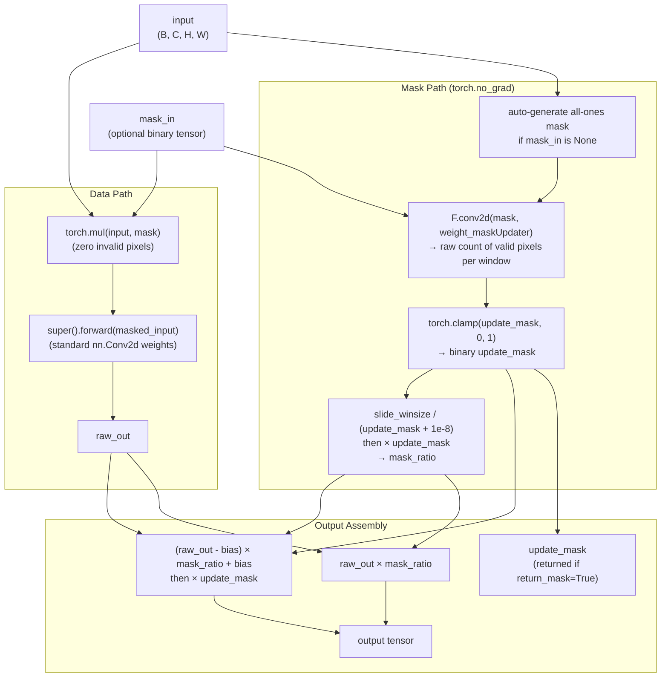
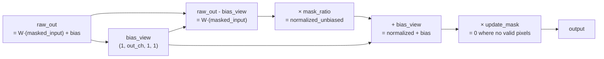
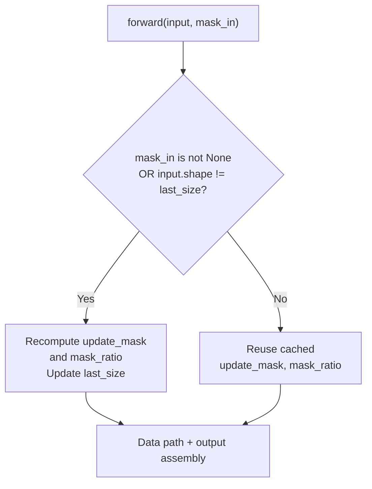
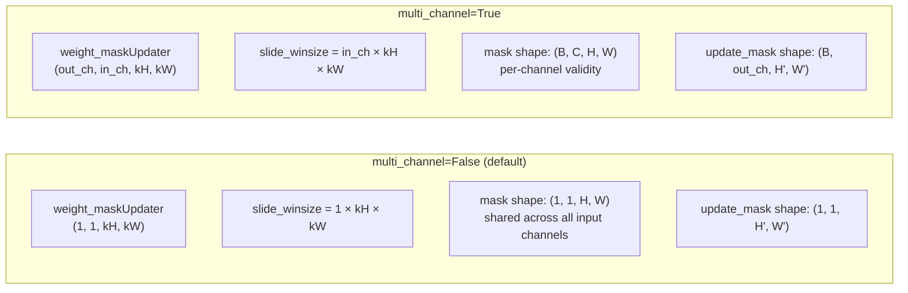

<!-- source: DeepWiki mcp.deepwiki.com · repo NVIDIA/partialconv · page 2 PartialConv2d: The Core Layer · fetched 2026-10-26 -->

# PartialConv2d: The Core Layer

<details>
<summary>Relevant source files</summary>

The following files were used as context for generating this wiki page:

- [README.MD](README.MD)
- [models/partialconv2d.py](models/partialconv2d.py)

</details>


This page is a complete reference for the `PartialConv2d` class defined in [models/partialconv2d.py](). It covers the constructor interface, all internal state variables, and the full forward-pass computation in detail. For a high-level orientation to the repository, see the [Overview](#1). For how masks propagate specifically at boundaries and across channels, see [Mask Propagation Mechanics](#2.1). For the 3D analog of this class, see [PartialConv3d](#3).

---

## Class Overview

`PartialConv2d` ([models/partialconv2d.py:14]()) extends `nn.Conv2d` directly. It accepts all standard `nn.Conv2d` constructor arguments plus two custom keyword arguments. All standard parameters (`in_channels`, `out_channels`, `kernel_size`, `stride`, `padding`, `dilation`, `bias`, etc.) are passed through to the parent class unchanged.

The core idea: before applying a convolution, invalid (masked-out) input pixels are zeroed and the output is rescaled by the ratio of valid pixels seen in each receptive field. This eliminates the influence of padding-introduced zeros on feature values at boundaries.

**Two use cases are supported by the same class:**

| Use Case | `multi_channel` | `return_mask` | Description |
|---|---|---|---|
| Padding replacement | `False` (default) | `False` (default) | Drop-in for `nn.Conv2d`; no mask needed at call sites |
| Image inpainting | `True` | `True` | Mask is passed in, updated, and returned for the next layer |

---

## Constructor Parameters

[models/partialconv2d.py:15-41]()

| Parameter | Type | Default | Purpose |
|---|---|---|---|
| `*args` | positional | — | Forwarded to `nn.Conv2d` |
| `**kwargs` | keyword | — | Forwarded to `nn.Conv2d` after custom keys are removed |
| `multi_channel` | `bool` | `False` | If `True`, the mask has shape `(B, C, H, W)`; if `False`, shape `(1, 1, H, W)` |
| `return_mask` | `bool` | `False` | If `True`, `forward()` returns `(output, updated_mask)` instead of just `output` |

Both custom parameters are extracted from `kwargs` before `super().__init__()` is called, so they are never passed to PyTorch's `nn.Conv2d`.

Sources: [models/partialconv2d.py:15-41]()

---

## Internal State Variables

After `__init__` completes, the following instance attributes exist on the object:

| Attribute | Shape | Role |
|---|---|---|
| `weight_maskUpdater` | `(out_ch, in_ch, kH, kW)` if `multi_channel`, else `(1, 1, kH, kW)` | All-ones kernel used to count valid pixels in each receptive field |
| `slide_winsize` | scalar `int` | `in_ch × kH × kW` (multi-channel) or `1 × kH × kW` (single-channel); the maximum possible valid-pixel count in one receptive field |
| `last_size` | 4-tuple `(B, C, H, W)` | Cached input shape; used to skip mask recomputation when shape is unchanged and no `mask_in` is provided |
| `update_mask` | `(B, out_ch, H', W')` or `(1, 1, H', W')` | Binary mask for the current layer's output (1 = at least one valid input pixel was seen) |
| `mask_ratio` | same shape as `update_mask` | Normalization factor `slide_winsize / valid_count`; zero where `update_mask` is zero |

Sources: [models/partialconv2d.py:32-41]()

---

## Forward Pass

**Signature:** `forward(self, input, mask_in=None)`

[models/partialconv2d.py:43-83]()

The forward pass has three stages: the mask path, the data path, and output assembly.

**Diagram: `PartialConv2d.forward()` data flow**



Sources: [models/partialconv2d.py:43-83]()

---

### Stage 1: Mask Path

[models/partialconv2d.py:45-67]()

This stage runs inside `torch.no_grad()` so it does not participate in gradient computation.

**Condition for execution:** the mask path runs if either `mask_in is not None` (mask was explicitly provided) or `input.shape != self.last_size` (shape has changed since last call). If neither condition holds, the cached `update_mask` and `mask_ratio` from the previous call are reused.

**Steps:**

1. **Type alignment** — if `weight_maskUpdater` is on a different device or dtype than `input`, it is moved to match: [models/partialconv2d.py:49-50]()

2. **Auto-mask generation** — if `mask_in is None`, a fresh all-ones mask is created. Shape depends on `multi_channel`: `(B, C, H, W)` when `True`, `(1, 1, H, W)` when `False`. [models/partialconv2d.py:52-59]()

3. **Valid pixel counting** — `F.conv2d` is called with `weight_maskUpdater` (all ones) and the same `stride`, `padding`, and `dilation` as the data convolution. The result `update_mask` holds the count of valid (1-valued) pixels that fell within each output position's receptive field. [models/partialconv2d.py:61]()

4. **Mask ratio computation** — `mask_ratio = slide_winsize / (update_mask + 1e-8)`. The epsilon prevents division by zero for fully-masked regions. [models/partialconv2d.py:64]()

5. **Binarization** — `update_mask` is clamped to `[0, 1]`, making it binary: any position that saw at least one valid pixel becomes 1. [models/partialconv2d.py:66]()

6. **Zero-out invalid output positions** — `mask_ratio` is multiplied element-wise by the binarized `update_mask`, ensuring positions with no valid inputs receive a ratio of 0 rather than a very large number. [models/partialconv2d.py:67]()

> **AMP note:** For mixed-precision (FP16) training, the epsilon should be changed from `1e-8` to `1e-6` to avoid numerical instability. See [Mixed Precision (AMP) Training](#6.1).

---

### Stage 2: Data Path

[models/partialconv2d.py:70]()

```
raw_out = super().forward(torch.mul(input, mask) if mask_in is not None else input)
```

- If `mask_in` was provided, `input` is element-wise multiplied with the mask first, zeroing all invalid pixel locations.
- If `mask_in` is `None` (padding-replacement use case), the raw `input` is passed directly since the auto-generated mask is all ones.
- `super().forward()` applies the standard `nn.Conv2d` learned weights to the (possibly masked) input.

---

### Stage 3: Output Assembly

[models/partialconv2d.py:72-83]()

The raw convolution output is normalized by `mask_ratio` and has its bias re-applied correctly.

**Without bias:**
```
output = raw_out × mask_ratio
```

**With bias** (bias must be removed before scaling, then added back):
```
output = (raw_out - bias) × mask_ratio + bias
output = output × update_mask          # zero positions with no valid inputs
```

The bias re-application is necessary because the standard `nn.Conv2d` forward adds bias to every output position uniformly. After partial convolution normalization, positions with no valid inputs should have output 0, not the bias value.

**Diagram: Bias correction logic**



Sources: [models/partialconv2d.py:72-83]()

---

### Return Value

| Condition | Return value |
|---|---|
| `self.return_mask == False` | `output` (tensor) |
| `self.return_mask == True` | `(output, self.update_mask)` (tuple of tensors) |

When chaining layers for inpainting, the returned `update_mask` from layer N is passed as `mask_in` to layer N+1.

---

## Caching Behavior

`PartialConv2d` caches the mask computation across calls using `self.last_size`. The cache is a single slot storing the most recent `update_mask` and `mask_ratio`.

**Diagram: Caching decision in `forward()`**



**Implications:**

- When used as a padding replacement (no `mask_in`, fixed input size), the mask computation runs only on the first call and is cached thereafter. Subsequent calls skip it entirely.
- When used for inpainting (with `mask_in` provided), the mask path always runs, because `mask_in is not None` is always true.
- The cache is **not** thread-safe. Using a single `PartialConv2d` instance across multiple parallel data streams with different shapes can produce incorrect results.

Sources: [models/partialconv2d.py:39-41](), [models/partialconv2d.py:45-46]()

---

## `multi_channel` vs Single-Channel Masks

**Diagram: Effect of `multi_channel` on tensor shapes**



- **`multi_channel=False`**: A single spatial mask applies to all input channels equally. This is appropriate for padding replacement where the invalid region is determined by spatial position only.
- **`multi_channel=True`**: Each input channel can independently be valid or invalid at a given spatial position. This is used for image inpainting where the mask may vary per channel (e.g., after partial fill-in from a previous layer's output).

Sources: [models/partialconv2d.py:32-37]()

---

## Complete Variable Reference

The following table maps every named variable in `forward()` to its role:

| Variable | Defined at | Description |
|---|---|---|
| `mask` | [models/partialconv2d.py:55-59]() | The effective mask: either `mask_in` or an auto-generated all-ones tensor |
| `self.update_mask` (pre-clamp) | [models/partialconv2d.py:61]() | Raw count of valid pixels in each output receptive field |
| `self.mask_ratio` | [models/partialconv2d.py:64]() | `slide_winsize / (update_mask + 1e-8)` before zeroing |
| `self.update_mask` (post-clamp) | [models/partialconv2d.py:66]() | Binary output mask (1 = valid, 0 = no valid inputs seen) |
| `self.mask_ratio` (final) | [models/partialconv2d.py:67]() | `mask_ratio × update_mask`; zero where output is invalid |
| `raw_out` | [models/partialconv2d.py:70]() | Result of standard `nn.Conv2d` applied to the masked input |
| `bias_view` | [models/partialconv2d.py:73]() | `self.bias` reshaped to `(1, out_ch, 1, 1)` for broadcasting |
| `output` | [models/partialconv2d.py:74-77]() | Final corrected output tensor |

Sources: [models/partialconv2d.py:43-83]()

---

