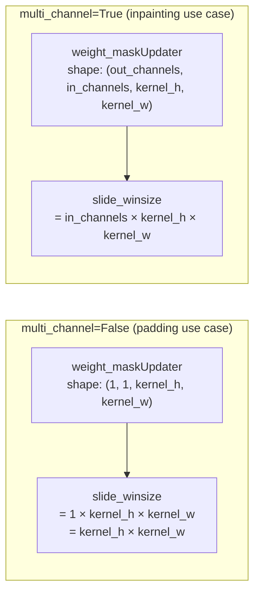
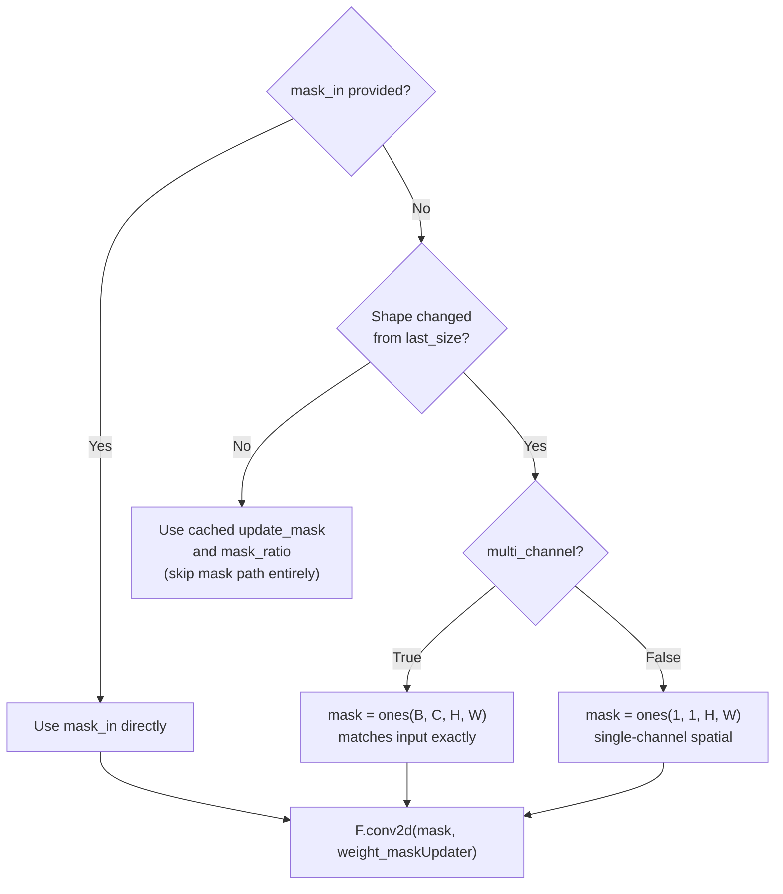
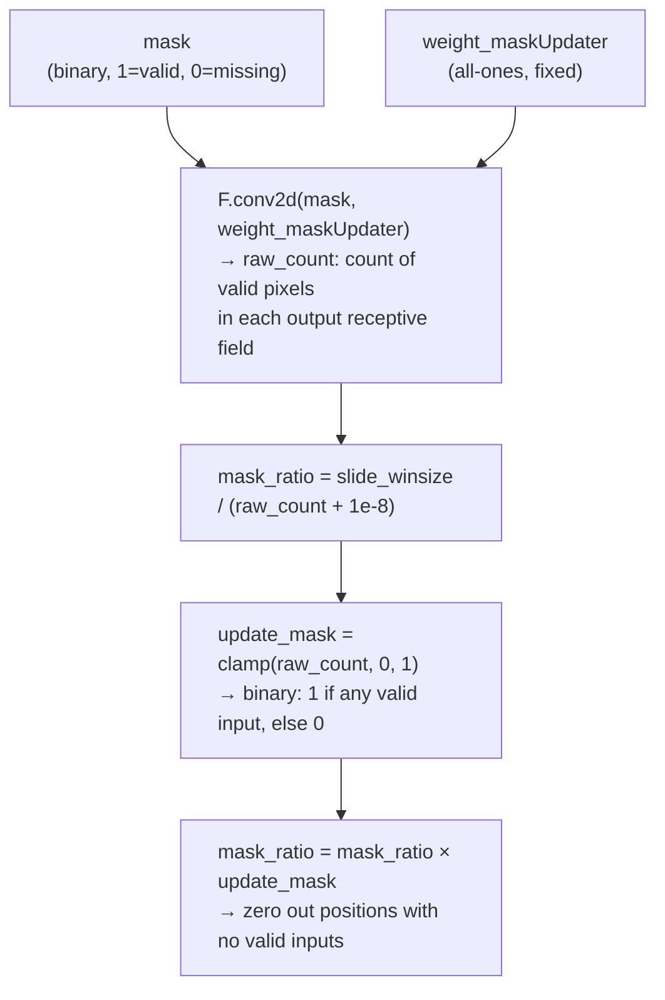
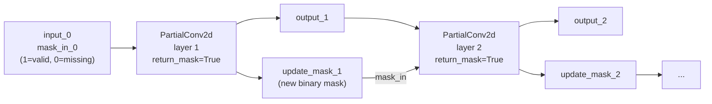

<!-- source: DeepWiki mcp.deepwiki.com · repo NVIDIA/partialconv · page 2.1 Mask Propagation Mechanics · fetched 2026-10-26 -->

# Mask Propagation Mechanics

<details>
<summary>Relevant source files</summary>

The following files were used as context for generating this wiki page:

- [README.MD](README.MD)
- [models/partialconv2d.py](models/partialconv2d.py)

</details>


This page is a focused reference on how masks are created, convolved, normalized, and passed forward within a single `PartialConv2d` forward call ([models/partialconv2d.py]()). It covers the mask path exclusively: the epsilon guard, the raw-count-to-binary conversion, the `mask_ratio` normalization formula, and the behavioral difference between `multi_channel=True` and `multi_channel=False`.

For the complete picture of the `PartialConv2d` layer including the data path and bias correction, see the parent page [2](#2). For how masks propagate across *multiple layers* in an inpainting pipeline, see [5](#5).

---

## Overview of the Mask Path

In a standard `nn.Conv2d`, all input pixels are treated as equally valid. `PartialConv2d` adds a parallel **mask path** that runs alongside the data convolution. The mask path answers the question: *"For each output position, how many of the input pixels in its receptive field were valid?"* The answer is used to scale the output so that the convolution result is not diluted by zero-padded or missing pixels.

The entire mask path runs inside `torch.no_grad()` and produces two instance variables:

| Variable | Meaning |
|---|---|
| `self.update_mask` | Binary mask for the output spatial positions (1 = at least one valid input pixel) |
| `self.mask_ratio` | Per-position scale factor that compensates for partially-valid receptive fields |

Sources: [models/partialconv2d.py:40-67]()

---

## The Mask Updater Kernel (`weight_maskUpdater`)

The mask update is implemented as a plain `F.conv2d` with a fixed all-ones kernel called `weight_maskUpdater`. This kernel is created once in `__init__` and is never trained. Its shape depends on the `multi_channel` flag.

**Mask Updater Kernel: Shape by Mode**



Sources: [models/partialconv2d.py:32-37]()

`slide_winsize` is always the product of the last three dimensions of `weight_maskUpdater`. When `multi_channel=False`, in-channel count is 1 and `slide_winsize` equals the spatial kernel area. When `multi_channel=True`, each channel adds to the total count of "slots" in the receptive field.

---

## Mask Input: Provided vs Auto-Generated

Every call to `forward(input, mask_in=None)` either receives an explicit mask or generates one automatically. The shape of the auto-generated mask also depends on `multi_channel`.

**Mask Generation Logic**



Sources: [models/partialconv2d.py:43-61]()

When `mask_in=None` and the input shape is the same as `last_size`, the entire mask path is skipped and the previously computed `update_mask` and `mask_ratio` are reused. This caching avoids redundant computation in the common case where all inputs to a layer have the same shape (e.g., inference on a fixed-size image).

---

## Step-by-Step Mask Update Computation

The following steps happen in sequence inside the `torch.no_grad()` block.

**Mask Path: Sequence of Operations**



Sources: [models/partialconv2d.py:61-67]()

### Step 1: Count valid pixels per receptive field

```
F.conv2d(mask, weight_maskUpdater, bias=None, stride=..., padding=..., dilation=..., groups=1)
```

Because `weight_maskUpdater` is all-ones, this convolution simply sums the mask values in each kernel window. The result `raw_count[b, c, h, w]` is the number of valid (mask=1) input pixels that contribute to output position `(b, c, h, w)`.

### Step 2: Compute `mask_ratio` from raw counts

```
self.mask_ratio = self.slide_winsize / (self.update_mask + 1e-8)
```

*(Note: at this line, `self.update_mask` still holds the raw count, before the clamp.)*

`slide_winsize` is the maximum possible number of valid pixels in any receptive field. Dividing by the raw count amplifies output values at partially-covered positions. A position where only half the receptive field was valid gets a ratio of approximately 2.0, rescaling the partial sum back to a full-window equivalent.

### Step 3: Epsilon guard

The `+ 1e-8` term prevents division by zero when `raw_count = 0`. At such positions the ratio would otherwise be infinite. The subsequent multiplication in step 4 will zero these positions out anyway, but the guard keeps the intermediate tensor numerically finite.

> **AMP note:** For mixed-precision (FP16) training the epsilon is increased to `1e-6` to avoid underflow in half precision. See page [6.1](#6.1) for the full AMP requirements.

### Step 4: Clamp raw counts to binary

```
self.update_mask = torch.clamp(self.update_mask, 0, 1)
```

Any position with at least one valid input pixel becomes 1; fully empty positions become 0. This binary tensor is what gets returned as the "new mask" for the next layer when `return_mask=True`.

### Step 5: Zero out invalid positions in `mask_ratio`

```
self.mask_ratio = torch.mul(self.mask_ratio, self.update_mask)
```

Positions with zero valid inputs get `mask_ratio = 0`. This means the output at those positions will be forced to zero (or bias-only after bias correction), preventing the large epsilon-divided value from contaminating the output.

---

## `multi_channel=True` vs `multi_channel=False`

The `multi_channel` flag controls whether the mask is treated as a single shared spatial map or as a per-channel map. The table below summarizes all resulting differences.

| Property | `multi_channel=False` | `multi_channel=True` |
|---|---|---|
| `weight_maskUpdater` shape | `(1, 1, k_h, k_w)` | `(out_ch, in_ch, k_h, k_w)` |
| `slide_winsize` | `k_h × k_w` | `in_ch × k_h × k_w` |
| Auto-generated mask shape | `(1, 1, H, W)` | `(B, C, H, W)` |
| Mask channels | 1 (broadcasts) | Matches input channels |
| Typical use case | Padding replacement | Image inpainting |
| `update_mask` output shape | `(1, 1, H_out, W_out)` | `(B, out_ch, H_out, W_out)` |

When `multi_channel=False`, a single spatial binary map controls validity for all channels uniformly. When `multi_channel=True`, each channel's validity is tracked independently, which is required for inpainting where the per-channel mask may differ.

Sources: [models/partialconv2d.py:32-37](), [models/partialconv2d.py:52-57]()

---

## Behavior at Boundary Regions

The following table captures the exact behavior for the three classes of output positions that arise when a partially-filled mask passes through the layer.

| Receptive Field State | `raw_count` | `mask_ratio` (before zeroing) | `update_mask` (after clamp) | `mask_ratio` (after zeroing) | Output Effect |
|---|---|---|---|---|---|
| All pixels valid | `slide_winsize` | ≈ 1.0 | 1 | ≈ 1.0 | No amplification |
| Some pixels valid (`N` out of total) | `N` | `slide_winsize / N` | 1 | `slide_winsize / N` | Output amplified by `slide_winsize/N` |
| No pixels valid | 0 | `slide_winsize / 1e-8` (large) | 0 | 0.0 | Output zeroed entirely |

The amplification at partially-valid positions is the key normalization step: it ensures the convolution output represents "what the sum would have been had all pixels been valid," rather than a deflated partial sum.

Sources: [models/partialconv2d.py:61-67]()

---

## How the Updated Mask Feeds the Next Layer

When `return_mask=True`, `forward()` returns a tuple `(output, self.update_mask)`. The caller (typically an inpainting U-Net) passes `self.update_mask` as `mask_in` to the next `PartialConv2d` layer. This causes the mask to propagate layer by layer.

**Layer-to-Layer Mask Propagation**



Each successive `update_mask` is at least as large as the previous one (more positions become valid), because holes can only shrink — a position needs just one valid neighbor to transition from 0 to 1. This is the mechanism by which inpainting models progressively fill in missing regions across the depth of the network.

Sources: [models/partialconv2d.py:43-83]()

---

