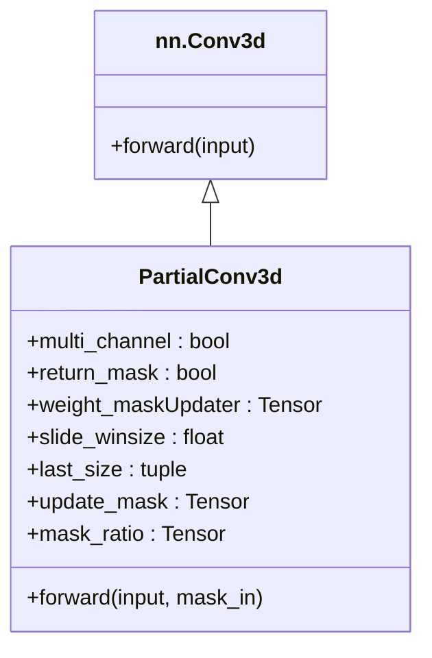
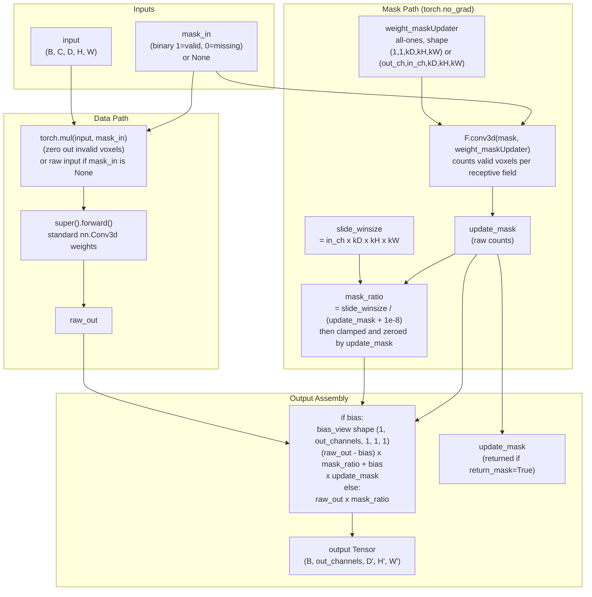
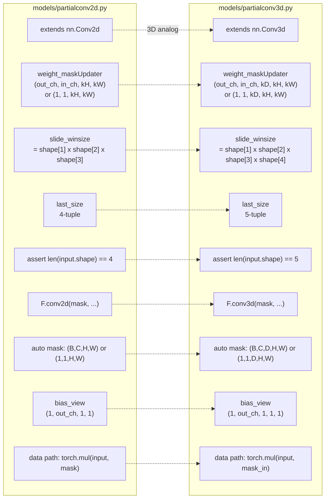

<!-- source: DeepWiki mcp.deepwiki.com · repo NVIDIA/partialconv · page 3 PartialConv3d: The 3D Extension · fetched 2026-10-26 -->

# PartialConv3d: The 3D Extension

<details>
<summary>Relevant source files</summary>

The following files were used as context for generating this wiki page:

- [models/partialconv2d.py](models/partialconv2d.py)
- [models/partialconv3d.py](models/partialconv3d.py)

</details>


`PartialConv3d` is a direct extension of the partial convolution mechanism to three spatial dimensions, enabling its use with volumetric data such as video (depth × height × width). This page documents the `PartialConv3d` class found in [models/partialconv3d.py](), covering its constructor, forward-pass computation, and all places where it diverges from the 2D counterpart.

For the foundational explanation of how partial convolution works—mask propagation, bias correction, `mask_ratio` normalization, and the `multi_channel`/`return_mask` flags—see the [PartialConv2d: The Core Layer](#2) page and its sub-page [Mask Propagation Mechanics](#2.1). This page focuses only on what is different in the 3D version.

---

## Class Overview

`PartialConv3d` is defined in [models/partialconv3d.py:14-85]() and subclasses `nn.Conv3d` the same way `PartialConv2d` subclasses `nn.Conv2d`.

**Class hierarchy diagram: PartialConv3d**



Sources: [models/partialconv3d.py:14-41]()

---

## Constructor

The constructor signature is identical to `PartialConv2d`. Two custom keyword arguments are extracted before the remaining arguments are forwarded to `nn.Conv3d`:

| Keyword argument | Type | Default | Effect |
|---|---|---|---|
| `multi_channel` | `bool` | `False` | If `True`, `weight_maskUpdater` has shape `(out_channels, in_channels, kD, kH, kW)` (one mask per channel). If `False`, shape is `(1, 1, kD, kH, kW)`. |
| `return_mask` | `bool` | `False` | If `True`, `forward` returns `(output, update_mask)` instead of just `output`. |

After the call to `super().__init__()`, three internal members are initialized:

- **`weight_maskUpdater`** — an all-ones tensor used in `F.conv3d` to count valid pixels in each receptive field [models/partialconv3d.py:32-35]().
- **`slide_winsize`** — the total number of elements in a single receptive field: `in_channels × kD × kH × kW` (or `1 × kD × kH × kW` when `multi_channel=False`) [models/partialconv3d.py:37]().
- **`last_size`** — a 5-tuple `(None, None, None, None, None)`, used to cache whether the mask needs to be recomputed [models/partialconv3d.py:39]().

### `slide_winsize` formula comparison

| Class | Formula | Tensor dimensions accessed |
|---|---|---|
| `PartialConv2d` | `shape[1] × shape[2] × shape[3]` | `(out_ch, in_ch, kH, kW)` → 3 dims |
| `PartialConv3d` | `shape[1] × shape[2] × shape[3] × shape[4]` | `(out_ch, in_ch, kD, kH, kW)` → 4 dims |

The extra `shape[4]` term accounts for the depth kernel dimension [models/partialconv3d.py:37]().

Sources: [models/partialconv3d.py:15-41]()

---

## Input Format

The `forward` method immediately asserts that the input tensor has exactly five dimensions [models/partialconv3d.py:44]():

```
assert len(input.shape) == 5
```

The expected layout is `(B, C, D, H, W)`:

| Dimension | Symbol | Meaning |
|---|---|---|
| 0 | B | Batch size |
| 1 | C | Channels |
| 2 | D | Depth (temporal frames, or z-slices) |
| 3 | H | Height |
| 4 | W | Width |

The corresponding `PartialConv2d` asserts `len(input.shape) == 4`, operating on `(B, C, H, W)`.

Sources: [models/partialconv3d.py:43-44](), [models/partialconv2d.py:44]()

---

## Forward Pass Computation

The structure of the forward pass mirrors `PartialConv2d` exactly, with every 2D PyTorch primitive replaced by its 3D counterpart.

**Forward pass data-flow diagram: PartialConv3d**



Sources: [models/partialconv3d.py:43-85]()

---

## Differences from PartialConv2d

The table below is a complete list of every concrete difference between the two implementations.

**Structural differences: PartialConv2d vs PartialConv3d**



| Aspect | `PartialConv2d` | `PartialConv3d` |
|---|---|---|
| Base class | `nn.Conv2d` | `nn.Conv3d` |
| Input rank assertion | `== 4` | `== 5` |
| `weight_maskUpdater` rank | 4 | 5 (adds depth `kD`) |
| `slide_winsize` factors | `shape[1] × shape[2] × shape[3]` | `shape[1] × shape[2] × shape[3] × shape[4]` |
| `last_size` initial value | `(None, None, None, None)` | `(None, None, None, None, None)` |
| Mask convolution | `F.conv2d` | `F.conv3d` |
| Auto-mask shape (no `multi_channel`) | `(1, 1, H, W)` | `(1, 1, D, H, W)` |
| Auto-mask shape (`multi_channel`) | `(B, C, H, W)` | `(B, C, D, H, W)` |
| `bias_view` shape | `(1, out_channels, 1, 1)` | `(1, out_channels, 1, 1, 1)` |
| Data-path masking variable | `mask` (local, may be auto-generated) | `mask_in` (the argument directly) |
| AMP epsilon comment | Present | Absent |

Sources: [models/partialconv2d.py:14-83](), [models/partialconv3d.py:14-85]()

---

## Subtle Behavioral Difference in the Data Path

There is one implementation-level difference worth noting. In `PartialConv2d`, the data path uses a local variable `mask` [models/partialconv2d.py:70]():

```python
# 2D: uses local `mask`, which is either mask_in or an auto-generated all-ones tensor
raw_out = super(PartialConv2d, self).forward(torch.mul(input, mask) if mask_in is not None else input)
```

In `PartialConv3d`, the data path uses `mask_in` directly [models/partialconv3d.py:72]():

```python
# 3D: uses mask_in argument directly
raw_out = super(PartialConv3d, self).forward(torch.mul(input, mask_in) if mask_in is not None else input)
```

The functional result is equivalent in both cases: when `mask_in is None`, neither version multiplies the input by a mask (the 2D version would multiply by all-ones, but that is a no-op). When `mask_in` is provided, both multiply the input by it before the convolution.

Sources: [models/partialconv2d.py:70](), [models/partialconv3d.py:72]()

---

## Caching Behavior

`PartialConv3d` reuses the same input-shape caching mechanism as `PartialConv2d`. The mask path (inside `torch.no_grad()`) is only re-executed when either:

1. `mask_in` is explicitly provided (mask propagation mode), or
2. The input tensor shape changes from the previous call.

`last_size` stores the previous 5-tuple `(B, C, D, H, W)`. If neither condition is met, `update_mask` and `mask_ratio` from the prior call are reused directly [models/partialconv3d.py:45-46]().

This optimization is primarily useful in the padding-replacement use case (see [Use Case: Padding Replacement](#4)), where the mask is all-ones and never changes between calls of the same shape.

Sources: [models/partialconv3d.py:39-66]()

---

## Usage in Context

`PartialConv3d` is the natural choice when extending either use case from 2D to 3D:

| Use case | 2D class | 3D class | Typical `multi_channel` | Typical `return_mask` |
|---|---|---|---|---|
| Padding replacement | `PartialConv2d` | `PartialConv3d` | `False` | `False` |
| Video inpainting | `PartialConv2d` | `PartialConv3d` | `True` | `True` |

As shown in the repository overview (Diagram 1), `PartialConv3d` currently stands alone in the codebase—no pre-built 3D model architectures (equivalent to `PDResNet` or `PDVGG`) are provided. It is intended to be used directly as a drop-in replacement for `nn.Conv3d` in user-defined networks.

For the inpainting training objective and loss module, see [Loss Functions](#5.1).

Sources: [models/partialconv3d.py:14-85](), [models/partialconv2d.py:14-83]()

---

